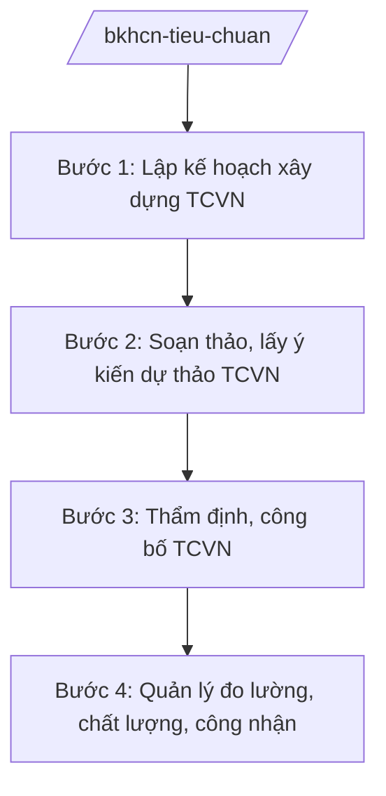

# Skill: Tiêu chuẩn, đo lường, chất lượng (TCVN)

## 2. Khi nào dùng

Khi Bộ Khoa học và Công nghệ thực hiện quản lý nhà nước về tiêu chuẩn, đo lường, chất lượng:
xây dựng, công bố tiêu chuẩn quốc gia (TCVN); quản lý đo lường; quản lý chất lượng sản phẩm,
hàng hóa; công nhận tổ chức đánh giá sự phù hợp.

## 3. Đầu vào (Input)

| Trường | Mô tả | Bắt buộc |
|--------|-------|----------|
| `nhiem_vu` | Nhiệm vụ: xây dựng TCVN / quản lý đo lường / quản lý chất lượng / công nhận | Có |
| `linh_vuc_tc` | Lĩnh vực tiêu chuẩn hoặc nhóm sản phẩm, hàng hóa | Có |
| `du_thao_tcvn` | Dự thảo TCVN (nếu nhiệm vụ là xây dựng tiêu chuẩn) | Không |
| `to_chuc` | Tổ chức đề nghị công nhận/đánh giá (nếu có) | Không |

## 4. Quy trình

**Bước 1. Lập kế hoạch xây dựng TCVN**

- Làm gì: Tổng hợp nhu cầu; lập kế hoạch xây dựng TCVN hằng năm; phân công ban kỹ thuật
  tiêu chuẩn quốc gia soạn thảo.
- Dùng input: `linh_vuc_tc`, `nhiem_vu`.
- Vai trò: Ủy ban Tiêu chuẩn Đo lường Chất lượng Quốc gia (Bộ KH&CN) chủ trì; AI hỗ trợ tổng hợp nhu cầu, dự thảo kế hoạch ⏱ ~3–5 ngày làm việc (ước tính).
- Lưu ý nghiệp vụ: Ưu tiên TCVN phục vụ chiến lược quốc gia, hội nhập, chuyển đổi số.
- → Kết quả bước: Kế hoạch xây dựng TCVN được phê duyệt.

**Bước 2. Soạn thảo, lấy ý kiến dự thảo TCVN**

- Làm gì: Ban kỹ thuật soạn thảo; lấy ý kiến rộng rãi; thẩm định dự thảo.
- Dùng input: `du_thao_tcvn`.
- Vai trò: Ban kỹ thuật tiêu chuẩn thực hiện; AI hỗ trợ rà soát kỹ thuật trình bày, tổng hợp ý kiến ⏱ ~3–5 ngày làm việc (ước tính).
- Lưu ý nghiệp vụ: TCVN hài hòa với tiêu chuẩn quốc tế (ISO, IEC) khi có thể.
- → Kết quả bước: Dự thảo TCVN hoàn chỉnh + báo cáo thẩm định.

**Bước 3. Thẩm định, công bố TCVN**

- Làm gì: Hội đồng thẩm định; Bộ trưởng công bố TCVN.
- Dùng input: Dự thảo TCVN sau thẩm định.
- Vai trò: Ủy ban Tiêu chuẩn Đo lường Chất lượng Quốc gia thẩm định; AI hỗ trợ checklist hồ sơ công bố ⏱ ~2–3 ngày làm việc (ước tính).
- Lưu ý nghiệp vụ: Công bố công khai; cập nhật, soát xét định kỳ.
- → Kết quả bước: Quyết định công bố TCVN.

**Bước 4. Quản lý đo lường, chất lượng, công nhận**

- Làm gì: Quản lý chuẩn đo lường quốc gia; kiểm định phương tiện đo; quản lý chất lượng
  sản phẩm, hàng hóa (nhóm 2); công nhận tổ chức đánh giá sự phù hợp (BoA).
- Dùng input: `to_chuc` (nếu có).
- Vai trò: Đơn vị chuyên môn thực hiện; AI hỗ trợ tổng hợp hồ sơ, theo dõi (⏱ 1–2 giờ).
- Lưu ý nghiệp vụ: Quyết định công nhận, xử lý vi phạm do người có thẩm quyền quyết định.
- → Kết quả bước: Quyết định công nhận / kết quả kiểm tra chất lượng.

## Luồng quy trình (Workflow)

## 5. Đầu ra (Output)

- Kế hoạch xây dựng TCVN; quyết định công bố TCVN.
- Quyết định công nhận tổ chức đánh giá sự phù hợp.
- Báo cáo quản lý đo lường, chất lượng.

### Cấu trúc output chuẩn (thể thức NĐ 30/2020/NĐ-CP) (quyết định công bố TCVN)

1. Quốc hiệu "CỘNG HÒA XÃ HỘI CHỦ NGHĨA VIỆT NAM", Tiêu ngữ "Độc lập – Tự do – Hạnh phúc"; số, ký hiệu: …/QĐ-BKHCN.
2. Căn cứ (pháp luật về tiêu chuẩn, quy chuẩn kỹ thuật; NĐ 55/2025/NĐ-CP...).
3. Điều 1: Công bố tiêu chuẩn quốc gia (số hiệu, tên TCVN).
4. Điều 2: Hiệu lực; trách nhiệm phổ biến, áp dụng.
5. Nơi nhận (kết thúc "- Lưu: VT, [mã đơn vị]."); chữ ký (ghi rõ chức danh, họ tên người ký; ký hiệu "KT."/"TL." khi ký thay) người có thẩm quyền.

> **Checklist thể thức văn bản theo NĐ 30/2020/NĐ-CP** — đối chiếu trước khi trình ký:
> 1. Quốc hiệu và Tiêu ngữ.
> 2. Tên cơ quan, tổ chức ban hành văn bản.
> 3. Số, ký hiệu của văn bản.
> 4. Địa danh và thời gian ban hành văn bản.
> 5. Tên loại và trích yếu nội dung văn bản.
> 6. Nội dung văn bản.
> 7. Chức vụ, họ tên và chữ ký của người có thẩm quyền.
> 8. Dấu, chữ ký số của cơ quan, tổ chức.
> 9. Nơi nhận (kèm Phụ lục nếu có).

## 6. Checklist nghiệm thu

- [ ] Kế hoạch TCVN đúng thứ tự ưu tiên, có phân công rõ.
- [ ] Dự thảo TCVN đã lấy ý kiến, thẩm định đúng trình tự.
- [ ] Hài hòa tiêu chuẩn quốc tế khi phù hợp.
- [ ] Công bố đúng thẩm quyền; công khai.
- [ ] Công nhận tổ chức đánh giá đúng tiêu chí, đúng trình tự.
- [ ] Đúng thể thức NĐ 30/2020/NĐ-CP.
- [ ] Đã qua human gate đầy đủ.

## 7. Ví dụ mô phỏng

*Dữ liệu dưới đây là giả lập 100% phục vụ minh họa.*

**Input mẫu:** `nhiem_vu` = xây dựng TCVN; `linh_vuc_tc` = an toàn thông tin cho thiết bị IoT;
`du_thao_tcvn` = dự thảo TCVN giả lập "Yêu cầu an toàn thông tin cho thiết bị IoT gia dụng".

**Output mẫu (trích cấu trúc chuẩn):**

> **BỘ KHOA HỌC VÀ CÔNG NGHỆ**
> **CỘNG HÒA XÃ HỘI CHỦ NGHĨA VIỆT NAM**
> **Độc lập – Tự do – Hạnh phúc**
>
> Số: 1234/QĐ-BKHCN *(số hiệu giả lập)*
>
> **QUYẾT ĐỊNH**
> **Về việc công bố Tiêu chuẩn quốc gia**
>
> *Căn cứ pháp luật về tiêu chuẩn và quy chuẩn kỹ thuật;*
> *Căn cứ Nghị định số 55/2025/NĐ-CP ngày 02/3/2025 của Chính phủ...;*
> *Theo đề nghị của Chủ tịch Ủy ban Tiêu chuẩn Đo lường Chất lượng Quốc gia,*
>
> **Điều 1.** Công bố Tiêu chuẩn quốc gia TCVN xxxxx:2026 "Yêu cầu an toàn thông tin
> cho thiết bị IoT gia dụng" *(tên giả lập)*...

## 8. Human gate

1. Ban kỹ thuật tiêu chuẩn quốc gia: soạn thảo, thẩm tra kỹ thuật.
2. Hội đồng thẩm định: thông qua dự thảo TCVN.
3. Chủ tịch Ủy ban Tiêu chuẩn Đo lường Chất lượng Quốc gia: trình công bố.
4. Bộ trưởng Bộ KH&CN: ký quyết định công bố TCVN.

## 9. Giới hạn

- AI không quyết định nội dung kỹ thuật của TCVN thay ban kỹ thuật và hội đồng thẩm định.
- AI không bịa thông số kỹ thuật, kết quả đánh giá.
- AI không tự ký, ban hành văn bản.
- AI không viện dẫn văn bản hết hiệu lực.

## 10. Căn cứ & lưu ý

- Nghị định số 55/2025/NĐ-CP ngày 02/3/2025 của Chính phủ quy định chức năng, nhiệm vụ,
  quyền hạn và cơ cấu tổ chức của Bộ Khoa học và Công nghệ (hiệu lực từ 01/3/2025).
- Pháp luật về tiêu chuẩn và quy chuẩn kỹ thuật.
- Nghị định số 30/2020/NĐ-CP về công tác văn thư (thể thức văn bản).
