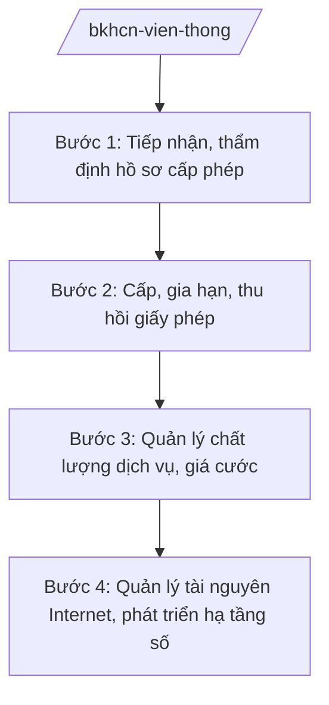

# Skill: Quản lý viễn thông, Internet

## 2. Khi nào dùng

Khi Bộ Khoa học và Công nghệ thực hiện quản lý nhà nước về viễn thông, Internet: cấp phép
kinh doanh dịch vụ viễn thông; quản lý chất lượng dịch vụ, giá cước; quản lý tên miền, tài nguyên
Internet; phát triển hạ tầng số quốc gia.

## 3. Đầu vào (Input)

| Trường | Mô tả | Bắt buộc |
|--------|-------|----------|
| `nhiem_vu` | Nhiệm vụ: cấp phép / quản lý chất lượng / quản lý tài nguyên / chính sách | Có |
| `doanh_nghiep` | Doanh nghiệp đề nghị cấp phép (nếu có) | Không |
| `loai_giay_phep` | Loại giấy phép viễn thông | Không |
| `muc_tieu` | Mục tiêu chính sách/phát triển hạ tầng | Không |

## 4. Quy trình

**Bước 1. Tiếp nhận, thẩm định hồ sơ cấp phép**

- Làm gì: Tiếp nhận hồ sơ đề nghị cấp giấy phép kinh doanh dịch vụ viễn thông, giấy phép
  tần số; thẩm định điều kiện (vốn, kỹ thuật, phương án kinh doanh).
- Dùng input: `doanh_nghiep`, `loai_giay_phep`.
- Vai trò: Cục Viễn thông (Bộ KH&CN) thẩm định; AI hỗ trợ kiểm tra tính đầy đủ hồ sơ, ⏱ ~1–2 ngày làm việc (ước tính).
  đối chiếu điều kiện (1–2 giờ).
- Lưu ý nghiệp vụ: AI chỉ hỗ trợ kiểm tra hồ sơ — quyết định cấp/từ chối do người có thẩm quyền
  quyết định theo quy định pháp luật về viễn thông.
- → Kết quả bước: Kết quả thẩm định hồ sơ.

**Bước 2. Cấp, gia hạn, thu hồi giấy phép**

- Làm gì: Cấp mới, sửa đổi, bổ sung, gia hạn, thu hồi giấy phép viễn thông theo quy định.
- Dùng input: Kết quả thẩm định.
- Vai trò: Cục trưởng Cục Viễn thông ký (theo phân cấp); AI hỗ trợ dự thảo giấy phép, ⏱ ~2–3 ngày làm việc (ước tính).
  theo dõi thời hạn (30 phút).
- Lưu ý nghiệp vụ: Đúng thời hạn giải quyết; công khai danh sách doanh nghiệp được cấp phép.
- → Kết quả bước: Giấy phép được cấp/gia hạn/thu hồi.

**Bước 3. Quản lý chất lượng dịch vụ, giá cước**

- Làm gì: Ban hành quy định chất lượng dịch vụ; kiểm tra, đo kiểm chất lượng; quản lý giá cước
  dịch vụ viễn thông theo quy định.
- Dùng input: `nhiem_vu`.
- Vai trò: Cục Viễn thông thực hiện; AI hỗ trợ tổng hợp kết quả đo kiểm, báo cáo (2 giờ).
- Lưu ý nghiệp vụ: Xử lý vi phạm chất lượng, cạnh tranh không lành mạnh theo thẩm quyền.
- → Kết quả bước: Báo cáo chất lượng dịch vụ; quyết định xử lý vi phạm (nếu có).

**Bước 4. Quản lý tài nguyên Internet, phát triển hạ tầng số**

- Làm gì: Quản lý tên miền quốc gia, địa chỉ IP; thúc đẩy phát triển hạ tầng số (5G, cáp quang,
  trung tâm dữ liệu); chính sách phát triển.
- Dùng input: `muc_tieu`.
- Vai trò: Trung tâm Internet Việt Nam / Cục Viễn thông thực hiện; AI hỗ trợ tổng hợp ⏱ ~3–5 ngày làm việc (ước tính).
  báo cáo phát triển hạ tầng (2 giờ).
- Lưu ý nghiệp vụ: Quản lý tên miền quốc gia ".vn" theo quy định; phát triển hạ tầng số
  gắn với an toàn thông tin mạng và chủ quyền số quốc gia.
- → Kết quả bước: Báo cáo phát triển hạ tầng số; văn bản chính sách.

## Luồng quy trình (Workflow)

## 5. Đầu ra (Output)

- Giấy phép viễn thông (cấp mới, gia hạn, sửa đổi, thu hồi).
- Báo cáo chất lượng dịch vụ; quyết định xử lý vi phạm.
- Văn bản chính sách phát triển hạ tầng số (đúng thể thức NĐ 30/2020/NĐ-CP).

### Cấu trúc output chuẩn (giấy phép kinh doanh dịch vụ viễn thông)

1. Quốc hiệu "CỘNG HÒA XÃ HỘI CHỦ NGHĨA VIỆT NAM", Tiêu ngữ "Độc lập – Tự do – Hạnh phúc"; số giấy phép.
2. Căn cứ (pháp luật về viễn thông; NĐ 55/2025/NĐ-CP...).
3. Nội dung: tên doanh nghiệp; loại hình dịch vụ; phạm vi; thời hạn; điều kiện, nghĩa vụ.
4. Hiệu lực; trách nhiệm thi hành.
5. Chữ ký (ghi rõ chức danh, họ tên người ký; ký hiệu "KT."/"TL." khi ký thay) người có thẩm quyền; con dấu.
6. Nơi nhận (kết thúc "- Lưu: VT, [mã đơn vị].").

> **Checklist thể thức văn bản theo NĐ 30/2020/NĐ-CP** — đối chiếu trước khi trình ký:
> 1. Quốc hiệu và Tiêu ngữ.
> 2. Tên cơ quan, tổ chức ban hành văn bản.
> 3. Số, ký hiệu của văn bản.
> 4. Địa danh và thời gian ban hành văn bản.
> 5. Tên loại và trích yếu nội dung văn bản.
> 6. Nội dung văn bản.
> 7. Chức vụ, họ tên và chữ ký của người có thẩm quyền.
> 8. Dấu, chữ ký số của cơ quan, tổ chức.
> 9. Nơi nhận (kèm Phụ lục nếu có).

## 6. Checklist nghiệm thu

- [ ] Hồ sơ cấp phép được thẩm định đúng điều kiện, đúng thời hạn.
- [ ] Quyết định cấp/từ chối có căn cứ pháp lý rõ ràng.
- [ ] Công khai danh sách cấp phép.
- [ ] Quản lý chất lượng, giá cước đúng quy định.
- [ ] Không để AI quyết định thay người có thẩm quyền.
- [ ] Đúng thể thức NĐ 30/2020/NĐ-CP.
- [ ] Đã qua human gate đầy đủ.

## 7. Ví dụ mô phỏng

*Dữ liệu dưới đây là giả lập 100% phục vụ minh họa.*

**Input mẫu:** `nhiem_vu` = cấp phép; `doanh_nghiep` = Công ty TNHH Viễn thông AA (tên giả lập);
`loai_giay_phep` = giấy phép kinh doanh dịch vụ viễn thông (loại hình giả lập).

**Output mẫu (trích cấu trúc chuẩn):**

> **BỘ KHOA HỌC VÀ CÔNG NGHỆ**
> **CỤC VIỄN THÔNG**
> **CỘNG HÒA XÃ HỘI CHỦ NGHĨA VIỆT NAM**
> **Độc lập – Tự do – Hạnh phúc**
>
> Số: 1234/GP-CVT *(số hiệu giả lập)*
>
> **GIẤY PHÉP KINH DOANH DỊCH VỤ VIỄN THÔNG**
>
> *Căn cứ pháp luật về viễn thông;*
> *Căn cứ Nghị định số 55/2025/NĐ-CP ngày 02/3/2025 của Chính phủ...;*
>
> **Cấp cho:** Công ty TNHH Viễn thông AA *(tên giả lập)*
> **Loại hình dịch vụ:** ... **Phạm vi:** toàn quốc *(giả lập)* **Thời hạn:** ... năm...

## 8. Human gate

1. Chuyên viên Cục Viễn thông: thẩm định hồ sơ.
2. Cục trưởng Cục Viễn thông: ký giấy phép (theo phân cấp) / trình Bộ.
3. Thứ trưởng phụ trách: duyệt chính sách, trường hợp phức tạp.
4. Bộ trưởng: ban hành văn bản chính sách.

## 9. Giới hạn

- AI không quyết định cấp/từ chối giấy phép thay người có thẩm quyền.
- AI không bịa thông tin doanh nghiệp, điều kiện cấp phép.
- AI không tự ký, ban hành văn bản.
- AI không viện dẫn văn bản hết hiệu lực.

## 10. Căn cứ & lưu ý

- Nghị định số 55/2025/NĐ-CP ngày 02/3/2025 của Chính phủ quy định chức năng, nhiệm vụ,
  quyền hạn và cơ cấu tổ chức của Bộ Khoa học và Công nghệ (hiệu lực từ 01/3/2025).
- Pháp luật về viễn thông.
- Nghị định số 30/2020/NĐ-CP về công tác văn thư (thể thức văn bản).
