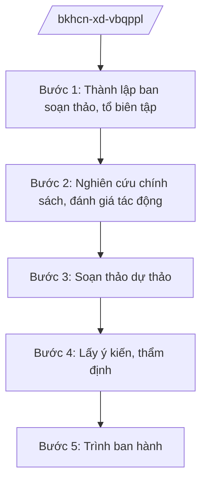

# Skill: Xây dựng VBQPPL lĩnh vực KH&CN

## 2. Khi nào dùng

Khi Bộ Khoa học và Công nghệ được giao chủ trì soạn thảo luật, nghị định, quyết định của
Thủ tướng hoặc ban hành thông tư của Bộ trưởng trong các lĩnh vực: KH&CN, đổi mới sáng tạo,
sở hữu trí tuệ, tiêu chuẩn – đo lường – chất lượng, viễn thông, công nghệ thông tin, chuyển đổi số,
an toàn thông tin mạng, báo chí, xuất bản, năng lượng nguyên tử.

## 3. Đầu vào (Input)

| Trường | Mô tả | Bắt buộc |
|--------|-------|----------|
| `loai_van_ban` | Loại văn bản: luật / nghị định / thông tư / quyết định TTg | Có |
| `ten_du_thao` | Tên gọi dự thảo văn bản | Có |
| `linh_vuc` | Lĩnh vực cụ thể trong phạm vi quản lý của Bộ | Có |
| `can_cu_chu_truong` | Văn bản giao nhiệm vụ | Có |
| `don_vi_chu_tri` | Vụ/cục được giao chủ trì soạn thảo | Có |
| `noi_dung_chinh_sach` | Nội dung chính sách cần thể chế hóa | Có |

## 4. Quy trình

**Bước 1. Thành lập ban soạn thảo, tổ biên tập**

- Làm gì: Trình Bộ trưởng quyết định thành lập ban soạn thảo/tổ biên tập; phân công vụ chủ trì.
- Dùng input: `loai_van_ban`, `don_vi_chu_tri`, `can_cu_chu_truong`.
- Vai trò: Vụ Pháp chế (Bộ KH&CN) tham mưu; AI hỗ trợ dự thảo quyết định thành lập (30 phút).
- Lưu ý nghiệp vụ: Thành phần phải có đại diện cơ quan, tổ chức liên quan theo quy định.
- → Kết quả bước: Quyết định thành lập ban soạn thảo/tổ biên tập.

**Bước 2. Nghiên cứu chính sách, đánh giá tác động**

- Làm gì: Tổng kết thi hành văn bản hiện hành; nghiên cứu chính sách; đánh giá tác động
  (đặc biệt với chính sách mới về công nghệ, dữ liệu, viễn thông).
- Dùng input: `noi_dung_chinh_sach`, `linh_vuc`.
- Vai trò: Chuyên viên vụ chủ trì thực hiện; AI hỗ trợ tổng hợp tài liệu, bảng so sánh (2–4 giờ).
- Lưu ý nghiệp vụ: Chính sách về công nghệ mới cần đánh giá tác động kỹ lưỡng đến doanh nghiệp,
  người dân; tham khảo thông lệ quốc tế.
- → Kết quả bước: Báo cáo nghiên cứu chính sách + đánh giá tác động.

**Bước 3. Soạn thảo dự thảo**

- Làm gì: Viết dự thảo điều khoản đúng kỹ thuật; kèm tờ trình, bản thuyết minh.
- Dùng input: `ten_du_thao`, `noi_dung_chinh_sach`.
- Vai trò: Tổ biên tập soạn thảo; AI hỗ trợ dự thảo điều khoản, rà soát kỹ thuật (1–2 ngày).
- Lưu ý nghiệp vụ: Thuật ngữ công nghệ phải chính xác, thống nhất; không trái Hiến pháp, luật.
- → Kết quả bước: Dự thảo văn bản + tờ trình + thuyết minh.

**Bước 4. Lấy ý kiến, thẩm định**

- Làm gì: Đăng lấy ý kiến trên Cổng TTĐT; gửi bộ/ngành, địa phương, hiệp hội, doanh nghiệp công nghệ;
  gửi Bộ Tư pháp thẩm định (luật, nghị định).
- Dùng input: Toàn bộ hồ sơ dự thảo.
- Vai trò: Vụ chủ trì tổng hợp; AI hỗ trợ phân loại ý kiến, bảng tiếp thu/giải trình (2–3 giờ).
- Lưu ý nghiệp vụ: Với văn bản về viễn thông, Internet, báo chí: lấy ý kiến rộng rãi doanh nghiệp,
  cơ quan báo chí chịu tác động trực tiếp.
- → Kết quả bước: Báo cáo tiếp thu, giải trình; dự thảo hoàn chỉnh.

**Bước 5. Trình ban hành**

- Làm gì: Hoàn thiện hồ sơ trình Bộ trưởng ký (thông tư) hoặc trình Chính phủ (luật, nghị định).
- Dùng input: Toàn bộ hồ sơ sau thẩm định.
- Vai trò: Vụ trưởng Vụ Pháp chế kiểm tra; Thứ trưởng duyệt; AI hỗ trợ checklist hồ sơ (1 giờ).
- Lưu ý nghiệp vụ: Hồ sơ đầy đủ thành phần theo quy định về ban hành VBQPPL.
- → Kết quả bước: Văn bản được ban hành + hồ sơ lưu trữ.

## Luồng quy trình (Workflow)

## 5. Đầu ra (Output)

- Dự thảo văn bản QPPL hoàn chỉnh đúng thể thức NĐ 30/2020/NĐ-CP.
- Tờ trình, bản thuyết minh, báo cáo đánh giá tác động.
- Báo cáo tiếp thu, giải trình ý kiến.

### Cấu trúc output chuẩn (dự thảo thông tư)

1. Quốc hiệu "CỘNG HÒA XÃ HỘI CHỦ NGHĨA VIỆT NAM", Tiêu ngữ "Độc lập – Tự do – Hạnh phúc"
2. Tên loại và trích yếu nội dung.
3. Căn cứ ban hành (luật chuyên ngành; NĐ 55/2025/NĐ-CP...).
4. Phần, chương, điều, khoản, điểm.
5. Điều khoản thi hành; hiệu lực.
6. Nơi nhận (kết thúc "- Lưu: VT, [mã đơn vị]."); chữ ký (ghi rõ chức danh, họ tên người ký; ký hiệu "KT."/"TL." khi ký thay) Bộ trưởng.
## 6. Checklist nghiệm thu

- [ ] Đúng loại văn bản theo thẩm quyền.
- [ ] Đủ thành phần hồ sơ theo quy định.
- [ ] Đã lấy ý kiến đúng đối tượng, đủ thời gian; có báo cáo tiếp thu/giải trình.
- [ ] Đã qua thẩm định theo quy định.
- [ ] Kỹ thuật soạn thảo đúng; thuật ngữ thống nhất.
- [ ] Không trái Hiến pháp, luật, văn bản cấp trên.
- [ ] Đúng thể thức NĐ 30/2020/NĐ-CP.
- [ ] Đã qua human gate đầy đủ.

## 7. Ví dụ mô phỏng

*Dữ liệu dưới đây là giả lập 100% phục vụ minh họa.*

**Input mẫu:** `loai_van_ban` = thông tư; `ten_du_thao` = "Thông tư quy định quản lý hoạt động
truyền dẫn, phát sóng"; `linh_vuc` = viễn thông; `don_vi_chu_tri` = Cục Viễn thông – Bộ KH&CN;
`can_cu_chu_truong` = Chương trình xây dựng văn bản QPPL năm 2026 của Bộ KH&CN (Quyết định
số 1234/QĐ-BKHCN — số hiệu giả lập).

**Output mẫu (trích cấu trúc chuẩn):**

> **BỘ KHOA HỌC VÀ CÔNG NGHỆ**
> **CỘNG HÒA XÃ HỘI CHỦ NGHĨA VIỆT NAM**
> **Độc lập – Tự do – Hạnh phúc**
>
> Số: 12/2026/TT-BKHCN *(số hiệu giả lập)*
>
> **THÔNG TƯ**
> **Quy định quản lý hoạt động truyền dẫn, phát sóng**
>
> *Căn cứ pháp luật về viễn thông;*
> *Căn cứ Nghị định số 55/2025/NĐ-CP ngày 02/3/2025 của Chính phủ quy định chức năng,
> nhiệm vụ, quyền hạn và cơ cấu tổ chức của Bộ Khoa học và Công nghệ;*
> *Theo đề nghị của Cục trưởng Cục Viễn thông;*
> *Bộ trưởng Bộ Khoa học và Công nghệ ban hành Thông tư quy định quản lý hoạt động
> truyền dẫn, phát sóng.*
>
> **Chương I. QUY ĐỊNH CHUNG**
> **Điều 1. Phạm vi điều chỉnh** ...

## 8. Human gate

1. Vụ trưởng Vụ Pháp chế: kiểm tra tính hợp hiến, hợp pháp, thống nhất.
2. Thứ trưởng phụ trách lĩnh vực: duyệt trước khi trình.
3. Bộ trưởng Bộ KH&CN: ký ban hành thông tư / ký tờ trình Chính phủ.
4. Bộ Tư pháp thẩm định (luật, nghị định).

## 9. Giới hạn

- AI không quyết định nội dung chính sách thay cơ quan có thẩm quyền.
- AI không tự ký, phát hành văn bản.
- AI không bịa số liệu, căn cứ pháp lý, số hiệu văn bản.
- AI không viện dẫn văn bản hết hiệu lực.

## 10. Căn cứ & lưu ý

- Nghị định số 55/2025/NĐ-CP ngày 02/3/2025 của Chính phủ quy định chức năng, nhiệm vụ,
  quyền hạn và cơ cấu tổ chức của Bộ Khoa học và Công nghệ (hiệu lực từ 01/3/2025).
- Nghị quyết số 176/2025/QH15 về cơ cấu tổ chức của Chính phủ.
- Nghị định số 303/2025/NĐ-CP — khung chung chức năng bộ, cơ quan ngang bộ.
- Quy định của pháp luật về ban hành văn bản quy phạm pháp luật.
- Nghị định số 30/2020/NĐ-CP về công tác văn thư (thể thức văn bản).
