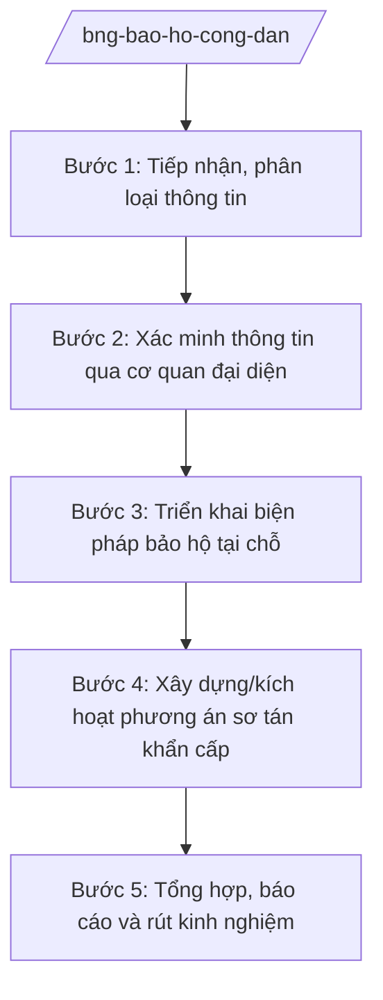

# Skill: Bảo hộ công dân Việt Nam ở nước ngoài

## 2. Khi nào dùng
- Công dân Việt Nam ở nước ngoài gặp khó khăn, hoạn nạn cần được bảo hộ: tai nạn, ốm đau, bị bắt giữ, mất giấy tờ, tranh chấp lao động, thiên tai, xung đột.
- Xảy ra tình huống khẩn cấp (thiên tai, dịch bệnh, xung đột vũ trang, bất ổn chính trị) tại địa bàn có đông công dân Việt Nam sinh sống, làm việc, học tập.
- Cần xây dựng, cập nhật phương án sơ tán, di dời công dân khỏi khu vực nguy hiểm; tổ chức chuyến bay/chuyến đi đưa công dân về nước.

## 3. Đầu vào (Input)

| Trường | Mô tả | Bắt buộc |
|--------|-------|----------|
| `tinh_huong` | Mô tả tình huống cần bảo hộ (loại sự việc, mức độ khẩn cấp) | Có |
| `dia_ban` | Quốc gia, địa phương xảy ra sự việc | Có |
| `thong_tin_cong_dan` | Thông tin công dân liên quan (số lượng, tình trạng) | Có |
| `nguon_tin` | Kênh tiếp nhận: đường dây nóng, cơ quan đại diện, người nhà, báo chí | Có |
| `co_quan_dd_phu_trach` | Cơ quan đại diện Việt Nam phụ trách địa bàn | Có |
| `phuong_an_so_tan` | Phương án sơ tán hiện có (nếu đã xây dựng) | Không |

## 4. Quy trình

**Bước 1. Tiếp nhận, phân loại thông tin**
- Làm gì: Tiếp nhận thông tin qua đường dây nóng bảo hộ công dân, hệ thống trực ban; ghi nhận đầy đủ nội dung; phân loại mức độ khẩn cấp (thông thường / khẩn cấp / đặc biệt khẩn cấp).
- Dùng input: `tinh_huong`, `nguon_tin`, `thong_tin_cong_dan`.
- Vai trò: Cán bộ trực ban Cục Lãnh sự tiếp nhận 24/7 (AI hỗ trợ chuẩn hóa phiếu tiếp nhận, phân loại mức độ khẩn cấp theo tiêu chí, cảnh báo trùng lặp vụ việc — 0,5 giờ) → Lãnh đạo Cục chỉ đạo xử lý.
- Lưu ý nghiệp vụ: Mọi cuộc gọi đường dây nóng đều phải lập phiếu tiếp nhận; thông tin cá nhân công dân được bảo mật.
- → Kết quả bước: Phiếu tiếp nhận vụ việc đã phân loại mức độ khẩn cấp.

**Bước 2. Xác minh thông tin qua cơ quan đại diện**
- Làm gì: Chuyển thông tin đến cơ quan đại diện phụ trách địa bàn để xác minh thực tế: tình trạng công dân, diễn biến sự việc, khả năng hỗ trợ tại chỗ.
- Dùng input: `dia_ban`, `thong_tin_cong_dan`, `co_quan_dd_phu_trach`.
- Vai trò: Chuyên viên Cục Lãnh sự chuyển và đôn đốc (AI hỗ trợ soạn công điện/điện khẩn theo mẫu, theo dõi thời hạn phản hồi — 1–2 giờ) → Cục trưởng chỉ đạo; cơ quan đại diện xác minh, báo cáo về.
- Lưu ý nghiệp vụ: Điện khẩn phải nêu rõ thời hạn báo cáo; không công bố thông tin chưa xác minh ra bên ngoài.
- → Kết quả bước: Báo cáo xác minh của cơ quan đại diện.

**Bước 3. Triển khai biện pháp bảo hộ tại chỗ**
- Làm gì: Chỉ đạo cơ quan đại diện thực hiện bảo hộ: thăm lãnh sự, hỗ trợ y tế/pháp lý, cấp giấy tờ thay thế, hỗ trợ tài chính khẩn cấp theo quy định, làm việc với chính quyền sở tại.
- Dùng input: Báo cáo xác minh bước 2.
- Vai trò: Cục trưởng Cục Lãnh sự chỉ đạo (AI hỗ trợ soạn hướng dẫn xử lý theo loại vụ việc, tổng hợp quy trình phối hợp với chính quyền sở tại — 2–4 giờ) → cơ quan đại diện thực hiện, báo cáo tiến độ.
- Lưu ý nghiệp vụ: Tôn trọng pháp luật nước sở tại; phối hợp chặt với gia đình công dân trong nước khi cần.
- → Kết quả bước: Công dân được hỗ trợ kịp thời; báo cáo tiến độ xử lý.

**Bước 4. Xây dựng/kích hoạt phương án sơ tán khẩn cấp**
- Làm gì: Khi tình huống leo thang (xung đột, thiên tai lớn): rà soát số lượng công dân trên địa bàn, xây dựng phương án sơ tán (đường đi, điểm tập kết, phương tiện, kinh phí), trình phê duyệt và kích hoạt.
- Dùng input: `phuong_an_so_tan`, `thong_tin_cong_dan`, `dia_ban`.
- Vai trò: Cục Lãnh sự chủ trì xây dựng phương án (AI hỗ trợ lập danh sách công dân theo khu vực, tính toán phương tiện, lập dự toán kinh phí, soạn kế hoạch điều phối — 1 ngày) → Cục trưởng trình → Thứ trưởng phê duyệt; trường hợp lớn trình Bộ trưởng báo cáo Thủ tướng Chính phủ.
- Lưu ý nghiệp vụ: Ưu tiên phụ nữ, trẻ em, người già, người ốm đau; phối hợp hãng hàng không, bộ, ngành liên quan tổ chức chuyến bay đưa công dân về nước.
- → Kết quả bước: Phương án sơ tán được phê duyệt và kích hoạt; công dân được đưa về nơi an toàn.

**Bước 5. Tổng hợp, báo cáo và rút kinh nghiệm**
- Làm gì: Tổng hợp toàn bộ vụ việc: diễn biến, biện pháp đã triển khai, kết quả, kinh phí; báo cáo lãnh đạo Bộ; cập nhật phương án bảo hộ công dân của địa bàn; rút kinh nghiệm.
- Dùng input: Toàn bộ hồ sơ vụ việc.
- Vai trò: Chuyên viên Cục Lãnh sự tổng hợp (AI hỗ trợ lập báo cáo tổng kết, thống kê vụ việc theo địa bàn/loại hình, cập nhật cơ sở dữ liệu bảo hộ công dân — 1 ngày) → Cục trưởng ký báo cáo.
- Lưu ý nghiệp vụ: Báo cáo nêu rõ bài học kinh nghiệm để hoàn thiện quy trình và phương án cho các địa bàn tương tự.
- → Kết quả bước: Báo cáo tổng kết vụ việc; phương án bảo hộ công dân được cập nhật.

## Luồng quy trình (Workflow)

## 5. Đầu ra (Output)

**Danh sách sản phẩm:**
1. Phiếu tiếp nhận vụ việc bảo hộ công dân
2. Công điện/điện khẩn gửi cơ quan đại diện
3. Báo cáo xác minh và báo cáo tiến độ xử lý
4. Phương án sơ tán khẩn cấp (khi kích hoạt)
5. Báo cáo tổng kết vụ việc

**Cấu trúc output chuẩn** (phương án sơ tán khẩn cấp công dân — thể thức theo NĐ 30/2020/NĐ-CP):
1. Quốc hiệu "CỘNG HÒA XÃ HỘI CHỦ NGHĨA VIỆT NAM", Tiêu ngữ "Độc lập – Tự do – Hạnh phúc"; tên cơ quan ban hành (Bộ Ngoại giao), số, ký hiệu, địa danh, ngày tháng năm
2. Tên phương án (trích yếu: địa bàn, tình huống)
3. Căn cứ xây dựng phương án (chỉ ghi văn bản có thật)
4. Đánh giá tình hình (diễn biến sự việc, số lượng công dân trên địa bàn)
5. Mục tiêu, yêu cầu sơ tán
6. Phương án tổ chức thực hiện (lực lượng, phương tiện, lộ trình, điểm tập kết, phân công nhiệm vụ)
7. Dự toán kinh phí
8. Tổ chức thực hiện và chế độ báo cáo
9. Chữ ký (ghi rõ chức danh, họ tên người ký; ký hiệu "KT."/"TL." khi ký thay) người có thẩm quyền; nơi nhận (kết thúc "- Lưu: VT, [mã đơn vị].")

> **Checklist thể thức văn bản theo NĐ 30/2020/NĐ-CP** — đối chiếu trước khi trình ký:
> 1. Quốc hiệu và Tiêu ngữ.
> 2. Tên cơ quan, tổ chức ban hành văn bản.
> 3. Số, ký hiệu của văn bản.
> 4. Địa danh và thời gian ban hành văn bản.
> 5. Tên loại và trích yếu nội dung văn bản.
> 6. Nội dung văn bản.
> 7. Chức vụ, họ tên và chữ ký của người có thẩm quyền.
> 8. Dấu, chữ ký số của cơ quan, tổ chức.
> 9. Nơi nhận (kèm Phụ lục nếu có).

## 6. Checklist nghiệm thu
1. 100% thông tin tiếp nhận qua đường dây nóng có phiếu tiếp nhận, phân loại mức độ khẩn cấp.
2. Điện xác minh gửi cơ quan đại diện đúng thời hạn; không công bố thông tin chưa xác minh.
3. Biện pháp bảo hộ tại chỗ triển khai kịp thời, đúng quy định; tôn trọng pháp luật nước sở tại.
4. Phương án sơ tán (nếu có) nêu rõ lộ trình, phương tiện, điểm tập kết, phân công, dự toán kinh phí.
5. Công dân thuộc diện ưu tiên (phụ nữ, trẻ em, người già, người ốm đau) được sắp xếp trước.
6. Báo cáo tổng kết đầy đủ diễn biến, biện pháp, kết quả, kinh phí và bài học kinh nghiệm.
7. Thông tin cá nhân công dân được bảo mật trong toàn bộ hồ sơ.
8. Căn cứ pháp lý viện dẫn là văn bản có thật, còn hiệu lực; không bịa số hiệu.
9. Đã qua human gate theo mục 8 trước khi kích hoạt phương án sơ tán.

## 7. Ví dụ mô phỏng

*Dữ liệu dưới đây là giả lập 100% phục vụ minh họa.*

**Tình huống giả lập:** Xảy ra động đất mạnh tại khu vực phía Nam nước Beta (quốc gia hư cấu), nơi có khoảng 2.000 công dân Việt Nam đang sinh sống, làm việc (số liệu giả lập). 15 công dân bị thương nhẹ, 200 công dân có nhà ở bị hư hỏng (số liệu giả lập).

**Input mẫu:**
- tinh_huong: Động đất mạnh 6,5 độ richter tại miền Nam nước Beta; mức độ đặc biệt khẩn cấp
- dia_ban: Miền Nam nước Beta (quốc gia hư cấu)
- thong_tin_cong_dan: ~2.000 công dân; 15 người bị thương nhẹ; 200 người mất nhà ở (số liệu giả lập)
- nguon_tin: Đường dây nóng bảo hộ công dân + Đại sứ quán Việt Nam tại nước Beta
- co_quan_dd_phu_trach: Đại sứ quán Việt Nam tại nước Beta

**Output mẫu** (trích phương án sơ tán khẩn cấp — giả lập):

> **BỘ NGOẠI GIAO**
> **Số: 1234/PA-BNG**
> **CỘNG HÒA XÃ HỘI CHỦ NGHĨA VIỆT NAM**
> **Độc lập – Tự do – Hạnh phúc**
>
> *Thủ đô, ngày 10 tháng 9 năm 2026*
>
> **PHƯƠNG ÁN**
> **Sơ tán khẩn cấp công dân Việt Nam tại miền Nam nước Beta**
>
> **1. Tình hình:** Ngày 09/9/2026 xảy ra động đất mạnh tại miền Nam nước Beta (quốc gia hư cấu). Theo báo cáo của Đại sứ quán Việt Nam tại nước Beta, có khoảng 2.000 công dân Việt Nam trên địa bàn; 15 người bị thương nhẹ; 200 người mất nhà ở (số liệu giả lập).
>
> **2. Mục tiêu:** Bảo đảm an toàn tính mạng cho toàn bộ công dân; sơ tán công dân khỏi khu vực nguy hiểm về điểm tập kết an toàn; tổ chức chuyến bay đưa công dân có nguyện vọng về nước.
>
> **3. Tổ chức thực hiện:**
> - Đại sứ quán Việt Nam tại nước Beta: lập danh sách công dân theo khu vực, tổ chức 3 điểm tập kết (địa điểm giả lập), cử cán bộ trực 24/7.
> - Cục Lãnh sự: điều phối, làm đầu mối thông tin với gia đình công dân trong nước.
> - Ưu tiên sơ tán: phụ nữ, trẻ em, người già, người bị thương.
>
> **4. Dự toán kinh phí:** ... (số liệu giả lập)
>
> ***Nơi nhận:*** ... — **KT. BỘ TRƯỞNG / THỨ TRƯỞNG** — *(ký, ghi rõ họ tên)* Bà Phạm Thị DD

## 8. Human gate
- Phiếu tiếp nhận, điện xác minh: **Lãnh đạo Cục Lãnh sự** chỉ đạo xử lý.
- Biện pháp bảo hộ tại chỗ: **Cục trưởng Cục Lãnh sự** chỉ đạo, báo cáo Thứ trưởng phụ trách.
- Phương án sơ tán khẩn cấp: **Cục trưởng** trình → **Thứ trưởng phụ trách** phê duyệt; tình huống quy mô lớn: **Bộ trưởng** báo cáo **Thủ tướng Chính phủ** quyết định.
- Báo cáo tổng kết vụ việc: **Cục trưởng Cục Lãnh sự** ký, báo cáo lãnh đạo Bộ.

## 9. Giới hạn
- AI KHÔNG ra quyết định kích hoạt sơ tán hay điều động lực lượng thay người có thẩm quyền.
- AI không tự ký, tự phát hành công điện, phương án hay báo cáo chính thức.
- AI không bịa số liệu công dân, tình trạng thương vong, căn cứ pháp lý; mọi số liệu phải từ nguồn xác minh của cơ quan đại diện.
- AI không công bố thông tin vụ việc chưa được xác minh; không tiết lộ thông tin cá nhân công dân.
- AI không đưa ra phát ngôn đối ngoại hay cam kết với nước sở tại thay Bộ Ngoại giao.

## 10. Căn cứ & lưu ý
- NQ 176/2025/QH15 (cơ cấu Chính phủ 14 Bộ + 3 cơ quan ngang Bộ).
- NĐ 28/2025/NĐ-CP (chức năng, nhiệm vụ, quyền hạn và cơ cấu tổ chức của Bộ Ngoại giao).
  *Lưu ý: thuvienphapluat ghi nhận NĐ 28/2025/NĐ-CP được sửa đổi tại NĐ 109/2025/NĐ-CP — cần tra văn bản hợp nhất khi áp dụng.*
- NĐ 303/2025/NĐ-CP (khung chung chức năng bộ, cơ quan ngang bộ).
- NĐ 30/2020/NĐ-CP (thể thức văn bản — chỉ dùng cho thể thức trình bày).
- Tên luật chỉ dẫn tên, không kèm số hiệu: Luật Cơ quan đại diện Việt Nam ở nước ngoài.
- Tuyệt đối không bịa số hiệu văn bản, ngày ban hành, ngày hiệu lực.
