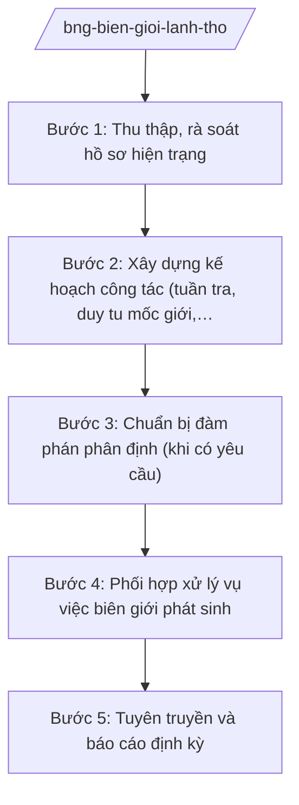

# Skill: Công tác biên giới, lãnh thổ quốc gia

## 2. Khi nào dùng
- Phối hợp quản lý đường biên giới trên đất liền: duy trì mốc giới, tuần tra liên hợp, xử lý vụ việc biên giới phát sinh.
- Chuẩn bị đàm phán, ký kết điều ước về phân định biên giới, cửa khẩu với nước láng giềng.
- Tuyên truyền, phổ biến về biển, đảo và biên giới quốc gia trong nước và cho kiều bào.
- Xây dựng báo cáo định kỳ về tình hình biên giới, lãnh thổ trình Chính phủ.

## 3. Đầu vào (Input)

| Trường | Mô tả | Bắt buộc |
|--------|-------|----------|
| `noi_dung_cong_viec` | Quản lý mốc giới / đàm phán phân định / tuyên truyền / báo cáo định kỳ | Có |
| `tuyen_bien_gioi` | Tuyến biên giới liên quan (mô tả hành chính) | Có |
| `doi_tac` | Nước láng giềng phối hợp (dùng tên hư cấu khi ví dụ nhạy cảm) | Có |
| `ho_so_hien_trang` | Hồ sơ hiện trạng mốc giới, điều ước liên quan đã ký | Không |
| `ke_hoach_thoi_gian` | Kế hoạch, thời gian triển khai | Không |

## 4. Quy trình

**Bước 1. Thu thập, rà soát hồ sơ hiện trạng**
- Làm gì: Thu thập hồ sơ mốc giới, bản đồ, điều ước quốc tế về biên giới đã ký với nước láng giềng; rà soát tình hình thực địa, các vụ việc tồn đọng trên tuyến.
- Dùng input: `tuyen_bien_gioi`, `ho_so_hien_trang`, `doi_tac`, `noi_dung_cong_viec`.
- Vai trò: Chuyên viên Ủy ban Biên giới quốc gia tổng hợp (AI hỗ trợ hệ thống hóa hồ sơ mốc giới theo tuyến, lập danh mục vụ việc tồn đọng ⏱ 2–3 ngày (ước tính)) → Lãnh đạo Ủy ban kiểm tra.
- Lưu ý nghiệp vụ: Hồ sơ biên giới có tính pháp lý cao; mọi số liệu tọa độ, mốc giới phải trích đúng văn kiện đã ký, không suy diễn.
- → Kết quả bước: Hồ sơ hiện trạng tuyến biên giới được hệ thống hóa.

**Bước 2. Xây dựng kế hoạch công tác (tuần tra, duy tu mốc giới, tuyên truyền)**
- Làm gì: Lập kế hoạch tuần tra liên hợp, duy tu, tôn tạo mốc giới; kế hoạch tuyên truyền về biên giới, biển đảo trong năm; phân công lực lượng phối hợp (bộ đội biên phòng, chính quyền địa phương).
- Dùng input: `ke_hoach_thoi_gian`, hồ sơ bước 1.
- Vai trò: Chuyên viên Ủy ban Biên giới quốc gia dự thảo (AI hỗ trợ lập lịch tuần tra theo tuyến, khung kế hoạch tuyên truyền theo đối tượng ⏱ 2 ngày (ước tính)) → Chủ nhiệm Ủy ban Biên giới quốc gia duyệt.
- Lưu ý nghiệp vụ: Hoạt động trên thực địa phải phối hợp chặt với lực lượng quản lý, bảo vệ biên giới và chính quyền địa phương tuyến biên giới.
- → Kết quả bước: Kế hoạch công tác biên giới năm được phê duyệt.

**Bước 3. Chuẩn bị đàm phán phân định (khi có yêu cầu)**
- Làm gì: Nghiên cứu cơ sở pháp lý, chuẩn bị phương án, lập trường đàm phán về phân định biên giới/cửa khẩu; xây dựng dự thảo điều ước; xin chủ trương đàm phán.
- Dùng input: `doi_tac`, `ho_so_hien_trang`.
- Vai trò: Tổ công tác Ủy ban Biên giới quốc gia chuẩn bị (AI hỗ trợ rà soát điều ước quốc tế tương tự, soạn dự thảo điều khoản kỹ thuật ⏱ 5–7 ngày (ước tính)) → Chủ nhiệm Ủy ban báo cáo → Thứ trưởng trình Bộ trưởng xin chủ trương.
- Lưu ý nghiệp vụ: Mọi phương án đàm phán về lãnh thổ phải được cấp có thẩm quyền phê duyệt chủ trương; không tiết lộ lập trường đàm phán.
- → Kết quả bước: Phương án đàm phán và dự thảo điều ước trình xin chủ trương.

**Bước 4. Phối hợp xử lý vụ việc biên giới phát sinh**
- Làm gì: Tiếp nhận thông tin vụ việc (vi phạm quy chế biên giới, tranh chấp tại khu vực giáp biên); phối hợp lực lượng chức năng xác minh; trao đổi qua kênh ngoại giao với nước láng giềng để xử lý.
- Dùng input: Thông tin vụ việc, `tuyen_bien_gioi`.
- Vai trò: Chuyên viên Ủy ban Biên giới quốc gia xử lý thường xuyên (AI hỗ trợ lập phiếu theo dõi vụ việc, soạn công hàm trao đổi theo mẫu ⏱ 1 ngày (ước tính)/vụ việc) → Lãnh đạo Ủy ban chỉ đạo; vụ việc phức tạp báo cáo Thứ trưởng.
- Lưu ý nghiệp vụ: Xử lý trên tinh thần hữu nghị, tôn trọng điều ước đã ký; không để vụ việc nhỏ leo thang.
- → Kết quả bước: Vụ việc được xử lý, có văn bản trao đổi qua kênh ngoại giao.

**Bước 5. Tuyên truyền và báo cáo định kỳ**
- Làm gì: Tổ chức tuyên truyền về biên giới, biển đảo (tài liệu, hội nghị, truyền thông); tổng hợp báo cáo định kỳ tình hình biên giới, lãnh thổ trình Chính phủ.
- Dùng input: Kết quả các bước trên.
- Vai trò: Chuyên viên Ủy ban Biên giới quốc gia thực hiện (AI hỗ trợ biên soạn tài liệu tuyên truyền, lập báo cáo định kỳ theo mẫu ⏱ 2–3 ngày (ước tính)) → Chủ nhiệm Ủy ban ký báo cáo.
- Lưu ý nghiệp vụ: Nội dung tuyên truyền về chủ quyền, lãnh thổ phải thống nhất với quan điểm chính thức của Nhà nước; tài liệu đối ngoại phải được kiểm duyệt.
- → Kết quả bước: Tài liệu tuyên truyền được phát hành; báo cáo định kỳ trình Chính phủ.

## Luồng quy trình (Workflow)

## 5. Đầu ra (Output)

**Danh sách sản phẩm:**
1. Hồ sơ hiện trạng tuyến biên giới (đã hệ thống hóa)
2. Kế hoạch công tác biên giới năm (tuần tra, duy tu mốc giới, tuyên truyền)
3. Phương án đàm phán phân định + dự thảo điều ước (khi có)
4. Hồ sơ xử lý vụ việc biên giới (phiếu theo dõi, công hàm trao đổi)
5. Tài liệu tuyên truyền về biên giới, biển đảo
6. Báo cáo định kỳ tình hình biên giới, lãnh thổ

**Cấu trúc output chuẩn** (báo cáo định kỳ tình hình biên giới, lãnh thổ — thể thức theo NĐ 30/2020/NĐ-CP):
1. Quốc hiệu "CỘNG HÒA XÃ HỘI CHỦ NGHĨA VIỆT NAM", Tiêu ngữ "Độc lập – Tự do – Hạnh phúc"; tên cơ quan (Ủy ban Biên giới quốc gia – Bộ Ngoại giao), số, ký hiệu, địa danh, ngày tháng năm
2. Tên báo cáo (trích yếu: kỳ báo cáo, tuyến biên giới)
3. Kính gửi (Chính phủ/Thủ tướng Chính phủ)
4. Tình hình chung tuyến biên giới trong kỳ
5. Kết quả quản lý mốc giới, tuần tra, xử lý vụ việc
6. Tiến độ đàm phán, hợp tác với nước láng giềng (mức độ công bố cho phép)
7. Công tác tuyên truyền về biên giới, biển đảo
8. Đánh giá, kiến nghị
9. Chữ ký (ghi rõ chức danh, họ tên người ký; ký hiệu "KT."/"TL." khi ký thay) người có thẩm quyền; nơi nhận (kết thúc "- Lưu: VT, [mã đơn vị].")

> **Checklist thể thức văn bản theo NĐ 30/2020/NĐ-CP** — đối chiếu trước khi trình ký:
> 1. Quốc hiệu và Tiêu ngữ.
> 2. Tên cơ quan, tổ chức ban hành văn bản.
> 3. Số, ký hiệu của văn bản.
> 4. Địa danh và thời gian ban hành văn bản.
> 5. Tên loại và trích yếu nội dung văn bản.
> 6. Nội dung văn bản.
> 7. Chức vụ, họ tên và chữ ký của người có thẩm quyền.
> 8. Dấu, chữ ký số của cơ quan, tổ chức.
> 9. Nơi nhận (kèm Phụ lục nếu có).

## 6. Checklist nghiệm thu
1. Hồ sơ mốc giới, tọa độ trích đúng văn kiện đã ký; không suy diễn số liệu.
2. Kế hoạch công tác năm có phân công rõ lực lượng phối hợp (biên phòng, địa phương).
3. Phương án đàm phán (nếu có) đã được cấp có thẩm quyền phê duyệt chủ trương; lập trường đàm phán được bảo mật.
4. Vụ việc biên giới có phiếu theo dõi, xử lý kịp thời theo tinh thần hữu nghị, đúng điều ước đã ký.
5. Nội dung tuyên truyền về chủ quyền, lãnh thổ thống nhất với quan điểm chính thức của Nhà nước.
6. Báo cáo định kỳ đầy đủ các nội dung theo cấu trúc chuẩn; số liệu có nguồn.
7. Căn cứ pháp lý viện dẫn là văn bản có thật, còn hiệu lực; không bịa số hiệu.
8. Đã qua human gate theo mục 8 trước khi ban hành văn bản chính thức.

## 7. Ví dụ mô phỏng

*Dữ liệu dưới đây là giả lập 100% phục vụ minh họa.*

**Input mẫu:**
- noi_dung_cong_viec: Báo cáo định kỳ tình hình tuyến biên giới đất liền
- tuyen_bien_gioi: Tuyến biên giới đất liền Việt Nam – nước Delta (quốc gia hư cấu), đoạn từ mốc số 100 đến mốc số 150 (số liệu giả lập)
- doi_tac: nước Delta (quốc gia hư cấu)
- ke_hoach_thoi_gian: Báo cáo 6 tháng đầu năm 2026

**Output mẫu** (trích báo cáo định kỳ — giả lập, nội dung hành chính):

> **ỦY BAN BIÊN GIỚI QUỐC GIA – BỘ NGOẠI GIAO**
> **Số: 123/BC-UBBG**
> **CỘNG HÒA XÃ HỘI CHỦ NGHĨA VIỆT NAM**
> **Độc lập – Tự do – Hạnh phúc**
>
> *Thủ đô, ngày 15 tháng 7 năm 2026*
>
> **BÁO CÁO**
> **Tình hình tuyến biên giới đất liền Việt Nam – nước Delta 6 tháng đầu năm 2026**
>
> *Kính gửi: Thủ tướng Chính phủ*
>
> **1. Tình hình chung:** Tuyến biên giới đất liền Việt Nam – nước Delta (quốc gia hư cấu) cơ bản ổn định; quan hệ hợp tác giữa lực lượng quản lý, bảo vệ biên giới hai bên được duy trì tốt (nhận định giả lập).
>
> **2. Quản lý mốc giới:** Đã phối hợp tuần tra liên hợp 12 đợt; duy tu, tôn tạo 08 cột mốc (số liệu giả lập); không phát sinh vụ việc phức tạp.
>
> **3. Tuyên truyền:** Tổ chức 05 hội nghị tuyên truyền về biên giới cho cán bộ, nhân dân khu vực giáp biên (số liệu giả lập).
>
> **4. Kiến nghị:** Tiếp tục duy trì cơ chế gặp gỡ định kỳ lực lượng bảo vệ biên giới hai bên...
>
> ***Nơi nhận:*** ... — **CHỦ NHIỆM ỦY BAN BIÊN GIỚI QUỐC GIA** — *(ký, ghi rõ họ tên)* Ông Hoàng Văn HH

## 8. Human gate
- Hồ sơ hiện trạng, kế hoạch công tác năm: **Chủ nhiệm Ủy ban Biên giới quốc gia** phê duyệt.
- Phương án đàm phán phân định: **Chủ nhiệm Ủy ban** báo cáo → **Thứ trưởng phụ trách** trình → **Bộ trưởng** xin chủ trương cấp có thẩm quyền.
- Công hàm trao đổi với nước láng giềng: **Lãnh đạo Ủy ban Biên giới quốc gia** duyệt; vụ việc phức tạp báo cáo **Thứ trưởng**.
- Tài liệu tuyên truyền về chủ quyền, lãnh thổ: **Thứ trưởng phụ trách** duyệt trước khi phát hành.
- Báo cáo định kỳ trình Chính phủ: **Chủ nhiệm Ủy ban** ký → **Thứ trưởng** kiểm tra → **Bộ trưởng** ký trình.

## 9. Giới hạn
- AI KHÔNG ra quyết định về chủ trương đàm phán, lập trường về lãnh thổ thay cấp có thẩm quyền.
- AI không tự ký, tự phát hành công hàm, báo cáo, tài liệu tuyên truyền chính thức.
- AI không bịa số liệu mốc giới, tọa độ, nội dung điều ước; không suy diễn từ hồ sơ.
- AI không tiết lộ lập trường đàm phán; không đưa ra phát ngôn về chủ quyền, lãnh thổ thay Nhà nước.
- AI không đề xuất nội dung vượt quá phạm vi hành chính được giao; tuyệt đối không chạm đến chủ quyền nhạy cảm cụ thể.

## 10. Căn cứ & lưu ý
- NQ 176/2025/QH15 (cơ cấu Chính phủ 14 Bộ + 3 cơ quan ngang Bộ).
- NĐ 28/2025/NĐ-CP (chức năng, nhiệm vụ, quyền hạn và cơ cấu tổ chức của Bộ Ngoại giao).
  *Lưu ý: thuvienphapluat ghi nhận NĐ 28/2025/NĐ-CP được sửa đổi tại NĐ 109/2025/NĐ-CP — cần tra văn bản hợp nhất khi áp dụng.*
- NĐ 303/2025/NĐ-CP (khung chung chức năng bộ, cơ quan ngang bộ).
- NĐ 30/2020/NĐ-CP (thể thức văn bản — chỉ dùng cho thể thức trình bày).
- Tên luật chỉ dẫn tên, không kèm số hiệu: Luật Biên giới quốc gia.
- Tuyệt đối không bịa số hiệu văn bản, ngày ban hành, ngày hiệu lực.
