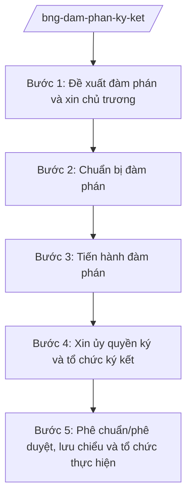

# Skill: Đàm phán, ký kết điều ước quốc tế

## 2. Khi nào dùng
- Có nhu cầu đàm phán, ký kết điều ước quốc tế song phương hoặc đa phương thuộc lĩnh vực đối ngoại do Bộ Ngoại giao chủ trì hoặc phối hợp.
- Cần xin chủ trương của cấp có thẩm quyền trước khi đàm phán, ký kết điều ước quốc tế nhân danh Nhà nước hoặc Chính phủ.
- Sau khi ký kết: cần làm thủ tục phê chuẩn/phê duyệt, lưu chiểu, đăng ký và tổ chức thực hiện điều ước quốc tế.

## 3. Đầu vào (Input)

| Trường | Mô tả | Bắt buộc |
|--------|-------|----------|
| `ten_dieu_uoc` | Tên điều ước quốc tế dự kiến (song phương/đa phương) | Có |
| `doi_tac` | Bên đối tác (quốc gia/tổ chức quốc tế) | Có |
| `chu_the_ky` | Nhân danh Nhà nước / nhân danh Chính phủ | Có |
| `muc_dich_noi_dung` | Mục đích, nội dung chính dự kiến đàm phán | Có |
| `co_quan_de_xuat` | Cơ quan đề xuất đàm phán, ký kết | Có |
| `du_thao_dieu_uoc` | Dự thảo điều ước (nếu đã có) | Không |
| `ke_hoach_dam_phan` | Kế hoạch đàm phán: vòng đàm phán, đoàn đàm phán, thời gian | Không |

## 4. Quy trình

**Bước 1. Đề xuất đàm phán và xin chủ trương**
- Làm gì: Lập đề xuất đàm phán, ký kết điều ước quốc tế: sự cần thiết, mục đích, nội dung chính, đánh giá tác động, chủ thể ký kết; trình xin chủ trương của cấp có thẩm quyền.
- Dùng input: `ten_dieu_uoc`, `doi_tac`, `chu_the_ky`, `muc_dich_noi_dung`, `co_quan_de_xuat`.
- Vai trò: Chuyên viên Vụ Pháp luật và Điều ước quốc tế soạn đề xuất (AI hỗ trợ rà soát điều ước quốc tế tương tự đã ký, đánh giá tính tương thích với pháp luật trong nước — 2–3 ngày) → Vụ trưởng kiểm tra → Thứ trưởng trình → Bộ trưởng ký tờ trình xin chủ trương.
- Lưu ý nghiệp vụ: Điều ước nhân danh Nhà nước có thủ tục phê chuẩn chặt chẽ hơn điều ước nhân danh Chính phủ; phải xác định đúng chủ thể ngay từ đầu.
- → Kết quả bước: Tờ trình xin chủ trương được phê duyệt.

**Bước 2. Chuẩn bị đàm phán**
- Làm gì: Xây dựng phương án đàm phán: lập trường, giới hạn nhượng bộ, kịch bản các vòng đàm phán; thành lập đoàn đàm phán; chuẩn bị dự thảo điều ước.
- Dùng input: `du_thao_dieu_uoc`, `ke_hoach_dam_phan`, kết quả bước 1.
- Vai trò: Tổ đàm phán (chuyên viên Vụ Pháp luật và Điều ước quốc tế + đơn vị chuyên môn) chuẩn bị (AI hỗ trợ soạn dự thảo điều khoản, đối chiếu mẫu điều ước quốc tế tương tự, lập bảng so sánh lập trường — 3–5 ngày) → Vụ trưởng duyệt phương án.
- Lưu ý nghiệp vụ: Mọi nhượng bộ vượt giới hạn đã duyệt phải báo cáo xin ý kiến trước khi tiếp tục đàm phán.
- → Kết quả bước: Phương án đàm phán và dự thảo điều ước được phê duyệt.

**Bước 3. Tiến hành đàm phán**
- Làm gì: Tổ chức các vòng đàm phán với đối tác; ghi nhận kết quả từng vòng; điều chỉnh lập trường trong giới hạn được ủy quyền; hoàn thiện văn bản điều ước.
- Dùng input: `ke_hoach_dam_phan`, phương án đàm phán.
- Vai trò: Trưởng đoàn đàm phán điều hành (AI hỗ trợ tổng hợp biên bản từng vòng đàm phán, theo dõi các điểm còn bất đồng — theo từng vòng) → Vụ trưởng báo cáo tiến độ sau mỗi vòng. ⏱ ~theo từng vòng đàm phán (ước tính).
- Lưu ý nghiệp vụ: Biên bản đàm phán phải được hai bên xác nhận; nội dung thống nhất cuối cùng phải rà soát pháp lý trước khi chuyển sang bước ký.
- → Kết quả bước: Văn bản điều ước đã được hai bên thống nhất; báo cáo kết quả đàm phán.

**Bước 4. Xin ủy quyền ký và tổ chức ký kết**
- Làm gì: Lập tờ trình xin ủy quyền ký (quyết định ủy quyền cho người ký); chuẩn bị lễ ký (lễ tân, văn bản ký, bản sao chứng thực); tổ chức ký kết.
- Dùng input: Văn bản điều ước đã thống nhất, `chu_the_ky`.
- Vai trò: Chuyên viên Vụ Pháp luật và Điều ước quốc tế soạn hồ sơ ủy quyền (AI hỗ trợ kiểm tra thể thức văn bản ủy quyền, danh mục hồ sơ — 1 ngày) → Vụ trưởng kiểm tra → Thứ trưởng trình → cấp có thẩm quyền quyết định ủy quyền.
- Lưu ý nghiệp vụ: Người ký phải có đầy đủ giấy ủy quyền (full powers) theo đúng chủ thể ký kết; kiểm tra kỹ bản chính trước giờ ký.
- → Kết quả bước: Quyết định ủy quyền ký; điều ước quốc tế được ký kết.

**Bước 5. Phê chuẩn/phê duyệt, lưu chiểu và tổ chức thực hiện**
- Làm gì: Làm thủ tục phê chuẩn hoặc phê duyệt theo chủ thể ký kết; lưu chiểu văn kiện; đăng ký (nếu là điều ước đa phương); xây dựng kế hoạch tổ chức thực hiện trong nước, phân công đơn vị chủ trì.
- Dùng input: Điều ước đã ký, `chu_the_ky`.
- Vai trò: Chuyên viên Vụ Pháp luật và Điều ước quốc tế soạn hồ sơ phê chuẩn/phê duyệt (AI hỗ trợ rà soát tính đầy đủ hồ sơ, soạn kế hoạch tổ chức thực hiện — 2 ngày) → Vụ trưởng kiểm tra → Thứ trưởng trình → cấp có thẩm quyền quyết định.
- Lưu ý nghiệp vụ: Theo dõi thời hạn hiệu lực, thời hạn tuyên bố bảo lưu/rút bảo lưu; cập nhật cơ sở dữ liệu điều ước quốc tế của Bộ.
- → Kết quả bước: Điều ước có hiệu lực; kế hoạch tổ chức thực hiện được ban hành.

## Luồng quy trình (Workflow)

## 5. Đầu ra (Output)

**Danh sách sản phẩm:**
1. Đề xuất đàm phán, ký kết điều ước quốc tế (đã được chấp thuận chủ trương)
2. Phương án đàm phán + dự thảo điều ước
3. Biên bản các vòng đàm phán; báo cáo kết quả đàm phán
4. Quyết định ủy quyền ký
5. Văn bản điều ước quốc tế đã ký (bản chính)
6. Hồ sơ phê chuẩn/phê duyệt; kế hoạch tổ chức thực hiện

**Cấu trúc output chuẩn** (tờ trình xin chủ trương đàm phán, ký kết — thể thức theo NĐ 30/2020/NĐ-CP):
1. Quốc hiệu "CỘNG HÒA XÃ HỘI CHỦ NGHĨA VIỆT NAM", Tiêu ngữ "Độc lập – Tự do – Hạnh phúc"
2. Tên cơ quan trình (Bộ Ngoại giao), số, ký hiệu tờ trình
3. Địa danh, ngày tháng năm ban hành; tên tờ trình (trích yếu)
4. Kính gửi (cấp có thẩm quyền)
5. Sự cần thiết đàm phán, ký kết
6. Mục đích, nội dung chính của điều ước dự kiến
7. Chủ thể ký kết (nhân danh Nhà nước / nhân danh Chính phủ) và căn cứ xác định
8. Đánh giá tác động (chính trị, pháp lý, kinh tế – xã hội)
9. Kiến nghị (xin chủ trương đàm phán, ký kết)
10. Hồ sơ kèm theo; chữ ký (ghi rõ chức danh, họ tên người ký; ký hiệu "KT."/"TL." khi ký thay) người có thẩm quyền; nơi nhận (kết thúc "- Lưu: VT, [mã đơn vị].")
## 6. Checklist nghiệm thu
1. Đã xác định đúng chủ thể ký kết (Nhà nước/Chính phủ) ngay từ đề xuất.
2. Đề xuất có đủ: sự cần thiết, mục đích, nội dung chính, đánh giá tác động.
3. Phương án đàm phán nêu rõ lập trường và giới hạn nhượng bộ được duyệt.
4. Biên bản đàm phán các vòng đầy đủ, được hai bên xác nhận.
5. Văn bản điều ước thống nhất cuối cùng đã qua rà soát pháp lý.
6. Giấy ủy quyền ký đúng chủ thể, đúng người, còn hiệu lực tại thời điểm ký.
7. Hồ sơ phê chuẩn/phê duyệt đầy đủ; kế hoạch tổ chức thực hiện phân công rõ đơn vị chủ trì.
8. Căn cứ pháp lý viện dẫn là văn bản có thật, còn hiệu lực; không bịa số hiệu.
9. Đã qua human gate theo mục 8 ở từng bước chuyển giai đoạn.

## 7. Ví dụ mô phỏng

*Dữ liệu dưới đây là giả lập 100% phục vụ minh họa.*

**Input mẫu:**
- ten_dieu_uoc: "Hiệp định khung về hợp tác giáo dục giữa Chính phủ nước Cộng hòa xã hội chủ nghĩa Việt Nam và Chính phủ nước Anpha"
- doi_tac: nước Anpha (quốc gia hư cấu)
- chu_the_ky: Nhân danh Chính phủ
- muc_dich_noi_dung: Thiết lập khung hợp tác về trao đổi sinh viên, công nhận văn bằng, hợp tác nghiên cứu giữa cơ sở giáo dục hai nước
- co_quan_de_xuat: Vụ Pháp luật và Điều ước quốc tế – Bộ Ngoại giao (phối hợp Bộ Giáo dục và Đào tạo)

**Output mẫu** (trích tờ trình xin chủ trương — giả lập):

> **BỘ NGOẠI GIAO**
> **Số: 1234/TTr-BNG**
> **CỘNG HÒA XÃ HỘI CHỦ NGHĨA VIỆT NAM**
> **Độc lập – Tự do – Hạnh phúc**
>
> *Thủ đô, ngày 20 tháng 3 năm 2026*
>
> **TỜ TRÌNH**
> **Về việc xin chủ trương đàm phán, ký kết Hiệp định khung về hợp tác giáo dục giữa Chính phủ nước Cộng hòa xã hội chủ nghĩa Việt Nam và Chính phủ nước Anpha**
>
> *Kính gửi: Thủ tướng Chính phủ*
>
> **1. Sự cần thiết:** Quan hệ hợp tác giáo dục giữa Việt Nam và nước Anpha (quốc gia hư cấu) ngày càng phát triển; cần một khung pháp lý để thúc đẩy trao đổi sinh viên và công nhận lẫn nhau về văn bằng...
>
> **2. Mục đích, nội dung chính:** (a) Trao đổi 500 lượt sinh viên/năm (số liệu giả lập); (b) Công nhận tương đương văn bằng đại học; (c) Hợp tác nghiên cứu khoa học...
>
> **3. Chủ thể ký kết:** Nhân danh Chính phủ.
>
> **4. Đánh giá tác động:** Phù hợp chủ trương hội nhập quốc tế về giáo dục; không phát sinh nghĩa vụ tài chính vượt dự toán...
>
> **5. Kiến nghị:** Kính đề nghị Thủ tướng Chính phủ cho chủ trương để Bộ Ngoại giao chủ trì, phối hợp với Bộ Giáo dục và Đào tạo đàm phán, ký kết Hiệp định nêu trên.
>
> ***Nơi nhận:*** ... — **BỘ TRƯỞNG** — *(ký, ghi rõ họ tên)* Ông Lê Văn CC

## 8. Human gate
- Đề xuất đàm phán, phương án đàm phán: **Vụ trưởng Vụ Pháp luật và Điều ước quốc tế** kiểm tra → **Thứ trưởng phụ trách** trình → **Bộ trưởng** ký tờ trình xin chủ trương.
- Kết quả đàm phán, văn bản điều ước thống nhất: **Thứ trưởng** báo cáo → **Bộ trưởng** cho ý kiến trước khi xin ủy quyền ký.
- Ủy quyền ký và phê chuẩn/phê duyệt: **cấp có thẩm quyền** quyết định theo chủ thể ký kết (điều ước nhân danh Nhà nước: trình Quốc hội phê chuẩn; nhân danh Chính phủ: Chính phủ phê duyệt) — Bộ trưởng Bộ Ngoại giao ký tờ trình.
- Kế hoạch tổ chức thực hiện: **Thứ trưởng phụ trách** phê duyệt.

## 9. Giới hạn
- AI KHÔNG ra quyết định về chủ trương đàm phán, lập trường đàm phán hay việc ký kết thay cấp có thẩm quyền.
- AI không tự ký, tự phát hành văn bản ủy quyền hay điều ước quốc tế.
- AI không bịa nội dung điều ước, số liệu cam kết, căn cứ pháp lý; không viện dẫn điều ước/văn bản không có thật hoặc hết hiệu lực.
- AI không đưa ra phát ngôn, cam kết đối ngoại thay mặt Nhà nước, Chính phủ, Bộ Ngoại giao.
- AI không đề xuất điều khoản trái với Hiến pháp, pháp luật Việt Nam và chủ trương đối ngoại của Đảng, Nhà nước.

## 10. Căn cứ & lưu ý
- NQ 176/2025/QH15 (cơ cấu Chính phủ 14 Bộ + 3 cơ quan ngang Bộ).
- NĐ 28/2025/NĐ-CP (chức năng, nhiệm vụ, quyền hạn và cơ cấu tổ chức của Bộ Ngoại giao).
  *Lưu ý: thuvienphapluat ghi nhận NĐ 28/2025/NĐ-CP được sửa đổi tại NĐ 109/2025/NĐ-CP — cần tra văn bản hợp nhất khi áp dụng.*
- NĐ 303/2025/NĐ-CP (khung chung chức năng bộ, cơ quan ngang bộ).
- NĐ 30/2020/NĐ-CP (thể thức văn bản — chỉ dùng cho thể thức trình bày).
- Tên luật chỉ dẫn tên, không kèm số hiệu: Luật Điều ước quốc tế.
- Tuyệt đối không bịa số hiệu văn bản, ngày ban hành, ngày hiệu lực.
