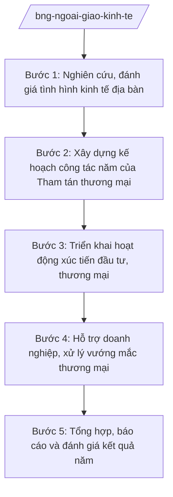

# Skill: Ngoại giao kinh tế, xúc tiến đầu tư, thương mại

## 2. Khi nào dùng
- Xây dựng kế hoạch công tác ngoại giao kinh tế hằng năm của Bộ và của từng cơ quan đại diện (kế hoạch công tác năm của Tham tán thương mại).
- Tổ chức hoạt động xúc tiến đầu tư, thương mại, du lịch tại địa bàn: diễn đàn doanh nghiệp, hội chợ, kết nối B2B, vận động chính sách thương mại của nước sở tại.
- Hỗ trợ doanh nghiệp Việt Nam thâm nhập thị trường, xử lý vướng mắc thương mại, phòng vệ thương mại tại địa bàn.
- Tổng hợp, báo cáo tình hình kinh tế địa bàn phục vụ điều hành của Chính phủ.

## 3. Đầu vào (Input)

| Trường | Mô tả | Bắt buộc |
|--------|-------|----------|
| `dia_ban` | Quốc gia/khu vực địa bàn phụ trách | Có |
| `muc_tieu_nam` | Mục tiêu ngoại giao kinh tế của năm (thu hút FDI, kim ngạch XK, ký kết...) | Có |
| `so_lieu_tham_khao` | Số liệu thương mại, đầu tư song phương kỳ trước | Có |
| `co_quan_dd` | Cơ quan đại diện phụ trách địa bàn | Có |
| `linh_vuc_uu_tien` | Lĩnh vực ưu tiên xúc tiến (nông sản, công nghệ, năng lượng...) | Không |
| `de_xuat_doanh_nghiep` | Đề xuất, kiến nghị của doanh nghiệp, hiệp hội | Không |

## 4. Quy trình

**Bước 1. Nghiên cứu, đánh giá tình hình kinh tế địa bàn**
- Làm gì: Thu thập, phân tích tình hình kinh tế vĩ mô, chính sách thương mại, đầu tư của nước sở tại; đánh giá dư địa hợp tác với Việt Nam; xác định cơ hội và thách thức.
- Dùng input: `dia_ban`, `so_lieu_tham_khao`, `co_quan_dd`.
- Vai trò: Tham tán thương mại tại địa bàn nghiên cứu (AI hỗ trợ tổng hợp số liệu thương mại song phương, rà soát chính sách mới của nước sở tại, lập báo cáo phân tích ⏱ 3–5 ngày (ước tính)) → Đại sứ cho ý kiến.
- Lưu ý nghiệp vụ: Số liệu phải có nguồn rõ ràng (cơ quan thống kê nước sở tại, hải quan, tổ chức quốc tế); phân biệt số liệu chính thức và ước tính.
- → Kết quả bước: Báo cáo đánh giá tình hình kinh tế địa bàn.

**Bước 2. Xây dựng kế hoạch công tác năm của Tham tán thương mại**
- Làm gì: Xác định mục tiêu, chỉ tiêu cụ thể; xây dựng chương trình hoạt động theo quý (xúc tiến, kết nối doanh nghiệp, vận động chính sách, hỗ trợ vụ việc); lập dự toán kinh phí.
- Dùng input: `muc_tieu_nam`, `linh_vuc_uu_tien`, `de_xuat_doanh_nghiep`, báo cáo bước 1.
- Vai trò: Tham tán thương mại dự thảo kế hoạch (AI hỗ trợ lập khung kế hoạch theo quý, gợi ý hoạt động theo lịch sự kiện thương mại của địa bàn, lập dự toán ⏱ 2–3 ngày (ước tính)) → Đại sứ duyệt → gửi về Vụ Kinh tế đối ngoại tổng hợp.
- Lưu ý nghiệp vụ: Kế hoạch phải gắn với mục tiêu ngoại giao kinh tế chung của Bộ; hoạt động xúc tiến phối hợp với Bộ Công Thương, các hiệp hội ngành hàng.
- → Kết quả bước: Kế hoạch công tác năm của Tham tán thương mại (đã được Đại sứ duyệt).

**Bước 3. Triển khai hoạt động xúc tiến đầu tư, thương mại**
- Làm gì: Tổ chức diễn đàn doanh nghiệp, hội chợ, chương trình kết nối B2B; đón đoàn xúc tiến từ trong nước; vận động chính quyền, doanh nghiệp nước sở tại đầu tư vào Việt Nam, nhập khẩu hàng Việt Nam.
- Dùng input: Kế hoạch công tác năm.
- Vai trò: Tham tán thương mại chủ trì tổ chức tại địa bàn (AI hỗ trợ soạn thư mời, tài liệu giới thiệu môi trường đầu tư Việt Nam, danh sách doanh nghiệp mục tiêu, theo dõi kết quả kết nối — theo từng sự kiện) → Đại sứ chỉ đạo. ⏱ ~theo từng sự kiện (ước tính).
- Lưu ý nghiệp vụ: Nội dung giới thiệu về Việt Nam phải thống nhất với tài liệu chính thức của Bộ; không đưa ra cam kết ưu đãi vượt thẩm quyền.
- → Kết quả bước: Các sự kiện xúc tiến được tổ chức; biên bản ghi nhớ, thỏa thuận hợp tác (nếu có).

**Bước 4. Hỗ trợ doanh nghiệp, xử lý vướng mắc thương mại**
- Làm gì: Tiếp nhận kiến nghị của doanh nghiệp Việt Nam tại địa bàn; hỗ trợ tháo gỡ vướng mắc (hải quan, tiêu chuẩn, tranh chấp); cảnh báo sớm biện pháp phòng vệ thương mại của nước sở tại.
- Dùng input: `de_xuat_doanh_nghiep`, diễn biến tại địa bàn.
- Vai trò: Tham tán thương mại xử lý, báo cáo về nước khi vượt thẩm quyền (AI hỗ trợ phân loại vướng mắc, soạn báo cáo nhanh, tra cứu quy định liên quan của nước sở tại ⏱ 1–2 ngày (ước tính)/vụ việc) → Đại sứ chỉ đạo; Vụ Kinh tế đối ngoại phối hợp bộ, ngành trong nước.
- Lưu ý nghiệp vụ: Không can thiệp vào tranh chấp thương mại thuần túy giữa các doanh nghiệp; chỉ hỗ trợ trong khuôn khổ chức năng ngoại giao kinh tế.
- → Kết quả bước: Vướng mắc được tháo gỡ hoặc báo cáo về nước xử lý; cảnh báo sớm được phát đi.

**Bước 5. Tổng hợp, báo cáo và đánh giá kết quả năm**
- Làm gì: Tổng hợp kết quả thực hiện kế hoạch: chỉ tiêu đạt được, sự kiện đã tổ chức, vụ việc đã xử lý; đánh giá, rút kinh nghiệm; đề xuất kế hoạch năm sau.
- Dùng input: Toàn bộ hồ sơ thực hiện trong năm.
- Vai trò: Tham tán thương mại tổng hợp (AI hỗ trợ lập báo cáo tổng kết theo mẫu, đối chiếu chỉ tiêu/kết quả, thống kê ⏱ 2 ngày (ước tính)) → Đại sứ ký → gửi Vụ Kinh tế đối ngoại tổng hợp toàn hệ thống.
- Lưu ý nghiệp vụ: Báo cáo trung thực kết quả, kể cả chỉ tiêu chưa đạt và nguyên nhân; số liệu phải khớp với báo cáo định kỳ trong năm.
- → Kết quả bước: Báo cáo tổng kết công tác ngoại giao kinh tế năm của địa bàn.

## Luồng quy trình (Workflow)

## 5. Đầu ra (Output)

**Danh sách sản phẩm:**
1. Báo cáo đánh giá tình hình kinh tế địa bàn
2. Kế hoạch công tác năm của Tham tán thương mại (đã duyệt)
3. Hồ sơ sự kiện xúc tiến (thư mời, tài liệu, biên bản ghi nhớ)
4. Báo cáo xử lý vướng mắc thương mại, cảnh báo sớm
5. Báo cáo tổng kết công tác ngoại giao kinh tế năm

**Cấu trúc output chuẩn** (kế hoạch công tác năm của Tham tán thương mại — thể thức theo NĐ 30/2020/NĐ-CP):
1. Quốc hiệu "CỘNG HÒA XÃ HỘI CHỦ NGHĨA VIỆT NAM", Tiêu ngữ "Độc lập – Tự do – Hạnh phúc"; tên cơ quan đại diện, số, ký hiệu, địa danh, ngày tháng năm
2. Tên kế hoạch (trích yếu: năm, địa bàn)
3. Căn cứ xây dựng (chỉ ghi văn bản có thật)
4. Đánh giá tình hình kinh tế địa bàn (tóm tắt)
5. Mục tiêu, chỉ tiêu cụ thể của năm
6. Chương trình hoạt động theo quý (nội dung, thời gian, đơn vị phối hợp)
7. Dự toán kinh phí
8. Tổ chức thực hiện và chế độ báo cáo
9. Chữ ký (ghi rõ chức danh, họ tên người ký; ký hiệu "KT."/"TL." khi ký thay) người có thẩm quyền; nơi nhận (kết thúc "- Lưu: VT, [mã đơn vị].")

> **Checklist thể thức văn bản theo NĐ 30/2020/NĐ-CP** — đối chiếu trước khi trình ký:
> 1. Quốc hiệu và Tiêu ngữ.
> 2. Tên cơ quan, tổ chức ban hành văn bản.
> 3. Số, ký hiệu của văn bản.
> 4. Địa danh và thời gian ban hành văn bản.
> 5. Tên loại và trích yếu nội dung văn bản.
> 6. Nội dung văn bản.
> 7. Chức vụ, họ tên và chữ ký của người có thẩm quyền.
> 8. Dấu, chữ ký số của cơ quan, tổ chức.
> 9. Nơi nhận (kèm Phụ lục nếu có).

## 6. Checklist nghiệm thu
1. Báo cáo đánh giá địa bàn có số liệu nguồn rõ ràng, phân biệt số liệu chính thức và ước tính.
2. Kế hoạch năm có mục tiêu, chỉ tiêu định lượng cụ thể, gắn với mục tiêu chung của Bộ.
3. Chương trình hoạt động phân theo quý, nêu rõ đơn vị phối hợp trong và ngoài nước.
4. Nội dung xúc tiến thống nhất với tài liệu chính thức; không cam kết ưu đãi vượt thẩm quyền.
5. Vướng mắc doanh nghiệp được phân loại, xử lý hoặc báo cáo về nước đúng thẩm quyền.
6. Cảnh báo sớm biện pháp phòng vệ thương mại được phát đi kịp thời.
7. Báo cáo tổng kết trung thực, số liệu khớp báo cáo định kỳ; có đánh giá chỉ tiêu chưa đạt.
8. Căn cứ pháp lý viện dẫn là văn bản có thật, còn hiệu lực; không bịa số hiệu.
9. Đã qua human gate theo mục 8 (Đại sứ duyệt kế hoạch, báo cáo).

## 7. Ví dụ mô phỏng

*Dữ liệu dưới đây là giả lập 100% phục vụ minh họa.*

**Input mẫu:**
- dia_ban: nước Anpha (quốc gia hư cấu)
- muc_tieu_nam: Thu hút 10 dự án FDI từ nước Anpha; tăng kim ngạch xuất khẩu nông sản sang nước Anpha 15% (chỉ tiêu giả lập)
- so_lieu_tham_khao: Kim ngạch thương mại song phương năm trước 5 tỷ đơn vị tiền tệ (số liệu giả lập)
- co_quan_dd: Đại sứ quán Việt Nam tại nước Anpha
- linh_vuc_uu_tien: Nông sản chế biến, năng lượng tái tạo, công nghệ thông tin

**Output mẫu** (trích kế hoạch công tác năm — giả lập):

> **ĐẠI SỨ QUÁN VIỆT NAM TẠI NƯỚC ANPHA**
> **Số: 123/KH-ĐSQ**
> **CỘNG HÒA XÃ HỘI CHỦ NGHĨA VIỆT NAM**
> **Độc lập – Tự do – Hạnh phúc**
>
> *Thủ đô nước Anpha, ngày 15 tháng 01 năm 2026*
>
> **KẾ HOẠCH**
> **Công tác ngoại giao kinh tế năm 2026 của Tham tán thương mại tại nước Anpha**
>
> **1. Đánh giá tình hình:** Kinh tế nước Anpha (quốc gia hư cấu) tăng trưởng ổn định; nhu cầu nhập khẩu nông sản chế biến tăng; chính sách ưu đãi đầu tư ra nước ngoài được nới lỏng (nhận định giả lập)...
>
> **2. Mục tiêu, chỉ tiêu:** Thu hút 10 dự án FDI; tăng kim ngạch xuất khẩu nông sản 15%; tổ chức 04 sự kiện xúc tiến (chỉ tiêu giả lập).
>
> **3. Chương trình hoạt động:**
> - Quý I: Diễn đàn doanh nghiệp Việt Nam – Anpha về nông sản chế biến.
> - Quý II: Đón đoàn xúc tiến đầu tư năng lượng tái tạo từ trong nước.
> - Quý III: Chương trình kết nối B2B công nghệ thông tin.
> - Quý IV: Tổng kết, đánh giá; vận động chính sách thương mại năm sau.
>
> **4. Dự toán kinh phí:** ... (số liệu giả lập)
>
> ***Nơi nhận:*** ... — **ĐẠI SỨ** — *(ký, ghi rõ họ tên)* Ông Nguyễn Văn GG

## 8. Human gate
- Báo cáo đánh giá tình hình kinh tế địa bàn: **Đại sứ** cho ý kiến trước khi gửi về nước.
- Kế hoạch công tác năm của Tham tán thương mại: **Đại sứ** duyệt → gửi **Vụ Kinh tế đối ngoại** tổng hợp → **Vụ trưởng** trình **Thứ trưởng phụ trách** phê duyệt kế hoạch chung toàn hệ thống.
- Sự kiện xúc tiến lớn, biên bản ghi nhớ: **Đại sứ** duyệt nội dung; vượt thẩm quyền báo cáo **Thứ trưởng**.
- Báo cáo tổng kết năm: **Đại sứ** ký, gửi về Bộ.

## 9. Giới hạn
- AI KHÔNG ra quyết định chính sách thương mại, cam kết ưu đãi đầu tư thay cấp có thẩm quyền.
- AI không tự ký, tự phát hành kế hoạch, báo cáo chính thức của cơ quan đại diện.
- AI không bịa số liệu thương mại, đầu tư; mọi số liệu phải có nguồn rõ ràng.
- AI không can thiệp vào tranh chấp thương mại thuần túy giữa các doanh nghiệp.
- AI không đưa ra phát ngôn, cam kết đối ngoại về kinh tế thay Bộ, Chính phủ.

## 10. Căn cứ & lưu ý
- NQ 176/2025/QH15 (cơ cấu Chính phủ 14 Bộ + 3 cơ quan ngang Bộ).
- NĐ 28/2025/NĐ-CP (chức năng, nhiệm vụ, quyền hạn và cơ cấu tổ chức của Bộ Ngoại giao).
  *Lưu ý: thuvienphapluat ghi nhận NĐ 28/2025/NĐ-CP được sửa đổi tại NĐ 109/2025/NĐ-CP — cần tra văn bản hợp nhất khi áp dụng.*
- NĐ 303/2025/NĐ-CP (khung chung chức năng bộ, cơ quan ngang bộ).
- NĐ 30/2020/NĐ-CP (thể thức văn bản — chỉ dùng cho thể thức trình bày).
- Tên luật chỉ dẫn tên, không kèm số hiệu: Luật Cơ quan đại diện Việt Nam ở nước ngoài.
- Tuyệt đối không bịa số hiệu văn bản, ngày ban hành, ngày hiệu lực.
