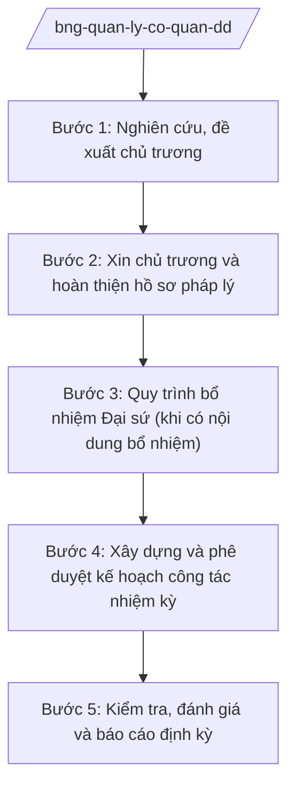

# Skill: Quản lý cơ quan đại diện Việt Nam ở nước ngoài

## 2. Khi nào dùng
- Đề xuất thành lập mới, sáp nhập, nâng cấp hoặc đóng cửa cơ quan đại diện Việt Nam ở nước ngoài (đại sứ quán, tổng lãnh sự quán, phái đoàn).
- Thực hiện quy trình bổ nhiệm Đại sứ đặc mệnh toàn quyền (trình Chủ tịch nước bổ nhiệm, Quốc hội phê chuẩn).
- Xây dựng, phê duyệt kế hoạch công tác nhiệm kỳ của người đứng đầu cơ quan đại diện.
- Kiểm tra, đánh giá hoạt động của cơ quan đại diện; luân chuyển, bổ nhiệm cán bộ ngoại giao.

## 3. Đầu vào (Input)

| Trường | Mô tả | Bắt buộc |
|--------|-------|----------|
| `noi_dung` | Thành lập/sáp nhập/đóng cửa / bổ nhiệm Đại sứ / kế hoạch nhiệm kỳ / kiểm tra | Có |
| `co_quan_dd` | Cơ quan đại diện liên quan | Có |
| `dia_ban` | Quốc gia, thành phố đặt trụ sở | Có |
| `can_cu_de_xuat` | Chủ trương, văn bản giao nhiệm vụ | Có |
| `ho_so_nhan_su` | Hồ sơ nhân sự dự kiến bổ nhiệm (nếu là bổ nhiệm) | Không |
| `ke_hoach_nhiem_ky` | Dự thảo kế hoạch công tác nhiệm kỳ (nếu có) | Không |

## 4. Quy trình

**Bước 1. Nghiên cứu, đề xuất chủ trương**
- Làm gì: Nghiên cứu sự cần thiết (thành lập/sáp nhập/đóng cửa cơ quan đại diện hoặc bổ nhiệm nhân sự): quan hệ song phương, yêu cầu nhiệm vụ, biên chế, kinh phí; lập đề xuất chủ trương.
- Dùng input: `noi_dung`, `co_quan_dd`, `dia_ban`, `can_cu_de_xuat`.
- Vai trò: Chuyên viên Vụ Tổ chức cán bộ soạn đề xuất (AI hỗ trợ rà soát mạng lưới cơ quan đại diện hiện có, phân tích quan hệ song phương với địa bàn, lập bảng so sánh phương án — 3–5 ngày) → Vụ trưởng kiểm tra.
- Lưu ý nghiệp vụ: Việc thành lập cơ quan đại diện mới liên quan thỏa thuận với nước sở tại (công hàm thỏa thuận đặt trụ sở); phải đánh giá kỹ hiệu quả, tránh dàn trải.
- → Kết quả bước: Đề xuất chủ trương trình lãnh đạo Bộ.

**Bước 2. Xin chủ trương và hoàn thiện hồ sơ pháp lý**
- Làm gì: Trình xin chủ trương của cấp có thẩm quyền; hoàn thiện hồ sơ pháp lý: công hàm thỏa thuận với nước sở tại (thành lập mới), quyết định thành lập/sáp nhập/đóng cửa, dự toán tổ chức bộ máy, biên chế.
- Dùng input: Đề xuất bước 1.
- Vai trò: Vụ trưởng Vụ Tổ chức cán bộ trình Thứ trưởng → Bộ trưởng ký tờ trình (AI hỗ trợ soạn thảo công hàm, quyết định theo mẫu, kiểm tra tính đầy đủ hồ sơ — 2 ngày); cấp có thẩm quyền quyết định.
- Lưu ý nghiệp vụ: Mọi văn bản gửi nước sở tại phải qua rà soát pháp lý của Vụ Pháp luật và Điều ước quốc tế.
- → Kết quả bước: Chủ trương được chấp thuận; hồ sơ pháp lý hoàn chỉnh.

**Bước 3. Quy trình bổ nhiệm Đại sứ (khi có nội dung bổ nhiệm)**
- Làm gì: Rà soát, đề xuất nhân sự: tiêu chuẩn, quy trình giới thiệu, lấy ý kiến, thẩm tra; lập tờ trình đề nghị bổ nhiệm Đại sứ đặc mệnh toàn quyền trình Chủ tịch nước (sau khi Quốc hội phê chuẩn theo quy định).
- Dùng input: `ho_so_nhan_su`, `co_quan_dd`.
- Vai trò: Vụ Tổ chức cán bộ chủ trì quy trình nhân sự (AI hỗ trợ đối chiếu tiêu chuẩn bổ nhiệm, tổng hợp hồ sơ, lập danh mục kiểm tra — 3 ngày) → Thứ trưởng phụ trách → Bộ trưởng ký tờ trình.
- Lưu ý nghiệp vụ: Quy trình nhân sự thực hiện đúng quy định của Đảng và Nhà nước về công tác cán bộ; hồ sơ cá nhân được bảo mật.
- → Kết quả bước: Tờ trình đề nghị bổ nhiệm Đại sứ trình cấp có thẩm quyền.

**Bước 4. Xây dựng và phê duyệt kế hoạch công tác nhiệm kỳ**
- Làm gì: Người đứng đầu cơ quan đại diện xây dựng kế hoạch công tác nhiệm kỳ (chính trị, kinh tế, văn hóa, lãnh sự, bảo hộ công dân); Vụ khu vực góp ý; trình phê duyệt.
- Dùng input: `ke_hoach_nhiem_ky`, `dia_ban`.
- Vai trò: Đại sứ/Trưởng cơ quan đại diện dự thảo (AI hỗ trợ lập khung kế hoạch nhiệm kỳ theo lĩnh vực, gợi ý mục tiêu phù hợp đặc thù địa bàn — 3–5 ngày) → Vụ khu vực góp ý → Thứ trưởng phụ trách phê duyệt.
- Lưu ý nghiệp vụ: Kế hoạch nhiệm kỳ phải cụ thể hóa đường lối đối ngoại và gắn với mục tiêu phát triển quan hệ song phương với địa bàn.
- → Kết quả bước: Kế hoạch công tác nhiệm kỳ được phê duyệt.

**Bước 5. Kiểm tra, đánh giá và báo cáo định kỳ**
- Làm gì: Tổ chức kiểm tra hoạt động của cơ quan đại diện (trực tiếp hoặc qua báo cáo); đánh giá kết quả thực hiện kế hoạch nhiệm kỳ; tổng hợp báo cáo toàn hệ thống cơ quan đại diện trình lãnh đạo Bộ.
- Dùng input: Báo cáo của cơ quan đại diện, kế hoạch nhiệm kỳ.
- Vai trò: Đoàn kiểm tra của Bộ (Vụ Tổ chức cán bộ chủ trì) thực hiện (AI hỗ trợ lập đề cương kiểm tra, tổng hợp báo cáo các cơ quan đại diện, đối chiếu chỉ tiêu/kết quả — 5–7 ngày) → Vụ trưởng ký báo cáo.
- Lưu ý nghiệp vụ: Kiểm tra toàn diện: thực hiện nhiệm vụ chính trị, quản lý tài chính, tài sản, công tác cán bộ; kết luận kiểm tra phải rõ trách nhiệm, kiến nghị.
- → Kết quả bước: Kết luận kiểm tra; báo cáo tổng hợp hệ thống cơ quan đại diện.

## Luồng quy trình (Workflow)

## 5. Đầu ra (Output)

**Danh sách sản phẩm:**
1. Đề xuất chủ trương (thành lập/sáp nhập/đóng cửa/bổ nhiệm)
2. Hồ sơ pháp lý: công hàm thỏa thuận, quyết định thành lập/sáp nhập/đóng cửa
3. Tờ trình đề nghị bổ nhiệm Đại sứ + hồ sơ nhân sự
4. Kế hoạch công tác nhiệm kỳ của người đứng đầu cơ quan đại diện (đã phê duyệt)
5. Kết luận kiểm tra; báo cáo tổng hợp hệ thống cơ quan đại diện

**Cấu trúc output chuẩn** (kế hoạch công tác nhiệm kỳ của Đại sứ — thể thức theo NĐ 30/2020/NĐ-CP):
1. Quốc hiệu "CỘNG HÒA XÃ HỘI CHỦ NGHĨA VIỆT NAM", Tiêu ngữ "Độc lập – Tự do – Hạnh phúc"; tên cơ quan đại diện, số, ký hiệu, địa danh, ngày tháng năm
2. Tên kế hoạch (trích yếu: nhiệm kỳ, địa bàn)
3. Căn cứ xây dựng (chỉ ghi văn bản có thật)
4. Đánh giá tình hình quan hệ song phương và địa bàn
5. Mục tiêu tổng quát của nhiệm kỳ
6. Nhiệm vụ theo lĩnh vực (chính trị, kinh tế, văn hóa, lãnh sự – bảo hộ công dân)
7. Tổ chức thực hiện và chế độ báo cáo về nước
8. Chữ ký (ghi rõ chức danh, họ tên người ký; ký hiệu "KT."/"TL." khi ký thay) người có thẩm quyền; nơi nhận (kết thúc "- Lưu: VT, [mã đơn vị].")

> **Checklist thể thức văn bản theo NĐ 30/2020/NĐ-CP** — đối chiếu trước khi trình ký:
> 1. Quốc hiệu và Tiêu ngữ.
> 2. Tên cơ quan, tổ chức ban hành văn bản.
> 3. Số, ký hiệu của văn bản.
> 4. Địa danh và thời gian ban hành văn bản.
> 5. Tên loại và trích yếu nội dung văn bản.
> 6. Nội dung văn bản.
> 7. Chức vụ, họ tên và chữ ký của người có thẩm quyền.
> 8. Dấu, chữ ký số của cơ quan, tổ chức.
> 9. Nơi nhận (kèm Phụ lục nếu có).

## 6. Checklist nghiệm thu
1. Đề xuất chủ trương nêu rõ sự cần thiết, phân tích phương án, đánh giá hiệu quả, dự toán biên chế, kinh phí.
2. Hồ sơ pháp lý đầy đủ; công hàm thỏa thuận với nước sở tại đã qua rà soát pháp lý.
3. Quy trình bổ nhiệm nhân sự đúng quy định công tác cán bộ; hồ sơ cá nhân được bảo mật.
4. Kế hoạch công tác nhiệm kỳ cụ thể hóa đường lối đối ngoại, gắn với mục tiêu quan hệ song phương.
5. Kết luận kiểm tra nêu rõ ưu điểm, tồn tại, trách nhiệm và kiến nghị cụ thể.
6. Báo cáo tổng hợp hệ thống cơ quan đại diện có số liệu đầy đủ, chính xác.
7. Căn cứ pháp lý viện dẫn là văn bản có thật, còn hiệu lực; không bịa số hiệu.
8. Đã qua human gate theo mục 8 ở từng bước (đề xuất, bổ nhiệm, kế hoạch nhiệm kỳ, kiểm tra).

## 7. Ví dụ mô phỏng

*Dữ liệu dưới đây là giả lập 100% phục vụ minh họa.*

**Input mẫu:**
- noi_dung: Xây dựng kế hoạch công tác nhiệm kỳ của Đại sứ
- co_quan_dd: Đại sứ quán Việt Nam tại nước Anpha
- dia_ban: nước Anpha (quốc gia hư cấu)
- can_cu_de_xuat: Chủ trương của Bộ Ngoại giao về công tác nhiệm kỳ 2026–2029 (giả lập)
- ke_hoach_nhiem_ky: Dự thảo của Đại sứ (giả lập)

**Output mẫu** (trích kế hoạch công tác nhiệm kỳ — giả lập):

> **ĐẠI SỨ QUÁN VIỆT NAM TẠI NƯỚC ANPHA**
> **Số: 123/KH-ĐSQ**
> **CỘNG HÒA XÃ HỘI CHỦ NGHĨA VIỆT NAM**
> **Độc lập – Tự do – Hạnh phúc**
>
> *Thủ đô nước Anpha, ngày 10 tháng 01 năm 2026*
>
> **KẾ HOẠCH**
> **Công tác nhiệm kỳ 2026–2029 của Đại sứ quán Việt Nam tại nước Anpha**
>
> **1. Đánh giá tình hình:** Quan hệ Việt Nam – nước Anpha (quốc gia hư cấu) phát triển tốt đẹp trên các lĩnh vực; cộng đồng người Việt tại địa bàn khoảng 10.000 người (số liệu giả lập)...
>
> **2. Mục tiêu tổng quát:** Củng cố tin cậy chính trị; thúc đẩy hợp tác kinh tế, văn hóa; làm tốt công tác lãnh sự, bảo hộ công dân.
>
> **3. Nhiệm vụ theo lĩnh vực:**
> - Chính trị – đối ngoại: duy trì trao đổi đoàn cấp cao; thúc đẩy cơ chế hợp tác song phương.
> - Kinh tế: hỗ trợ mục tiêu thu hút đầu tư, tăng kim ngạch thương mại (chỉ tiêu giả lập).
> - Văn hóa – thông tin: tổ chức Ngày Văn hóa Việt Nam hằng năm.
> - Lãnh sự – bảo hộ công dân: kiện toàn đường dây nóng; cập nhật phương án sơ tán khẩn cấp.
>
> **4. Tổ chức thực hiện:** Đại sứ quán báo cáo định kỳ hằng quý về Vụ Chính sách đối ngoại khu vực và Cục Lãnh sự.
>
> ***Nơi nhận:*** ... — **ĐẠI SỨ** — *(ký, ghi rõ họ tên)* Ông Nguyễn Văn GG

## 8. Human gate
- Đề xuất chủ trương thành lập/sáp nhập/đóng cửa: **Vụ trưởng Vụ Tổ chức cán bộ** kiểm tra → **Thứ trưởng** trình → **Bộ trưởng** ký tờ trình cấp có thẩm quyền.
- Tờ trình bổ nhiệm Đại sứ: **Thứ trưởng phụ trách công tác cán bộ** trình → **Bộ trưởng** ký tờ trình (trình Chủ tịch nước bổ nhiệm sau khi Quốc hội phê chuẩn theo quy định).
- Kế hoạch công tác nhiệm kỳ: **Vụ khu vực** góp ý → **Thứ trưởng phụ trách** phê duyệt.
- Kết luận kiểm tra cơ quan đại diện: **Trưởng đoàn kiểm tra** ký → **Thứ trưởng** cho ý kiến → báo cáo **Bộ trưởng**.

## 9. Giới hạn
- AI KHÔNG ra quyết định về tổ chức bộ máy, nhân sự, bổ nhiệm thay cấp có thẩm quyền.
- AI không tự ký, tự phát hành quyết định, tờ trình, kết luận kiểm tra.
- AI không bịa hồ sơ nhân sự, kết quả kiểm tra, căn cứ pháp lý; thông tin cán bộ được bảo mật.
- AI không tiết lộ nội dung quy trình nhân sự chưa công khai.
- AI không đưa ra phát ngôn, cam kết đối ngoại thay cơ quan đại diện, Bộ Ngoại giao.

## 10. Căn cứ & lưu ý
- NQ 176/2025/QH15 (cơ cấu Chính phủ 14 Bộ + 3 cơ quan ngang Bộ).
- NĐ 28/2025/NĐ-CP (chức năng, nhiệm vụ, quyền hạn và cơ cấu tổ chức của Bộ Ngoại giao).
  *Lưu ý: thuvienphapluat ghi nhận NĐ 28/2025/NĐ-CP được sửa đổi tại NĐ 109/2025/NĐ-CP — cần tra văn bản hợp nhất khi áp dụng.*
- NĐ 303/2025/NĐ-CP (khung chung chức năng bộ, cơ quan ngang bộ).
- NĐ 30/2020/NĐ-CP (thể thức văn bản — chỉ dùng cho thể thức trình bày).
- Tên luật chỉ dẫn tên, không kèm số hiệu: Luật Cơ quan đại diện Việt Nam ở nước ngoài.
- Tuyệt đối không bịa số hiệu văn bản, ngày ban hành, ngày hiệu lực.
