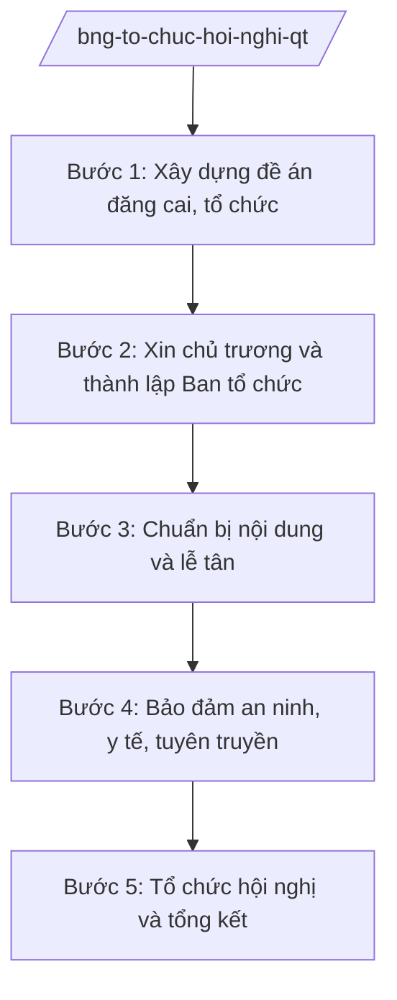

# Skill: Tổ chức hội nghị quốc tế tại Việt Nam

## 2. Khi nào dùng
- Việt Nam đăng cai hoặc đồng đăng cai hội nghị, diễn đàn quốc tế (khu vực, liên khu vực, toàn cầu).
- Bộ Ngoại giao được giao chủ trì công tác tổ chức: đề án đăng cai, lễ tân, nội dung, an ninh, tuyên truyền.
- Cần phối hợp bộ, ngành, địa phương nơi tổ chức hội nghị và các cơ quan đại diện nước ngoài tại Việt Nam.

## 3. Đầu vào (Input)

| Trường | Mô tả | Bắt buộc |
|--------|-------|----------|
| `ten_hoi_nghi` | Tên hội nghị quốc tế | Có |
| `quy_mo` | Số đoàn, số đại biểu, cấp trưởng đoàn dự kiến | Có |
| `thoi_gian_dia_diem` | Thời gian, địa điểm tổ chức dự kiến | Có |
| `chu_tri` | Cơ quan chủ trì, cơ quan phối hợp | Có |
| `noi_dung_chuong_trinh` | Nội dung, chương trình nghị sự dự kiến | Có |
| `du_toan` | Dự toán kinh phí | Không |

## 4. Quy trình

**Bước 1. Xây dựng đề án đăng cai, tổ chức**
- Làm gì: Lập đề án đăng cai/tổ chức hội nghị: sự cần thiết, mục tiêu, quy mô, chương trình nghị sự dự kiến, phương án lễ tân, an ninh, tuyên truyền, dự toán kinh phí, phân công bộ, ngành, địa phương.
- Dùng input: `ten_hoi_nghi`, `quy_mo`, `thoi_gian_dia_diem`, `chu_tri`, `noi_dung_chuong_trinh`, `du_toan`.
- Vai trò: Chuyên viên Vụ Chính sách đối ngoại đa phương (đơn vị chủ trì) dự thảo (AI hỗ trợ lập khung đề án, gợi ý chương trình theo thông lệ hội nghị quốc tế tương tự, lập dự toán mẫu ⏱ 3–5 ngày (ước tính)) → Vụ trưởng kiểm tra.
- Lưu ý nghiệp vụ: Đề án phải đánh giá tác động đối ngoại và khả năng bảo đảm an ninh, lễ tân tương xứng cấp hội nghị.
- → Kết quả bước: Đề án đăng cai, tổ chức hội nghị trình phê duyệt.

**Bước 2. Xin chủ trương và thành lập Ban tổ chức**
- Làm gì: Trình xin chủ trương đăng cai, tổ chức; sau khi được chấp thuận thì thành lập Ban tổ chức, các tiểu ban (nội dung, lễ tân, an ninh, tuyên truyền, hậu cần), ban hành quy chế hoạt động.
- Dùng input: Đề án bước 1.
- Vai trò: Vụ trưởng trình Thứ trưởng → Bộ trưởng ký tờ trình (AI hỗ trợ soạn tờ trình, dự thảo quyết định thành lập Ban tổ chức ⏱ 1–2 ngày (ước tính)); cấp có thẩm quyền quyết định.
- Lưu ý nghiệp vụ: Thành phần Ban tổ chức phải bao gồm đại diện các bộ, ngành, địa phương liên quan; phân công rõ trách nhiệm từng tiểu ban.
- → Kết quả bước: Chủ trương được chấp thuận; Ban tổ chức và các tiểu ban được thành lập.

**Bước 3. Chuẩn bị nội dung và lễ tân**
- Làm gì: Chuẩn bị văn kiện, tuyên bố chung, chương trình nghị sự chi tiết; xây dựng phương án lễ tân (đón tiếp theo cấp, chỗ ở, phương tiện, phiên dịch); gửi thư mời qua kênh ngoại giao.
- Dùng input: `noi_dung_chuong_trinh`, `quy_mo`.
- Vai trò: Tiểu ban nội dung và Tiểu ban lễ tân thực hiện (AI hỗ trợ soạn dự thảo văn kiện, lịch đón tiếp theo cấp đoàn, danh sách kiểm tra lễ tân ⏱ 5–7 ngày (ước tính)) → Trưởng Ban tổ chức duyệt.
- Lưu ý nghiệp vụ: Lễ tân phải tương xứng cấp trưởng đoàn và thông lệ quốc tế; văn kiện phải được các bên liên quan thống nhất trước giờ khai mạc.
- → Kết quả bước: Văn kiện, chương trình nghị sự hoàn chỉnh; phương án lễ tân được duyệt.

**Bước 4. Bảo đảm an ninh, y tế, tuyên truyền**
- Làm gì: Phối hợp lực lượng công an, y tế xây dựng phương án bảo đảm an ninh, an toàn, y tế cho đại biểu; xây dựng kế hoạch tuyên truyền trong nước và quốc tế; tổ chức trung tâm báo chí.
- Dùng input: `quy_mo`, `thoi_gian_dia_diem`.
- Vai trò: Tiểu ban an ninh, Tiểu ban tuyên truyền thực hiện (AI hỗ trợ lập kế hoạch tuyên truyền theo giai đoạn, bộ tài liệu báo chí ⏱ 3 ngày (ước tính)) → Trưởng Ban tổ chức duyệt; phối hợp Bộ Công an, Bộ Y tế.
- Lưu ý nghiệp vụ: Phương án an ninh phải bao quát từ sân bay, nơi ở đến địa điểm họp; thông tin tuyên truyền thống nhất, do người phát ngôn cung cấp.
- → Kết quả bước: Phương án an ninh, y tế, tuyên truyền sẵn sàng.

**Bước 5. Tổ chức hội nghị và tổng kết**
- Làm gì: Điều hành hội nghị theo chương trình; xử lý tình huống phát sinh; thông qua văn kiện; tổ chức họp báo bế mạc; sau hội nghị thì tổng kết, đánh giá, quyết toán kinh phí, báo cáo cấp có thẩm quyền.
- Dùng input: Toàn bộ hồ sơ chuẩn bị.
- Vai trò: Trưởng Ban tổ chức điều hành (AI hỗ trợ kịch bản điều hành theo giờ, tổng hợp nhanh kết quả từng phiên — trong thời gian diễn ra); sau hội nghị chuyên viên tổng hợp (AI hỗ trợ lập báo cáo tổng kết, quyết toán ⏱ 3 ngày (ước tính)) → Trưởng Ban ký báo cáo.
- Lưu ý nghiệp vụ: Mọi thay đổi chương trình phải được Trưởng Ban tổ chức quyết định; văn kiện thông qua phải có bản chính được các bên xác nhận.
- → Kết quả bước: Hội nghị thành công; văn kiện được thông qua; báo cáo tổng kết trình cấp có thẩm quyền.

## Luồng quy trình (Workflow)

## 5. Đầu ra (Output)

**Danh sách sản phẩm:**
1. Đề án đăng cai, tổ chức hội nghị (đã được chấp thuận)
2. Quyết định thành lập Ban tổ chức, các tiểu ban
3. Văn kiện, chương trình nghị sự, phương án lễ tân
4. Phương án an ninh, y tế, kế hoạch tuyên truyền
5. Kịch bản điều hành hội nghị
6. Báo cáo tổng kết + hồ sơ quyết toán kinh phí

**Cấu trúc output chuẩn** (đề án đăng cai, tổ chức hội nghị quốc tế — thể thức theo NĐ 30/2020/NĐ-CP):
1. Quốc hiệu "CỘNG HÒA XÃ HỘI CHỦ NGHĨA VIỆT NAM", Tiêu ngữ "Độc lập – Tự do – Hạnh phúc"; tên cơ quan ban hành (Bộ Ngoại giao), số, ký hiệu, địa danh, ngày tháng năm
2. Tên đề án (trích yếu)
3. Căn cứ xây dựng (chỉ ghi văn bản có thật)
4. Sự cần thiết, mục tiêu đăng cai, tổ chức
5. Quy mô, thành phần, chương trình nghị sự dự kiến
6. Phương án lễ tân, an ninh, tuyên truyền, hậu cần
7. Dự toán kinh phí và nguồn kinh phí
8. Phân công bộ, ngành, địa phương phối hợp
9. Tổ chức thực hiện; chữ ký (ghi rõ chức danh, họ tên người ký; ký hiệu "KT."/"TL." khi ký thay) người có thẩm quyền; nơi nhận (kết thúc "- Lưu: VT, [mã đơn vị].")

> **Checklist thể thức văn bản theo NĐ 30/2020/NĐ-CP** — đối chiếu trước khi trình ký:
> 1. Quốc hiệu và Tiêu ngữ.
> 2. Tên cơ quan, tổ chức ban hành văn bản.
> 3. Số, ký hiệu của văn bản.
> 4. Địa danh và thời gian ban hành văn bản.
> 5. Tên loại và trích yếu nội dung văn bản.
> 6. Nội dung văn bản.
> 7. Chức vụ, họ tên và chữ ký của người có thẩm quyền.
> 8. Dấu, chữ ký số của cơ quan, tổ chức.
> 9. Nơi nhận (kèm Phụ lục nếu có).

## 6. Checklist nghiệm thu
1. Đề án có đủ: sự cần thiết, mục tiêu, quy mô, chương trình, phương án lễ tân/an ninh/tuyên truyền, dự toán, phân công.
2. Đã được cấp có thẩm quyền chấp thuận chủ trương; Ban tổ chức, tiểu ban thành lập đúng thành phần.
3. Văn kiện, chương trình nghị sự được các bên liên quan thống nhất trước khai mạc.
4. Lễ tân tương xứng cấp trưởng đoàn, đúng thông lệ quốc tế.
5. Phương án an ninh, y tế bao quát toàn bộ hành trình đại biểu; có phương án dự phòng.
6. Tuyên truyền thống nhất, do người có thẩm quyền phát ngôn; trung tâm báo chí hoạt động tốt.
7. Báo cáo tổng kết đánh giá trung thực kết quả; quyết toán kinh phí đầy đủ.
8. Căn cứ pháp lý viện dẫn là văn bản có thật, còn hiệu lực; không bịa số hiệu.
9. Đã qua human gate theo mục 8 ở các mốc: đề án, văn kiện, điều hành.

## 7. Ví dụ mô phỏng

*Dữ liệu dưới đây là giả lập 100% phục vụ minh họa.*

**Input mẫu:**
- ten_hoi_nghi: "Diễn đàn hợp tác khu vực Anpha lần thứ 12"
- quy_mo: 20 đoàn, khoảng 500 đại biểu, cấp Bộ trưởng (số liệu giả lập)
- thoi_gian_dia_diem: 20–22/10/2026, Thủ đô (địa điểm giả lập theo quy ước — dùng tên chung, không gắn địa chỉ thật)
- chu_tri: Bộ Ngoại giao chủ trì; phối hợp các bộ, ngành liên quan
- noi_dung_chuong_trinh: Hợp tác kinh tế, kết nối hạ tầng, ứng phó biến đổi khí hậu trong khu vực Anpha (khu vực hư cấu)

**Output mẫu** (trích đề án — giả lập):

> **BỘ NGOẠI GIAO**
> **Số: 1234/ĐA-BNG**
> **CỘNG HÒA XÃ HỘI CHỦ NGHĨA VIỆT NAM**
> **Độc lập – Tự do – Hạnh phúc**
>
> *Thủ đô, ngày 01 tháng 6 năm 2026*
>
> **ĐỀ ÁN**
> **Đăng cai, tổ chức Diễn đàn hợp tác khu vực Anpha lần thứ 12**
>
> **1. Sự cần thiết, mục tiêu:** Diễn đàn hợp tác khu vực Anpha (khu vực hư cấu) là cơ chế hợp tác quan trọng; việc đăng cai thể hiện vai trò, trách nhiệm của Việt Nam, góp phần quảng bá hình ảnh đất nước...
>
> **2. Quy mô:** 20 đoàn, khoảng 500 đại biểu, cấp Bộ trưởng (số liệu giả lập); thời gian 20–22/10/2026 tại Thủ đô (giả lập).
>
> **3. Chương trình nghị sự dự kiến:** Phiên khai mạc; 03 phiên chuyên đề (hợp tác kinh tế, kết nối hạ tầng, ứng phó biến đổi khí hậu); thông qua Tuyên bố chung; họp báo bế mạc.
>
> **4. Phương án lễ tân, an ninh:** Đón tiếp theo cấp Bộ trưởng; phối hợp lực lượng công an bảo đảm an ninh tuyệt đối...
>
> **5. Dự toán kinh phí:** ... (số liệu giả lập)
>
> ***Nơi nhận:*** ... — **BỘ TRƯỞNG** — *(ký, ghi rõ họ tên)* Ông Lê Văn CC

## 8. Human gate
- Đề án đăng cai, tổ chức: **Vụ trưởng đơn vị chủ trì** kiểm tra → **Thứ trưởng** trình → **Bộ trưởng** ký tờ trình xin chủ trương cấp có thẩm quyền.
- Văn kiện, chương trình nghị sự, phương án lễ tân: **Trưởng Ban tổ chức** (Thứ trưởng/Bộ trưởng) duyệt.
- Phương án an ninh: phối hợp **Bộ Công an** thẩm định; **Trưởng Ban tổ chức** phê duyệt.
- Điều hành hội nghị: **Trưởng Ban tổ chức** quyết định mọi thay đổi chương trình.
- Báo cáo tổng kết: **Trưởng Ban tổ chức** ký, trình cấp có thẩm quyền.

## 9. Giới hạn
- AI KHÔNG ra quyết định về chủ trương đăng cai, nội dung văn kiện hay thay đổi chương trình thay người có thẩm quyền.
- AI không tự ký, tự phát hành đề án, văn kiện, báo cáo chính thức.
- AI không bịa số liệu đại biểu, kinh phí, căn cứ pháp lý.
- AI không đưa ra phát ngôn về kết quả hội nghị thay người phát ngôn/Ban tổ chức.
- AI không đề xuất nội dung văn kiện trái chủ trương đối ngoại của Đảng, Nhà nước.

## 10. Căn cứ & lưu ý
- NQ 176/2025/QH15 (cơ cấu Chính phủ 14 Bộ + 3 cơ quan ngang Bộ).
- NĐ 28/2025/NĐ-CP (chức năng, nhiệm vụ, quyền hạn và cơ cấu tổ chức của Bộ Ngoại giao).
  *Lưu ý: thuvienphapluat ghi nhận NĐ 28/2025/NĐ-CP được sửa đổi tại NĐ 109/2025/NĐ-CP — cần tra văn bản hợp nhất khi áp dụng.*
- NĐ 303/2025/NĐ-CP (khung chung chức năng bộ, cơ quan ngang bộ).
- NĐ 30/2020/NĐ-CP (thể thức văn bản — chỉ dùng cho thể thức trình bày).
- Tuyệt đối không bịa số hiệu văn bản, ngày ban hành, ngày hiệu lực.
