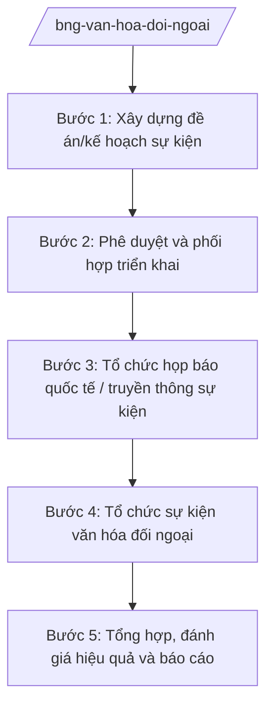

# Skill: Văn hóa đối ngoại, thông tin đối ngoại

## 2. Khi nào dùng
- Tổ chức sự kiện văn hóa đối ngoại ở nước ngoài: Tuần lễ/Ngày văn hóa Việt Nam, triển lãm, biểu diễn nghệ thuật, tuần phim Việt Nam.
- Tổ chức họp báo quốc tế, cung cấp thông tin cho báo chí nước ngoài về tình hình Việt Nam.
- Xây dựng kế hoạch thông tin đối ngoại hằng năm; quản lý, định hướng thông tin về Việt Nam trên kênh đối ngoại.
- Phối hợp quảng bá hình ảnh Việt Nam nhân các sự kiện quốc tế lớn.

## 3. Đầu vào (Input)

| Trường | Mô tả | Bắt buộc |
|--------|-------|----------|
| `ten_su_kien` | Tên sự kiện văn hóa đối ngoại / chủ đề họp báo | Có |
| `dia_ban` | Quốc gia, thành phố tổ chức | Có |
| `thoi_gian_dia_diem` | Thời gian, địa điểm dự kiến | Có |
| `muc_tieu` | Mục tiêu quảng bá, đối tượng hướng tới | Có |
| `don_vi_chu_tri` | Đơn vị chủ trì (vụ/cơ quan đại diện) | Có |
| `don_vi_phoi_hop` | Bộ, ngành, địa phương, đoàn nghệ thuật phối hợp | Không |
| `du_toan` | Dự toán kinh phí dự kiến | Không |

## 4. Quy trình

**Bước 1. Xây dựng đề án/kế hoạch sự kiện**
- Làm gì: Lập đề án tổ chức sự kiện văn hóa đối ngoại hoặc kế hoạch họp báo quốc tế: mục tiêu, nội dung chương trình, thời gian, địa điểm, thành phần tham dự, phân công, dự toán kinh phí.
- Dùng input: `ten_su_kien`, `dia_ban`, `thoi_gian_dia_diem`, `muc_tieu`, `don_vi_chu_tri`, `don_vi_phoi_hop`, `du_toan`.
- Vai trò: Chuyên viên Vụ Văn hóa đối ngoại (hoặc cơ quan đại diện) dự thảo (AI hỗ trợ lập khung chương trình, gợi ý nội dung theo thông lệ tổ chức sự kiện văn hóa đối ngoại, lập dự toán mẫu ⏱ 2–3 ngày (ước tính)) → Vụ trưởng kiểm tra.
- Lưu ý nghiệp vụ: Nội dung quảng bá phải bảo đảm tính chính xác về lịch sử, văn hóa Việt Nam; phù hợp phong tục nước sở tại.
- → Kết quả bước: Đề án/kế hoạch sự kiện trình phê duyệt.

**Bước 2. Phê duyệt và phối hợp triển khai**
- Làm gì: Trình phê duyệt đề án; làm việc với cơ quan chức năng nước sở tại (giấy phép tổ chức, địa điểm); phối hợp đoàn nghệ thuật, đơn vị trong nước chuẩn bị nội dung, hiện vật.
- Dùng input: Đề án bước 1.
- Vai trò: Vụ trưởng trình Thứ trưởng phê duyệt (AI hỗ trợ soạn công hàm xin phép nước sở tại, checklist công tác chuẩn bị ⏱ 1 ngày (ước tính)); cơ quan đại diện làm đầu mối tại địa bàn.
- Lưu ý nghiệp vụ: Tuân thủ quy định nước sở tại về tổ chức sự kiện công cộng; bảo đảm an ninh, an toàn cho đoàn và hiện vật.
- → Kết quả bước: Đề án được phê duyệt; giấy phép và công tác chuẩn bị hoàn tất.

**Bước 3. Tổ chức họp báo quốc tế / truyền thông sự kiện**
- Làm gì: Chuẩn bị thông cáo báo chí, tài liệu cung cấp thông tin; mời phóng viên trong nước và quốc tế; tổ chức họp báo; điều phối trả lời phỏng vấn của người phát ngôn/lãnh đạo.
- Dùng input: `ten_su_kien`, `muc_tieu`.
- Vai trò: Chuyên viên Vụ Thông tin – Báo chí chuẩn bị (AI hỗ trợ soạn thông cáo báo chí song ngữ, bộ câu hỏi – trả lời dự kiến, tổng hợp danh sách phóng viên ⏱ 1–2 ngày (ước tính)) → Vụ trưởng duyệt nội dung → người phát ngôn chủ trì họp báo.
- Lưu ý nghiệp vụ: Mọi phát ngôn chính thức phải do người có thẩm quyền thực hiện; nội dung cung cấp cho báo chí nước ngoài phải thống nhất, chính xác.
- → Kết quả bước: Họp báo quốc tế được tổ chức; thông tin được đăng tải đúng định hướng.

**Bước 4. Tổ chức sự kiện văn hóa đối ngoại**
- Làm gì: Điều hành chương trình: lễ khai mạc, biểu diễn, triển lãm, giao lưu; đón tiếp khách mời; bảo đảm lễ tân, an ninh, kỹ thuật; ghi hình, chụp ảnh tư liệu.
- Dùng input: Đề án đã duyệt.
- Vai trò: Trưởng đoàn/cơ quan đại diện điều hành tại địa bàn (AI hỗ trợ lập kịch bản điều hành chi tiết theo giờ, checklist hậu cần ⏱ 1 ngày (ước tính)) → báo cáo nhanh về Vụ sau mỗi ngày diễn ra sự kiện.
- Lưu ý nghiệp vụ: Xử lý linh hoạt tình huống phát sinh (thay đổi lịch, sự cố kỹ thuật); giữ hình ảnh trang trọng của quốc gia.
- → Kết quả bước: Sự kiện diễn ra thành công, an toàn.

**Bước 5. Tổng hợp, đánh giá hiệu quả và báo cáo**
- Làm gì: Tổng hợp kết quả: số lượng khách tham dự, độ phủ truyền thông trong nước và quốc tế; đánh giá hiệu quả quảng bá; quyết toán kinh phí; rút kinh nghiệm.
- Dùng input: Toàn bộ hồ sơ sự kiện, thống kê truyền thông.
- Vai trò: Chuyên viên đơn vị chủ trì tổng hợp (AI hỗ trợ thu thập, thống kê tin bài báo chí, lập báo cáo tổng kết và quyết toán ⏱ 2 ngày (ước tính)) → Vụ trưởng ký báo cáo.
- Lưu ý nghiệp vụ: Đánh giá dựa trên số liệu thực tế (lượt đưa tin, lượng khán giả), không phóng đại hiệu quả.
- → Kết quả bước: Báo cáo tổng kết sự kiện; hồ sơ quyết toán.

## Luồng quy trình (Workflow)

## 5. Đầu ra (Output)

**Danh sách sản phẩm:**
1. Đề án/kế hoạch tổ chức sự kiện văn hóa đối ngoại (đã phê duyệt)
2. Thông cáo báo chí, bộ tài liệu họp báo quốc tế
3. Kịch bản điều hành sự kiện
4. Báo cáo tổng kết sự kiện + hồ sơ quyết toán kinh phí

**Cấu trúc output chuẩn** (đề án tổ chức sự kiện văn hóa đối ngoại — thể thức theo NĐ 30/2020/NĐ-CP):
1. Quốc hiệu "CỘNG HÒA XÃ HỘI CHỦ NGHĨA VIỆT NAM", Tiêu ngữ "Độc lập – Tự do – Hạnh phúc"; tên cơ quan ban hành, số, ký hiệu, địa danh, ngày tháng năm
2. Tên đề án (trích yếu)
3. Căn cứ xây dựng (chỉ ghi văn bản có thật)
4. Mục tiêu, yêu cầu
5. Nội dung chương trình (chi tiết theo ngày/giờ)
6. Thời gian, địa điểm tổ chức
7. Thành phần tham dự, khách mời
8. Phân công nhiệm vụ (đơn vị chủ trì, phối hợp)
9. Dự toán kinh phí
10. Tổ chức thực hiện; chữ ký (ghi rõ chức danh, họ tên người ký; ký hiệu "KT."/"TL." khi ký thay) người có thẩm quyền; nơi nhận (kết thúc "- Lưu: VT, [mã đơn vị].")

> **Checklist thể thức văn bản theo NĐ 30/2020/NĐ-CP** — đối chiếu trước khi trình ký:
> 1. Quốc hiệu và Tiêu ngữ.
> 2. Tên cơ quan, tổ chức ban hành văn bản.
> 3. Số, ký hiệu của văn bản.
> 4. Địa danh và thời gian ban hành văn bản.
> 5. Tên loại và trích yếu nội dung văn bản.
> 6. Nội dung văn bản.
> 7. Chức vụ, họ tên và chữ ký của người có thẩm quyền.
> 8. Dấu, chữ ký số của cơ quan, tổ chức.
> 9. Nơi nhận (kèm Phụ lục nếu có).

## 6. Checklist nghiệm thu
1. Đề án nêu rõ mục tiêu, đối tượng hướng tới, nội dung chương trình chi tiết.
2. Nội dung quảng bá chính xác về lịch sử, văn hóa Việt Nam; phù hợp phong tục nước sở tại.
3. Đã có giấy phép/đồng ý của cơ quan chức năng nước sở tại (nếu sự kiện yêu cầu).
4. Thông cáo báo chí, tài liệu họp báo song ngữ chính xác; phát ngôn do người có thẩm quyền thực hiện.
5. Công tác lễ tân, an ninh, kỹ thuật được bảo đảm; có phương án dự phòng tình huống phát sinh.
6. Báo cáo tổng kết có số liệu thực tế về khán giả và độ phủ truyền thông; không phóng đại.
7. Hồ sơ quyết toán kinh phí đầy đủ, đúng quy định.
8. Căn cứ pháp lý viện dẫn là văn bản có thật, còn hiệu lực; không bịa số hiệu.
9. Đã qua human gate theo mục 8 trước khi tổ chức sự kiện và phát hành tài liệu báo chí.

## 7. Ví dụ mô phỏng

*Dữ liệu dưới đây là giả lập 100% phục vụ minh họa.*

**Input mẫu:**
- ten_su_kien: "Tuần lễ Văn hóa Việt Nam tại nước Gamma"
- dia_ban: Thủ đô nước Gamma (quốc gia hư cấu)
- thoi_gian_dia_diem: 10–16/11/2026, Trung tâm Văn hóa thủ đô nước Gamma (địa điểm giả lập)
- muc_tieu: Quảng bá văn hóa, du lịch Việt Nam tới công chúng nước Gamma nhân dịp kỷ niệm quan hệ hai nước
- don_vi_chu_tri: Vụ Văn hóa đối ngoại – Bộ Ngoại giao
- don_vi_phoi_hop: Đại sứ quán Việt Nam tại nước Gamma; đoàn nghệ thuật (giả lập)

**Output mẫu** (trích đề án — giả lập):

> **CỘNG HÒA XÃ HỘI CHỦ NGHĨA VIỆT NAM**
> **Độc lập – Tự do – Hạnh phúc**
> **BỘ NGOẠI GIAO**
> **Số: 1234/ĐA-BNG**
>
> *Thủ đô, ngày 01 tháng 9 năm 2026*
>
> **ĐỀ ÁN**
> **Tổ chức Tuần lễ Văn hóa Việt Nam tại nước Gamma**
>
> **1. Mục tiêu:** Giới thiệu văn hóa, nghệ thuật truyền thống và hiện đại, quảng bá du lịch Việt Nam tới công chúng nước Gamma (quốc gia hư cấu); tăng cường hiểu biết, tình hữu nghị giữa nhân dân hai nước.
>
> **2. Nội dung chương trình:**
> - Ngày 10/11: Lễ khai mạc, biểu diễn nghệ thuật truyền thống.
> - Ngày 11–14/11: Triển lãm ảnh "Việt Nam — đất nước, con người"; trình diễn ẩm thực; tuần phim Việt Nam.
> - Ngày 15/11: Giao lưu văn hóa thanh niên hai nước.
> - Ngày 16/11: Lễ bế mạc.
>
> **3. Phân công:** Vụ Văn hóa đối ngoại chủ trì nội dung; Đại sứ quán Việt Nam tại nước Gamma làm đầu mối tại địa bàn, xin phép cơ quan chức năng sở tại.
>
> **4. Dự toán kinh phí:** ... (số liệu giả lập)
>
> ***Nơi nhận:*** ... — **KT. BỘ TRƯỞNG / THỨ TRƯỞNG** — *(ký, ghi rõ họ tên)* Bà Phạm Thị DD

## 8. Human gate
- Đề án/kế hoạch sự kiện: **Vụ trưởng Vụ Văn hóa đối ngoại** kiểm tra → **Thứ trưởng phụ trách** phê duyệt.
- Thông cáo báo chí, tài liệu họp báo quốc tế: **Vụ trưởng Vụ Thông tin – Báo chí** duyệt nội dung; phát ngôn chính thức do **người phát ngôn Bộ Ngoại giao** hoặc lãnh đạo được ủy quyền thực hiện.
- Sự kiện tại địa bàn: **Đại sứ** duyệt chương trình chi tiết và điều hành.
- Báo cáo tổng kết, quyết toán: **Vụ trưởng đơn vị chủ trì** ký.

## 9. Giới hạn
- AI KHÔNG ra quyết định tổ chức sự kiện hay phê duyệt kinh phí thay người có thẩm quyền.
- AI không tự phát hành thông cáo báo chí, tài liệu đối ngoại chính thức.
- AI không bịa số liệu khán giả, độ phủ truyền thông, căn cứ pháp lý.
- AI không đưa ra phát ngôn về đường lối đối ngoại thay người phát ngôn/lãnh đạo Bộ.
- AI không đề xuất nội dung văn hóa sai lệch lịch sử hoặc trái thuần phong mỹ tục, trái chủ trương đối ngoại.

## 10. Căn cứ & lưu ý
- NQ 176/2025/QH15 (cơ cấu Chính phủ 14 Bộ + 3 cơ quan ngang Bộ).
- NĐ 28/2025/NĐ-CP (chức năng, nhiệm vụ, quyền hạn và cơ cấu tổ chức của Bộ Ngoại giao).
  *Lưu ý: thuvienphapluat ghi nhận NĐ 28/2025/NĐ-CP được sửa đổi tại NĐ 109/2025/NĐ-CP — cần tra văn bản hợp nhất khi áp dụng.*
- NĐ 303/2025/NĐ-CP (khung chung chức năng bộ, cơ quan ngang bộ).
- NĐ 30/2020/NĐ-CP (thể thức văn bản — chỉ dùng cho thể thức trình bày).
- Tên luật chỉ dẫn tên, không kèm số hiệu: Luật Cơ quan đại diện Việt Nam ở nước ngoài.
- Tuyệt đối không bịa số hiệu văn bản, ngày ban hành, ngày hiệu lực.
