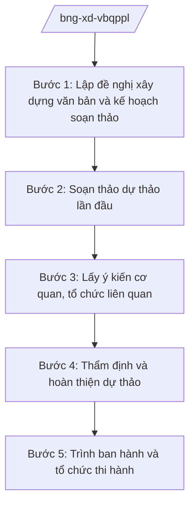

# Skill: Xây dựng VBQPPL lĩnh vực đối ngoại

## 2. Khi nào dùng
- Bộ Ngoại giao được giao chủ trì soạn thảo thông tư, quyết định của Bộ trưởng hoặc dự thảo nghị định của Chính phủ thuộc lĩnh vực đối ngoại (lễ tân, điều ước quốc tế, lãnh sự, cơ quan đại diện...).
- Cần sửa đổi, bổ sung hoặc thay thế VBQPPL hiện hành của Bộ cho phù hợp tổ chức bộ máy mới theo NĐ 28/2025/NĐ-CP và yêu cầu nhiệm vụ.
- Rà soát, hệ thống hóa VBQPPL lĩnh vực đối ngoại theo kế hoạch hằng năm của Bộ.

## 3. Đầu vào (Input)

| Trường | Mô tả | Bắt buộc |
|--------|-------|----------|
| `ten_van_ban` | Tên dự thảo văn bản (thông tư/quyết định/nghị định) | Có |
| `loai_van_ban` | Thông tư / Quyết định của Bộ trưởng / Nghị định trình Chính phủ | Có |
| `can_cu_chu_truong` | Văn bản giao nhiệm vụ, chương trình xây dựng pháp luật | Có |
| `don_vi_chu_tri` | Vụ/cục/đơn vị chủ trì soạn thảo | Có |
| `pham_vi_dieu_chinh` | Phạm vi, đối tượng điều chỉnh của văn bản | Có |
| `du_thao_hien_tai` | Dự thảo (nếu đã có) | Không |
| `danh_sach_lay_y_kien` | Các bộ, ngành, cơ quan, địa phương lấy ý kiến | Không |

## 4. Quy trình

**Bước 1. Lập đề nghị xây dựng văn bản và kế hoạch soạn thảo**
- Làm gì: Căn cứ chương trình xây dựng pháp luật và văn bản giao nhiệm vụ, lập đề nghị xây dựng văn bản: sự cần thiết, phạm vi điều chỉnh, nội dung chính, lộ trình; trình phê duyệt kế hoạch soạn thảo.
- Dùng input: `ten_van_ban`, `loai_van_ban`, `can_cu_chu_truong`, `don_vi_chu_tri`.
- Vai trò: Chuyên viên đơn vị chủ trì lập đề nghị (AI hỗ trợ rà soát văn bản giao nhiệm vụ, trích xuất yêu cầu, gợi ý khung đề cương ⏱ 1 ngày (ước tính)) → Vụ trưởng/Cục trưởng kiểm tra → Thứ trưởng phụ trách phê duyệt.
- Lưu ý nghiệp vụ: Nội dung phải phù hợp chủ trương, đường lối đối ngoại của Đảng và Nhà nước; không đưa nội dung vượt thẩm quyền Bộ vào văn bản.
- → Kết quả bước: Đề nghị xây dựng văn bản được phê duyệt, kèm kế hoạch và phân công soạn thảo.

**Bước 2. Soạn thảo dự thảo lần đầu**
- Làm gì: Nghiên cứu, soạn thảo dự thảo theo đề cương đã duyệt; đối chiếu văn bản hiện hành, điều ước quốc tế liên quan và văn bản của bộ, ngành khác.
- Dùng input: `du_thao_hien_tai`, `pham_vi_dieu_chinh`.
- Vai trò: Tổ soạn thảo (chuyên viên đơn vị chủ trì + Vụ Pháp luật và Điều ước quốc tế) thực hiện (AI hỗ trợ tra cứu văn bản liên quan, kiểm tra trùng lặp, chuẩn hóa kỹ thuật soạn thảo ⏱ 3–5 ngày (ước tính)) → Vụ trưởng đơn vị chủ trì rà soát.
- Lưu ý nghiệp vụ: Thuật ngữ đối ngoại, ngoại giao phải thống nhất; điều khoản phải bảo đảm tính khả thi khi triển khai qua hệ thống cơ quan đại diện ở nước ngoài.
- → Kết quả bước: Dự thảo lần 1 kèm bản thuyết minh.

**Bước 3. Lấy ý kiến cơ quan, tổ chức liên quan**
- Làm gì: Gửi dự thảo lấy ý kiến các đơn vị trong Bộ, bộ, ngành liên quan, cơ quan đại diện ở nước ngoài (nếu cần) theo danh sách; tổng hợp, tiếp thu hoặc giải trình.
- Dùng input: `danh_sach_lay_y_kien`, `du_thao_hien_tai`.
- Vai trò: Chuyên viên đơn vị chủ trì tổng hợp (AI hỗ trợ phân loại ý kiến theo điều khoản, lập bảng tổng hợp tiếp thu/giải trình ⏱ 2–3 ngày (ước tính)) → Vụ trưởng ký văn bản xin ý kiến.
- Lưu ý nghiệp vụ: Ý kiến của bộ, ngành liên quan không tiếp thu phải giải trình bằng văn bản; bảo đảm thời hạn lấy ý kiến theo quy định.
- → Kết quả bước: Bảng tổng hợp ý kiến và dự thảo lần 2 đã tiếp thu.

**Bước 4. Thẩm định và hoàn thiện dự thảo**
- Làm gì: Vụ Pháp luật và Điều ước quốc tế thẩm định dự thảo (tính hợp hiến, hợp pháp, thống nhất với hệ thống pháp luật và điều ước quốc tế, tính khả thi, kỹ thuật soạn thảo); chỉnh sửa theo ý kiến thẩm định.
- Dùng input: Toàn bộ hồ sơ các bước trước.
- Vai trò: Vụ Pháp luật và Điều ước quốc tế thẩm định (AI hỗ trợ đối chiếu tính thống nhất với văn bản hiện hành ⏱ 2 ngày (ước tính)) → Tổ soạn thảo hoàn thiện → Vụ trưởng ký báo cáo thẩm định.
- Lưu ý nghiệp vụ: Không trình ban hành khi còn ý kiến thẩm định chưa được tiếp thu/giải trình thỏa đáng.
- → Kết quả bước: Báo cáo thẩm định và dự thảo hoàn thiện.

**Bước 5. Trình ban hành và tổ chức thi hành**
- Làm gì: Lập tờ trình, hoàn thiện hồ sơ trình Bộ trưởng ký ban hành (thông tư, quyết định) hoặc trình Chính phủ (dự thảo nghị định); sau ban hành thì đăng công báo, phổ biến đến các đơn vị và cơ quan đại diện.
- Dùng input: Toàn bộ hồ sơ.
- Vai trò: Vụ trưởng ký tờ trình (AI hỗ trợ rà soát thể thức lần cuối theo NĐ 30/2020/NĐ-CP ⏱ 0,5 ngày (ước tính)) → Thứ trưởng kiểm tra → Bộ trưởng ký ban hành (hoặc trình Chính phủ đối với nghị định).
- Lưu ý nghiệp vụ: Hồ sơ trình đầy đủ: tờ trình, dự thảo, thuyết minh, báo cáo thẩm định, bảng tổng hợp ý kiến; đối với nghị định còn phải qua Bộ Tư pháp thẩm định trước khi trình Chính phủ.
- → Kết quả bước: Văn bản được ký ban hành; kế hoạch phổ biến, triển khai.

## Luồng quy trình (Workflow)

## 5. Đầu ra (Output)

**Danh sách sản phẩm:**
1. Đề nghị xây dựng văn bản (đã phê duyệt)
2. Dự thảo văn bản + bản thuyết minh
3. Bảng tổng hợp ý kiến và tiếp thu/giải trình
4. Báo cáo thẩm định
5. Tờ trình ban hành + hồ sơ trình đầy đủ
6. Văn bản QPPL đã ký ban hành (bản chính thức)

**Cấu trúc output chuẩn** (văn bản QPPL lĩnh vực đối ngoại, thể thức theo NĐ 30/2020/NĐ-CP):
1. Quốc hiệu "CỘNG HÒA XÃ HỘI CHỦ NGHĨA VIỆT NAM", Tiêu ngữ "Độc lập – Tự do – Hạnh phúc"
2. Tên loại văn bản và trích yếu nội dung
3. Số, ký hiệu văn bản (vd: 12/2026/TT-BNG)
4. Địa danh và ngày, tháng, năm ban hành
5. Căn cứ ban hành (chỉ ghi văn bản có thật)
6. Phạm vi điều chỉnh, đối tượng áp dụng
7. Các chương, mục, điều, khoản, điểm
8. Điều khoản thi hành (hiệu lực, trách nhiệm thi hành)
9. Chức vụ, họ tên và chữ ký (ghi rõ chức danh, họ tên người ký; ký hiệu "KT."/"TL." khi ký thay) người có thẩm quyền
10. Nơi nhận (kết thúc "- Lưu: VT, [mã đơn vị].")
## 6. Checklist nghiệm thu
1. Đề nghị xây dựng văn bản có đủ: sự cần thiết, phạm vi, nội dung chính, lộ trình.
2. Dự thảo bám sát chủ trương đối ngoại của Đảng, Nhà nước; không vượt thẩm quyền Bộ.
3. Thuật ngữ đối ngoại, ngoại giao thống nhất trong toàn văn bản.
4. Đã lấy ý kiến đầy đủ các cơ quan theo danh sách; ý kiến không tiếp thu có giải trình.
5. Có báo cáo thẩm định của Vụ Pháp luật và Điều ước quốc tế; không còn ý kiến thẩm định tồn đọng.
6. Hồ sơ trình đầy đủ thành phần; thể thức đúng NĐ 30/2020/NĐ-CP.
7. Căn cứ pháp lý viện dẫn đều là văn bản có thật, còn hiệu lực; không bịa số hiệu.
8. Đã qua human gate theo mục 8 trước khi ký ban hành.

## 7. Ví dụ mô phỏng

*Dữ liệu dưới đây là giả lập 100% phục vụ minh họa.*

**Input mẫu:**
- ten_van_ban: "Thông tư quy định chế độ lễ tân đối ngoại tại Bộ Ngoại giao"
- loai_van_ban: Thông tư của Bộ trưởng
- can_cu_chu_truong: Chương trình xây dựng pháp luật năm 2026 của Bộ Ngoại giao
- don_vi_chu_tri: Vụ Lễ tân đối ngoại – Bộ Ngoại giao
- pham_vi_dieu_chinh: Chế độ lễ tân đón, tiếp khách quốc tế tại trụ sở Bộ và các hoạt động đối ngoại do Bộ chủ trì
- danh_sach_lay_y_kien: Văn phòng Bộ, Vụ Pháp luật và Điều ước quốc tế, Cục Quản trị tài vụ, Đại sứ quán Việt Nam tại nước Anpha

**Output mẫu** (trích cấu trúc chuẩn — thông tư giả lập):

> **BỘ NGOẠI GIAO**
> **Số: 12/2026/TT-BNG**
> **CỘNG HÒA XÃ HỘI CHỦ NGHĨA VIỆT NAM**
> **Độc lập – Tự do – Hạnh phúc**
>
> *Thủ đô, ngày 15 tháng 6 năm 2026*
>
> **THÔNG TƯ**
> **Quy định chế độ lễ tân đối ngoại tại Bộ Ngoại giao**
>
> *Căn cứ Nghị định số 28/2025/NĐ-CP ngày 24 tháng 02 năm 2025 của Chính phủ quy định chức năng, nhiệm vụ, quyền hạn và cơ cấu tổ chức của Bộ Ngoại giao;*
>
> *Theo đề nghị của Vụ trưởng Vụ Lễ tân đối ngoại;*
>
> *Bộ trưởng Bộ Ngoại giao ban hành Thông tư quy định chế độ lễ tân đối ngoại tại Bộ Ngoại giao.*
>
> **Chương I. QUY ĐỊNH CHUNG**
> **Điều 1. Phạm vi điều chỉnh** — Thông tư này quy định chế độ lễ tân đón, tiếp khách quốc tế tại trụ sở Bộ Ngoại giao và các hoạt động đối ngoại do Bộ chủ trì tổ chức trong nước.
> **Điều 2. Đối tượng áp dụng** — Các vụ, cục, đơn vị thuộc Bộ Ngoại giao; cơ quan, tổ chức phối hợp.
>
> **Chương II. CHẾ ĐỘ LỄ TÂN ĐÓN, TIẾP KHÁCH QUỐC TẾ**
> **Điều 3. Cấp đón tiếp** — ... (nội dung giả lập minh họa cấu trúc)
>
> **Chương III. ĐIỀU KHOẢN THI HÀNH**
> **Điều 10. Hiệu lực thi hành** — Thông tư này có hiệu lực thi hành kể từ ngày 01 tháng 8 năm 2026.
> **Điều 11. Trách nhiệm thi hành** — Vụ trưởng Vụ Lễ tân đối ngoại, Thủ trưởng các đơn vị thuộc Bộ chịu trách nhiệm thi hành Thông tư này.
>
> ***Nơi nhận:*** ... — **BỘ TRƯỞNG** — *(ký, ghi rõ họ tên)* Ông Lê Văn CC

## 8. Human gate
- Đề nghị xây dựng văn bản, kế hoạch soạn thảo: **Vụ trưởng đơn vị chủ trì** kiểm tra → **Thứ trưởng phụ trách** phê duyệt.
- Dự thảo sau lấy ý kiến và báo cáo thẩm định: **Vụ trưởng Vụ Pháp luật và Điều ước quốc tế** ký báo cáo thẩm định.
- Tờ trình ban hành: **Thứ trưởng phụ trách** kiểm tra → **Bộ trưởng** ký ban hành (thông tư, quyết định).
- Đối với dự thảo nghị định: **Bộ trưởng** ký tờ trình Chính phủ; văn bản do **Chính phủ** ban hành (Thủ tướng Chính phủ ký).

## 9. Giới hạn
- AI KHÔNG ra quyết định chính sách đối ngoại thay lãnh đạo Bộ, Chính phủ.
- AI không tự ký, tự phát hành văn bản QPPL; mọi văn bản chỉ có hiệu lực khi người có thẩm quyền ký.
- AI không bịa số hiệu, ngày ban hành, ngày hiệu lực của văn bản; không viện dẫn văn bản hết hiệu lực.
- AI không đề xuất nội dung vượt thẩm quyền của Bộ Ngoại giao hoặc trái chủ trương đối ngoại của Đảng, Nhà nước.
- AI không đưa ra phát ngôn, cam kết đối ngoại thay mặt Bộ, Nhà nước.

## 10. Căn cứ & lưu ý
- NQ 176/2025/QH15 (cơ cấu Chính phủ 14 Bộ + 3 cơ quan ngang Bộ).
- NĐ 28/2025/NĐ-CP (chức năng, nhiệm vụ, quyền hạn và cơ cấu tổ chức của Bộ Ngoại giao).
  *Lưu ý: thuvienphapluat ghi nhận NĐ 28/2025/NĐ-CP được sửa đổi tại NĐ 109/2025/NĐ-CP — cần tra văn bản hợp nhất khi áp dụng.*
- NĐ 303/2025/NĐ-CP (khung chung chức năng bộ, cơ quan ngang bộ).
- NĐ 30/2020/NĐ-CP (thể thức văn bản — chỉ dùng cho thể thức trình bày).
- Tên luật chỉ dẫn tên, không kèm số hiệu: Luật Ban hành văn bản quy phạm pháp luật.
- Tuyệt đối không bịa số hiệu văn bản, ngày ban hành, ngày hiệu lực.
