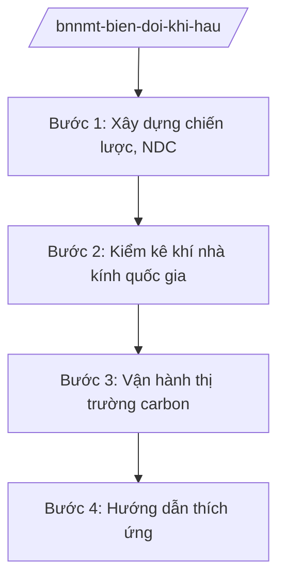

# Skill: Ứng phó biến đổi khí hậu

## 2. Khi nào dùng

- Khi xây dựng, cập nhật Chiến lược quốc gia về biến đổi khí hậu; Đóng góp do quốc gia tự quyết định (NDC).
- Khi tổ chức kiểm kê khí nhà kính quốc gia.
- Khi xây dựng, vận hành thị trường carbon trong nước.
- Khi hướng dẫn địa phương, bộ ngành thực hiện thích ứng biến đổi khí hậu.

## 3. Đầu vào (Input)

| Trường | Mô tả | Bắt buộc |
|--------|-------|----------|
| `loai_viec` | chiến lược / kiểm kê KNK / thị trường carbon / thích ứng | Có |
| `linh_vuc` | Năng lượng / nông nghiệp / chất thải / lâm nghiệp... | Không |
| `so_lieu` | Số liệu phát thải, hấp thụ | Không |

## 4. Quy trình

**Bước 1. Xây dựng chiến lược, NDC**
- Làm gì: Đánh giá thực hiện chiến lược hiện hành; cập nhật mục tiêu giảm phát thải, thích ứng; xây dựng NDC trình Thủ tướng phê duyệt, gửi Ban Thư ký Công ước khung LHQ về BĐKH.
- Dùng input: `loai_viec` (chiến lược).
- Vai trò: Chuyên viên Cục Biến đổi khí hậu dự thảo; AI hỗ trợ tổng hợp số liệu, soạn thảo — ⏱ 45 ngày.
- Lưu ý nghiệp vụ: Mục tiêu phù hợp cam kết quốc tế (net zero 2050) và điều kiện phát triển; lấy ý kiến bộ, ngành.
- → Kết quả bước: Chiến lược/NDC được phê duyệt.

**Bước 2. Kiểm kê khí nhà kính quốc gia**
- Làm gì: Tổ chức kiểm kê phát thải KNK các lĩnh vực theo hướng dẫn IPCC; xây dựng báo cáo kiểm kê quốc gia định kỳ.
- Dùng input: `so_lieu`, `linh_vuc`.
- Vai trò: Đơn vị kiểm kê thuộc Bộ thực hiện; AI hỗ trợ tính toán, lập bảng — ⏱ 60 ngày/kỳ.
- Lưu ý nghiệp vụ: Số liệu phải đầy đủ, minh bạch, có thể kiểm chứng; phối hợp các bộ cung cấp số liệu ngành.
- → Kết quả bước: Báo cáo kiểm kê khí nhà kính quốc gia.

**Bước 3. Vận hành thị trường carbon**
- Làm gì: Phân bổ hạn ngạch phát thải cho cơ sở thuộc diện; quản lý sàn giao dịch tín chỉ carbon; giám sát, báo cáo, thẩm định (MRV).
- Dùng input: `linh_vuc`.
- Vai trò: Cục Biến đổi khí hậu quản lý; AI hỗ trợ theo dõi hạn ngạch, giao dịch — ⏱ theo lộ trình.
- Lưu ý nghiệp vụ: Lộ trình thí điểm rồi vận hành chính thức; bảo đảm minh bạch, chống gian lận tín chỉ.
- → Kết quả bước: Thị trường carbon vận hành; báo cáo MRV.

**Bước 4. Hướng dẫn thích ứng**
- Làm gì: Hướng dẫn bộ, ngành, địa phương xây dựng kế hoạch thích ứng BĐKH: kịch bản, giải pháp cho nông nghiệp, thủy lợi, đô thị, y tế.
- Dùng input: `loai_viec` (thích ứng).
- Vai trò: Chuyên viên Cục hướng dẫn; AI hỗ trợ biên soạn tài liệu — ⏱ 30 ngày.
- Lưu ý nghiệp vụ: Kịch bản BĐKH cập nhật định kỳ làm căn cứ chung.
- → Kết quả bước: Tài liệu hướng dẫn; kế hoạch thích ứng của bộ, ngành, địa phương.

## Luồng quy trình (Workflow)

## 5. Đầu ra (Output)

- Chiến lược quốc gia về BĐKH; NDC cập nhật.
- Báo cáo kiểm kê khí nhà kính quốc gia.
- Quyết định phân bổ hạn ngạch phát thải.
- Tài liệu hướng dẫn thích ứng.

### Cấu trúc output chuẩn (thể thức NĐ 30/2020/NĐ-CP)

**Khung thể thức chung (NĐ 30/2020/NĐ-CP):** mọi văn bản trong output đều trình bày đầy đủ: Quốc hiệu "CỘNG HÒA XÃ HỘI CHỦ NGHĨA VIỆT NAM", Tiêu ngữ "Độc lập – Tự do – Hạnh phúc"; tên cơ quan ban hành; số, ký hiệu văn bản; địa danh, ngày tháng năm ban hành; tên loại văn bản; nội dung theo các mục dưới đây; nơi nhận (kết thúc "- Lưu: VT, [mã đơn vị]."); khối chữ ký (chức danh, họ tên người ký; ký hiệu "KT."/"TL." khi ký thay).

**Báo cáo kiểm kê khí nhà kính quốc gia gồm:**
1. Phương pháp kiểm kê.
2. Tổng phát thải theo lĩnh vực.
3. Xu hướng phát thải.
4. Đảm bảo chất lượng, kiểm chứng.
5. Kiến nghị.
## 6. Checklist nghiệm thu

- [ ] Mục tiêu giảm phát thải phù hợp cam kết quốc tế.
- [ ] Kiểm kê theo phương pháp chuẩn, số liệu kiểm chứng được.
- [ ] Hạn ngạch phân bổ công bằng, minh bạch.
- [ ] Kịch bản BĐKH cập nhật làm căn cứ thích ứng.
- [ ] Đúng thẩm quyền phê duyệt.

## 7. Ví dụ mô phỏng

*Dữ liệu dưới đây là giả lập 100% phục vụ minh họa.*

**Input mẫu:** loai_viec = "kiểm kê KNK"; so_lieu = "Tổng phát thải 500 triệu tấn CO2tđ (giả lập)"; linh_vuc = "Năng lượng, nông nghiệp, chất thải".

**Output mẫu (trích Báo cáo kiểm kê — giả lập):**

1. **Phương pháp:** theo hướng dẫn IPCC 2006 (giả lập).
2. **Tổng phát thải:** 500 triệu tấn CO2tđ (giả lập); năng lượng chiếm 65% (giả lập).
3. **Xu hướng:** tăng 3%/năm giai đoạn 2020–2025 (giả lập).
4. **Kiểm chứng:** đối chiếu số liệu ngành năng lượng, nông nghiệp (giả lập).
5. **Kiến nghị:** ưu tiên giảm phát thải năng lượng, phát triển điện gió, mặt trời (giả lập).

## 8. Human gate (người kiểm duyệt)

- Chuyên viên → Cục trưởng Cục Biến đổi khí hậu duyệt.
- Thứ trưởng → Bộ trưởng trình Thủ tướng (chiến lược, NDC).

## 9. Giới hạn (guardrails)

- AI không quyết định mục tiêu, hạn ngạch phát thải thay cấp có thẩm quyền.
- Không bịa số liệu phát thải; số liệu phải từ kiểm kê chính thức.
- Không viện dẫn văn bản hết hiệu lực.

## 10. Căn cứ & lưu ý

- NĐ 35/2025/NĐ-CP ngày 25/02/2025 — chức năng, nhiệm vụ, quyền hạn của Bộ NN&MT (được sửa đổi tại NĐ 109/2025/NĐ-CP).
- NQ 176/2025/QH15 — cơ cấu tổ chức của Chính phủ.
- Pháp luật về bảo vệ môi trường (ứng phó biến đổi khí hậu).
- NĐ 30/2020/NĐ-CP — thể thức văn bản hành chính.
