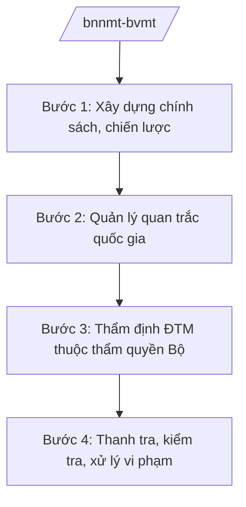

# Skill: Bảo vệ môi trường (chính sách, quan trắc quốc gia)

## 2. Khi nào dùng

- Khi xây dựng chính sách, chiến lược bảo vệ môi trường quốc gia.
- Khi quản lý hệ thống quan trắc môi trường quốc gia; công bố hiện trạng môi trường.
- Khi thẩm định báo cáo đánh giá tác động môi trường (ĐTM) thuộc thẩm quyền Bộ.
- Khi kiểm tra, xử lý vi phạm môi trường có tính chất liên tỉnh, nghiêm trọng.

## 3. Đầu vào (Input)

| Trường | Mô tả | Bắt buộc |
|--------|-------|----------|
| `loai_viec` | chính sách / quan trắc / thẩm định ĐTM / thanh kiểm tra | Có |
| `doi_tuong` | Dự án / cơ sở / lưu vực sông / khu vực | Không |
| `so_lieu_moi_truong` | Số liệu quan trắc, hiện trạng | Không |

## 4. Quy trình

**Bước 1. Xây dựng chính sách, chiến lược**
- Làm gì: Nghiên cứu, đề xuất chính sách BVMT: kiểm soát ô nhiễm không khí, nước, đất; quản lý chất thải; kinh tế tuần hoàn; trình cấp có thẩm quyền phê duyệt.
- Dùng input: `loai_viec` (chính sách), `so_lieu_moi_truong`.
- Vai trò: Chuyên viên Cục Môi trường dự thảo; AI hỗ trợ tổng hợp kinh nghiệm quốc tế, soạn thảo — ⏱ 30 ngày.
- Lưu ý nghiệp vụ: Chính sách phải khả thi, có lộ trình; lấy ý kiến doanh nghiệp, cộng đồng.
- → Kết quả bước: Dự thảo chính sách/chiến lược.

**Bước 2. Quản lý quan trắc quốc gia**
- Làm gì: Vận hành mạng lưới quan trắc môi trường quốc gia (không khí, nước mặt, nước ngầm); tổng hợp, công bố báo cáo hiện trạng môi trường quốc gia hằng năm.
- Dùng input: `so_lieu_moi_truong`.
- Vai trò: Đơn vị quan trắc thuộc Bộ thực hiện; AI hỗ trợ tổng hợp số liệu, vẽ bản đồ hiện trạng — ⏱ định kỳ hằng năm.
- Lưu ý nghiệp vụ: Số liệu quan trắc phải liên tục, tin cậy; công bố công khai theo quy định.
- → Kết quả bước: Báo cáo hiện trạng môi trường quốc gia.

**Bước 3. Thẩm định ĐTM thuộc thẩm quyền Bộ**
- Làm gì: Tổ chức thẩm định báo cáo ĐTM của dự án thuộc thẩm quyền Bộ (dự án lớn, liên tỉnh, nhạy cảm môi trường); trình phê duyệt kết quả thẩm định.
- Dùng input: `doi_tuong` (dự án).
- Vai trò: Hội đồng thẩm định của Bộ; AI hỗ trợ rà soát hồ sơ, tổng hợp ý kiến phản biện — ⏱ 30 ngày.
- Lưu ý nghiệp vụ: Dự án không đạt yêu cầu BVMT không được phê duyệt; hậu kiểm sau phê duyệt.
- → Kết quả bước: Quyết định phê duyệt kết quả thẩm định ĐTM.

**Bước 4. Thanh tra, kiểm tra, xử lý vi phạm**
- Làm gì: Thanh tra việc chấp hành pháp luật BVMT tại các cơ sở, khu công nghiệp; xử lý vi phạm nghiêm trọng, liên tỉnh; công bố danh sách cơ sở gây ô nhiễm nghiêm trọng.
- Dùng input: `doi_tuong`.
- Vai trò: Thanh tra Bộ chủ trì; AI hỗ trợ lập kế hoạch thanh tra, soạn kết luận — ⏱ theo đợt.
- Lưu ý nghiệp vụ: Phối hợp Bộ Công an (Cảnh sát môi trường); vụ việc có dấu hiệu tội phạm chuyển cơ quan điều tra.
- → Kết quả bước: Kết luận thanh tra; quyết định xử phạt.

## Luồng quy trình (Workflow)

## 5. Đầu ra (Output)

- Chính sách, chiến lược BVMT quốc gia.
- Báo cáo hiện trạng môi trường quốc gia hằng năm.
- Quyết định phê duyệt kết quả thẩm định ĐTM.
- Kết luận thanh tra môi trường.

### Cấu trúc output chuẩn (thể thức NĐ 30/2020/NĐ-CP)

**Khung thể thức chung (NĐ 30/2020/NĐ-CP):** mọi văn bản trong output đều trình bày đầy đủ: Quốc hiệu "CỘNG HÒA XÃ HỘI CHỦ NGHĨA VIỆT NAM", Tiêu ngữ "Độc lập – Tự do – Hạnh phúc"; tên cơ quan ban hành; số, ký hiệu văn bản; địa danh, ngày tháng năm ban hành; tên loại văn bản; nội dung theo các mục dưới đây; nơi nhận (kết thúc "- Lưu: VT, [mã đơn vị]."); khối chữ ký (chức danh, họ tên người ký; ký hiệu "KT."/"TL." khi ký thay).

**Báo cáo hiện trạng môi trường quốc gia gồm:**
1. Tổng quan hiện trạng (không khí, nước, đất, chất thải, đa dạng sinh học).
2. Áp lực môi trường (phát triển KT-XH, đô thị hóa).
3. Công tác quản lý nhà nước về BVMT.
4. Đánh giá xu hướng.
5. Giải pháp, kiến nghị.

> **Checklist thể thức văn bản theo NĐ 30/2020/NĐ-CP** — đối chiếu trước khi trình ký:
> 1. Quốc hiệu và Tiêu ngữ.
> 2. Tên cơ quan, tổ chức ban hành văn bản.
> 3. Số, ký hiệu của văn bản.
> 4. Địa danh và thời gian ban hành văn bản.
> 5. Tên loại và trích yếu nội dung văn bản.
> 6. Nội dung văn bản.
> 7. Chức vụ, họ tên và chữ ký của người có thẩm quyền.
> 8. Dấu, chữ ký số của cơ quan, tổ chức.
> 9. Nơi nhận (kèm Phụ lục nếu có).

## 6. Checklist nghiệm thu

- [ ] Chính sách có mục tiêu, lộ trình, nguồn lực rõ ràng.
- [ ] Số liệu quan trắc đầy đủ, tin cậy, công bố công khai.
- [ ] ĐTM thẩm định đúng thẩm quyền, có hậu kiểm.
- [ ] Vi phạm nghiêm trọng được xử lý dứt điểm.
- [ ] Đúng thẩm quyền ký các quyết định.

## 7. Ví dụ mô phỏng

*Dữ liệu dưới đây là giả lập 100% phục vụ minh họa.*

**Input mẫu:** loai_viec = "quan trắc"; so_lieu_moi_truong = "100 trạm quan trắc không khí tự động (giả lập); chỉ số AQI trung bình các đô thị (giả lập)".

**Output mẫu (trích Báo cáo hiện trạng môi trường quốc gia — giả lập):**

1. **Không khí:** AQI trung bình đô thị loại I ở mức trung bình (giả lập); bụi mịn PM2.5 vượt chuẩn tại 5 đô thị mùa đông (giả lập).
2. **Nước:** 80% sông quan trắc đạt chuẩn (giả lập); một số đoạn sông ô nhiễm hữu cơ (giả lập).
3. **Chất thải:** tỷ lệ thu gom chất thải rắn đô thị 95% (giả lập).
4. **Quản lý:** 200 cơ sở gây ô nhiễm nghiêm trọng được xử lý (giả lập).
5. **Giải pháp:** kiểm soát khí thải giao thông; xử lý nước thải đô thị đạt 60% năm 2030 (giả lập).

## 8. Human gate (người kiểm duyệt)

- Chuyên viên → Cục trưởng Cục Môi trường duyệt.
- Thứ trưởng phụ trách → Bộ trưởng ký báo cáo, quyết định thuộc thẩm quyền Bộ.

## 9. Giới hạn (guardrails)

- AI không quyết định phê duyệt ĐTM hay kết luận thanh tra thay người có thẩm quyền.
- Không bịa số liệu quan trắc; số liệu phải từ hệ thống quan trắc chính thức.
- Không công bố thông tin chưa được kiểm chứng.

## 10. Căn cứ & lưu ý

- NĐ 35/2025/NĐ-CP ngày 25/02/2025 — chức năng, nhiệm vụ, quyền hạn của Bộ NN&MT (được sửa đổi tại NĐ 109/2025/NĐ-CP).
- NQ 176/2025/QH15 — cơ cấu tổ chức của Chính phủ.
- Pháp luật về bảo vệ môi trường.
- NĐ 30/2020/NĐ-CP — thể thức văn bản hành chính.
