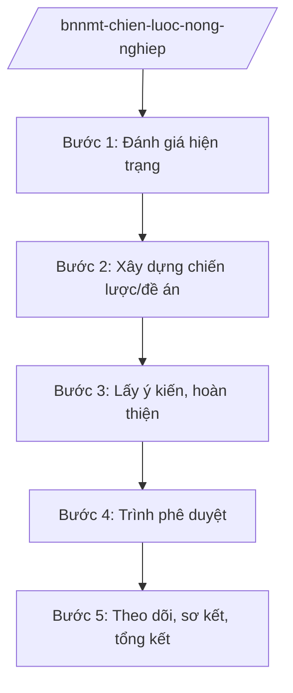

# Skill: Chiến lược phát triển nông nghiệp

## 2. Khi nào dùng

- Khi xây dựng Chiến lược phát triển nông nghiệp và nông thôn thời kỳ mới.
- Khi xây dựng đề án cơ cấu lại ngành nông nghiệp theo hướng nâng cao giá trị, phát triển bền vững.
- Khi sơ kết, tổng kết thực hiện chiến lược; điều chỉnh mục tiêu, giải pháp.
- Khi xây dựng chính sách phát triển nông nghiệp hữu cơ, nông nghiệp công nghệ cao, kinh tế tuần hoàn.

## 3. Đầu vào (Input)

| Trường | Mô tả | Bắt buộc |
|--------|-------|----------|
| `loai_viec` | chiến lược mới / đề án cơ cấu lại / sơ kết / tổng kết | Có |
| `thoi_ky` | Thời kỳ chiến lược | Có |
| `so_lieu_hien_trang` | Hiện trạng sản xuất nông nghiệp | Có |
| `dinh_huong` | Nông nghiệp sinh thái / công nghệ cao / hữu cơ... | Không |

## 4. Quy trình

**Bước 1. Đánh giá hiện trạng**
- Làm gì: Thu thập, phân tích số liệu: diện tích, năng suất, sản lượng các ngành trồng trọt, chăn nuôi, thủy sản, lâm nghiệp; kim ngạch xuất khẩu nông sản; thu nhập nông dân.
- Dùng input: `so_lieu_hien_trang`.
- Vai trò: Chuyên viên Vụ Kế hoạch – Tài chính (Bộ NN&MT) tổng hợp; AI hỗ trợ phân tích số liệu, biểu đồ — ⏱ 20 ngày.
- Lưu ý nghiệp vụ: Số liệu từ Tổng cục Thống kê, các cục chuyên ngành; đánh giá thẳng thắn tồn tại (manh mún, giá trị thấp...).
- → Kết quả bước: Báo cáo đánh giá hiện trạng.

**Bước 2. Xây dựng chiến lược/đề án**
- Làm gì: Đề xuất quan điểm, mục tiêu, định hướng: nông nghiệp sinh thái, nông thôn hiện đại, nông dân văn minh; cơ cấu lại theo lợi thế vùng; phát triển chuỗi giá trị.
- Dùng input: `thoi_ky`, `dinh_huong`.
- Vai trò: Vụ trưởng chỉ đạo; đơn vị tư vấn phối hợp; AI hỗ trợ soạn thảo, tham khảo kinh nghiệm quốc tế — ⏱ 45 ngày.
- Lưu ý nghiệp vụ: Gắn với an ninh lương thực quốc gia; thích ứng biến đổi khí hậu; phát triển nông thôn gắn NTM.
- → Kết quả bước: Dự thảo chiến lược/đề án.

**Bước 3. Lấy ý kiến, hoàn thiện**
- Làm gì: Lấy ý kiến bộ, ngành, địa phương, hiệp hội, nông dân, doanh nghiệp; hội thảo vùng.
- Dùng input: Dự thảo.
- Vai trò: Chuyên viên tổng hợp; AI hỗ trợ phân loại ý kiến — ⏱ 25 ngày.
- Lưu ý nghiệp vụ: Lắng nghe ý kiến từ cơ sở (HTX, nông dân) — đối tượng chịu tác động trực tiếp.
- → Kết quả bước: Dự thảo hoàn thiện.

**Bước 4. Trình phê duyệt**
- Làm gì: Hoàn thiện hồ sơ trình Thủ tướng Chính phủ phê duyệt chiến lược (tờ trình Bộ trưởng, dự thảo quyết định).
- Dùng input: Hồ sơ hoàn chỉnh.
- Vai trò: Thứ trưởng ký tờ trình; Bộ trưởng trình Thủ tướng; AI hỗ trợ: kiểm tra hồ sơ — ⏱ 15 ngày.
- Lưu ý nghiệp vụ: Chiến lược phát triển nông nghiệp quốc gia do Thủ tướng phê duyệt.
- → Kết quả bước: Quyết định phê duyệt của Thủ tướng Chính phủ.

**Bước 5. Theo dõi, sơ kết, tổng kết**
- Làm gì: Theo dõi chỉ tiêu hằng năm; sơ kết giữa kỳ, tổng kết cuối kỳ; đề xuất điều chỉnh.
- Dùng input: `loai_viec` (sơ kết/tổng kết).
- Vai trò: Chuyên viên theo dõi; AI hỗ trợ lập bảng chỉ tiêu — ⏱ định kỳ.
- Lưu ý nghiệp vụ: Đánh giá thực chất theo số liệu, không hình thức.
- → Kết quả bước: Báo cáo sơ kết/tổng kết.

## Luồng quy trình (Workflow)

## 5. Đầu ra (Output)

- Báo cáo đánh giá hiện trạng nông nghiệp.
- Dự thảo chiến lược/đề án cơ cấu lại ngành.
- Quyết định phê duyệt của Thủ tướng Chính phủ.
- Báo cáo sơ kết, tổng kết.

### Cấu trúc output chuẩn (thể thức NĐ 30/2020/NĐ-CP)

**Khung thể thức chung (NĐ 30/2020/NĐ-CP):** mọi văn bản trong output đều trình bày đầy đủ: Quốc hiệu "CỘNG HÒA XÃ HỘI CHỦ NGHĨA VIỆT NAM", Tiêu ngữ "Độc lập – Tự do – Hạnh phúc"; tên cơ quan ban hành; số, ký hiệu văn bản; địa danh, ngày tháng năm ban hành; tên loại văn bản; nội dung theo các mục dưới đây; nơi nhận (kết thúc "- Lưu: VT, [mã đơn vị]."); khối chữ ký (chức danh, họ tên người ký; ký hiệu "KT."/"TL." khi ký thay).

**Chiến lược phát triển nông nghiệp và nông thôn gồm:**
1. Bối cảnh, đánh giá hiện trạng.
2. Quan điểm phát triển (nông nghiệp sinh thái, nông thôn hiện đại, nông dân văn minh).
3. Mục tiêu đến 2030, tầm nhìn 2050 (giả lập theo thời kỳ).
4. Định hướng cơ cấu lại theo ngành, vùng.
5. Giải pháp (thể chế, KHCN, vốn, nhân lực, thị trường).
6. Tổ chức thực hiện.

> **Checklist thể thức văn bản theo NĐ 30/2020/NĐ-CP** — đối chiếu trước khi trình ký:
> 1. Quốc hiệu và Tiêu ngữ.
> 2. Tên cơ quan, tổ chức ban hành văn bản.
> 3. Số, ký hiệu của văn bản.
> 4. Địa danh và thời gian ban hành văn bản.
> 5. Tên loại và trích yếu nội dung văn bản.
> 6. Nội dung văn bản.
> 7. Chức vụ, họ tên và chữ ký của người có thẩm quyền.
> 8. Dấu, chữ ký số của cơ quan, tổ chức.
> 9. Nơi nhận (kèm Phụ lục nếu có).

## 6. Checklist nghiệm thu

- [ ] Đánh giá hiện trạng có số liệu đầy đủ, tin cậy.
- [ ] Mục tiêu cụ thể, đo lường được.
- [ ] Gắn an ninh lương thực, thích ứng biến đổi khí hậu.
- [ ] Đã lấy ý kiến địa phương, hiệp hội, nông dân, doanh nghiệp.
- [ ] Đúng thẩm quyền phê duyệt.
- [ ] Có cơ chế theo dõi, đánh giá định kỳ.

## 7. Ví dụ mô phỏng

*Dữ liệu dưới đây là giả lập 100% phục vụ minh họa.*

**Input mẫu:** loai_viec = "đề án cơ cấu lại"; thoi_ky = "2026–2030 (giả lập)"; so_lieu_hien_trang = "Kim ngạch xuất khẩu nông sản 60 tỷ USD (giả lập); 60% hộ sản xuất quy mô nhỏ (giả lập)"; dinh_huong = "Nông nghiệp hữu cơ, chuỗi giá trị".

**Output mẫu (trích Đề án):**

1. **Bối cảnh:** xuất khẩu tăng nhưng giá trị gia tăng thấp, sản xuất manh mún (giả lập).
2. **Quan điểm:** chuyển từ tư duy sản lượng sang tư duy giá trị, sinh thái.
3. **Mục tiêu:** kim ngạch 80 tỷ USD năm 2030 (giả lập); 30% diện tích đạt chuẩn hữu cơ/ VietGAP (giả lập).
4. **Định hướng:** 7 vùng sinh thái nông nghiệp; chuỗi giá trị lúa gạo, cà phê, thủy sản (giả lập).
5. **Giải pháp:** vốn tín dụng ưu đãi; chuyển giao công nghệ; đào tạo nông dân số.
6. **Tổ chức thực hiện:** Bộ NN&MT chủ trì; UBND tỉnh A và các địa phương triển khai.

## 8. Human gate (người kiểm duyệt)

- Chuyên viên → Vụ trưởng duyệt dự thảo.
- Thứ trưởng ký tờ trình → Bộ trưởng trình → Thủ tướng Chính phủ phê duyệt.

## 9. Giới hạn (guardrails)

- AI không quyết định định hướng, mục tiêu chiến lược thay Bộ.
- Không bịa số liệu ngành; số liệu phải có nguồn.
- Không viện dẫn văn bản hết hiệu lực.

## 10. Căn cứ & lưu ý

- NĐ 35/2025/NĐ-CP ngày 25/02/2025 — chức năng, nhiệm vụ, quyền hạn của Bộ NN&MT (được sửa đổi tại NĐ 109/2025/NĐ-CP).
- NQ 176/2025/QH15 — cơ cấu tổ chức của Chính phủ.
- NĐ 30/2020/NĐ-CP — thể thức văn bản hành chính.
- Lưu ý: chiến lược quốc gia về nông nghiệp do Thủ tướng Chính phủ phê duyệt.
