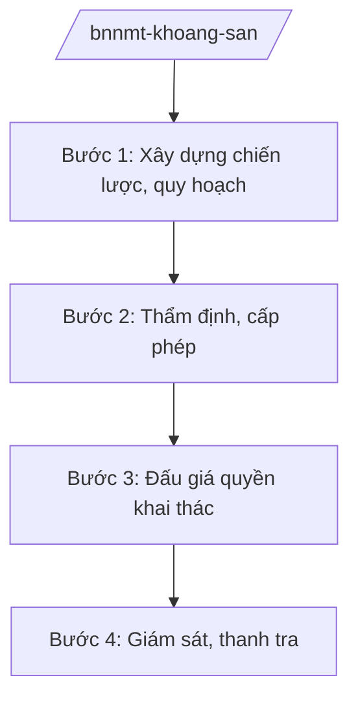

# Skill: Quản lý khoáng sản (chiến lược, cấp phép)

## 2. Khi nào dùng

- Khi xây dựng chiến lược, quy hoạch thăm dò, khai thác, sử dụng khoáng sản quốc gia.
- Khi cấp giấy phép thăm dò, khai thác khoáng sản thuộc thẩm quyền Bộ (khoáng sản quan trọng, liên tỉnh).
- Khi đấu giá quyền khai thác khoáng sản.
- Khi thanh tra, xử lý vi phạm khai thác khoáng sản trái phép.

## 3. Đầu vào (Input)

| Trường | Mô tả | Bắt buộc |
|--------|-------|----------|
| `loai_viec` | chiến lược / cấp phép / đấu giá / thanh tra | Có |
| `loai_khoang_san` | Tên loại khoáng sản | Không |
| `khu_vuc` | Khu vực thăm dò/khai thác | Không |
| `ho_so` | Hồ sơ đề nghị cấp phép | Không |

## 4. Quy trình

**Bước 1. Xây dựng chiến lược, quy hoạch**
- Làm gì: Đánh giá tiềm năng, trữ lượng khoáng sản; lập quy hoạch thăm dò, khai thác, sử dụng khoáng sản quốc gia; khoanh định khu vực cấm, tạm cấm hoạt động khoáng sản.
- Dùng input: `loai_viec` (chiến lược), `loai_khoang_san`.
- Vai trò: Chuyên viên Cục Khoáng sản Việt Nam dự thảo; AI hỗ trợ tổng hợp số liệu địa chất — ⏱ 45 ngày.
- Lưu ý nghiệp vụ: Phù hợp quy hoạch tổng thể quốc gia; bảo vệ môi trường, di tích, rừng đặc dụng.
- → Kết quả bước: Dự thảo quy hoạch trình phê duyệt.

**Bước 2. Thẩm định, cấp phép**
- Làm gì: Tiếp nhận hồ sơ đề nghị cấp phép thăm dò/khai thác; thẩm định năng lực tài chính, kỹ thuật, phương án BVMT; trình Bộ trưởng cấp giấy phép.
- Dùng input: `ho_so`, `khu_vuc`.
- Vai trò: Chuyên viên Cục thẩm định; AI hỗ trợ kiểm tra checklist hồ sơ — ⏱ 30 ngày/hồ sơ.
- Lưu ý nghiệp vụ: Khu vực phải nằm trong quy hoạch; không cấp phép trong khu vực cấm; tiền cấp quyền khai thác phải nộp đủ.
- → Kết quả bước: Giấy phép thăm dò/khai thác khoáng sản.

**Bước 3. Đấu giá quyền khai thác**
- Làm gì: Lập danh mục khu vực đấu giá; tổ chức đấu giá quyền khai thác khoáng sản; thu tiền trúng đấu giá.
- Dùng input: `khu_vuc`.
- Vai trò: Cục Khoáng sản Việt Nam tổ chức; AI hỗ trợ lập hồ sơ đấu giá — ⏱ 60 ngày.
- Lưu ý nghiệp vụ: Đấu giá công khai, minh bạch; giá khởi điểm theo quy định.
- → Kết quả bước: Kết quả đấu giá; giấy phép cho đơn vị trúng đấu giá.

**Bước 4. Giám sát, thanh tra**
- Làm gì: Giám sát hoạt động khai thác (sản lượng, BVMT, nghĩa vụ tài chính); thanh tra, xử lý khai thác trái phép, vượt công suất.
- Dùng input: `loai_viec` (thanh tra), `khu_vuc`.
- Vai trò: Thanh tra Bộ chủ trì; AI hỗ trợ lập kế hoạch thanh tra — ⏱ theo đợt.
- Lưu ý nghiệp vụ: Phối hợp địa phương, Công an xử lý "khoáng tặc"; thu hồi giấy phép khi vi phạm nghiêm trọng.
- → Kết quả bước: Kết luận thanh tra; quyết định xử phạt/thu hồi.

## Luồng quy trình (Workflow)

## 5. Đầu ra (Output)

- Quy hoạch thăm dò, khai thác khoáng sản quốc gia.
- Giấy phép thăm dò/khai thác khoáng sản.
- Kết quả đấu giá quyền khai thác.
- Kết luận thanh tra khoáng sản.

### Cấu trúc output chuẩn (thể thức NĐ 30/2020/NĐ-CP)

**Khung thể thức chung (NĐ 30/2020/NĐ-CP):** mọi văn bản trong output đều trình bày đầy đủ: Quốc hiệu "CỘNG HÒA XÃ HỘI CHỦ NGHĨA VIỆT NAM", Tiêu ngữ "Độc lập – Tự do – Hạnh phúc"; tên cơ quan ban hành; số, ký hiệu văn bản; địa danh, ngày tháng năm ban hành; tên loại văn bản; nội dung theo các mục dưới đây; nơi nhận (kết thúc "- Lưu: VT, [mã đơn vị]."); khối chữ ký (chức danh, họ tên người ký; ký hiệu "KT."/"TL." khi ký thay).

**Giấy phép khai thác khoáng sản gồm:**
1. Tên tổ chức được phép; loại khoáng sản; khu vực, diện tích, độ sâu.
2. Trữ lượng, công suất khai thác.
3. Thời hạn giấy phép.
4. Nghĩa vụ tài chính (tiền cấp quyền, thuế tài nguyên, phí BVMT).
5. Nghĩa vụ bảo vệ môi trường, cải tạo phục hồi môi trường.
6. Điều khoản thu hồi.

> **Chuẩn tài liệu đầu ra** (thứ tự ưu tiên):
> 1. Chuẩn riêng của ngành/cơ quan chủ quản — mẫu, biểu mẫu, quy chuẩn tại văn bản quy phạm chuyên ngành (xem mục "Căn cứ & lưu ý").
> 2. Tài liệu không có quy chuẩn riêng — thể thức NĐ 30/2020/NĐ-CP: Quốc hiệu và Tiêu ngữ; tên cơ quan ban hành; số, ký hiệu; địa danh và thời gian; tên loại và trích yếu; nội dung; chức vụ, họ tên, chữ ký người có thẩm quyền; dấu, chữ ký số; nơi nhận (kèm Phụ lục nếu có).

## 6. Checklist nghiệm thu

- [ ] Khu vực nằm trong quy hoạch được phê duyệt.
- [ ] Hồ sơ đủ điều kiện (năng lực, phương án BVMT).
- [ ] Tiền cấp quyền khai thác được xác định, nộp đủ.
- [ ] Đấu giá công khai, minh bạch.
- [ ] Giấy phép đúng thẩm quyền, thể thức.
- [ ] Có giám sát sau cấp phép.

## 7. Ví dụ mô phỏng

*Dữ liệu dưới đây là giả lập 100% phục vụ minh họa.*

**Input mẫu:** loai_viec = "cấp phép"; loai_khoang_san = "Đá vôi làm xi măng (giả lập)"; khu_vuc = "Khu vực AA, tỉnh A (giả lập)"; ho_so = "Hồ sơ Công ty BB (giả lập)".

**Output mẫu (trích Giấy phép — giả lập):**

**Giấy phép khai thác khoáng sản** (số 1234/GP-BNNMT, giả lập):
1. Tổ chức: Công ty BB (giả lập); khoáng sản: đá vôi xi măng (giả lập).
2. Khu vực AA, tỉnh A (giả lập); diện tích 50 ha (giả lập); trữ lượng 10 triệu tấn (giả lập).
3. Công suất 500.000 tấn/năm (giả lập); thời hạn 20 năm (giả lập).
4. Tiền cấp quyền: 20 tỷ đồng (giả lập); thuế tài nguyên, phí BVMT theo quy định.
5. Ký quỹ cải tạo môi trường 5 tỷ đồng (giả lập).

## 8. Human gate (người kiểm duyệt)

- Chuyên viên thẩm định → Cục trưởng Cục Khoáng sản Việt Nam duyệt.
- Thứ trưởng phụ trách → Bộ trưởng ký giấy phép thuộc thẩm quyền Bộ.

## 9. Giới hạn (guardrails)

- AI không quyết định cấp/thu hồi giấy phép thay Bộ trưởng.
- Không bịa số liệu trữ lượng, tiền cấp quyền.
- Không viện dẫn văn bản hết hiệu lực.

## 10. Căn cứ & lưu ý

- NĐ 35/2025/NĐ-CP ngày 25/02/2025 — chức năng, nhiệm vụ, quyền hạn của Bộ NN&MT (được sửa đổi tại NĐ 109/2025/NĐ-CP).
- NQ 176/2025/QH15 — cơ cấu tổ chức của Chính phủ.
- Pháp luật về khoáng sản.
- NĐ 30/2020/NĐ-CP — thể thức văn bản hành chính.
- Lưu ý: giấy phép khai thác khoáng sản quan trọng, liên tỉnh thuộc thẩm quyền Bộ NN&MT.
