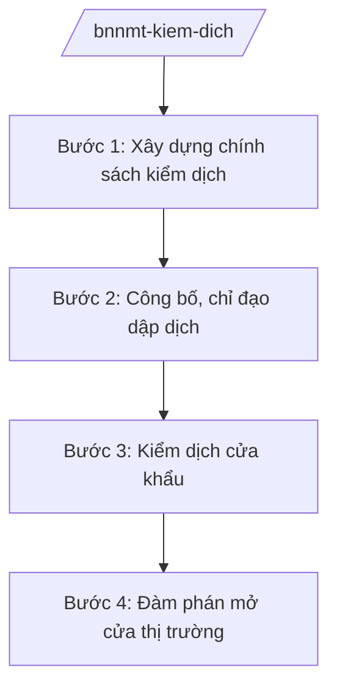

# Skill: Kiểm dịch động vật, thực vật (cấp bộ)

## 2. Khi nào dùng

- Khi xây dựng chính sách, quy định kiểm dịch động vật, thực vật, sản phẩm động vật, thực vật.
- Khi công bố dịch bệnh động vật, vùng dịch; chỉ đạo dập dịch liên tỉnh.
- Khi quản lý kiểm dịch tại cửa khẩu: xuất nhập khẩu động vật, thực vật.
- Khi đàm phán mở cửa thị trường xuất khẩu nông sản với nước ngoài.

## 3. Đầu vào (Input)

| Trường | Mô tả | Bắt buộc |
|--------|-------|----------|
| `loai_viec` | chính sách / công bố dịch / kiểm dịch cửa khẩu / mở cửa thị trường | Có |
| `doi_tuong` | Loài vật / loại cây / cửa khẩu / nước nhập khẩu | Không |
| `tinh_huong_dich` | Tên dịch bệnh, phạm vi (nếu có) | Không |

## 4. Quy trình

**Bước 1. Xây dựng chính sách kiểm dịch**
- Làm gì: Nghiên cứu chuẩn mực quốc tế (OIE, IPPC); soạn thảo quy định kiểm dịch động vật, thực vật; lấy ý kiến, trình ban hành.
- Dùng input: `loai_viec` (chính sách).
- Vai trò: Chuyên viên Cục Chăn nuôi và Thú y / Cục Trồng trọt và BVTV dự thảo; AI hỗ trợ soạn thảo — ⏱ 30 ngày.
- Lưu ý nghiệp vụ: Quy định phải phù hợp cam kết SPS trong các FTA; không tạo rào cản thương mại không cần thiết.
- → Kết quả bước: Văn bản quy định kiểm dịch được ban hành.

**Bước 2. Công bố, chỉ đạo dập dịch**
- Làm gì: Khi có dịch bệnh nguy hiểm (cúm gia cầm, dịch tả lợn châu Phi...): xác minh, công bố dịch; chỉ đạo địa phương khoanh vùng, tiêu hủy, tiêm phòng; điều phối vaccine, vật tư.
- Dùng input: `tinh_huong_dich`.
- Vai trò: Cục trưởng Cục Chăn nuôi và Thú y tham mưu; Bộ trưởng công bố dịch; AI hỗ trợ tổng hợp báo cáo dịch — ⏱ khẩn cấp.
- Lưu ý nghiệp vụ: Công bố dịch kịp thời, chính xác; cấm vận chuyển động vật ra khỏi vùng dịch; hỗ trợ người chăn nuôi theo chính sách.
- → Kết quả bước: Quyết định công bố dịch; dịch được khống chế.

**Bước 3. Kiểm dịch cửa khẩu**
- Làm gì: Chỉ đạo Chi cục Kiểm dịch vùng tại cửa khẩu kiểm tra lô hàng động vật, thực vật xuất nhập khẩu; cấp giấy chứng nhận kiểm dịch.
- Dùng input: `doi_tuong` (lô hàng, cửa khẩu).
- Vai trò: Chi cục trưởng Chi cục Kiểm dịch vùng thực hiện; AI hỗ trợ tra cứu yêu cầu kiểm dịch của nước nhập khẩu — ⏱ theo lô hàng.
- Lưu ý nghiệp vụ: Lô hàng không đạt bị trả về/tiêu hủy; phối hợp Hải quan, Biên phòng.
- → Kết quả bước: Giấy chứng nhận kiểm dịch; lô hàng thông quan.

**Bước 4. Đàm phán mở cửa thị trường**
- Làm gì: Đàm phán với nước nhập khẩu về yêu cầu kiểm dịch đối với nông sản Việt Nam (thanh long, vải, nhãn, thịt...); đón đoàn kiểm tra của nước ngoài.
- Dùng input: `doi_tuong` (nước nhập khẩu, mặt hàng).
- Vai trò: Lãnh đạo Cục/Bộ đàm phán; AI hỗ trợ chuẩn bị tài liệu kỹ thuật — ⏱ theo tiến trình.
- Lưu ý nghiệp vụ: Phối hợp Bộ Ngoại giao, Thương vụ; bảo đảm vùng trồng, cơ sở đóng gói đạt chuẩn.
- → Kết quả bước: Nghị định thư/thỏa thuận mở cửa thị trường.

## Luồng quy trình (Workflow)

## 5. Đầu ra (Output)

- Văn bản quy định kiểm dịch.
- Quyết định công bố dịch bệnh động vật.
- Giấy chứng nhận kiểm dịch xuất nhập khẩu.
- Thỏa thuận mở cửa thị trường nông sản.

### Cấu trúc output chuẩn (thể thức NĐ 30/2020/NĐ-CP)

**Khung thể thức chung (NĐ 30/2020/NĐ-CP):** mọi văn bản trong output đều trình bày đầy đủ: Quốc hiệu "CỘNG HÒA XÃ HỘI CHỦ NGHĨA VIỆT NAM", Tiêu ngữ "Độc lập – Tự do – Hạnh phúc"; tên cơ quan ban hành; số, ký hiệu văn bản; địa danh, ngày tháng năm ban hành; tên loại văn bản; nội dung theo các mục dưới đây; nơi nhận (kết thúc "- Lưu: VT, [mã đơn vị]."); khối chữ ký (chức danh, họ tên người ký; ký hiệu "KT."/"TL." khi ký thay).

**Quyết định công bố dịch bệnh động vật gồm:**
1. Căn cứ pháp lý.
2. Tên dịch bệnh, địa bàn công bố dịch.
3. Các biện pháp áp dụng (khoanh vùng, tiêu hủy, tiêm phòng, cấm vận chuyển).
4. Kinh phí, hỗ trợ.
5. Tổ chức thực hiện.
## 6. Checklist nghiệm thu

- [ ] Quy định kiểm dịch phù hợp chuẩn mực quốc tế, cam kết FTA.
- [ ] Dịch bệnh được công bố kịp thời, dập dịch hiệu quả.
- [ ] Kiểm dịch cửa khẩu chặt chẽ, không để lọt dịch bệnh.
- [ ] Hồ sơ mở cửa thị trường đầy đủ yêu cầu kỹ thuật.
- [ ] Đúng thẩm quyền ký.

## 7. Ví dụ mô phỏng

*Dữ liệu dưới đây là giả lập 100% phục vụ minh họa.*

**Input mẫu:** loai_viec = "công bố dịch"; tinh_huong_dich = "Dịch tả lợn châu Phi tại 3 tỉnh (giả lập)"; doi_tuong = "Đàn lợn 1 triệu con vùng dịch (giả lập)".

**Output mẫu (trích Quyết định công bố dịch — giả lập):**

1. **Căn cứ:** NĐ 35/2025/NĐ-CP; pháp luật về thú y.
2. **Công bố dịch** tả lợn châu Phi tại 3 tỉnh (giả lập).
3. **Biện pháp:** tiêu hủy 50.000 con mắc bệnh (giả lập); khoanh vùng 10 km (giả lập); cấm vận chuyển lợn ra khỏi vùng dịch; tiêm phòng bao vây.
4. **Kinh phí:** hỗ trợ 38.000 đồng/kg lợn tiêu hủy (giả lập) từ ngân sách.
5. **Tổ chức thực hiện:** Cục Chăn nuôi và Thú y chỉ đạo; UBND tỉnh A và các tỉnh triển khai.

## 8. Human gate (người kiểm duyệt)

- Chuyên viên → Cục trưởng Cục Chăn nuôi và Thú y / Cục Trồng trọt và BVTV duyệt.
- Bộ trưởng công bố dịch bệnh, ký văn bản quy phạm.

## 9. Giới hạn (guardrails)

- AI không quyết định công bố dịch, tiêu hủy thay người có thẩm quyền.
- Không bịa số liệu dịch bệnh; số liệu phải từ báo cáo giám sát.
- Thông tin dịch bệnh phải chính xác, không gây hoang mang.

## 10. Căn cứ & lưu ý

- NĐ 35/2025/NĐ-CP ngày 25/02/2025 — chức năng, nhiệm vụ, quyền hạn của Bộ NN&MT (được sửa đổi tại NĐ 109/2025/NĐ-CP).
- NQ 176/2025/QH15 — cơ cấu tổ chức của Chính phủ.
- Pháp luật về thú y; pháp luật về bảo vệ và kiểm dịch thực vật.
- NĐ 30/2020/NĐ-CP — thể thức văn bản hành chính.
