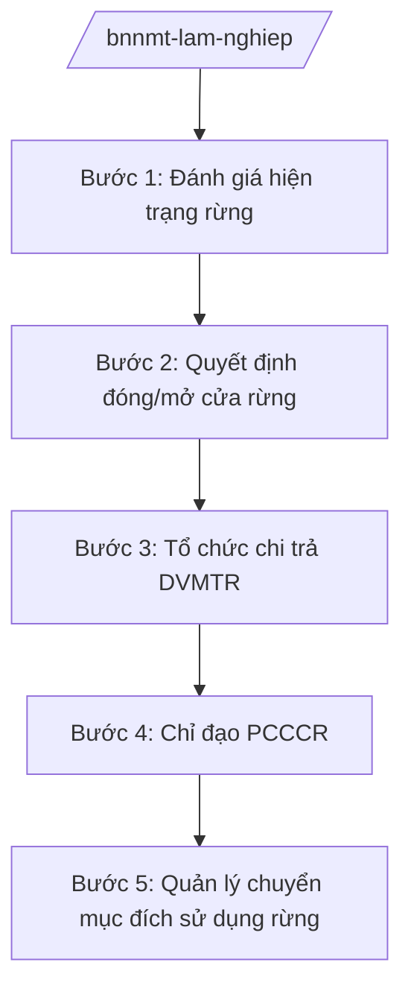

# Skill: Lâm nghiệp (đóng/mở cửa rừng, chi trả DVMTR)

## 2. Khi nào dùng

- Khi quyết định đóng/mở cửa rừng tự nhiên (đóng cửa rừng, khai thác chính gỗ rừng tự nhiên).
- Khi quản lý rừng đặc dụng, rừng phòng hộ; chuyển mục đích sử dụng rừng.
- Khi tổ chức chi trả dịch vụ môi trường rừng (DVMTR) toàn quốc.
- Khi chỉ đạo phòng cháy, chữa cháy rừng (PCCCR) cấp quốc gia.

## 3. Đầu vào (Input)

| Trường | Mô tả | Bắt buộc |
|--------|-------|----------|
| `loai_viec` | đóng/mở cửa rừng / DVMTR / PCCCR / chuyển mục đích | Có |
| `doi_tuong` | Khu rừng / tỉnh / lưu vực | Không |
| `so_lieu` | Diện tích rừng, trữ lượng, tiền DVMTR | Không |

## 4. Quy trình

**Bước 1. Đánh giá hiện trạng rừng**
- Làm gì: Tổng hợp số liệu diễn biến rừng toàn quốc: diện tích, độ che phủ, trữ lượng rừng tự nhiên; đánh giá công tác quản lý, bảo vệ rừng.
- Dùng input: `so_lieu`.
- Vai trò: Chuyên viên Cục Lâm nghiệp và Kiểm lâm tổng hợp; AI hỗ trợ phân tích số liệu, bản đồ — ⏱ 20 ngày.
- Lưu ý nghiệp vụ: Số liệu kiểm kê rừng định kỳ là căn cứ bắt buộc.
- → Kết quả bước: Báo cáo hiện trạng rừng toàn quốc.

**Bước 2. Quyết định đóng/mở cửa rừng**
- Làm gì: Đánh giá khả năng khai thác bền vững rừng tự nhiên; trình Thủ tướng quyết định đóng cửa rừng hoặc cho phép khai thác chính gỗ rừng tự nhiên có chọn lọc.
- Dùng input: `loai_viec`, `doi_tuong`.
- Vai trò: Cục trưởng Cục Lâm nghiệp và Kiểm lâm trình; Bộ trưởng trình Thủ tướng; AI hỗ trợ tổng hợp số liệu — ⏱ 30 ngày.
- Lưu ý nghiệp vụ: Chủ trương đóng cửa rừng tự nhiên được duy trì; chỉ xem xét khai thác khi đủ điều kiện bền vững.
- → Kết quả bước: Quyết định của Thủ tướng về đóng/mở cửa rừng.

**Bước 3. Tổ chức chi trả DVMTR**
- Làm gì: Xác định đối tượng chi trả (thủy điện, nước sạch, du lịch...); thu tiền DVMTR vào Quỹ Bảo vệ và phát triển rừng; chi trả cho chủ rừng, hộ nhận khoán bảo vệ rừng.
- Dùng input: `so_lieu` (diện tích cung ứng DVMTR).
- Vai trò: Quỹ Bảo vệ và phát triển rừng Việt Nam tổ chức thu, chi; AI hỗ trợ tính toán mức chi trả, lập danh sách — ⏱ định kỳ hằng năm.
- Lưu ý nghiệp vụ: Tiền DVMTR phải chi đúng đối tượng, công khai; ưu tiên hộ nghèo, đồng bào dân tộc thiểu số nhận khoán.
- → Kết quả bước: Tiền DVMTR được thu, chi đúng quy định.

**Bước 4. Chỉ đạo PCCCR**
- Làm gì: Dự báo nguy cơ cháy rừng; chỉ đạo lực lượng kiểm lâm, địa phương trực PCCCR mùa khô; điều động lực lượng chữa cháy rừng lớn.
- Dùng input: `loai_viec` (PCCCR), `doi_tuong`.
- Vai trò: Cục trưởng Cục Lâm nghiệp và Kiểm lâm chỉ huy; AI hỗ trợ cảnh báo điểm cháy từ vệ tinh — ⏱ mùa khô hằng năm.
- Lưu ý nghiệp vụ: Phối hợp Bộ Quốc phòng, Bộ Công an khi cháy lớn; thông tin kịp thời cho địa phương.
- → Kết quả bước: Cháy rừng được kiểm soát, dập tắt.

**Bước 5. Quản lý chuyển mục đích sử dụng rừng**
- Làm gì: Thẩm định hồ sơ chuyển mục đích sử dụng rừng sang mục đích khác (dự án); trình cấp có thẩm quyền quyết định; yêu cầu trồng rừng thay thế.
- Dùng input: `doi_tuong` (dự án).
- Vai trò: Chuyên viên Cục thẩm định; AI hỗ trợ kiểm tra hồ sơ — ⏱ 20 ngày/hồ sơ.
- Lưu ý nghiệp vụ: Dự án phải trồng rừng thay thế đủ diện tích; rừng đặc dụng, phòng hộ đầu nguồn hạn chế tối đa chuyển đổi.
- → Kết quả bước: Quyết định chuyển mục đích; diện tích trồng thay thế.

## Luồng quy trình (Workflow)

## 5. Đầu ra (Output)

- Báo cáo hiện trạng rừng toàn quốc.
- Quyết định đóng/mở cửa rừng của Thủ tướng.
- Báo cáo thu, chi DVMTR hằng năm.
- Chỉ thị PCCCR; quyết định chuyển mục đích sử dụng rừng.

### Cấu trúc output chuẩn (thể thức NĐ 30/2020/NĐ-CP)

**Khung thể thức chung (NĐ 30/2020/NĐ-CP):** mọi văn bản trong output đều trình bày đầy đủ: Quốc hiệu "CỘNG HÒA XÃ HỘI CHỦ NGHĨA VIỆT NAM", Tiêu ngữ "Độc lập – Tự do – Hạnh phúc"; tên cơ quan ban hành; số, ký hiệu văn bản; địa danh, ngày tháng năm ban hành; tên loại văn bản; nội dung theo các mục dưới đây; nơi nhận (kết thúc "- Lưu: VT, [mã đơn vị]."); khối chữ ký (chức danh, họ tên người ký; ký hiệu "KT."/"TL." khi ký thay).

**Báo cáo thu, chi DVMTR gồm:**
1. Tổng thu từ các đối tượng chi trả.
2. Diện tích rừng cung ứng DVMTR.
3. Tổng chi cho chủ rừng, hộ nhận khoán.
4. Công khai, minh bạch.
5. Tồn tại, kiến nghị.
## 6. Checklist nghiệm thu

- [ ] Số liệu rừng từ kiểm kê chính thức.
- [ ] Quyết định đóng/mở cửa rừng đúng thẩm quyền (Thủ tướng).
- [ ] Tiền DVMTR chi đúng đối tượng, công khai.
- [ ] PCCCR có dự báo, lực lượng trực, phương án chữa cháy.
- [ ] Chuyển mục đích rừng có trồng rừng thay thế.

## 7. Ví dụ mô phỏng

*Dữ liệu dưới đây là giả lập 100% phục vụ minh họa.*

**Input mẫu:** loai_viec = "DVMTR"; so_lieu = "Diện tích cung ứng DVMTR 6 triệu ha (giả lập); thu 3.000 tỷ đồng/năm (giả lập)".

**Output mẫu (trích Báo cáo DVMTR — giả lập):**

1. **Tổng thu:** 3.000 tỷ đồng từ 500 nhà máy thủy điện, 100 công ty nước sạch (giả lập).
2. **Diện tích:** 6 triệu ha rừng cung ứng DVMTR (giả lập).
3. **Tổng chi:** 2.800 tỷ đồng cho 200.000 hộ nhận khoán (giả lập); bình quân 14 triệu đồng/hộ/năm (giả lập).
4. **Công khai:** danh sách chi trả công bố trên Cổng thông tin Bộ (giả lập).
5. **Kiến nghị:** nâng mức chi trả vùng đầu nguồn xung yếu (giả lập).

## 8. Human gate (người kiểm duyệt)

- Chuyên viên → Cục trưởng Cục Lâm nghiệp và Kiểm lâm duyệt.
- Thứ trưởng → Bộ trưởng trình Thủ tướng (đóng/mở cửa rừng).
- Hội đồng quản lý Quỹ Bảo vệ và phát triển rừng duyệt thu, chi DVMTR.

## 9. Giới hạn (guardrails)

- AI không quyết định đóng/mở cửa rừng, chuyển mục đích rừng thay cấp có thẩm quyền.
- Không bịa số liệu rừng, tiền DVMTR.
- Không viện dẫn văn bản hết hiệu lực.

## 10. Căn cứ & lưu ý

- NĐ 35/2025/NĐ-CP ngày 25/02/2025 — chức năng, nhiệm vụ, quyền hạn của Bộ NN&MT (được sửa đổi tại NĐ 109/2025/NĐ-CP).
- NQ 176/2025/QH15 — cơ cấu tổ chức của Chính phủ.
- Pháp luật về lâm nghiệp (đóng cửa rừng, DVMTR, PCCCR).
- NĐ 30/2020/NĐ-CP — thể thức văn bản hành chính.
- Lưu ý: quyết định đóng/mở cửa rừng tự nhiên thuộc thẩm quyền Thủ tướng Chính phủ.
