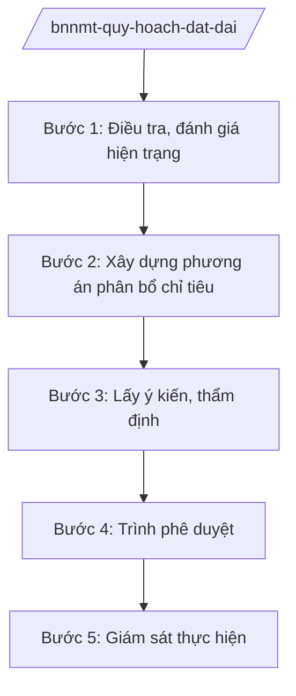

# Skill: Quy hoạch, kế hoạch sử dụng đất quốc gia

## 2. Khi nào dùng

- Khi lập Quy hoạch sử dụng đất quốc gia thời kỳ mới.
- Khi lập Kế hoạch sử dụng đất quốc gia 5 năm.
- Khi điều chỉnh quy hoạch, kế hoạch sử dụng đất quốc gia.
- Khi thẩm định quy hoạch sử dụng đất cấp tỉnh; giám sát thực hiện chỉ tiêu sử dụng đất.

## 3. Đầu vào (Input)

| Trường | Mô tả | Bắt buộc |
|--------|-------|----------|
| `loai_viec` | lập quy hoạch / lập kế hoạch 5 năm / điều chỉnh / thẩm định tỉnh | Có |
| `thoi_ky` | Thời kỳ quy hoạch/kế hoạch | Có |
| `so_lieu_hien_trang` | Hiện trạng sử dụng đất toàn quốc | Có |
| `chi_tieu_du_kien` | Chỉ tiêu các loại đất dự kiến | Không |

## 4. Quy trình

**Bước 1. Điều tra, đánh giá hiện trạng**
- Làm gì: Tổng hợp số liệu kiểm kê đất đai toàn quốc; đánh giá biến động, hiệu quả sử dụng đất các loại.
- Dùng input: `so_lieu_hien_trang`, `thoi_ky`.
- Vai trò: Chuyên viên Cục Quy hoạch và Phát triển tài nguyên đất tổng hợp; AI hỗ trợ chuẩn hóa số liệu, lập bảng — ⏱ 30 ngày.
- Lưu ý nghiệp vụ: Số liệu kiểm kê đất đai định kỳ là căn cứ bắt buộc; phân loại đất thống nhất toàn quốc.
- → Kết quả bước: Báo cáo hiện trạng sử dụng đất.

**Bước 2. Xây dựng phương án phân bổ chỉ tiêu**
- Làm gì: Dự báo nhu cầu sử dụng đất các ngành, địa phương; phân bổ chỉ tiêu: đất nông nghiệp, đất phi nông nghiệp, đất chưa sử dụng; chỉ tiêu bảo vệ đất trồng lúa, đất rừng.
- Dùng input: `chi_tieu_du_kien`.
- Vai trò: Cục trưởng chỉ đạo; AI hỗ trợ lập bảng phân bổ, đối chiếu với quy hoạch ngành — ⏱ 45 ngày.
- Lưu ý nghiệp vụ: Bảo đảm chỉ tiêu đất trồng lúa, đất rừng phòng hộ theo quy định; cân đối với quy hoạch phát triển KT-XH.
- → Kết quả bước: Dự thảo quy hoạch/kế hoạch sử dụng đất quốc gia.

**Bước 3. Lấy ý kiến, thẩm định**
- Làm gì: Lấy ý kiến bộ, ngành, địa phương; Hội đồng thẩm định quy hoạch sử dụng đất quốc gia thẩm định.
- Dùng input: Dự thảo.
- Vai trò: Chuyên viên tổng hợp ý kiến; AI hỗ trợ phân loại — ⏱ 30 ngày.
- Lưu ý nghiệp vụ: Ý kiến địa phương về chỉ tiêu đất phải được xem xét kỹ; công khai dự thảo theo quy định.
- → Kết quả bước: Báo cáo thẩm định.

**Bước 4. Trình phê duyệt**
- Làm gì: Hoàn thiện hồ sơ trình Chính phủ; Quy hoạch sử dụng đất quốc gia trình Quốc hội quyết định.
- Dùng input: Hồ sơ hoàn chỉnh.
- Vai trò: Thứ trưởng ký tờ trình; Bộ trưởng trình Chính phủ; AI hỗ trợ: kiểm tra hồ sơ — ⏱ 20 ngày.
- Lưu ý nghiệp vụ: Quy hoạch sử dụng đất quốc gia do Quốc hội quyết định; kế hoạch 5 năm do Chính phủ phê duyệt.
- → Kết quả bước: Nghị quyết của Quốc hội / Quyết định của Chính phủ.

**Bước 5. Giám sát thực hiện**
- Làm gì: Theo dõi thực hiện chỉ tiêu tại địa phương; thẩm định quy hoạch sử dụng đất cấp tỉnh bảo đảm phù hợp chỉ tiêu quốc gia.
- Dùng input: `loai_viec` (thẩm định tỉnh/giám sát).
- Vai trò: Chuyên viên Cục; AI hỗ trợ đối chiếu chỉ tiêu — ⏱ thường xuyên.
- Lưu ý nghiệp vụ: Quy hoạch cấp tỉnh không được vượt chỉ tiêu quốc gia phân bổ.
- → Kết quả bước: Văn bản thẩm định; báo cáo giám sát.

## Luồng quy trình (Workflow)

## 5. Đầu ra (Output)

- Báo cáo hiện trạng sử dụng đất.
- Dự thảo Quy hoạch/Kế hoạch sử dụng đất quốc gia.
- Nghị quyết Quốc hội / Quyết định Chính phủ phê duyệt.
- Văn bản thẩm định quy hoạch cấp tỉnh; báo cáo giám sát.

### Cấu trúc output chuẩn (thể thức NĐ 30/2020/NĐ-CP)

**Khung thể thức chung (NĐ 30/2020/NĐ-CP):** mọi văn bản trong output đều trình bày đầy đủ: Quốc hiệu "CỘNG HÒA XÃ HỘI CHỦ NGHĨA VIỆT NAM", Tiêu ngữ "Độc lập – Tự do – Hạnh phúc"; tên cơ quan ban hành; số, ký hiệu văn bản; địa danh, ngày tháng năm ban hành; tên loại văn bản; nội dung theo các mục dưới đây; nơi nhận (kết thúc "- Lưu: VT, [mã đơn vị]."); khối chữ ký (chức danh, họ tên người ký; ký hiệu "KT."/"TL." khi ký thay).

**Quy hoạch sử dụng đất quốc gia gồm:**
1. Đánh giá hiện trạng, biến động sử dụng đất.
2. Quan điểm, mục tiêu sử dụng đất.
3. Định hướng sử dụng đất theo loại đất, theo vùng.
4. Chỉ tiêu sử dụng đất phân bổ cho các tỉnh.
5. Giải pháp thực hiện.
6. Tổ chức thực hiện, giám sát.

> **Checklist thể thức văn bản theo NĐ 30/2020/NĐ-CP** — đối chiếu trước khi trình ký:
> 1. Quốc hiệu và Tiêu ngữ.
> 2. Tên cơ quan, tổ chức ban hành văn bản.
> 3. Số, ký hiệu của văn bản.
> 4. Địa danh và thời gian ban hành văn bản.
> 5. Tên loại và trích yếu nội dung văn bản.
> 6. Nội dung văn bản.
> 7. Chức vụ, họ tên và chữ ký của người có thẩm quyền.
> 8. Dấu, chữ ký số của cơ quan, tổ chức.
> 9. Nơi nhận (kèm Phụ lục nếu có).

## 6. Checklist nghiệm thu

- [ ] Số liệu kiểm kê đất đai đầy đủ, cập nhật.
- [ ] Chỉ tiêu đất trồng lúa, đất rừng được bảo vệ.
- [ ] Phù hợp quy hoạch tổng thể quốc gia.
- [ ] Đã lấy ý kiến địa phương, công khai dự thảo.
- [ ] Có báo cáo thẩm định của Hội đồng.
- [ ] Đúng thẩm quyền phê duyệt (Quốc hội/Chính phủ).

## 7. Ví dụ mô phỏng

*Dữ liệu dưới đây là giả lập 100% phục vụ minh họa.*

**Input mẫu:** loai_viec = "lập kế hoạch 5 năm"; thoi_ky = "2026–2030 (giả lập)"; so_lieu_hien_trang = "Tổng diện tích tự nhiên 33 triệu ha (giả lập); đất nông nghiệp 27 triệu ha (giả lập)"; chi_tieu_du_kien = "Giữ 3,5 triệu ha đất trồng lúa (giả lập)".

**Output mẫu (trích Kế hoạch sử dụng đất quốc gia):**

1. **Hiện trạng:** đất nông nghiệp 27 triệu ha, đất phi nông nghiệp 5 triệu ha (giả lập).
2. **Mục tiêu:** sử dụng đất tiết kiệm, hiệu quả; bảo vệ 3,5 triệu ha đất trồng lúa (giả lập).
3. **Phân bổ:** bảng chỉ tiêu 34 tỉnh (giả lập): tỉnh A được phân bổ 500.000 ha đất nông nghiệp (giả lập).
4. **Giải pháp:** siết chuyển mục đích đất lúa; đấu giá quyền sử dụng đất minh bạch.
5. **Giám sát:** Bộ NN&MT kiểm tra hằng năm; xử lý vượt chỉ tiêu.

## 8. Human gate (người kiểm duyệt)

- Chuyên viên → Cục trưởng Cục Quy hoạch và Phát triển tài nguyên đất duyệt.
- Hội đồng thẩm định thẩm định.
- Thứ trưởng ký tờ trình → Bộ trưởng trình Chính phủ → Quốc hội quyết định (quy hoạch).

## 9. Giới hạn (guardrails)

- AI không quyết định chỉ tiêu phân bổ đất thay cơ quan có thẩm quyền.
- Không bịa số liệu đất đai; số liệu phải từ kiểm kê chính thức.
- Không viện dẫn văn bản hết hiệu lực.

## 10. Căn cứ & lưu ý

- NĐ 35/2025/NĐ-CP ngày 25/02/2025 — chức năng, nhiệm vụ, quyền hạn của Bộ NN&MT (được sửa đổi tại NĐ 109/2025/NĐ-CP).
- NQ 176/2025/QH15 — cơ cấu tổ chức của Chính phủ.
- Pháp luật về đất đai (quy hoạch, kế hoạch sử dụng đất).
- Pháp luật về quy hoạch.
- NĐ 30/2020/NĐ-CP — thể thức văn bản hành chính.
- Lưu ý: Quy hoạch sử dụng đất quốc gia do Quốc hội quyết định.
