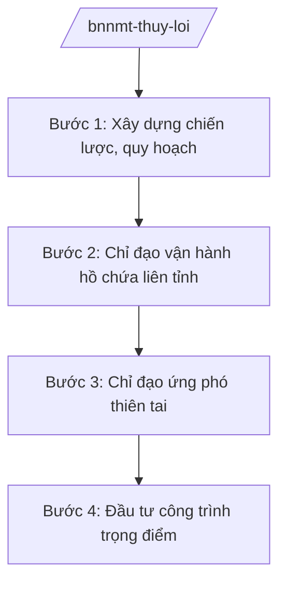

# Skill: Thủy lợi, đê điều, PCTT (cấp bộ)

## 2. Khi nào dùng

- Khi xây dựng chiến lược, quy hoạch thủy lợi, đê điều toàn quốc.
- Khi chỉ đạo vận hành hồ chứa lớn liên tỉnh trong mùa mưa lũ.
- Khi chỉ đạo ứng phó thiên tai cấp quốc gia: bão, lũ, hạn hán, xâm nhập mặn.
- Khi phân bổ vốn đầu tư công trình thủy lợi, đê điều trọng điểm.

## 3. Đầu vào (Input)

| Trường | Mô tả | Bắt buộc |
|--------|-------|----------|
| `loai_viec` | quy hoạch / vận hành hồ chứa / ứng phó thiên tai / đầu tư | Có |
| `doi_tuong` | Hệ thống thủy lợi / tuyến đê / lưu vực sông | Không |
| `tinh_huong` | Bão, lũ, hạn, mặn / vận hành bình thường | Không |

## 4. Quy trình

**Bước 1. Xây dựng chiến lược, quy hoạch**
- Làm gì: Lập quy hoạch thủy lợi, đê điều, phòng chống thiên tai toàn quốc; xác định hệ thống công trình trọng điểm.
- Dùng input: `loai_viec` (quy hoạch).
- Vai trò: Chuyên viên Cục Thủy lợi dự thảo; AI hỗ trợ tổng hợp số liệu, soạn thảo — ⏱ 45 ngày.
- Lưu ý nghiệp vụ: Phù hợp quy hoạch tổng thể quốc gia, thích ứng biến đổi khí hậu.
- → Kết quả bước: Dự thảo quy hoạch trình phê duyệt.

**Bước 2. Chỉ đạo vận hành hồ chứa liên tỉnh**
- Làm gì: Ban hành quy trình vận hành liên hồ chứa trên các lưu vực sông; chỉ đạo xả lũ, tích nước theo diễn biến mưa lũ, hạn hán.
- Dùng input: `doi_tuong`, `tinh_huong`.
- Vai trò: Cục trưởng Cục Thủy lợi tham mưu; Bộ trưởng ban hành quy trình; AI hỗ trợ tổng hợp mực nước, lưu lượng — ⏱ theo mùa vụ.
- Lưu ý nghiệp vụ: Vận hành liên hồ phải bảo đảm an toàn đập, giảm lũ hạ du, cấp nước; thông báo kịp thời cho địa phương hạ du.
- → Kết quả bước: Quy trình vận hành; lệnh vận hành hồ chứa.

**Bước 3. Chỉ đạo ứng phó thiên tai**
- Làm gì: Theo dõi diễn biến bão, lũ; ban hành công điện chỉ đạo địa phương ứng phó; điều động lực lượng, vật tư cứu hộ; tổng hợp thiệt hại, đề xuất hỗ trợ.
- Dùng input: `tinh_huong`.
- Vai trò: Cục trưởng Cục Quản lý đê điều và PCTT tham mưu; Bộ trưởng ký công điện; AI hỗ trợ tổng hợp báo cáo nhanh — ⏱ khẩn cấp theo diễn biến.
- Lưu ý nghiệp vụ: Phối hợp Ban Chỉ đạo quốc gia về PCTT, Bộ Quốc phòng, Bộ Công an; thông tin kịp thời, chính xác.
- → Kết quả bước: Công điện chỉ đạo; báo cáo thiệt hại và đề xuất hỗ trợ.

**Bước 4. Đầu tư công trình trọng điểm**
- Làm gì: Đề xuất danh mục công trình thủy lợi, đê điều trọng điểm đầu tư công; thẩm định, trình phê duyệt chủ trương đầu tư.
- Dùng input: `doi_tuong`.
- Vai trò: Chuyên viên Cục thẩm định; AI hỗ trợ lập danh mục, phân tích hiệu quả — ⏱ 30 ngày.
- Lưu ý nghiệp vụ: Ưu tiên công trình phòng chống lũ, hạn, xâm nhập mặn vùng trọng điểm; phối hợp Bộ Kế hoạch và Đầu tư (nay thuộc Bộ Tài chính).
- → Kết quả bước: Danh mục công trình được phê duyệt.

## Luồng quy trình (Workflow)

## 5. Đầu ra (Output)

- Quy hoạch thủy lợi, đê điều toàn quốc.
- Quy trình vận hành liên hồ chứa; công điện chỉ đạo ứng phó.
- Báo cáo thiệt hại thiên tai, đề xuất hỗ trợ.
- Danh mục công trình trọng điểm.

### Cấu trúc output chuẩn (thể thức NĐ 30/2020/NĐ-CP)

**Khung thể thức chung (NĐ 30/2020/NĐ-CP):** mọi văn bản trong output đều trình bày đầy đủ: Quốc hiệu "CỘNG HÒA XÃ HỘI CHỦ NGHĨA VIỆT NAM", Tiêu ngữ "Độc lập – Tự do – Hạnh phúc"; tên cơ quan ban hành; số, ký hiệu văn bản; địa danh, ngày tháng năm ban hành; tên loại văn bản; nội dung theo các mục dưới đây; nơi nhận (kết thúc "- Lưu: VT, [mã đơn vị]."); khối chữ ký (chức danh, họ tên người ký; ký hiệu "KT."/"TL." khi ký thay).

**Công điện chỉ đạo ứng phó thiên tai gồm:**
1. Nhận định diễn biến thiên tai.
2. Yêu cầu các địa phương, bộ ngành (sơ tán dân, bảo vệ đê, hồ chứa).
3. Lực lượng, phương tiện sẵn sàng.
4. Chế độ thông tin, báo cáo.
5. Tổ chức thực hiện.

> **Checklist thể thức văn bản theo NĐ 30/2020/NĐ-CP** — đối chiếu trước khi trình ký:
> 1. Quốc hiệu và Tiêu ngữ.
> 2. Tên cơ quan, tổ chức ban hành văn bản.
> 3. Số, ký hiệu của văn bản.
> 4. Địa danh và thời gian ban hành văn bản.
> 5. Tên loại và trích yếu nội dung văn bản.
> 6. Nội dung văn bản.
> 7. Chức vụ, họ tên và chữ ký của người có thẩm quyền.
> 8. Dấu, chữ ký số của cơ quan, tổ chức.
> 9. Nơi nhận (kèm Phụ lục nếu có).

## 6. Checklist nghiệm thu

- [ ] Quy hoạch phù hợp quy hoạch tổng thể, thích ứng BĐKH.
- [ ] Quy trình vận hành liên hồ bảo đảm an toàn đập và hạ du.
- [ ] Công điện ban hành kịp thời theo diễn biến thiên tai.
- [ ] Báo cáo thiệt hại có số liệu địa phương, đề xuất hỗ trợ cụ thể.
- [ ] Đúng thẩm quyền ký.

## 7. Ví dụ mô phỏng

*Dữ liệu dưới đây là giả lập 100% phục vụ minh họa.*

**Input mẫu:** loai_viec = "ứng phó thiên tai"; tinh_huong = "Bão số 5 đổ bộ, lũ lớn lưu vực sông AA (giả lập)"; doi_tuong = "Lưu vực sông AA (giả lập)".

**Output mẫu (trích Công điện — giả lập):**

**Công điện của Bộ trưởng Bộ NN&MT** (số 1234/CĐ-BNNMT, giả lập):
1. Bão số 5 (giả lập) đổ bộ, lũ trên sông AA vượt báo động 3 (giả lập).
2. Yêu cầu UBND tỉnh A và các tỉnh hạ du: sơ tán 10.000 dân vùng ngập (giả lập); gia cố 5 trọng điểm đê xung yếu (giả lập).
3. Hồ chứa AA (giả lập) xả lũ theo quy trình liên hồ; thông báo trước 4 giờ cho hạ du (giả lập).
4. Lực lượng xung kích trực 24/24; báo cáo về Bộ 6 giờ/lần (giả lập).

## 8. Human gate (người kiểm duyệt)

- Chuyên viên → Cục trưởng Cục Thủy lợi / Cục Quản lý đê điều và PCTT duyệt.
- Bộ trưởng ký quy trình vận hành, công điện chỉ đạo.
- Phối hợp Ban Chỉ đạo quốc gia về PCTT.

## 9. Giới hạn (guardrails)

- AI không ra lệnh vận hành hồ chứa, sơ tán dân thay người có thẩm quyền.
- Không bịa số liệu mưa lũ, thiệt hại; số liệu phải từ quan trắc, báo cáo địa phương.
- Thông tin thiên tai phải chính xác, kịp thời, không gây hoang mang.

## 10. Căn cứ & lưu ý

- NĐ 35/2025/NĐ-CP ngày 25/02/2025 — chức năng, nhiệm vụ, quyền hạn của Bộ NN&MT (được sửa đổi tại NĐ 109/2025/NĐ-CP).
- NQ 176/2025/QH15 — cơ cấu tổ chức của Chính phủ.
- Pháp luật về đê điều; pháp luật về phòng, chống thiên tai; pháp luật về thủy lợi.
- NĐ 30/2020/NĐ-CP — thể thức văn bản hành chính.
