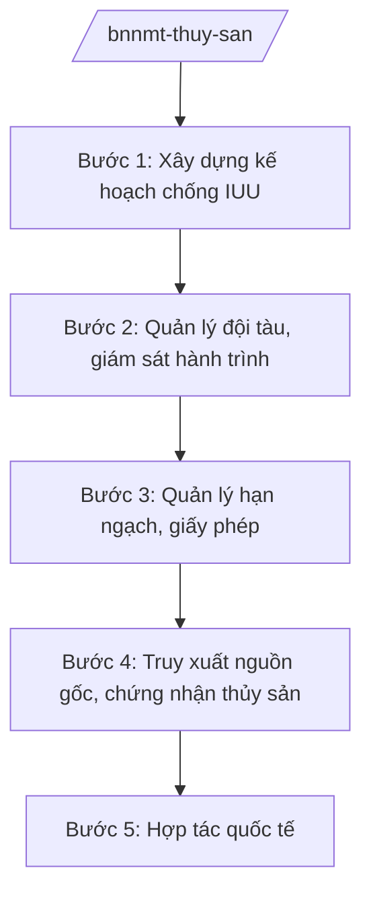

# Skill: Quản lý thủy sản (chống IUU, hạn ngạch)

## 2. Khi nào dùng

- Khi triển khai nhiệm vụ chống khai thác hải sản bất hợp pháp, không báo cáo, không theo quy định (IUU).
- Khi phân bổ hạn ngạch khai thác, giấy phép khai thác thủy sản vùng khơi.
- Khi quản lý đội tàu cá: đăng ký, giám sát hành trình (VMS), truy xuất nguồn gốc.
- Khi đàm phán, hợp tác quốc tế về nghề cá; thực hiện cam kết với thị trường xuất khẩu.

## 3. Đầu vào (Input)

| Trường | Mô tả | Bắt buộc |
|--------|-------|----------|
| `loai_viec` | chống IUU / hạn ngạch / quản lý tàu cá / hợp tác quốc tế | Có |
| `doi_tuong` | Vùng biển / đội tàu / cảng cá | Không |
| `so_lieu` | Số liệu tàu cá, sản lượng, vi phạm | Không |

## 4. Quy trình

**Bước 1. Xây dựng kế hoạch chống IUU**
- Làm gì: Rà soát khuyến nghị của thị trường nhập khẩu (EC); xây dựng kế hoạch hành động quốc gia chống IUU: hoàn thiện pháp luật, kiểm soát tàu cá, truy xuất nguồn gốc.
- Dùng input: `loai_viec` (chống IUU).
- Vai trò: Chuyên viên Cục Thủy sản và Kiểm ngư dự thảo; AI hỗ trợ tổng hợp tiến độ các địa phương — ⏱ 20 ngày.
- Lưu ý nghiệp vụ: 4 nhóm nhiệm vụ trọng tâm: khung pháp lý, quản lý đội tàu, truy xuất nguồn gốc, thực thi pháp luật.
- → Kết quả bước: Kế hoạch hành động được phê duyệt.

**Bước 2. Quản lý đội tàu, giám sát hành trình**
- Làm gì: Quản lý đăng ký tàu cá toàn quốc; bắt buộc lắp thiết bị giám sát hành trình (VMS) tàu từ 15m trở lên; xử lý tàu mất kết nối, vượt ranh giới.
- Dùng input: `doi_tuong`, `so_lieu`.
- Vai trò: Cục Thủy sản và Kiểm ngư chỉ đạo; Chi cục Thủy sản địa phương thực hiện; AI hỗ trợ phân tích dữ liệu VMS, cảnh báo — ⏱ thường xuyên.
- Lưu ý nghiệp vụ: Tàu cá vi phạm vùng biển nước ngoài bị xử lý nghiêm, tước giấy phép; 100% tàu phải có VMS hoạt động khi ra khơi.
- → Kết quả bước: Đội tàu được kiểm soát; vi phạm bị xử lý.

**Bước 3. Quản lý hạn ngạch, giấy phép**
- Làm gì: Đánh giá trữ lượng nguồn lợi; phân bổ hạn ngạch khai thác theo vùng biển, nghề; cấp giấy phép khai thác thủy sản vùng khơi.
- Dùng input: `so_lieu`.
- Vai trò: Lãnh đạo Cục trình; Bộ trưởng quyết định hạn ngạch; AI hỗ trợ tính toán, lập bảng phân bổ — ⏱ 30 ngày.
- Lưu ý nghiệp vụ: Hạn ngạch dựa trên đánh giá khoa học trữ lượng; bảo vệ nguồn lợi, cấm khai thác mùa sinh sản.
- → Kết quả bước: Quyết định hạn ngạch, giấy phép khai thác.

**Bước 4. Truy xuất nguồn gốc, chứng nhận thủy sản**
- Làm gì: Quản lý hệ thống truy xuất nguồn gốc thủy sản từ khai thác đến xuất khẩu; cấp giấy chứng nhận nguồn gốc (Catch Certificate) cho lô hàng xuất khẩu.
- Dùng input: `doi_tuong` (cảng cá, lô hàng).
- Vai trò: Chuyên viên Cục; AI hỗ trợ kiểm tra hồ sơ truy xuất — ⏱ theo lô hàng.
- Lưu ý nghiệp vụ: Lô hàng không truy xuất được nguồn gốc không được chứng nhận xuất khẩu.
- → Kết quả bước: Giấy chứng nhận nguồn gốc thủy sản.

**Bước 5. Hợp tác quốc tế**
- Làm gì: Đàm phán hiệp định nghề cá; phối hợp tuần tra chung; làm việc với EC về gỡ "thẻ vàng" IUU.
- Dùng input: `loai_viec` (hợp tác quốc tế).
- Vai trò: Lãnh đạo Bộ chỉ đạo; AI hỗ trợ chuẩn bị tài liệu — ⏱ theo sự kiện.
- Lưu ý nghiệp vụ: Phối hợp Bộ Ngoại giao, Bộ Quốc phòng (Cảnh sát biển).
- → Kết quả bước: Thỏa thuận hợp tác; tiến triển gỡ thẻ vàng.

## Luồng quy trình (Workflow)

## 5. Đầu ra (Output)

- Kế hoạch hành động quốc gia chống IUU.
- Quyết định hạn ngạch khai thác; giấy phép khai thác vùng khơi.
- Giấy chứng nhận nguồn gốc thủy sản xuất khẩu.
- Báo cáo kết quả chống IUU định kỳ.

### Cấu trúc output chuẩn (thể thức NĐ 30/2020/NĐ-CP)

**Khung thể thức chung (NĐ 30/2020/NĐ-CP):** mọi văn bản trong output đều trình bày đầy đủ: Quốc hiệu "CỘNG HÒA XÃ HỘI CHỦ NGHĨA VIỆT NAM", Tiêu ngữ "Độc lập – Tự do – Hạnh phúc"; tên cơ quan ban hành; số, ký hiệu văn bản; địa danh, ngày tháng năm ban hành; tên loại văn bản; nội dung theo các mục dưới đây; nơi nhận (kết thúc "- Lưu: VT, [mã đơn vị]."); khối chữ ký (chức danh, họ tên người ký; ký hiệu "KT."/"TL." khi ký thay).

**Báo cáo kết quả chống IUU gồm:**
1. Hoàn thiện khung pháp lý.
2. Quản lý đội tàu (đăng ký, VMS).
3. Truy xuất nguồn gốc, chứng nhận.
4. Thực thi pháp luật (số vụ xử lý).
5. Hợp tác quốc tế.
6. Tồn tại, kiến nghị.
## 6. Checklist nghiệm thu

- [ ] Kế hoạch chống IUU đầy đủ 4 nhóm nhiệm vụ.
- [ ] 100% tàu thuộc diện lắp VMS hoạt động.
- [ ] Hạn ngạch dựa trên đánh giá trữ lượng khoa học.
- [ ] Truy xuất nguồn gốc thông suốt từ khai thác đến xuất khẩu.
- [ ] Tàu vi phạm vùng biển nước ngoài bị xử lý nghiêm.
- [ ] Đúng thẩm quyền ký các quyết định.

## 7. Ví dụ mô phỏng

*Dữ liệu dưới đây là giả lập 100% phục vụ minh họa.*

**Input mẫu:** loai_viec = "chống IUU"; doi_tuong = "Vùng biển giả lập"; so_lieu = "10.000 tàu cá từ 15m trở lên (giả lập); 50 tàu mất kết nối VMS/tháng (giả lập)".

**Output mẫu (trích Báo cáo — giả lập):**

1. **Khung pháp lý:** hoàn thiện nghị định xử phạt vi phạm IUU (giả lập).
2. **Quản lý tàu:** 98% tàu lắp VMS hoạt động (giả lập); xử phạt 50 tàu mất kết nối (giả lập).
3. **Truy xuất:** 100% lô hàng xuất khẩu có Catch Certificate (giả lập).
4. **Thực thi:** xử lý 200 vụ vi phạm, tước 10 giấy phép (giả lập).
5. **Hợp tác:** đoàn công tác làm việc với EC, ghi nhận tiến triển (giả lập).
6. **Kiến nghị:** tăng mức phạt tàu vi phạm vùng biển nước ngoài (giả lập).

## 8. Human gate (người kiểm duyệt)

- Chuyên viên → Cục trưởng Cục Thủy sản và Kiểm ngư duyệt.
- Thứ trưởng phụ trách → Bộ trưởng quyết định hạn ngạch, kế hoạch quốc gia.

## 9. Giới hạn (guardrails)

- AI không quyết định hạn ngạch, xử phạt thay người có thẩm quyền.
- Không bịa số liệu tàu cá, sản lượng, vi phạm.
- Không tiết lộ thông tin tuần tra, kiểm soát trên biển.

## 10. Căn cứ & lưu ý

- NĐ 35/2025/NĐ-CP ngày 25/02/2025 — chức năng, nhiệm vụ, quyền hạn của Bộ NN&MT (được sửa đổi tại NĐ 109/2025/NĐ-CP).
- NQ 176/2025/QH15 — cơ cấu tổ chức của Chính phủ.
- Pháp luật về thủy sản (chống khai thác IUU, quản lý tàu cá).
- NĐ 30/2020/NĐ-CP — thể thức văn bản hành chính.
