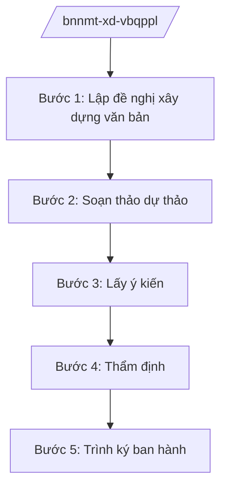

# Skill: Xây dựng VBQPPL lĩnh vực NN&MT

## 2. Khi nào dùng

- Khi Bộ NN&MT lập đề nghị xây dựng nghị định, thông tư thuộc lĩnh vực nông nghiệp, đất đai, tài nguyên, môi trường.
- Khi Vụ Pháp chế thẩm định dự thảo do các vụ, cục thuộc Bộ chủ trì soạn thảo.
- Khi lấy ý kiến bộ, ngành, địa phương, đối tượng chịu tác động.
- Khi hoàn thiện hồ sơ trình Bộ trưởng ký ban hành (thông tư) hoặc trình Chính phủ (nghị định).

## 3. Đầu vào (Input)

| Trường | Mô tả | Bắt buộc |
|--------|-------|----------|
| `loai_van_ban` | Nghị định / Thông tư | Có |
| `ten_van_ban` | Tên gọi dự thảo | Có |
| `don_vi_chu_tri` | Vụ/cục chủ trì soạn thảo | Có |
| `can_cu_phap_ly` | Văn bản làm căn cứ ban hành | Có |
| `noi_dung_chinh` | Các chính sách, nội dung cốt lõi dự kiến | Có |
| `doi_tuong_tac_dong` | Tổ chức, cá nhân chịu tác động | Không |

## 4. Quy trình

**Bước 1. Lập đề nghị xây dựng văn bản**
- Làm gì: Đơn vị chủ trì lập đề nghị: sự cần thiết, phạm vi điều chỉnh, nội dung chính, đánh giá tác động; lấy ý kiến sơ bộ.
- Dùng input: `loai_van_ban`, `ten_van_ban`, `noi_dung_chinh`, `don_vi_chu_tri`.
- Vai trò: Chuyên viên vụ/cục chủ trì dự thảo; AI hỗ trợ lập dàn ý, tra cứu văn bản liên quan — ⏱ 10 ngày.
- Lưu ý nghiệp vụ: Lĩnh vực NN&MT rộng (đất đai, môi trường, nông nghiệp...); xác định đúng đơn vị chủ trì, phối hợp.
- → Kết quả bước: Đề nghị xây dựng văn bản được phê duyệt.

**Bước 2. Soạn thảo dự thảo**
- Làm gì: Tổ biên tập soạn thảo dự thảo; xây dựng tờ trình, báo cáo đánh giá tác động.
- Dùng input: `noi_dung_chinh`, `can_cu_phap_ly`.
- Vai trò: Vụ trưởng/Cục trưởng đơn vị chủ trì chỉ đạo; AI hỗ trợ soạn khung điều khoản, rà kỹ thuật — ⏱ 20 ngày.
- Lưu ý nghiệp vụ: Không quy định vượt thẩm quyền; thống nhất với pháp luật đất đai, môi trường, nông nghiệp hiện hành.
- → Kết quả bước: Dự thảo lần 1 + tờ trình + đánh giá tác động.

**Bước 3. Lấy ý kiến**
- Làm gì: Gửi lấy ý kiến các bộ, ngành, địa phương, hiệp hội, người dân; đăng công khai; tổ chức hội thảo.
- Dùng input: `doi_tuong_tac_dong`.
- Vai trò: Chuyên viên tổng hợp; AI hỗ trợ phân loại ý kiến, lập bảng tiếp thu — ⏱ 15 ngày.
- Lưu ý nghiệp vụ: Văn bản về đất đai, môi trường tác động rộng — phải lấy ý kiến kỹ, thực chất.
- → Kết quả bước: Bảng tổng hợp ý kiến + dự thảo hoàn thiện.

**Bước 4. Thẩm định**
- Làm gì: Vụ Pháp chế thẩm định tính hợp hiến, hợp pháp, thống nhất, kỹ thuật soạn thảo; có báo cáo thẩm định.
- Dùng input: Toàn bộ hồ sơ.
- Vai trò: Vụ trưởng Vụ Pháp chế ký báo cáo; AI hỗ trợ đối chiếu văn bản — ⏱ 10 ngày.
- Lưu ý nghiệp vụ: Dự thảo nghị định phải qua thẩm định của Bộ Tư pháp trước khi trình Chính phủ.
- → Kết quả bước: Báo cáo thẩm định.

**Bước 5. Trình ký ban hành**
- Làm gì: Hoàn thiện hồ sơ trình Bộ trưởng ký (thông tư) hoặc trình Chính phủ (nghị định).
- Dùng input: Toàn bộ hồ sơ.
- Vai trò: Thứ trưởng ký tờ trình; Bộ trưởng ký ban hành; AI hỗ trợ: kiểm tra lần cuối — ⏱ 7 ngày.
- Lưu ý nghiệp vụ: Hồ sơ trình Chính phủ qua Văn phòng Chính phủ.
- → Kết quả bước: Văn bản được ban hành / hồ sơ trình Chính phủ.

## Luồng quy trình (Workflow)

## 5. Đầu ra (Output)

- Đề nghị xây dựng văn bản được phê duyệt.
- Dự thảo + tờ trình + đánh giá tác động + bảng tổng hợp ý kiến.
- Báo cáo thẩm định Vụ Pháp chế.
- Văn bản QPPL được ban hành / hồ sơ trình Chính phủ.

### Cấu trúc output chuẩn

**Khung thể thức chung (NĐ 30/2020/NĐ-CP):** mọi văn bản trong output đều trình bày đầy đủ: Quốc hiệu "CỘNG HÒA XÃ HỘI CHỦ NGHĨA VIỆT NAM", Tiêu ngữ "Độc lập – Tự do – Hạnh phúc"; tên cơ quan ban hành; số, ký hiệu văn bản; địa danh, ngày tháng năm ban hành; tên loại văn bản; nội dung theo các mục dưới đây; nơi nhận (kết thúc "- Lưu: VT, [mã đơn vị]."); khối chữ ký (chức danh, họ tên người ký; ký hiệu "KT."/"TL." khi ký thay).

**Hồ sơ trình ban hành gồm:**
1. Tờ trình.
2. Dự thảo văn bản (thể thức NĐ 30/2020/NĐ-CP).
3. Báo cáo đánh giá tác động.
4. Bảng tổng hợp, tiếp thu, giải trình ý kiến.
5. Báo cáo thẩm định (Vụ Pháp chế; Bộ Tư pháp đối với nghị định).

*Thể thức văn bản tuân thủ NĐ 30/2020/NĐ-CP.*

*Thể thức văn bản tuân thủ NĐ 30/2020/NĐ-CP.*
## 6. Checklist nghiệm thu

- [ ] Đúng loại văn bản theo thẩm quyền.
- [ ] Đủ hồ sơ: tờ trình, dự thảo, đánh giá tác động, tổng hợp ý kiến, thẩm định.
- [ ] Ý kiến được tiếp thu/giải trình đầy đủ.
- [ ] Không trái văn bản cấp trên; thống nhất hệ thống pháp luật.
- [ ] Đúng thể thức NĐ 30/2020/NĐ-CP.
- [ ] Đã qua thẩm định theo quy định.

## 7. Ví dụ mô phỏng

*Dữ liệu dưới đây là giả lập 100% phục vụ minh họa.*

**Input mẫu:** loai_van_ban = "Thông tư"; ten_van_ban = "Thông tư quy định quan trắc môi trường định kỳ"; don_vi_chu_tri = "Cục Môi trường – Bộ NN&MT (giả lập)"; can_cu_phap_ly = "NĐ 35/2025/NĐ-CP; pháp luật về bảo vệ môi trường"; noi_dung_chinh = "Tần suất quan trắc, thông số bắt buộc, báo cáo dữ liệu"; doi_tuong_tac_dong = "Cơ sở sản xuất thuộc diện quan trắc".

**Output mẫu (trích hồ sơ trình):**

1. **Tờ trình Bộ trưởng** (số 1234/TTr-BNNMT, giả lập): sự cần thiết thống nhất tần suất quan trắc; nội dung 3 chương 15 điều (giả lập).
2. **Dự thảo Thông tư** (thể thức NĐ 30/2020/NĐ-CP).
3. **Báo cáo đánh giá tác động:** chi phí quan trắc của doanh nghiệp (giả lập).
4. **Bảng tổng hợp ý kiến:** 25 ý kiến, tiếp thu 20, giải trình 5 (giả lập).
5. **Báo cáo thẩm định Vụ Pháp chế:** đạt.

## 8. Human gate (người kiểm duyệt)

- Chuyên viên soạn → Vụ trưởng/Cục trưởng đơn vị chủ trì duyệt.
- Vụ Pháp chế thẩm định độc lập.
- Thứ trưởng ký tờ trình → Bộ trưởng ký ban hành (hoặc trình Chính phủ).

## 9. Giới hạn (guardrails)

- AI không quyết định nội dung chính sách thay Bộ; không tự ký/phát hành.
- Không bịa số hiệu, căn cứ pháp lý; không viện dẫn văn bản hết hiệu lực.
- Mọi ý kiến góp ý do con người quyết định tiếp thu hay giải trình.

## 10. Căn cứ & lưu ý

- NĐ 35/2025/NĐ-CP ngày 25/02/2025 — chức năng, nhiệm vụ, quyền hạn của Bộ NN&MT (được sửa đổi tại NĐ 109/2025/NĐ-CP).
- NQ 176/2025/QH15 — cơ cấu tổ chức của Chính phủ.
- Pháp luật về ban hành văn bản quy phạm pháp luật.
- NĐ 30/2020/NĐ-CP — thể thức văn bản hành chính.
