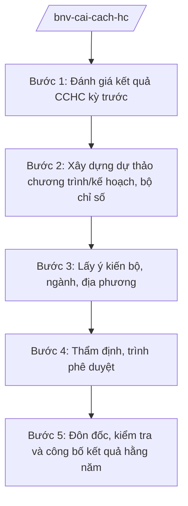

# Skill: Cải cách hành chính (chương trình tổng thể)

## 2. Khi nào dùng
- Xây dựng chương trình tổng thể cải cách hành chính nhà nước theo giai đoạn hoặc kế hoạch CCHC hằng năm trình Chính phủ/Thủ tướng phê duyệt.
- Xây dựng, sửa đổi bộ chỉ số đánh giá cải cách hành chính (PAR Index) của bộ, ngành, địa phương.
- Đôn đốc, kiểm tra, đánh giá kết quả thực hiện CCHC của các bộ, cơ quan ngang bộ và UBND cấp tỉnh.

## 3. Đầu vào (Input)

| Trường | Mô tả | Bắt buộc |
|--------|-------|----------|
| `pham_vi_chuong_trinh` | Chương trình tổng thể giai đoạn / Kế hoạch năm / Bộ chỉ số PAR Index | Có |
| `ket_qua_danh_gia_truoc` | Kết quả CCHC, điểm PAR Index kỳ trước | Có |
| `muc_tieu_yeu_cau` | Mục tiêu, yêu cầu của Chính phủ/Thủ tướng về CCHC | Có |
| `du_lieu_bo_nganh_dia_phuong` | Số liệu CCHC do bộ, ngành, địa phương báo cáo | Không |
| `can_cu_giao_nhiem_vu` | Văn bản giao nhiệm vụ | Có |

## 4. Quy trình

**Bước 1. Đánh giá kết quả CCHC kỳ trước**
- Làm gì: Tổng hợp kết quả thực hiện chương trình/kế hoạch CCHC kỳ trước; phân tích điểm PAR Index của bộ, ngành, địa phương; xác định tồn tại, nguyên nhân.
- Dùng input: `ket_qua_danh_gia_truoc`, `du_lieu_bo_nganh_dia_phuong`.
- Vai trò: Chuyên viên Vụ Cải cách hành chính tổng hợp (AI hỗ trợ phân tích số liệu, xếp hạng, so sánh biến động điểm PAR Index giữa các kỳ — 3–5 ngày) → Vụ trưởng kiểm tra.
- Lưu ý nghiệp vụ: Số liệu PAR Index phải từ kết quả đánh giá chính thức đã công bố; AI không tự chấm điểm thay hội đồng đánh giá.
- → Kết quả bước: Báo cáo đánh giá kết quả CCHC kỳ trước.

**Bước 2. Xây dựng dự thảo chương trình/kế hoạch, bộ chỉ số**
- Làm gì: Soạn thảo mục tiêu, nhiệm vụ, giải pháp của chương trình tổng thể/kế hoạch năm; thiết kế tiêu chí, thang điểm PAR Index (nếu xây dựng/sửa đổi bộ chỉ số).
- Dùng input: `muc_tieu_yeu_cau`, kết quả bước 1.
- Vai trò: Chuyên viên Vụ Cải cách hành chính soạn thảo (AI hỗ trợ rà soát mục tiêu các kỳ trước, gợi ý tiêu chí đo lường được, kiểm tra tính nhất quán — 5–7 ngày) → Vụ trưởng rà soát.
- Lưu ý nghiệp vụ: Mục tiêu phải cụ thể, đo lường được; tiêu chí PAR Index phải phản ánh đúng 6–8 nội dung CCHC và phù hợp mô hình CQĐP 2 cấp.
- → Kết quả bước: Dự thảo chương trình/kế hoạch, dự thảo bộ chỉ số PAR Index.

**Bước 3. Lấy ý kiến bộ, ngành, địa phương**
- Làm gì: Gửi dự thảo lấy ý kiến các bộ, cơ quan ngang bộ, UBND cấp tỉnh; tổ chức hội thảo (nếu cần); tổng hợp, tiếp thu/giải trình.
- Dùng input: Dự thảo bước 2.
- Vai trò: Chuyên viên tổng hợp (AI hỗ trợ phân loại ý kiến theo nhóm nội dung, lập bảng tiếp thu/giải trình — 2–3 ngày) → Vụ trưởng ký văn bản xin ý kiến.
- Lưu ý nghiệp vụ: Với bộ chỉ số PAR Index, ý kiến của địa phương về tính khả thi của tiêu chí phải được xem xét kỹ; ý kiến không tiếp thu phải giải trình.
- → Kết quả bước: Dự thảo hoàn thiện sau tiếp thu ý kiến.

**Bước 4. Thẩm định, trình phê duyệt**
- Làm gì: Vụ Pháp chế thẩm định (nếu là VBQPPL); lập tờ trình trình Bộ trưởng xem xét, báo cáo Chính phủ/Thủ tướng phê duyệt chương trình, kế hoạch, bộ chỉ số.
- Dùng input: Toàn bộ hồ sơ các bước trước.
- Vai trò: Vụ trưởng ký tờ trình (AI hỗ trợ rà soát thể thức theo NĐ 30/2020/NĐ-CP — 0,5 ngày) → Thứ trưởng kiểm tra → Bộ trưởng quyết định trình Chính phủ/Thủ tướng.
- Lưu ý nghiệp vụ: Hồ sơ trình đầy đủ: tờ trình, dự thảo, báo cáo đánh giá kỳ trước, bảng tổng hợp ý kiến.
- → Kết quả bước: Chương trình/kế hoạch/bộ chỉ số được phê duyệt.

**Bước 5. Đôn đốc, kiểm tra và công bố kết quả hằng năm**
- Làm gì: Hướng dẫn bộ, ngành, địa phương triển khai; tổ chức đánh giá PAR Index hằng năm; công bố kết quả xếp hạng; đôn đốc đơn vị điểm thấp khắc phục.
- Dùng input: Văn bản phê duyệt bước 4, số liệu báo cáo hằng năm.
- Vai trò: Chuyên viên Vụ Cải cách hành chính theo dõi (AI hỗ trợ tổng hợp số liệu tự đánh giá, đối chiếu chéo, lập bảng xếp hạng dự kiến — 5–7 ngày) → Vụ trưởng báo cáo Bộ trưởng → trình Thủ tướng công bố.
- Lưu ý nghiệp vụ: Kết quả xếp hạng chỉ công bố sau khi được cấp có thẩm quyền phê duyệt; AI không tự công bố hoặc "dự đoán" điểm chính thức.
- → Kết quả bước: Báo cáo kết quả CCHC và PAR Index hằng năm đã công bố; văn bản đôn đốc khắc phục.

## Luồng quy trình (Workflow)

## 5. Đầu ra (Output)

- Tờ trình + dự thảo chương trình tổng thể/kế hoạch CCHC (hoặc bộ chỉ số PAR Index).
- Báo cáo đánh giá kết quả CCHC kỳ trước.
- Báo cáo kết quả PAR Index hằng năm; văn bản đôn đốc.

### Cấu trúc output chuẩn
1. Quốc hiệu "CỘNG HÒA XÃ HỘI CHỦ NGHĨA VIỆT NAM", Tiêu ngữ "Độc lập – Tự do – Hạnh phúc"
2. Tên loại và trích yếu (Tờ trình/Chương trình/Kế hoạch).
3. Căn cứ (văn bản có thật, còn hiệu lực).
4. Phần I: Đánh giá kết quả kỳ trước (tồn tại, nguyên nhân).
5. Phần II: Mục tiêu, nhiệm vụ, giải pháp kỳ mới.
6. Phần III: Bộ chỉ số đánh giá (tiêu chí, thang điểm) — nếu có.
7. Phần IV: Tổ chức thực hiện, phân công bộ/ngành/địa phương.
8. Nơi nhận (kết thúc "- Lưu: VT, [mã đơn vị]."), chữ ký (ghi rõ chức danh, họ tên người ký; ký hiệu "KT."/"TL." khi ký thay) người có thẩm quyền (đúng thể thức NĐ 30/2020/NĐ-CP).

> **Checklist thể thức văn bản theo NĐ 30/2020/NĐ-CP** — đối chiếu trước khi trình ký:
> 1. Quốc hiệu và Tiêu ngữ.
> 2. Tên cơ quan, tổ chức ban hành văn bản.
> 3. Số, ký hiệu của văn bản.
> 4. Địa danh và thời gian ban hành văn bản.
> 5. Tên loại và trích yếu nội dung văn bản.
> 6. Nội dung văn bản.
> 7. Chức vụ, họ tên và chữ ký của người có thẩm quyền.
> 8. Dấu, chữ ký số của cơ quan, tổ chức.
> 9. Nơi nhận (kèm Phụ lục nếu có).

## 6. Checklist nghiệm thu
- [ ] Có báo cáo đánh giá kết quả kỳ trước với số liệu chính thức.
- [ ] Mục tiêu cụ thể, đo lường được; nhiệm vụ gắn đầu mối, thời hạn.
- [ ] Bộ chỉ số PAR Index có tiêu chí, thang điểm rõ ràng, phù hợp CQĐP 2 cấp.
- [ ] Đã lấy ý kiến bộ, ngành, địa phương; bảng tiếp thu/giải trình đầy đủ.
- [ ] Nội dung thuộc thẩm quyền Chính phủ/Thủ tướng được trình đúng cấp.
- [ ] Kết quả xếp hạng chỉ công bố sau phê duyệt của cấp có thẩm quyền.
- [ ] Thể thức đúng NĐ 30/2020/NĐ-CP; đã qua human gate các nấc.

## 7. Ví dụ mô phỏng

*Dữ liệu dưới đây là giả lập 100% phục vụ minh họa.*

**Input mẫu:**
- pham_vi_chuong_trinh: Kế hoạch cải cách hành chính năm 2026 của Chính phủ (giả lập)
- ket_qua_danh_gia_truoc: Điểm PAR Index bình quân các bộ năm 2025 đạt 85/100 (số liệu giả lập)
- muc_tieu_yeu_cau: Đẩy mạnh số hóa TTHC, cắt giảm điều kiện kinh doanh (giả lập)

**Output mẫu (trích Tờ trình):**

> **BỘ NỘI VỤ — VỤ CẢI CÁCH HÀNH CHÍNH**
> **Tờ trình về việc ban hành Kế hoạch cải cách hành chính năm 2026 của Chính phủ**
>
> Kính gửi: Thủ tướng Chính phủ (ông Nguyễn Văn AA)
>
> Căn cứ Nghị định số 25/2025/NĐ-CP của Chính phủ quy định chức năng, nhiệm vụ, quyền hạn và cơ cấu tổ chức của Bộ Nội vụ, Bộ Nội vụ kính trình Thủ tướng Chính phủ xem xét, phê duyệt Kế hoạch cải cách hành chính năm 2026 với các nhiệm vụ trọng tâm (giả lập): (1) rà soát, cắt giảm 20% điều kiện kinh doanh; (2) số hóa 100% TTHC đủ điều kiện; (3) hoàn thiện bộ chỉ số PAR Index phù hợp mô hình CQĐP 2 cấp...
>
> Hồ sơ kèm theo: dự thảo Kế hoạch, báo cáo đánh giá kết quả CCHC năm 2025, bảng tổng hợp ý kiến.
>
> *Nơi nhận: ... — BỘ TRƯỞNG (ông Lê Văn CC)*

## 8. Human gate
- Vụ trưởng Vụ Cải cách hành chính: duyệt báo cáo đánh giá, dự thảo chương trình/kế hoạch/bộ chỉ số, tờ trình.
- Thứ trưởng phụ trách (bà Phạm Thị DD): kiểm tra hồ sơ trước khi trình Bộ trưởng.
- Bộ trưởng (ông Lê Văn CC): cho ý kiến; quyết định trình Chính phủ/Thủ tướng.
- Thủ tướng Chính phủ/Chính phủ: phê duyệt chương trình tổng thể, kế hoạch CCHC, bộ chỉ số PAR Index; quyết định công bố kết quả xếp hạng.

## 9. Giới hạn
- AI không tự chấm điểm, xếp hạng PAR Index thay hội đồng đánh giá.
- AI không công bố kết quả xếp hạng khi chưa được cấp có thẩm quyền phê duyệt.
- AI không quyết định mục tiêu, nhiệm vụ CCHC thay người có thẩm quyền.
- Không bịa số liệu PAR Index, kết quả đánh giá; không viện dẫn văn bản hết hiệu lực.

## 10. Căn cứ & lưu ý
- Nghị định số 25/2025/NĐ-CP của Chính phủ quy định chức năng, nhiệm vụ, quyền hạn và cơ cấu tổ chức của Bộ Nội vụ. **Lưu ý:** thuvienphapluat.vn ghi nhận NĐ này được sửa đổi tại NĐ 128/2025/NĐ-CP và NĐ 109/2025/NĐ-CP — cần tra văn bản hợp nhất khi áp dụng.
- Thông tư số 06/2026/TT-BNV sửa đổi, bổ sung TT 10/2025/TT-BNV (cập nhật nhiệm vụ CCHC của ngành Nội vụ).
- Nghị định số 30/2020/NĐ-CP về công tác văn thư (thể thức văn bản).
- Luật Tổ chức Chính phủ (dẫn tên, không ghi số hiệu).
