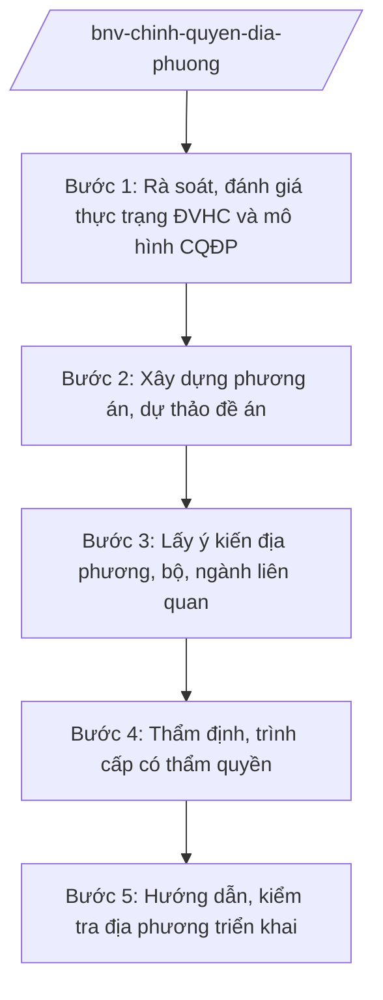

# Skill: Tổ chức chính quyền địa phương

## 2. Khi nào dùng
- Xây dựng đề án sắp xếp đơn vị hành chính cấp tỉnh, cấp xã (sáp nhập, điều chỉnh địa giới, đổi tên...).
- Hoàn thiện mô hình tổ chức chính quyền địa phương 2 cấp; rà soát, điều chỉnh phân cấp, phân quyền giữa trung ương và địa phương trong lĩnh vực nội vụ.
- Hướng dẫn, kiểm tra địa phương thực hiện sắp xếp ĐVHC và vận hành mô hình CQĐP 2 cấp.

## 3. Đầu vào (Input)

| Trường | Mô tả | Bắt buộc |
|--------|-------|----------|
| `noi_dung_de_an` | Sắp xếp ĐVHC / hoàn thiện mô hình CQĐP 2 cấp / phân cấp phân quyền | Có |
| `pham_vi_dia_phuong` | Tỉnh/thành phố, các ĐVHC liên quan (vd: UBND tỉnh A) | Có |
| `thuc_trang_dvhc` | Số liệu ĐVHC, dân số, diện tích, cán bộ dôi dư hiện tại | Có |
| `phuong_an_du_kien` | Phương án sắp xếp dự kiến của địa phương (nếu có) | Không |
| `can_cu_giao_nhiem_vu` | Văn bản giao nhiệm vụ của Chính phủ/Thủ tướng/Bộ trưởng | Có |

## 4. Quy trình

**Bước 1. Rà soát, đánh giá thực trạng ĐVHC và mô hình CQĐP**
- Làm gì: Thu thập số liệu ĐVHC (số lượng, diện tích, dân số), thực trạng tổ chức, hoạt động của CQĐP 2 cấp; đánh giá kết quả sắp xếp giai đoạn trước, tồn tại, vướng mắc.
- Dùng input: `pham_vi_dia_phuong`, `thuc_trang_dvhc`.
- Vai trò: Chuyên viên Vụ Chính quyền địa phương rà soát (AI hỗ trợ tổng hợp số liệu, đối chiếu tiêu chuẩn ĐVHC, lập bảng so sánh trước–sau — 3–5 ngày) → Vụ trưởng kiểm tra.
- Lưu ý nghiệp vụ: Số liệu phải do địa phương cung cấp/chính thức xác nhận; AI không tự suy đoán dân số, diện tích.
- → Kết quả bước: Báo cáo đánh giá thực trạng ĐVHC và mô hình CQĐP.

**Bước 2. Xây dựng phương án, dự thảo đề án**
- Làm gì: Thiết kế phương án sắp xếp ĐVHC (sáp nhập, điều chỉnh, đặt tên, xác định trụ sở) hoặc phương án phân cấp, phân quyền; dự thảo đề án kèm phụ lục số liệu, bản đồ địa giới (nếu có).
- Dùng input: `noi_dung_de_an`, `phuong_an_du_kien`, kết quả bước 1.
- Vai trò: Chuyên viên Vụ Chính quyền địa phương phối hợp địa phương xây dựng (AI hỗ trợ kiểm tra tính đầy đủ nội dung đề án, rà soát trùng tên ĐVHC — 5–7 ngày) → Vụ trưởng rà soát.
- Lưu ý nghiệp vụ: Phương án phải bảo đảm tiêu chuẩn ĐVHC theo quy định; có phương án bố trí, sắp xếp cán bộ, công chức dôi dư; tôn trọng ý kiến của địa phương và nguyện vọng nhân dân nơi sắp xếp.
- → Kết quả bước: Dự thảo đề án sắp xếp ĐVHC/phân cấp phân quyền.

**Bước 3. Lấy ý kiến địa phương, bộ, ngành liên quan**
- Làm gì: Gửi dự thảo đề án lấy ý kiến UBND cấp tỉnh liên quan (vd: UBND tỉnh A — Chủ tịch UBND tỉnh A: ông Phạm Văn P), các bộ, ngành có liên quan; tổng hợp, tiếp thu/giải trình.
- Dùng input: Dự thảo đề án bước 2.
- Vai trò: Chuyên viên tổng hợp (AI hỗ trợ phân loại ý kiến, lập bảng tiếp thu/giải trình — 2–3 ngày) → Vụ trưởng ký văn bản xin ý kiến.
- Lưu ý nghiệp vụ: Đề án sắp xếp ĐVHC phải có ý kiến chính thức của HĐND, UBND cấp tỉnh liên quan; ý kiến không tiếp thu phải giải trình bằng văn bản.
- → Kết quả bước: Đề án hoàn thiện sau tiếp thu ý kiến địa phương, bộ, ngành.

**Bước 4. Thẩm định, trình cấp có thẩm quyền**
- Làm gì: Vụ Pháp chế thẩm định tính hợp pháp, thống nhất; lập tờ trình trình Bộ trưởng xem xét, báo cáo Chính phủ/Thủ tướng; trình cấp có thẩm quyền quyết định theo quy định (đề án sắp xếp ĐVHC cấp tỉnh trình Quốc hội/Ủy ban Thường vụ Quốc hội theo thẩm quyền).
- Dùng input: Toàn bộ hồ sơ các bước trước.
- Vai trò: Vụ trưởng ký tờ trình (AI hỗ trợ rà soát thể thức theo NĐ 30/2020/NĐ-CP — 0,5 ngày) → Thứ trưởng kiểm tra → Bộ trưởng quyết định trình Chính phủ.
- Lưu ý nghiệp vụ: Xác định đúng thẩm quyền quyết định đối với từng loại ĐVHC (cấp tỉnh/cấp xã); không trình vượt thẩm quyền, không quyết thay cấp có thẩm quyền.
- → Kết quả bước: Đề án được trình cấp có thẩm quyền xem xét, quyết định.

**Bước 5. Hướng dẫn, kiểm tra địa phương triển khai**
- Làm gì: Ban hành văn bản hướng dẫn địa phương triển khai nghị quyết/quyết định về sắp xếp ĐVHC; kiểm tra tiến độ kiện toàn tổ chức, bố trí cán bộ, giải quyết chế độ dôi dư; tổng hợp báo cáo Chính phủ.
- Dùng input: Văn bản quyết định của cấp có thẩm quyền, báo cáo địa phương.
- Vai trò: Chuyên viên Vụ Chính quyền địa phương theo dõi (AI hỗ trợ tổng hợp tiến độ các địa phương, phát hiện vướng mắc phổ biến — 3–5 ngày/kỳ) → Vụ trưởng báo cáo Bộ trưởng.
- Lưu ý nghiệp vụ: Kịp thời tháo gỡ vướng mắc về chế độ, chính sách đối với cán bộ dôi dư; bảo đảm ổn định tổ chức, không gián đoạn quản lý nhà nước tại địa phương.
- → Kết quả bước: Văn bản hướng dẫn; báo cáo kiểm tra, tổng hợp kết quả triển khai.

## Luồng quy trình (Workflow)

## 5. Đầu ra (Output)

- Tờ trình + dự thảo đề án sắp xếp ĐVHC / phân cấp, phân quyền.
- Báo cáo đánh giá thực trạng; báo cáo thẩm định; bảng tổng hợp ý kiến.
- Văn bản hướng dẫn triển khai; báo cáo kiểm tra, tổng hợp.

### Cấu trúc output chuẩn
1. Quốc hiệu "CỘNG HÒA XÃ HỘI CHỦ NGHĨA VIỆT NAM", Tiêu ngữ "Độc lập – Tự do – Hạnh phúc"
2. Tên loại và trích yếu (Tờ trình/Đề án).
3. Căn cứ (văn bản có thật, còn hiệu lực).
4. Phần I: Sự cần thiết, căn cứ xây dựng đề án.
5. Phần II: Thực trạng ĐVHC, mô hình CQĐP (số liệu).
6. Phần III: Phương án sắp xếp/phân cấp phân quyền (tên gọi, địa giới, trụ sở, cán bộ).
7. Phần IV: Tổ chức thực hiện, lộ trình, kinh phí.
8. Nơi nhận (kết thúc "- Lưu: VT, [mã đơn vị]."), chữ ký (ghi rõ chức danh, họ tên người ký; ký hiệu "KT."/"TL." khi ký thay) người có thẩm quyền (đúng thể thức NĐ 30/2020/NĐ-CP).
## 6. Checklist nghiệm thu
- [ ] Có báo cáo đánh giá thực trạng với số liệu chính thức của địa phương.
- [ ] Phương án bảo đảm tiêu chuẩn ĐVHC; có phương án bố trí cán bộ dôi dư.
- [ ] Có ý kiến chính thức của HĐND, UBND cấp tỉnh liên quan.
- [ ] Đã lấy ý kiến bộ, ngành liên quan; bảng tiếp thu/giải trình đầy đủ.
- [ ] Xác định đúng thẩm quyền quyết định; trình đúng cấp, không quyết thay.
- [ ] Phù hợp NĐ 128/2025, NĐ 129/2025 về phân quyền, phân cấp, phân định thẩm quyền lĩnh vực nội vụ.
- [ ] Thể thức đúng NĐ 30/2020/NĐ-CP; đã qua human gate các nấc.

## 7. Ví dụ mô phỏng

*Dữ liệu dưới đây là giả lập 100% phục vụ minh họa.*

**Input mẫu:**
- noi_dung_de_an: Đề án sắp xếp đơn vị hành chính cấp xã thuộc tỉnh A (giả lập)
- pham_vi_dia_phuong: UBND tỉnh A
- thuc_trang_dvhc: Tỉnh A có 100 xã, trong đó 20 xã chưa đạt 50% tiêu chuẩn diện tích (số liệu giả lập)
- phuong_an_du_kien: Sáp nhập 20 xã thành 10 xã (phương án của tỉnh A, giả lập)

**Output mẫu (trích Tờ trình):**

> **BỘ NỘI VỤ — VỤ CHÍNH QUYỀN ĐỊA PHƯƠNG**
> **Tờ trình về Đề án sắp xếp đơn vị hành chính cấp xã thuộc tỉnh A giai đoạn 2026–2030**
>
> Kính gửi: Chính phủ
>
> Căn cứ Nghị định số 25/2025/NĐ-CP của Chính phủ quy định chức năng, nhiệm vụ, quyền hạn và cơ cấu tổ chức của Bộ Nội vụ; trên cơ sở đề nghị của UBND tỉnh A (Chủ tịch UBND tỉnh A: ông Phạm Văn P) và ý kiến của các bộ, ngành liên quan, Bộ Nội vụ kính trình Chính phủ xem xét Đề án với phương án (giả lập): sáp nhập 20 xã chưa đạt tiêu chuẩn thành 10 xã; bố trí, sắp xếp 60 cán bộ dôi dư theo lộ trình...
>
> Hồ sơ kèm theo: dự thảo Đề án, văn bản của UBND tỉnh A, bảng tổng hợp ý kiến, báo cáo thẩm định.
>
> *Nơi nhận: ... — BỘ TRƯỞNG (ông Lê Văn CC)*

## 8. Human gate
- Vụ trưởng Vụ Chính quyền địa phương: duyệt báo cáo đánh giá, dự thảo đề án, tờ trình.
- Vụ trưởng Vụ Pháp chế: ký báo cáo thẩm định.
- Thứ trưởng phụ trách (bà Phạm Thị DD): kiểm tra hồ sơ trước khi trình Bộ trưởng.
- Bộ trưởng (ông Lê Văn CC): cho ý kiến đề án; quyết định trình Chính phủ.
- Chính phủ/Thủ tướng Chính phủ: xem xét, trình cấp có thẩm quyền quyết định theo quy định (đối với sắp xếp ĐVHC thuộc thẩm quyền Quốc hội/Ủy ban Thường vụ Quốc hội).

## 9. Giới hạn
- AI không quyết định phương án sắp xếp ĐVHC thay người có thẩm quyền; chỉ hỗ trợ phân tích, đối chiếu tiêu chuẩn.
- AI không tự suy đoán số liệu dân số, diện tích, cán bộ dôi dư.
- AI không thay địa phương đề xuất phương án; không quyết thay cấp có thẩm quyền.
- Không bịa số liệu, tên ĐVHC có thật; không viện dẫn văn bản hết hiệu lực.

## 10. Căn cứ & lưu ý
- Nghị định số 25/2025/NĐ-CP của Chính phủ quy định chức năng, nhiệm vụ, quyền hạn và cơ cấu tổ chức của Bộ Nội vụ. **Lưu ý:** thuvienphapluat.vn ghi nhận NĐ này được sửa đổi tại NĐ 128/2025/NĐ-CP và NĐ 109/2025/NĐ-CP — cần tra văn bản hợp nhất khi áp dụng.
- Nghị định số 128/2025/NĐ-CP về phân quyền, phân cấp trong quản lý nhà nước lĩnh vực nội vụ.
- Nghị định số 129/2025/NĐ-CP về phân định thẩm quyền của chính quyền địa phương 2 cấp trong lĩnh vực quản lý nhà nước của Bộ Nội vụ.
- Nghị định số 150/2025/NĐ-CP về tổ chức cơ quan chuyên môn thuộc UBND cấp tỉnh, cấp xã; được sửa đổi bởi NĐ 370/2025/NĐ-CP (hiệu lực 01/01/2026).
- Nghị định số 30/2020/NĐ-CP về công tác văn thư (thể thức văn bản).
- Luật Tổ chức Chính phủ (dẫn tên, không ghi số hiệu).
