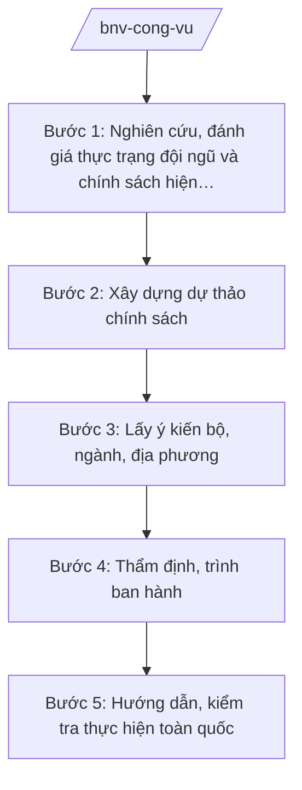

# Skill: Quản lý công vụ, chế độ CBCCVC

## 2. Khi nào dùng
- Xây dựng, sửa đổi chính sách về tuyển dụng, sử dụng, đánh giá, kỷ luật, đạo đức công vụ đối với cán bộ, công chức, viên chức trong cả nước.
- Xây dựng chính sách thu hút, trọng dụng nhân tài vào khu vực công.
- Hướng dẫn, kiểm tra việc thực hiện chế độ công vụ của bộ, ngành, địa phương; tổng hợp báo cáo Chính phủ.

## 3. Đầu vào (Input)

| Trường | Mô tả | Bắt buộc |
|--------|-------|----------|
| `noi_dung_chinh_sach` | Nội dung chính sách cần xây dựng/sửa đổi (tuyển dụng, đánh giá, kỷ luật, đạo đức công vụ, thu hút nhân tài...) | Có |
| `hinh_thuc_van_ban` | Thông tư / Nghị định / Đề án chính sách | Có |
| `thuc_trang_doi_ngu` | Số liệu đội ngũ CBCCVC, kết quả thực hiện chính sách hiện hành | Có |
| `can_cu_chu_truong` | Văn bản giao nhiệm vụ, chủ trương của cấp có thẩm quyền | Có |
| `danh_sach_lay_y_kien` | Bộ, ngành, địa phương lấy ý kiến | Không |

## 4. Quy trình

**Bước 1. Nghiên cứu, đánh giá thực trạng đội ngũ và chính sách hiện hành**
- Làm gì: Thu thập số liệu đội ngũ CBCCVC toàn quốc (số lượng, cơ cấu, chất lượng); đánh giá kết quả, hạn chế của chính sách hiện hành về nội dung cần xây dựng.
- Dùng input: `thuc_trang_doi_ngu`, `noi_dung_chinh_sach`.
- Vai trò: Chuyên viên Vụ Công chức – Viên chức nghiên cứu (AI hỗ trợ tổng hợp số liệu, phân tích xu hướng, so sánh với chính sách các giai đoạn trước — 3–5 ngày) → Vụ trưởng kiểm tra.
- Lưu ý nghiệp vụ: Số liệu phải từ báo cáo chính thức của bộ, ngành, địa phương; AI không tự suy đoán số liệu đội ngũ.
- → Kết quả bước: Báo cáo đánh giá thực trạng.

**Bước 2. Xây dựng dự thảo chính sách**
- Làm gì: Thiết kế nội dung chính sách: đối tượng, điều kiện, tiêu chuẩn, trình tự thủ tục, chế độ đãi ngộ, trách nhiệm thực hiện; dự thảo văn bản (thông tư/nghị định) hoặc đề án.
- Dùng input: `noi_dung_chinh_sach`, `hinh_thuc_van_ban`, kết quả bước 1.
- Vai trò: Tổ soạn thảo (chuyên viên Vụ Công chức – Viên chức + Vụ Pháp chế) thực hiện (AI hỗ trợ rà soát chính sách hiện hành liên quan, kiểm tra tính thống nhất, chuẩn hóa kỹ thuật — 5–7 ngày) → Vụ trưởng rà soát.
- Lưu ý nghiệp vụ: Chính sách phải phù hợp Luật Cán bộ, công chức và Luật Viên chức; phân biệt rõ đối tượng công chức và viên chức; chính sách thu hút nhân tài phải có cơ chế đãi ngộ cụ thể, khả thi về ngân sách.
- → Kết quả bước: Dự thảo chính sách (văn bản/đề án) lần 1.

**Bước 3. Lấy ý kiến bộ, ngành, địa phương**
- Làm gì: Gửi dự thảo lấy ý kiến các bộ, cơ quan ngang bộ, UBND cấp tỉnh; tổng hợp, tiếp thu/giải trình; đánh giá tác động ngân sách (phối hợp cơ quan tài chính khi có chế độ đãi ngộ).
- Dùng input: `danh_sach_lay_y_kien`, dự thảo bước 2.
- Vai trò: Chuyên viên tổng hợp (AI hỗ trợ phân loại ý kiến, lập bảng tiếp thu/giải trình — 2–3 ngày) → Vụ trưởng ký văn bản xin ý kiến.
- Lưu ý nghiệp vụ: Chính sách tác động đến địa phương phải lấy ý kiến UBND cấp tỉnh (vd: UBND tỉnh A); ý kiến không tiếp thu phải giải trình bằng văn bản.
- → Kết quả bước: Dự thảo lần 2 đã tiếp thu ý kiến.

**Bước 4. Thẩm định, trình ban hành**
- Làm gì: Vụ Pháp chế thẩm định; lập tờ trình trình Bộ trưởng ký ban hành (thông tư) hoặc báo cáo Chính phủ (nghị định/đề án chính sách).
- Dùng input: Toàn bộ hồ sơ các bước trước.
- Vai trò: Vụ trưởng ký tờ trình (AI hỗ trợ rà soát thể thức theo NĐ 30/2020/NĐ-CP — 0,5 ngày) → Thứ trưởng kiểm tra → Bộ trưởng ký ban hành hoặc quyết định trình Chính phủ.
- Lưu ý nghiệp vụ: Không trình ban hành khi còn ý kiến thẩm định chưa được xử lý; kiểm tra không viện dẫn văn bản hết hiệu lực.
- → Kết quả bước: Chính sách được ban hành.

**Bước 5. Hướng dẫn, kiểm tra thực hiện toàn quốc**
- Làm gì: Ban hành văn bản hướng dẫn thực hiện; kiểm tra việc áp dụng tại bộ, ngành, địa phương; tổng hợp khó khăn, vướng mắc, báo cáo Chính phủ; sơ kết, đề xuất sửa đổi khi cần.
- Dùng input: Văn bản chính sách đã ban hành, báo cáo của bộ/ngành/địa phương.
- Vai trò: Chuyên viên Vụ Công chức – Viên chức theo dõi (AI hỗ trợ tổng hợp báo cáo, phát hiện vướng mắc phổ biến — 3–5 ngày/kỳ) → Vụ trưởng báo cáo Bộ trưởng.
- Lưu ý nghiệp vụ: Việc kiểm tra tuân thủ đúng thẩm quyền, không can thiệp vào thẩm quyền quản lý CBCCVC của bộ, ngành, địa phương theo phân cấp.
- → Kết quả bước: Văn bản hướng dẫn; báo cáo kiểm tra, sơ kết thực hiện chính sách.

## Luồng quy trình (Workflow)

## 5. Đầu ra (Output)

- Tờ trình + dự thảo văn bản chính sách (thông tư/nghị định/đề án).
- Báo cáo đánh giá thực trạng; báo cáo thẩm định; bảng tổng hợp ý kiến.
- Văn bản hướng dẫn thực hiện; báo cáo kiểm tra, sơ kết.

### Cấu trúc output chuẩn
1. Quốc hiệu "CỘNG HÒA XÃ HỘI CHỦ NGHĨA VIỆT NAM", Tiêu ngữ "Độc lập – Tự do – Hạnh phúc"
2. Tên loại và trích yếu nội dung văn bản.
3. Căn cứ ban hành (văn bản có thật, còn hiệu lực).
4. Phần I: Sự cần thiết, mục tiêu, đối tượng, phạm vi.
5. Phần II: Nội dung chính sách (điều kiện, tiêu chuẩn, trình tự, chế độ).
6. Phần III: Tổ chức thực hiện, điều khoản thi hành.
7. Nơi nhận (kết thúc "- Lưu: VT, [mã đơn vị]."), chữ ký (ghi rõ chức danh, họ tên người ký; ký hiệu "KT."/"TL." khi ký thay) người có thẩm quyền (đúng thể thức NĐ 30/2020/NĐ-CP).
## 6. Checklist nghiệm thu
- [ ] Có báo cáo đánh giá thực trạng với số liệu chính thức.
- [ ] Nội dung phù hợp Luật Cán bộ, công chức và Luật Viên chức; phân biệt rõ đối tượng.
- [ ] Chính sách thu hút nhân tài có cơ chế đãi ngộ cụ thể, khả thi.
- [ ] Đã lấy ý kiến bộ, ngành, địa phương; bảng tiếp thu/giải trình đầy đủ.
- [ ] Có báo cáo thẩm định của Vụ Pháp chế; ý kiến thẩm định đã xử lý.
- [ ] Đúng thẩm quyền ban hành (thông tư Bộ trưởng / nghị định Chính phủ).
- [ ] Thể thức đúng NĐ 30/2020/NĐ-CP; đã qua human gate các nấc.

## 7. Ví dụ mô phỏng

*Dữ liệu dưới đây là giả lập 100% phục vụ minh họa.*

**Input mẫu:**
- noi_dung_chinh_sach: Chính sách thu hút, trọng dụng nhân tài vào cơ quan hành chính nhà nước (giả lập)
- hinh_thuc_van_ban: Nghị định
- thuc_trang_doi_ngu: Tỷ lệ công chức trẻ dưới 35 tuổi đạt 25% (số liệu giả lập)
- can_cu_chu_truong: Văn bản giao nhiệm vụ của Thủ tướng Chính phủ (giả lập)

**Output mẫu (trích Tờ trình):**

> **BỘ NỘI VỤ — VỤ CÔNG CHỨC – VIÊN CHỨC**
> **Tờ trình về việc ban hành Nghị định quy định chính sách thu hút, trọng dụng nhân tài vào cơ quan hành chính nhà nước**
>
> Kính gửi: Chính phủ
>
> Căn cứ Luật Cán bộ, công chức; Luật Viên chức; căn cứ Nghị định số 25/2025/NĐ-CP của Chính phủ quy định chức năng, nhiệm vụ, quyền hạn và cơ cấu tổ chức của Bộ Nội vụ, Bộ Nội vụ kính trình Chính phủ xem xét, ban hành Nghị định với các nội dung chính (giả lập): (1) đối tượng, tiêu chuẩn nhân tài; (2) chính sách tuyển dụng đặc cách; (3) chế độ đãi ngộ về thu nhập, nhà ở, đào tạo; (4) cơ chế đánh giá, sử dụng và thay thế...
>
> Hồ sơ kèm theo: dự thảo Nghị định, báo cáo đánh giá thực trạng, báo cáo thẩm định, bảng tổng hợp ý kiến.
>
> *Nơi nhận: ... — BỘ TRƯỞNG (ông Lê Văn CC)*

## 8. Human gate
- Vụ trưởng Vụ Công chức – Viên chức: duyệt báo cáo đánh giá, dự thảo chính sách, tờ trình.
- Vụ trưởng Vụ Pháp chế: ký báo cáo thẩm định.
- Thứ trưởng phụ trách (bà Phạm Thị DD): kiểm tra hồ sơ trước khi trình Bộ trưởng.
- Bộ trưởng (ông Lê Văn CC): ký ban hành thông tư; quyết định trình Chính phủ đối với nghị định/đề án chính sách.
- Thủ tướng Chính phủ/Chính phủ: xem xét, ban hành nghị định, phê duyệt đề án khi thuộc thẩm quyền.

## 9. Giới hạn
- AI không quyết định nội dung chính sách, tiêu chuẩn, mức đãi ngộ thay người có thẩm quyền.
- AI không tự suy đoán số liệu đội ngũ CBCCVC; chỉ dùng số liệu chính thức.
- AI không tự trình ký, ban hành hoặc hướng dẫn áp dụng chính sách.
- Không bịa số hiệu, căn cứ pháp lý; không viện dẫn văn bản hết hiệu lực.

## 10. Căn cứ & lưu ý
- Nghị định số 25/2025/NĐ-CP của Chính phủ quy định chức năng, nhiệm vụ, quyền hạn và cơ cấu tổ chức của Bộ Nội vụ. **Lưu ý:** thuvienphapluat.vn ghi nhận NĐ này được sửa đổi tại NĐ 128/2025/NĐ-CP và NĐ 109/2025/NĐ-CP — cần tra văn bản hợp nhất khi áp dụng.
- Thông tư số 10/2025/TT-BNV hướng dẫn chức năng, nhiệm vụ của Sở Nội vụ và lĩnh vực nội vụ cấp xã; được sửa đổi bởi TT 06/2026/TT-BNV.
- Nghị định số 30/2020/NĐ-CP về công tác văn thư (thể thức văn bản).
- Luật Cán bộ, công chức; Luật Viên chức (dẫn tên, không ghi số hiệu).
