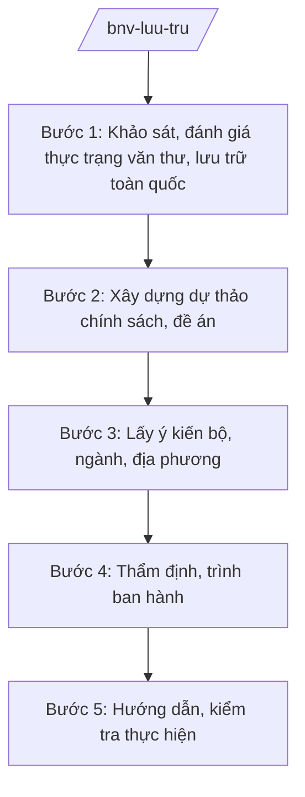

# Skill: Quản lý văn thư, lưu trữ nhà nước

## 2. Khi nào dùng
- Xây dựng, sửa đổi chính sách, chương trình, đề án về văn thư, lưu trữ (lưu trữ số, số hóa tài liệu, Kho lưu trữ số, cơ sở dữ liệu tài liệu lưu trữ).
- Xây dựng văn bản QPPL hướng dẫn nghiệp vụ văn thư, lưu trữ (thu thập, bảo quản, tổ chức khai thác, sử dụng tài liệu lưu trữ).
- Hướng dẫn, kiểm tra công tác văn thư, lưu trữ của bộ, ngành, địa phương.

## 3. Đầu vào (Input)

| Trường | Mô tả | Bắt buộc |
|--------|-------|----------|
| `noi_dung_chinh_sach` | Nội dung chính sách/đề án (lưu trữ số, Kho lưu trữ số, CSDL tài liệu lưu trữ, hướng dẫn nghiệp vụ...) | Có |
| `hinh_thuc_van_ban` | Thông tư / Nghị định / Đề án, chương trình | Có |
| `thuc_trang_luu_tru` | Thực trạng văn thư, lưu trữ toàn quốc (kho tàng, tài liệu, nhân lực, số hóa) | Có |
| `can_cu_chu_truong` | Văn bản giao nhiệm vụ, chủ trương của cấp có thẩm quyền | Có |
| `danh_sach_lay_y_kien` | Bộ, ngành, địa phương (Sở Nội vụ) lấy ý kiến | Không |

## 4. Quy trình

**Bước 1. Khảo sát, đánh giá thực trạng văn thư, lưu trữ toàn quốc**
- Làm gì: Thu thập số liệu về kho lưu trữ, khối lượng tài liệu, tình hình số hóa, nhân lực lưu trữ của bộ, ngành, địa phương; đánh giá kết quả thực hiện chính sách hiện hành.
- Dùng input: `thuc_trang_luu_tru`, `noi_dung_chinh_sach`.
- Vai trò: Chuyên viên Cục Văn thư và Lưu trữ nhà nước khảo sát (AI hỗ trợ tổng hợp số liệu, lập bảng thống kê hiện trạng số hóa theo bộ/ngành/địa phương — 3–5 ngày) → Cục trưởng kiểm tra.
- Lưu ý nghiệp vụ: Số liệu phải từ báo cáo chính thức; phân biệt tài liệu lưu trữ giấy và tài liệu lưu trữ số; AI không tự suy đoán khối lượng tài liệu.
- → Kết quả bước: Báo cáo đánh giá thực trạng văn thư, lưu trữ.

**Bước 2. Xây dựng dự thảo chính sách, đề án**
- Làm gì: Thiết kế nội dung: mục tiêu lưu trữ số, lộ trình số hóa, mô hình Kho lưu trữ số, cấu trúc cơ sở dữ liệu tài liệu lưu trữ, tiêu chuẩn kỹ thuật, kinh phí; dự thảo văn bản/đề án.
- Dùng input: `noi_dung_chinh_sach`, `hinh_thuc_van_ban`, kết quả bước 1.
- Vai trò: Chuyên viên Cục Văn thư và Lưu trữ nhà nước soạn thảo (AI hỗ trợ rà soát chính sách hiện hành, kiểm tra tính thống nhất với Luật Lưu trữ — 5–7 ngày) → Cục trưởng rà soát.
- Lưu ý nghiệp vụ: Nội dung phải phù hợp Luật Lưu trữ; tiêu chuẩn kỹ thuật lưu trữ số phải đồng bộ, tránh "đảo dữ liệu" khi liên thông giữa các kho; bảo đảm an toàn, bảo mật tài liệu.
- → Kết quả bước: Dự thảo chính sách/đề án lần 1.

**Bước 3. Lấy ý kiến bộ, ngành, địa phương**
- Làm gì: Gửi dự thảo lấy ý kiến các bộ, cơ quan ngang bộ, Sở Nội vụ các tỉnh (vd: Sở Nội vụ tỉnh A); tổng hợp, tiếp thu/giải trình; đánh giá tác động kinh phí (khi có đầu tư kho, hạ tầng số).
- Dùng input: `danh_sach_lay_y_kien`, dự thảo bước 2.
- Vai trò: Chuyên viên tổng hợp (AI hỗ trợ phân loại ý kiến, lập bảng tiếp thu/giải trình — 2–3 ngày) → Cục trưởng ký văn bản xin ý kiến.
- Lưu ý nghiệp vụ: Ý kiến của địa phương về khả năng thực hiện (kho tàng, nhân lực, kinh phí) phải được xem xét kỹ; ý kiến không tiếp thu phải giải trình.
- → Kết quả bước: Dự thảo lần 2 đã tiếp thu ý kiến.

**Bước 4. Thẩm định, trình ban hành**
- Làm gì: Vụ Pháp chế thẩm định (nếu là VBQPPL); lập tờ trình trình Bộ trưởng ký ban hành (thông tư) hoặc báo cáo Chính phủ (nghị định/đề án, chương trình).
- Dùng input: Toàn bộ hồ sơ các bước trước.
- Vai trò: Cục trưởng ký tờ trình (AI hỗ trợ rà soát thể thức theo NĐ 30/2020/NĐ-CP — 0,5 ngày) → Thứ trưởng kiểm tra → Bộ trưởng ký ban hành hoặc quyết định trình Chính phủ.
- Lưu ý nghiệp vụ: Không trình ban hành khi còn ý kiến thẩm định chưa được xử lý; kiểm tra không viện dẫn văn bản hết hiệu lực.
- → Kết quả bước: Chính sách/đề án được ban hành.

**Bước 5. Hướng dẫn, kiểm tra thực hiện**
- Làm gì: Ban hành tài liệu hướng dẫn nghiệp vụ; kiểm tra công tác văn thư, lưu trữ tại bộ, ngành, địa phương; đánh giá tiến độ số hóa, vận hành Kho lưu trữ số, CSDL tài liệu lưu trữ; tổng hợp báo cáo.
- Dùng input: Văn bản chính sách đã ban hành, báo cáo của bộ/ngành/địa phương.
- Vai trò: Chuyên viên Cục Văn thư và Lưu trữ nhà nước theo dõi (AI hỗ trợ tổng hợp tiến độ số hóa, phát hiện vướng mắc — 3–5 ngày/kỳ) → Cục trưởng báo cáo Bộ trưởng.
- Lưu ý nghiệp vụ: Kiểm tra tuân thủ đúng thẩm quyền; kịp thời hướng dẫn xử lý tài liệu tồn đọng, tài liệu mật theo quy định.
- → Kết quả bước: Văn bản hướng dẫn; báo cáo kiểm tra, đánh giá thực hiện.

## Luồng quy trình (Workflow)

## 5. Đầu ra (Output)

- Tờ trình + dự thảo chính sách/đề án (thông tư/nghị định/chương trình).
- Báo cáo đánh giá thực trạng; báo cáo thẩm định; bảng tổng hợp ý kiến.
- Tài liệu hướng dẫn nghiệp vụ; báo cáo kiểm tra, đánh giá.

### Cấu trúc output chuẩn
1. Quốc hiệu "CỘNG HÒA XÃ HỘI CHỦ NGHĨA VIỆT NAM", Tiêu ngữ "Độc lập – Tự do – Hạnh phúc"
2. Tên loại và trích yếu nội dung văn bản.
3. Căn cứ (văn bản có thật, còn hiệu lực).
4. Phần I: Sự cần thiết, mục tiêu, phạm vi.
5. Phần II: Nội dung chính sách (lưu trữ số, Kho lưu trữ số, CSDL, tiêu chuẩn kỹ thuật).
6. Phần III: Tổ chức thực hiện, kinh phí, điều khoản thi hành.
7. Nơi nhận (kết thúc "- Lưu: VT, [mã đơn vị]."), chữ ký (ghi rõ chức danh, họ tên người ký; ký hiệu "KT."/"TL." khi ký thay) người có thẩm quyền (đúng thể thức NĐ 30/2020/NĐ-CP).

> **Checklist thể thức văn bản theo NĐ 30/2020/NĐ-CP** — đối chiếu trước khi trình ký:
> 1. Quốc hiệu và Tiêu ngữ.
> 2. Tên cơ quan, tổ chức ban hành văn bản.
> 3. Số, ký hiệu của văn bản.
> 4. Địa danh và thời gian ban hành văn bản.
> 5. Tên loại và trích yếu nội dung văn bản.
> 6. Nội dung văn bản.
> 7. Chức vụ, họ tên và chữ ký của người có thẩm quyền.
> 8. Dấu, chữ ký số của cơ quan, tổ chức.
> 9. Nơi nhận (kèm Phụ lục nếu có).

## 6. Checklist nghiệm thu
- [ ] Có báo cáo đánh giá thực trạng với số liệu chính thức.
- [ ] Nội dung phù hợp Luật Lưu trữ; tiêu chuẩn kỹ thuật đồng bộ, liên thông được.
- [ ] Có đánh giá tác động kinh phí khi đầu tư kho, hạ tầng số.
- [ ] Đã lấy ý kiến bộ, ngành, Sở Nội vụ địa phương; bảng tiếp thu/giải trình đầy đủ.
- [ ] Có báo cáo thẩm định của Vụ Pháp chế (nếu là VBQPPL); ý kiến thẩm định đã xử lý.
- [ ] Đúng thẩm quyền ban hành.
- [ ] Thể thức đúng NĐ 30/2020/NĐ-CP; đã qua human gate các nấc.

## 7. Ví dụ mô phỏng

*Dữ liệu dưới đây là giả lập 100% phục vụ minh họa.*

**Input mẫu:**
- noi_dung_chinh_sach: Đề án xây dựng Kho lưu trữ số và cơ sở dữ liệu tài liệu lưu trữ quốc gia (giả lập)
- hinh_thuc_van_ban: Đề án trình Thủ tướng Chính phủ
- thuc_trang_luu_tru: Tỷ lệ tài liệu lưu trữ được số hóa toàn quốc đạt 40% (số liệu giả lập)
- can_cu_chu_truong: Văn bản giao nhiệm vụ của Thủ tướng Chính phủ (giả lập)

**Output mẫu (trích Tờ trình):**

> **BỘ NỘI VỤ — CỤC VĂN THƯ VÀ LƯU TRỮ NHÀ NƯỚC**
> **Tờ trình về Đề án xây dựng Kho lưu trữ số và cơ sở dữ liệu tài liệu lưu trữ quốc gia**
>
> Kính gửi: Thủ tướng Chính phủ (ông Nguyễn Văn AA)
>
> Căn cứ Luật Lưu trữ; căn cứ Nghị định số 25/2025/NĐ-CP của Chính phủ quy định chức năng, nhiệm vụ, quyền hạn và cơ cấu tổ chức của Bộ Nội vụ, Bộ Nội vụ kính trình Thủ tướng Chính phủ xem xét, phê duyệt Đề án với các nội dung chính (giả lập): (1) mục tiêu số hóa 80% tài liệu lưu trữ có giá trị; (2) mô hình Kho lưu trữ số tập trung, liên thông các kho địa phương; (3) tiêu chuẩn kỹ thuật, an toàn dữ liệu; (4) lộ trình và kinh phí thực hiện...
>
> Hồ sơ kèm theo: dự thảo Đề án, báo cáo đánh giá thực trạng, bảng tổng hợp ý kiến.
>
> *Nơi nhận: ... — BỘ TRƯỞNG (ông Lê Văn CC)*

## 8. Human gate
- Cục trưởng Cục Văn thư và Lưu trữ nhà nước (bà Vũ Thị FF): duyệt báo cáo đánh giá, dự thảo chính sách/đề án, ký tờ trình.
- Vụ trưởng Vụ Pháp chế: ký báo cáo thẩm định (nếu là VBQPPL).
- Thứ trưởng phụ trách (bà Phạm Thị DD): kiểm tra hồ sơ trước khi trình Bộ trưởng.
- Bộ trưởng (ông Lê Văn CC): ký ban hành thông tư; quyết định trình Chính phủ/Thủ tướng đối với nghị định, đề án, chương trình.
- Thủ tướng Chính phủ/Chính phủ: phê duyệt đề án, chương trình khi thuộc thẩm quyền.

## 9. Giới hạn
- AI không quyết định nội dung chính sách, tiêu chuẩn kỹ thuật thay người có thẩm quyền.
- AI không tự suy đoán số liệu tài liệu, tiến độ số hóa; chỉ dùng số liệu chính thức.
- AI không tự trình ký, ban hành văn bản hoặc đề án.
- Không bịa số hiệu, căn cứ pháp lý; không viện dẫn văn bản hết hiệu lực.

## 10. Căn cứ & lưu ý
- Nghị định số 25/2025/NĐ-CP của Chính phủ quy định chức năng, nhiệm vụ, quyền hạn và cơ cấu tổ chức của Bộ Nội vụ. **Lưu ý:** thuvienphapluat.vn ghi nhận NĐ này được sửa đổi tại NĐ 128/2025/NĐ-CP và NĐ 109/2025/NĐ-CP — cần tra văn bản hợp nhất khi áp dụng.
- Thông tư số 06/2026/TT-BNV sửa đổi, bổ sung TT 10/2025/TT-BNV (cập nhật nhiệm vụ văn thư – lưu trữ của ngành Nội vụ: quản lý tài liệu lưu trữ lịch sử, Kho lưu trữ số, cơ sở dữ liệu tài liệu lưu trữ).
- Nghị định số 30/2020/NĐ-CP về công tác văn thư (thể thức văn bản).
- Luật Lưu trữ (dẫn tên, không ghi số hiệu).
