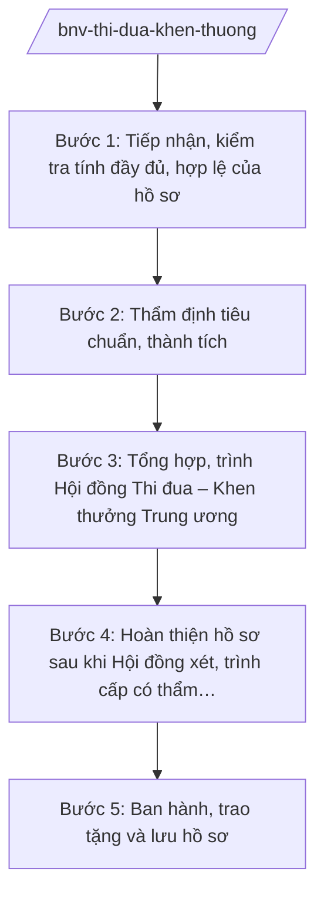

# Skill: Thi đua, khen thưởng (cấp nhà nước)

## 2. Khi nào dùng
- Tiếp nhận, thẩm định hồ sơ đề nghị khen thưởng cấp nhà nước do bộ, ngành, địa phương gửi đến (Huân chương, Huy chương, danh hiệu vinh dự nhà nước, Chiến sĩ thi đua toàn quốc...).
- Tổng hợp, trình Hội đồng Thi đua – Khen thưởng Trung ương xét khen thưởng.
- Hướng dẫn nghiệp vụ thi đua, khen thưởng cho bộ, ngành, địa phương theo phân cấp tại NĐ 152/2025/NĐ-CP.

## 3. Đầu vào (Input)

| Trường | Mô tả | Bắt buộc |
|--------|-------|----------|
| `ho_so_de_nghi` | Hồ sơ đề nghị khen thưởng (tờ trình, báo cáo thành tích, biên bản họp hội đồng cấp trình...) | Có |
| `hinh_thuc_khen_thuong` | Huân chương / Huy chương / Danh hiệu vinh dự nhà nước / Chiến sĩ thi đua toàn quốc... | Có |
| `doi_tuong` | Tập thể/cá nhân được đề nghị | Có |
| `co_quan_trinh` | Bộ, ngành, UBND cấp tỉnh trình hồ sơ | Có |
| `ket_qua_hiep_y` | Kết quả lấy ý kiến hiệp y (nếu đối tượng thuộc diện phải hiệp y) | Không |

## 4. Quy trình

**Bước 1. Tiếp nhận, kiểm tra tính đầy đủ, hợp lệ của hồ sơ**
- Làm gì: Kiểm tra thành phần hồ sơ theo quy định: tờ trình, báo cáo thành tích, biên bản họp hội đồng thi đua khen thưởng cấp trình, kết quả hiệp y; trả lại bổ sung nếu thiếu.
- Dùng input: `ho_so_de_nghi`, `co_quan_trinh`.
- Vai trò: Chuyên viên Vụ Thi đua – Khen thưởng kiểm tra (AI hỗ trợ đối chiếu checklist thành phần hồ sơ, phát hiện thiếu sót — 1–2 ngày) → Lãnh đạo vụ xác nhận.
- Lưu ý nghiệp vụ: Kiên quyết trả hồ sơ thiếu thành phần bắt buộc; không "châm chước" hồ sơ để kịp tiến độ xét.
- → Kết quả bước: Hồ sơ hợp lệ được tiếp nhận; văn bản yêu cầu bổ sung (nếu thiếu).

**Bước 2. Thẩm định tiêu chuẩn, thành tích**
- Làm gì: Đối chiếu thành tích với tiêu chuẩn của từng hình thức khen thưởng; kiểm tra tính chính xác của số liệu thành tích; xác minh khi có dấu hiệu chưa rõ.
- Dùng input: `ho_so_de_nghi`, `hinh_thuc_khen_thuong`, `doi_tuong`, `ket_qua_hiep_y`.
- Vai trò: Chuyên viên Vụ Thi đua – Khen thưởng thẩm định (AI hỗ trợ đối chiếu tiêu chuẩn, rà soát tính nhất quán số liệu trong hồ sơ — 3–5 ngày) → Vụ trưởng kết luận thẩm định.
- Lưu ý nghiệp vụ: Thành tích phải cụ thể, có minh chứng; không xét khen thưởng đối với trường hợp đang trong thời gian thi hành kỷ luật hoặc có vi phạm chưa được kết luận; AI không tự "nâng/hạ" hình thức khen thưởng.
- → Kết quả bước: Báo cáo thẩm định từng hồ sơ (đủ điều kiện/không đủ điều kiện, lý do).

**Bước 3. Tổng hợp, trình Hội đồng Thi đua – Khen thưởng Trung ương**
- Làm gì: Lập danh sách tổng hợp các trường hợp đủ điều kiện; xây dựng báo cáo trình Hội đồng Thi đua – Khen thưởng Trung ương xét.
- Dùng input: Kết quả thẩm định bước 2.
- Vai trò: Vụ trưởng Vụ Thi đua – Khen thưởng ký báo cáo (AI hỗ trợ lập danh sách tổng hợp, kiểm tra trùng lặp đối tượng giữa các đợt — 2–3 ngày) → Thứ trưởng kiểm tra → Bộ trưởng (Phó Chủ tịch Hội đồng) trình Hội đồng.
- Lưu ý nghiệp vụ: Hồ sơ trình Hội đồng phải đầy đủ, chính xác; danh sách phải ghi rõ hình thức đề nghị cho từng trường hợp.
- → Kết quả bước: Báo cáo và danh sách trình Hội đồng Thi đua – Khen thưởng Trung ương.

**Bước 4. Hoàn thiện hồ sơ sau khi Hội đồng xét, trình cấp có thẩm quyền quyết định**
- Làm gì: Tiếp thu kết luận của Hội đồng; hoàn thiện tờ trình, dự thảo quyết định khen thưởng trình cấp có thẩm quyền quyết định theo quy định của Luật Thi đua, khen thưởng.
- Dùng input: Kết luận của Hội đồng, hồ sơ đã thẩm định.
- Vai trò: Chuyên viên hoàn thiện hồ sơ (AI hỗ trợ rà soát thể thức quyết định theo NĐ 30/2020/NĐ-CP — 1 ngày) → Vụ trưởng kiểm tra → Bộ trưởng ký tờ trình.
- Lưu ý nghiệp vụ: Chỉ trình đúng hình thức, đối tượng đã được Hội đồng thống nhất; không tự ý bổ sung trường hợp ngoài kết luận của Hội đồng.
- → Kết quả bước: Hồ sơ trình cấp có thẩm quyền quyết định khen thưởng.

**Bước 5. Ban hành, trao tặng và lưu hồ sơ**
- Làm gì: Sau khi có quyết định khen thưởng: ban hành, tổ chức trao tặng (hoặc ủy quyền trao tặng); cập nhật cơ sở dữ liệu thi đua, khen thưởng; lưu trữ hồ sơ.
- Dùng input: Quyết định khen thưởng của cấp có thẩm quyền.
- Vai trò: Chuyên viên Vụ Thi đua – Khen thưởng thực hiện (AI hỗ trợ lập danh sách trao tặng, cập nhật dữ liệu — 2–3 ngày) → Vụ trưởng theo dõi.
- Lưu ý nghiệp vụ: Bảo đảm trang trọng, đúng nghi thức; hồ sơ lưu trữ đầy đủ phục vụ tra cứu, kiểm tra sau này.
- → Kết quả bước: Quyết định khen thưởng được ban hành, trao tặng; hồ sơ lưu trữ đầy đủ.

## Luồng quy trình (Workflow)

## 5. Đầu ra (Output)

- Báo cáo thẩm định hồ sơ đề nghị khen thưởng.
- Báo cáo + danh sách trình Hội đồng Thi đua – Khen thưởng Trung ương.
- Tờ trình + dự thảo quyết định khen thưởng trình cấp có thẩm quyền.

### Cấu trúc output chuẩn
1. Quốc hiệu "CỘNG HÒA XÃ HỘI CHỦ NGHĨA VIỆT NAM", Tiêu ngữ "Độc lập – Tự do – Hạnh phúc"
2. Tên loại và trích yếu (Báo cáo thẩm định/Tờ trình/Quyết định).
3. Căn cứ (văn bản có thật, còn hiệu lực).
4. Phần I: Kết quả thẩm định (đủ điều kiện/không đủ điều kiện, lý do từng trường hợp).
5. Phần II: Danh sách đề nghị (hình thức khen thưởng cho từng tập thể/cá nhân).
6. Phần III: Kiến nghị trình Hội đồng/cấp có thẩm quyền.
7. Nơi nhận (kết thúc "- Lưu: VT, [mã đơn vị]."), chữ ký (ghi rõ chức danh, họ tên người ký; ký hiệu "KT."/"TL." khi ký thay) người có thẩm quyền (đúng thể thức NĐ 30/2020/NĐ-CP).
## 6. Checklist nghiệm thu
- [ ] Hồ sơ đầy đủ thành phần theo quy định; có kết quả hiệp y khi thuộc diện phải hiệp y.
- [ ] Thành tích được đối chiếu đúng tiêu chuẩn của từng hình thức khen thưởng.
- [ ] Không xét trường hợp đang thi hành kỷ luật hoặc vi phạm chưa có kết luận.
- [ ] Danh sách trình ghi rõ hình thức đề nghị cho từng trường hợp, không trùng lặp.
- [ ] Chỉ trình đúng kết luận của Hội đồng Thi đua – Khen thưởng Trung ương.
- [ ] Đúng thẩm quyền quyết định theo Luật Thi đua, khen thưởng.
- [ ] Thể thức đúng NĐ 30/2020/NĐ-CP; đã qua human gate các nấc.

## 7. Ví dụ mô phỏng

*Dữ liệu dưới đây là giả lập 100% phục vụ minh họa.*

**Input mẫu:**
- hinh_thuc_khen_thuong: Huân chương Lao động hạng Nhì (giả lập)
- doi_tuong: Một tập thể thuộc tỉnh A (giả lập)
- co_quan_trinh: UBND tỉnh A (Chủ tịch UBND tỉnh A: ông Phạm Văn P)
- ho_so_de_nghi: Tờ trình, báo cáo thành tích 5 năm, biên bản họp Hội đồng TĐKT tỉnh A (giả lập)

**Output mẫu (trích Báo cáo thẩm định):**

> **BỘ NỘI VỤ — VỤ THI ĐUA – KHEN THƯỞNG**
> **Báo cáo thẩm định hồ sơ đề nghị tặng thưởng Huân chương Lao động hạng Nhì**
>
> Kính gửi: Hội đồng Thi đua – Khen thưởng Trung ương (qua Đồng chí Bộ trưởng Bộ Nội vụ — ông Lê Văn CC)
>
> Sau khi thẩm định hồ sơ do UBND tỉnh A trình (tờ trình của Chủ tịch UBND tỉnh A — ông Phạm Văn P), Vụ Thi đua – Khen thưởng báo cáo (số liệu giả lập): tập thể được đề nghị có thành tích 5 năm liên tục hoàn thành xuất sắc nhiệm vụ, đủ tiêu chuẩn tặng thưởng Huân chương Lao động hạng Nhì; hồ sơ đầy đủ thành phần, có kết quả hiệp y...
>
> Vụ kính đề nghị Hội đồng xem xét, thống nhất trình cấp có thẩm quyền quyết định.
>
> *Nơi nhận: ... — KT. VỤ TRƯỞNG / PHÓ VỤ TRƯỞNG (ông Hoàng Văn EE ký nháy)*

## 8. Human gate
- Vụ trưởng Vụ Thi đua – Khen thưởng: kết luận thẩm định từng hồ sơ; ký báo cáo trình Hội đồng.
- Thứ trưởng phụ trách (bà Phạm Thị DD): kiểm tra hồ sơ trước khi trình Bộ trưởng.
- Bộ trưởng (ông Lê Văn CC): ký báo cáo, tờ trình lên Hội đồng Thi đua – Khen thưởng Trung ương và cấp có thẩm quyền.
- Hội đồng Thi đua – Khen thưởng Trung ương: xét, cho ý kiến đối với các trường hợp đề nghị.
- Cấp có thẩm quyền (theo Luật Thi đua, khen thưởng): quyết định khen thưởng.

## 9. Giới hạn
- AI không quyết định đủ/không đủ điều kiện khen thưởng thay người có thẩm quyền; chỉ hỗ trợ đối chiếu tiêu chuẩn.
- AI không tự nâng/hạ hình thức khen thưởng, không bổ sung đối tượng ngoài hồ sơ.
- AI không thay Hội đồng xét duyệt; không tự ban hành quyết định khen thưởng.
- Không bịa thành tích, số liệu hồ sơ; không viện dẫn văn bản hết hiệu lực.

## 10. Căn cứ & lưu ý
- Nghị định số 152/2025/NĐ-CP về phân cấp, phân quyền trong lĩnh vực thi đua, khen thưởng; quy định chi tiết, hướng dẫn một số điều của Luật Thi đua, khen thưởng.
- Nghị định số 25/2025/NĐ-CP của Chính phủ quy định chức năng, nhiệm vụ, quyền hạn và cơ cấu tổ chức của Bộ Nội vụ. **Lưu ý:** thuvienphapluat.vn ghi nhận NĐ này được sửa đổi tại NĐ 128/2025/NĐ-CP và NĐ 109/2025/NĐ-CP — cần tra văn bản hợp nhất khi áp dụng.
- Nghị định số 30/2020/NĐ-CP về công tác văn thư (thể thức văn bản).
- Luật Thi đua, khen thưởng (dẫn tên, không ghi số hiệu).
