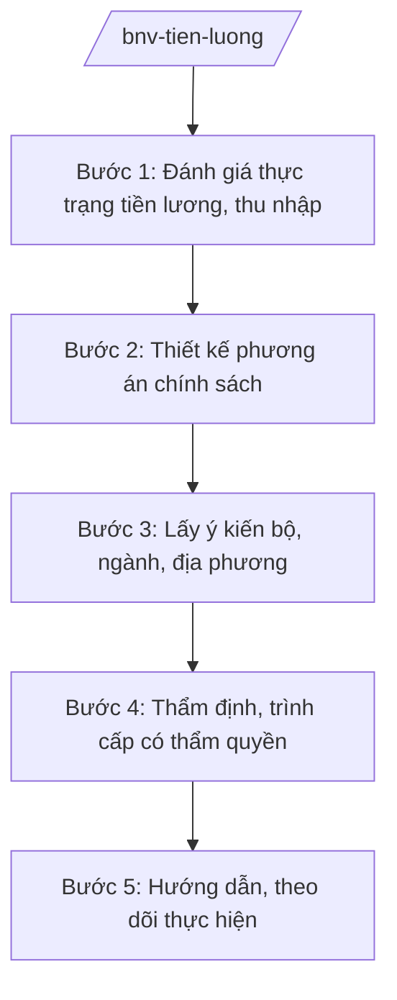

# Skill: Chính sách tiền lương (cải cách tiền lương)

## 2. Khi nào dùng
- Nghiên cứu, xây dựng chính sách cải cách tiền lương đối với cán bộ, công chức, viên chức và lực lượng vũ trang.
- Xây dựng, sửa đổi bảng lương, chế độ phụ cấp theo vị trí việc làm, chức danh, chức vụ lãnh đạo.
- Đánh giá tác động của chính sách tiền lương; hướng dẫn thực hiện chế độ tiền lương mới.

## 3. Đầu vào (Input)

| Trường | Mô tả | Bắt buộc |
|--------|-------|----------|
| `noi_dung_chinh_sach` | Nội dung (cải cách tiền lương / bảng lương / phụ cấp theo vị trí việc làm...) | Có |
| `hinh_thuc_van_ban` | Nghị định / Đề án, chính sách trình cấp có thẩm quyền | Có |
| `thuc_trang_tien_luong` | Số liệu tiền lương, thu nhập bình quân CBCCVC hiện hành | Có |
| `tac_dong_nsnn` | Dự kiến tác động đến ngân sách nhà nước (nếu đã có tính toán) | Không |
| `can_cu_chu_truong` | Văn bản giao nhiệm vụ, chủ trương của cấp có thẩm quyền | Có |

## 4. Quy trình

**Bước 1. Đánh giá thực trạng tiền lương, thu nhập**
- Làm gì: Thu thập số liệu tiền lương, phụ cấp, thu nhập bình quân của CBCCVC theo ngạch, chức danh, vùng; đánh giá bất cập của chế độ hiện hành; so sánh với khu vực doanh nghiệp và mặt bằng chung.
- Dùng input: `thuc_trang_tien_luong`, `noi_dung_chinh_sach`.
- Vai trò: Chuyên viên Vụ Tiền lương nghiên cứu (AI hỗ trợ tổng hợp số liệu, phân tích chênh lệch thu nhập theo nhóm đối tượng — 5–7 ngày) → Vụ trưởng kiểm tra.
- Lưu ý nghiệp vụ: Số liệu phải từ nguồn chính thức (báo cáo bộ, ngành, địa phương, cơ quan thống kê); AI không tự suy đoán mức lương, thu nhập.
- → Kết quả bước: Báo cáo đánh giá thực trạng tiền lương.

**Bước 2. Thiết kế phương án chính sách**
- Làm gì: Thiết kế bảng lương theo vị trí việc làm, chức danh, chức vụ; xác định hệ số, mức lương cơ sở hoặc mức lương theo phương án mới; thiết kế chế độ phụ cấp; tính toán tác động ngân sách.
- Dùng input: `noi_dung_chinh_sach`, kết quả bước 1, `tac_dong_nsnn`.
- Vai trò: Chuyên viên Vụ Tiền lương phối hợp Vụ Công chức – Viên chức thiết kế (AI hỗ trợ mô phỏng các phương án hệ số, tính toán tác động ngân sách theo kịch bản — 7–10 ngày) → Vụ trưởng rà soát.
- Lưu ý nghiệp vụ: Phương án phải gắn với vị trí việc làm và kết quả thực hiện nhiệm vụ; tính toán kỹ khả năng cân đối ngân sách; không thiết kế chính sách vượt khả năng chi trả.
- → Kết quả bước: Các phương án chính sách tiền lương kèm tính toán tác động.

**Bước 3. Lấy ý kiến bộ, ngành, địa phương**
- Làm gì: Gửi phương án lấy ý kiến các bộ, cơ quan ngang bộ (đặc biệt cơ quan tài chính về cân đối ngân sách), UBND cấp tỉnh; tổng hợp, tiếp thu/giải trình.
- Dùng input: Các phương án bước 2.
- Vai trò: Chuyên viên tổng hợp (AI hỗ trợ phân loại ý kiến, lập bảng tiếp thu/giải trình — 3–5 ngày) → Vụ trưởng ký văn bản xin ý kiến.
- Lưu ý nghiệp vụ: Chính sách tiền lương tác động toàn hệ thống nên phải lấy ý kiến rộng; ý kiến về khả năng cân đối ngân sách của cơ quan tài chính phải được xem xét đặc biệt kỹ.
- → Kết quả bước: Phương án hoàn thiện sau tiếp thu ý kiến.

**Bước 4. Thẩm định, trình cấp có thẩm quyền**
- Làm gì: Vụ Pháp chế thẩm định (nếu là VBQPPL); lập tờ trình, báo cáo trình Bộ trưởng xem xét, báo cáo Chính phủ; trình cấp có thẩm quyền quyết định theo quy định (chính sách tiền lương thuộc thẩm quyền quyết định của cấp có thẩm quyền theo quy định).
- Dùng input: Toàn bộ hồ sơ các bước trước.
- Vai trò: Vụ trưởng ký tờ trình (AI hỗ trợ rà soát thể thức theo NĐ 30/2020/NĐ-CP — 0,5 ngày) → Thứ trưởng kiểm tra → Bộ trưởng quyết định trình Chính phủ.
- Lưu ý nghiệp vụ: Hồ sơ trình đầy đủ: tờ trình, dự thảo, báo cáo đánh giá thực trạng, tính toán tác động ngân sách, bảng tổng hợp ý kiến; không trình khi chưa có đánh giá tác động ngân sách.
- → Kết quả bước: Chính sách tiền lương được cấp có thẩm quyền xem xét, quyết định.

**Bước 5. Hướng dẫn, theo dõi thực hiện**
- Làm gì: Ban hành văn bản hướng dẫn xếp lương, chuyển xếp lương sang chế độ mới; theo dõi, kiểm tra việc thực hiện tại bộ, ngành, địa phương; đánh giá tác động sau thực hiện, đề xuất điều chỉnh.
- Dùng input: Văn bản chính sách đã ban hành, báo cáo bộ/ngành/địa phương.
- Vai trò: Chuyên viên Vụ Tiền lương theo dõi (AI hỗ trợ tổng hợp báo cáo thực hiện, phát hiện vướng mắc trong chuyển xếp lương — 3–5 ngày/kỳ) → Vụ trưởng báo cáo Bộ trưởng.
- Lưu ý nghiệp vụ: Bảo đảm không ai bị thiệt thòi bất hợp lý khi chuyển xếp; kịp thời hướng dẫn các trường hợp vướng mắc về ngạch, bậc, phụ cấp.
- → Kết quả bước: Văn bản hướng dẫn; báo cáo theo dõi, đánh giá tác động.

## Luồng quy trình (Workflow)

## 5. Đầu ra (Output)

- Tờ trình + dự thảo chính sách tiền lương (nghị định/đề án).
- Báo cáo đánh giá thực trạng; các phương án kèm tính toán tác động ngân sách.
- Báo cáo thẩm định; bảng tổng hợp ý kiến; văn bản hướng dẫn thực hiện.

### Cấu trúc output chuẩn
1. Quốc hiệu "CỘNG HÒA XÃ HỘI CHỦ NGHĨA VIỆT NAM", Tiêu ngữ "Độc lập – Tự do – Hạnh phúc"
2. Tên loại và trích yếu nội dung văn bản.
3. Căn cứ (văn bản có thật, còn hiệu lực).
4. Phần I: Sự cần thiết, mục tiêu, đối tượng, phạm vi.
5. Phần II: Nội dung chính sách (bảng lương, phụ cấp theo vị trí việc làm; lộ trình).
6. Phần III: Tác động ngân sách; tổ chức thực hiện, điều khoản thi hành.
7. Nơi nhận (kết thúc "- Lưu: VT, [mã đơn vị]."), chữ ký (ghi rõ chức danh, họ tên người ký; ký hiệu "KT."/"TL." khi ký thay) người có thẩm quyền (đúng thể thức NĐ 30/2020/NĐ-CP).

> **Checklist thể thức văn bản theo NĐ 30/2020/NĐ-CP** — đối chiếu trước khi trình ký:
> 1. Quốc hiệu và Tiêu ngữ.
> 2. Tên cơ quan, tổ chức ban hành văn bản.
> 3. Số, ký hiệu của văn bản.
> 4. Địa danh và thời gian ban hành văn bản.
> 5. Tên loại và trích yếu nội dung văn bản.
> 6. Nội dung văn bản.
> 7. Chức vụ, họ tên và chữ ký của người có thẩm quyền.
> 8. Dấu, chữ ký số của cơ quan, tổ chức.
> 9. Nơi nhận (kèm Phụ lục nếu có).

## 6. Checklist nghiệm thu
- [ ] Có báo cáo đánh giá thực trạng với số liệu chính thức.
- [ ] Bảng lương gắn với vị trí việc làm, chức danh, chức vụ lãnh đạo.
- [ ] Có tính toán tác động đến ngân sách nhà nước theo kịch bản.
- [ ] Đã lấy ý kiến bộ, ngành (đặc biệt cơ quan tài chính), địa phương; bảng tiếp thu/giải trình đầy đủ.
- [ ] Có báo cáo thẩm định của Vụ Pháp chế (nếu là VBQPPL); ý kiến thẩm định đã xử lý.
- [ ] Trình đúng cấp có thẩm quyền quyết định; không quyết thay.
- [ ] Thể thức đúng NĐ 30/2020/NĐ-CP; đã qua human gate các nấc.

## 7. Ví dụ mô phỏng

*Dữ liệu dưới đây là giả lập 100% phục vụ minh họa.*

**Input mẫu:**
- noi_dung_chinh_sach: Phương án phụ cấp theo vị trí việc làm đối với công chức hành chính (giả lập)
- hinh_thuc_van_ban: Nghị định
- thuc_trang_tien_luong: Thu nhập bình quân công chức hành chính đạt 8 triệu đồng/tháng (số liệu giả lập)
- can_cu_chu_truong: Văn bản giao nhiệm vụ của Thủ tướng Chính phủ (giả lập)

**Output mẫu (trích Tờ trình):**

> **BỘ NỘI VỤ — VỤ TIỀN LƯƠNG**
> **Tờ trình về việc ban hành Nghị định quy định phụ cấp theo vị trí việc làm đối với công chức**
>
> Kính gửi: Chính phủ
>
> Căn cứ Luật Cán bộ, công chức; căn cứ Nghị định số 25/2025/NĐ-CP của Chính phủ quy định chức năng, nhiệm vụ, quyền hạn và cơ cấu tổ chức của Bộ Nội vụ, Bộ Nội vụ kính trình Chính phủ xem xét, ban hành Nghị định với các nội dung chính (giả lập): (1) nguyên tắc xác định phụ cấp theo vị trí việc làm; (2) các loại phụ cấp và hệ số; (3) lộ trình áp dụng; (4) tác động ngân sách ước tính tăng thêm 5% quỹ lương (số liệu giả lập)...
>
> Hồ sơ kèm theo: dự thảo Nghị định, báo cáo đánh giá thực trạng, tính toán tác động ngân sách, báo cáo thẩm định, bảng tổng hợp ý kiến.
>
> *Nơi nhận: ... — BỘ TRƯỞNG (ông Lê Văn CC)*

## 8. Human gate
- Vụ trưởng Vụ Tiền lương: duyệt báo cáo đánh giá, các phương án, tờ trình.
- Vụ trưởng Vụ Pháp chế: ký báo cáo thẩm định (nếu là VBQPPL).
- Thứ trưởng phụ trách (bà Phạm Thị DD): kiểm tra hồ sơ trước khi trình Bộ trưởng.
- Bộ trưởng (ông Lê Văn CC): cho ý kiến phương án; quyết định trình Chính phủ.
- Chính phủ/cấp có thẩm quyền: xem xét, quyết định chính sách tiền lương theo quy định.

## 9. Giới hạn
- AI không quyết định mức lương, hệ số, phụ cấp thay người có thẩm quyền; chỉ hỗ trợ mô phỏng, tính toán.
- AI không tự suy đoán số liệu tiền lương, thu nhập; chỉ dùng số liệu chính thức.
- AI không tự trình ký, ban hành chính sách tiền lương.
- Không bịa số hiệu, căn cứ pháp lý; không viện dẫn văn bản hết hiệu lực.

## 10. Căn cứ & lưu ý
- Nghị định số 25/2025/NĐ-CP của Chính phủ quy định chức năng, nhiệm vụ, quyền hạn và cơ cấu tổ chức của Bộ Nội vụ. **Lưu ý:** thuvienphapluat.vn ghi nhận NĐ này được sửa đổi tại NĐ 128/2025/NĐ-CP và NĐ 109/2025/NĐ-CP — cần tra văn bản hợp nhất khi áp dụng.
- Nghị định số 30/2020/NĐ-CP về công tác văn thư (thể thức văn bản).
- Luật Cán bộ, công chức; Luật Viên chức (dẫn tên, không ghi số hiệu).
