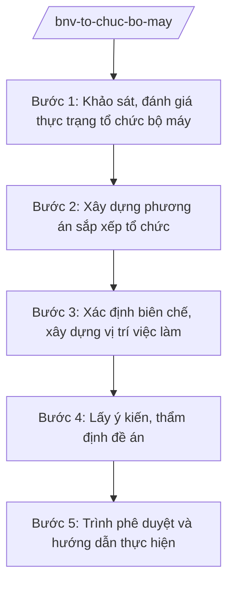

# Skill: Tổ chức bộ máy hành chính nhà nước

## 2. Khi nào dùng
- Rà soát, đánh giá tổ chức bộ máy của bộ, cơ quan ngang bộ để sắp xếp, kiện toàn theo cơ cấu Chính phủ (NQ 176/2025/QH15) và khung chung (NĐ 303/2025/NĐ-CP).
- Xây dựng đề án thành lập mới, sáp nhập, giải thể tổ chức hành chính, đơn vị sự nghiệp công lập thuộc bộ, ngành.
- Xác định biên chế, xây dựng vị trí việc làm của bộ, cơ quan ngang bộ sau sắp xếp.

## 3. Đầu vào (Input)

| Trường | Mô tả | Bắt buộc |
|--------|-------|----------|
| `don_vi_ra_soat` | Bộ/ngành, tổ chức cần rà soát, sắp xếp | Có |
| `muc_tieu_sap_xep` | Mục tiêu, yêu cầu sắp xếp (tinh gọn, hiệu lực, hiệu quả...) | Có |
| `thuc_trang_to_chuc` | Số liệu tổ chức, biên chế, vị trí việc làm hiện tại | Có |
| `de_xuat_phuong_an` | Phương án sắp xếp dự kiến (nếu bộ/ngành đã đề xuất) | Không |
| `can_cu_giao_nhiem_vu` | Văn bản giao nhiệm vụ của Chính phủ/Thủ tướng/Bộ trưởng | Có |

## 4. Quy trình

**Bước 1. Khảo sát, đánh giá thực trạng tổ chức bộ máy**
- Làm gì: Thu thập số liệu về cơ cấu tổ chức (vụ, cục, đơn vị sự nghiệp), biên chế, vị trí việc làm của đơn vị được rà soát; đánh giá chồng chéo, trùng lắp chức năng.
- Dùng input: `don_vi_ra_soat`, `thuc_trang_to_chuc`.
- Vai trò: Chuyên viên Vụ Tổ chức bộ máy – Bộ Nội vụ khảo sát (AI hỗ trợ tổng hợp số liệu, đối chiếu cơ cấu tổ chức với khung NĐ 303/2025/NĐ-CP, phát hiện chồng chéo — 3–5 ngày) → Vụ trưởng kiểm tra.
- Lưu ý nghiệp vụ: Số liệu phải do đơn vị được rà soát cung cấp/chính thức xác nhận; AI không tự suy đoán số biên chế.
- → Kết quả bước: Báo cáo đánh giá thực trạng tổ chức bộ máy.

**Bước 2. Xây dựng phương án sắp xếp tổ chức**
- Làm gì: Thiết kế phương án: giữ nguyên, sáp nhập, giải thể, thành lập mới các tổ chức; xác định tên gọi, chức năng, nhiệm vụ, cơ cấu bên trong từng tổ chức sau sắp xếp.
- Dùng input: `muc_tieu_sap_xep`, `de_xuat_phuong_an`, kết quả bước 1.
- Vai trò: Chuyên viên Vụ Tổ chức bộ máy xây dựng phương án (AI hỗ trợ so sánh các phương án, lập bảng đối chiếu tổ chức trước–sau — 3–5 ngày) → Vụ trưởng rà soát.
- Lưu ý nghiệp vụ: Phương án phải bảo đảm không bỏ sót chức năng, nhiệm vụ quản lý nhà nước; tuân thủ khung chung tại NĐ 303/2025/NĐ-CP.
- → Kết quả bước: Dự thảo đề án sắp xếp tổ chức bộ máy.

**Bước 3. Xác định biên chế, xây dựng vị trí việc làm**
- Làm gì: Xác định số lượng biên chế theo từng tổ chức sau sắp xếp; xây dựng danh mục vị trí việc làm, bản mô tả công việc, khung năng lực.
- Dùng input: `thuc_trang_to_chuc`, phương án bước 2.
- Vai trò: Chuyên viên Vụ Tổ chức bộ máy phối hợp Vụ Công chức – Viên chức thực hiện (AI hỗ trợ lập bảng biên chế trước–sau, rà soát trùng lặp vị trí việc làm — 3–5 ngày) → Vụ trưởng hai vụ thống nhất.
- Lưu ý nghiệp vụ: Biên chế xác định trên cơ sở vị trí việc làm và khối lượng công việc thực tế, không áp đặt cơ học; bảo đảm lộ trình tinh giản theo chủ trương chung.
- → Kết quả bước: Phương án biên chế và danh mục vị trí việc làm.

**Bước 4. Lấy ý kiến, thẩm định đề án**
- Làm gì: Gửi đề án lấy ý kiến bộ/ngành liên quan và đơn vị được sắp xếp; tổng hợp, tiếp thu; Vụ Pháp chế thẩm định tính hợp pháp, thống nhất của đề án.
- Dùng input: Toàn bộ hồ sơ các bước trước.
- Vai trò: Chuyên viên tổng hợp ý kiến (AI hỗ trợ phân loại ý kiến, lập bảng tiếp thu/giải trình — 2–3 ngày) → Vụ trưởng ký văn bản xin ý kiến và báo cáo thẩm định.
- Lưu ý nghiệp vụ: Ý kiến của đơn vị được sắp xếp phải được xem xét đầy đủ; không trình phê duyệt khi còn nội dung chưa thống nhất về chức năng, nhiệm vụ.
- → Kết quả bước: Đề án hoàn thiện kèm báo cáo thẩm định.

**Bước 5. Trình phê duyệt và hướng dẫn thực hiện**
- Làm gì: Lập tờ trình trình Bộ trưởng xem xét, báo cáo Chính phủ/Thủ tướng phê duyệt đề án theo thẩm quyền; sau phê duyệt thì hướng dẫn bộ/ngành triển khai sắp xếp, theo dõi tiến độ.
- Dùng input: Toàn bộ hồ sơ.
- Vai trò: Vụ trưởng ký tờ trình (AI hỗ trợ rà soát thể thức theo NĐ 30/2020/NĐ-CP — 0,5 ngày) → Thứ trưởng kiểm tra → Bộ trưởng quyết định trình Chính phủ/Thủ tướng.
- Lưu ý nghiệp vụ: Nội dung thuộc thẩm quyền Chính phủ (cơ cấu tổ chức bộ, cơ quan ngang bộ) phải trình Chính phủ, không quyết thay ở cấp Bộ.
- → Kết quả bước: Đề án được phê duyệt; văn bản hướng dẫn triển khai và kế hoạch theo dõi.

## Luồng quy trình (Workflow)

## 5. Đầu ra (Output)

- Đề án sắp xếp, kiện toàn tổ chức bộ máy (kèm tờ trình).
- Phương án biên chế, danh mục vị trí việc làm.
- Báo cáo thẩm định; văn bản hướng dẫn triển khai.

### Cấu trúc output chuẩn
1. Quốc hiệu "CỘNG HÒA XÃ HỘI CHỦ NGHĨA VIỆT NAM", Tiêu ngữ "Độc lập – Tự do – Hạnh phúc"
2. Tên loại và trích yếu (Tờ trình/Đề án).
3. Căn cứ (văn bản có thật, còn hiệu lực).
4. Phần I: Sự cần thiết và căn cứ xây dựng đề án.
5. Phần II: Thực trạng tổ chức bộ máy.
6. Phần III: Phương án sắp xếp (tổ chức trước–sau, biên chế, vị trí việc làm).
7. Phần IV: Tổ chức thực hiện, lộ trình, kinh phí.
8. Nơi nhận (kết thúc "- Lưu: VT, [mã đơn vị]."), chữ ký (ghi rõ chức danh, họ tên người ký; ký hiệu "KT."/"TL." khi ký thay) người có thẩm quyền (đúng thể thức NĐ 30/2020/NĐ-CP).

> **Checklist thể thức văn bản theo NĐ 30/2020/NĐ-CP** — đối chiếu trước khi trình ký:
> 1. Quốc hiệu và Tiêu ngữ.
> 2. Tên cơ quan, tổ chức ban hành văn bản.
> 3. Số, ký hiệu của văn bản.
> 4. Địa danh và thời gian ban hành văn bản.
> 5. Tên loại và trích yếu nội dung văn bản.
> 6. Nội dung văn bản.
> 7. Chức vụ, họ tên và chữ ký của người có thẩm quyền.
> 8. Dấu, chữ ký số của cơ quan, tổ chức.
> 9. Nơi nhận (kèm Phụ lục nếu có).

## 6. Checklist nghiệm thu
- [ ] Có văn bản giao nhiệm vụ và báo cáo đánh giá thực trạng.
- [ ] Phương án sắp xếp không bỏ sót chức năng, nhiệm vụ quản lý nhà nước.
- [ ] Phù hợp khung chung NĐ 303/2025/NĐ-CP và cơ cấu tại NQ 176/2025/QH15.
- [ ] Biên chế, vị trí việc làm xác định trên cơ sở khối lượng công việc thực tế.
- [ ] Đã lấy ý kiến đơn vị được sắp xếp và bộ/ngành liên quan; có báo cáo thẩm định.
- [ ] Nội dung thuộc thẩm quyền Chính phủ được trình đúng cấp, không quyết thay.
- [ ] Thể thức đúng NĐ 30/2020/NĐ-CP; đã qua human gate các nấc.

## 7. Ví dụ mô phỏng

*Dữ liệu dưới đây là giả lập 100% phục vụ minh họa.*

**Input mẫu:**
- don_vi_ra_soat: "Một cục trực thuộc Bộ Nội vụ (giả lập)"
- muc_tieu_sap_xep: Tinh gọn đầu mối, khắc phục chồng chéo chức năng giữa các phòng thuộc cục
- thuc_trang_to_chuc: Cục có 8 phòng, 120 biên chế (số liệu giả lập)
- can_cu_giao_nhiem_vu: Văn bản giao nhiệm vụ của Bộ trưởng Bộ Nội vụ (giả lập)

**Output mẫu (trích Đề án):**

> **BỘ NỘI VỤ — VỤ TỔ CHỨC BỘ MÁY**
> **Đề án sắp xếp, kiện toàn tổ chức bộ máy của Cục (giả lập) trực thuộc Bộ Nội vụ**
>
> **Phần I. Sự cần thiết:** Thực hiện NQ 176/2025/QH15 và NĐ 303/2025/NĐ-CP, Cục hiện có 8 phòng với một số chức năng trùng lắp giữa các phòng (số liệu giả lập), cần sắp xếp lại để tinh gọn đầu mối, nâng cao hiệu lực hoạt động...
>
> **Phần III. Phương án sắp xếp (giả lập):** Sáp nhập 8 phòng thành 5 phòng; biên chế từ 120 xuống 105 theo lộ trình; xây dựng lại danh mục vị trí việc làm cho 5 phòng mới...
>
> *Kính trình: Đồng chí Bộ trưởng (ông Lê Văn CC) xem xét, báo cáo Thủ tướng Chính phủ (ông Nguyễn Văn AA).*
>
> *Nơi nhận: ... — KT. VỤ TRƯỞNG / PHÓ VỤ TRƯỞNG (ông Hoàng Văn EE ký nháy)*

## 8. Human gate
- Vụ trưởng Vụ Tổ chức bộ máy: duyệt báo cáo đánh giá, dự thảo đề án, tờ trình.
- Thứ trưởng phụ trách (bà Phạm Thị DD): kiểm tra hồ sơ trước khi trình Bộ trưởng.
- Bộ trưởng (ông Lê Văn CC): cho ý kiến đề án; quyết định trình Chính phủ/Thủ tướng đối với nội dung thuộc thẩm quyền Chính phủ.
- Thủ tướng Chính phủ/Chính phủ: phê duyệt đề án sắp xếp tổ chức bộ máy thuộc thẩm quyền.

## 9. Giới hạn
- AI không quyết định phương án sắp xếp thay người có thẩm quyền; chỉ hỗ trợ phân tích, so sánh phương án.
- AI không tự xác định số biên chế; số liệu biên chế phải từ nguồn chính thức.
- AI không tự trình ký, phê duyệt hoặc phát hành đề án.
- Không bịa số liệu tổ chức, biên chế; không viện dẫn văn bản hết hiệu lực.

## 10. Căn cứ & lưu ý
- Nghị quyết số 176/2025/QH15 của Quốc hội về cơ cấu tổ chức của Chính phủ.
- Nghị định số 303/2025/NĐ-CP quy định khung chung về chức năng, nhiệm vụ, quyền hạn và cơ cấu tổ chức của bộ, cơ quan ngang bộ.
- Nghị định số 25/2025/NĐ-CP của Chính phủ quy định chức năng, nhiệm vụ, quyền hạn và cơ cấu tổ chức của Bộ Nội vụ. **Lưu ý:** thuvienphapluat.vn ghi nhận NĐ này được sửa đổi tại NĐ 128/2025/NĐ-CP và NĐ 109/2025/NĐ-CP — cần tra văn bản hợp nhất khi áp dụng.
- Nghị định số 30/2020/NĐ-CP về công tác văn thư (thể thức văn bản).
- Luật Tổ chức Chính phủ (dẫn tên, không ghi số hiệu).
