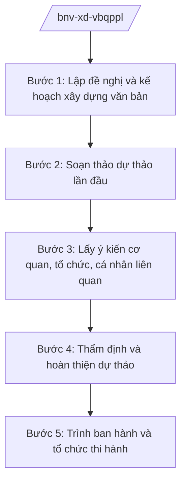

# Skill: Xây dựng VBQPPL lĩnh vực nội vụ

## 2. Khi nào dùng
- Bộ Nội vụ được giao chủ trì soạn thảo thông tư của Bộ trưởng hoặc dự thảo nghị định của Chính phủ thuộc lĩnh vực nội vụ (tổ chức bộ máy, công vụ, tiền lương, thi đua khen thưởng, chính quyền địa phương, văn thư lưu trữ).
- Cần sửa đổi, bổ sung hoặc thay thế văn bản QPPL hiện hành cho phù hợp tổ chức bộ máy mới (14 Bộ + 3 cơ quan ngang Bộ) và mô hình chính quyền địa phương 2 cấp.
- Rà soát, hệ thống hóa văn bản QPPL lĩnh vực nội vụ theo kế hoạch hằng năm của Bộ.

## 3. Đầu vào (Input)

| Trường | Mô tả | Bắt buộc |
|--------|-------|----------|
| `ten_van_ban` | Tên dự thảo văn bản (thông tư/nghị định) | Có |
| `loai_van_ban` | Thông tư / Nghị định | Có |
| `can_cu_chu_truong` | Văn bản giao nhiệm vụ, chương trình xây dựng pháp luật | Có |
| `co_quan_chu_tri` | Vụ/cục chủ trì soạn thảo thuộc Bộ Nội vụ | Có |
| `pham_vi_dieu_chinh` | Phạm vi, đối tượng điều chỉnh của văn bản | Có |
| `du_thao_hien_tai` | Dự thảo (nếu đã có) | Không |
| `danh_sach_lay_y_kien` | Các bộ, ngành, địa phương lấy ý kiến | Không |

## 4. Quy trình

**Bước 1. Lập đề nghị và kế hoạch xây dựng văn bản**
- Làm gì: Căn cứ chương trình xây dựng pháp luật và văn bản giao nhiệm vụ, lập đề nghị xây dựng văn bản: sự cần thiết ban hành, phạm vi điều chỉnh, nội dung chính, lộ trình thực hiện.
- Dùng input: `ten_van_ban`, `loai_van_ban`, `can_cu_chu_truong`, `co_quan_chu_tri`.
- Vai trò: Chuyên viên vụ/cục chủ trì lập đề nghị (AI hỗ trợ rà soát văn bản giao nhiệm vụ, trích xuất yêu cầu, gợi ý khung đề cương ⏱ 1 ngày (ước tính)) → Vụ trưởng/Cục trưởng kiểm tra → Thứ trưởng phụ trách phê duyệt.
- Lưu ý nghiệp vụ: Xác định đúng hình thức văn bản theo thẩm quyền: nội dung thuộc thẩm quyền Bộ trưởng thì xây dựng thông tư; nội dung thuộc thẩm quyền Chính phủ thì xây dựng nghị định, không "nâng cấp" thẩm quyền.
- → Kết quả bước: Đề nghị xây dựng văn bản được phê duyệt, kèm kế hoạch và phân công tổ soạn thảo.

**Bước 2. Soạn thảo dự thảo lần đầu**
- Làm gì: Tổ chức nghiên cứu, soạn thảo dự thảo theo đề cương đã duyệt; đối chiếu văn bản hiện hành và các văn bản liên quan trong lĩnh vực nội vụ.
- Dùng input: `du_thao_hien_tai`, `pham_vi_dieu_chinh`.
- Vai trò: Tổ soạn thảo (chuyên viên vụ chủ trì + Vụ Pháp chế – Bộ Nội vụ) thực hiện (AI hỗ trợ tra cứu văn bản liên quan, kiểm tra trùng lặp, chuẩn hóa kỹ thuật soạn thảo ⏱ 3–5 ngày (ước tính)) → Vụ trưởng cơ quan chủ trì rà soát.
- Lưu ý nghiệp vụ: Tuân thủ kỹ thuật trình bày văn bản QPPL; mọi nội dung phải có căn cứ pháp lý rõ ràng; đối chiếu để không mâu thuẫn với NĐ 25/2025/NĐ-CP và các nghị định phân cấp, phân quyền lĩnh vực nội vụ.
- → Kết quả bước: Dự thảo lần 1 kèm bản thuyết minh.

**Bước 3. Lấy ý kiến cơ quan, tổ chức, cá nhân liên quan**
- Làm gì: Gửi dự thảo lấy ý kiến các bộ, ngành, địa phương theo danh sách; đăng tải lấy ý kiến rộng rãi theo quy định của pháp luật về ban hành văn bản QPPL; tổng hợp, tiếp thu/giải trình.
- Dùng input: `danh_sach_lay_y_kien`, `du_thao_hien_tai`.
- Vai trò: Chuyên viên vụ chủ trì tổng hợp (AI hỗ trợ phân loại ý kiến theo điều khoản, lập bảng tổng hợp tiếp thu/giải trình ⏱ 2–3 ngày (ước tính)) → Vụ trưởng ký văn bản xin ý kiến.
- Lưu ý nghiệp vụ: Ý kiến không tiếp thu phải giải trình bằng văn bản; bảo đảm thời hạn lấy ý kiến theo quy định; với văn bản tác động đến địa phương phải lấy ý kiến UBND cấp tỉnh (vd: UBND tỉnh A).
- → Kết quả bước: Bảng tổng hợp ý kiến và dự thảo lần 2 đã tiếp thu.

**Bước 4. Thẩm định và hoàn thiện dự thảo**
- Làm gì: Vụ Pháp chế – Bộ Nội vụ thẩm định dự thảo (tính hợp hiến, hợp pháp, tính thống nhất, tính khả thi, kỹ thuật soạn thảo); chỉnh sửa theo ý kiến thẩm định.
- Dùng input: Toàn bộ hồ sơ các bước trước.
- Vai trò: Vụ Pháp chế thẩm định (AI hỗ trợ đối chiếu tính thống nhất với hệ thống văn bản hiện hành ⏱ 2 ngày (ước tính)) → Tổ soạn thảo hoàn thiện → Vụ trưởng Vụ Pháp chế ký báo cáo thẩm định.
- Lưu ý nghiệp vụ: Không trình ban hành khi còn ý kiến thẩm định chưa được tiếp thu/giải trình thỏa đáng; kiểm tra lần cuối không viện dẫn văn bản đã hết hiệu lực (vd: NĐ 45/2025/NĐ-CP đã bị thay thế).
- → Kết quả bước: Báo cáo thẩm định và dự thảo hoàn thiện.

**Bước 5. Trình ban hành và tổ chức thi hành**
- Làm gì: Lập tờ trình, hoàn thiện hồ sơ trình Bộ trưởng ký ban hành (thông tư) hoặc trình Chính phủ (nghị định); sau ban hành thì đăng công báo, phổ biến, hướng dẫn thi hành văn bản.
- Dùng input: Toàn bộ hồ sơ.
- Vai trò: Vụ trưởng ký tờ trình (AI hỗ trợ rà soát thể thức lần cuối theo NĐ 30/2020/NĐ-CP ⏱ 0,5 ngày (ước tính)) → Thứ trưởng kiểm tra → Bộ trưởng ký ban hành (thông tư) hoặc quyết định trình Chính phủ (nghị định).
- Lưu ý nghiệp vụ: Hồ sơ trình đầy đủ: tờ trình, dự thảo, thuyết minh, báo cáo thẩm định, bảng tổng hợp ý kiến; với nghị định phải qua Văn phòng Chính phủ tiếp nhận hồ sơ trình Chính phủ.
- → Kết quả bước: Văn bản được ký ban hành; kế hoạch phổ biến, hướng dẫn thi hành.

## Luồng quy trình (Workflow)

## 5. Đầu ra (Output)

- Tờ trình ban hành văn bản.
- Dự thảo văn bản QPPL hoàn thiện (kèm bản thuyết minh).
- Báo cáo thẩm định; bảng tổng hợp tiếp thu ý kiến.

### Cấu trúc output chuẩn
1. Quốc hiệu "CỘNG HÒA XÃ HỘI CHỦ NGHĨA VIỆT NAM", Tiêu ngữ "Độc lập – Tự do – Hạnh phúc"
2. Tên loại và trích yếu nội dung văn bản.
3. Căn cứ ban hành (văn bản có thật, còn hiệu lực).
4. Nội dung văn bản theo chương/mục/điều.
5. Điều khoản thi hành, hiệu lực.
6. Nơi nhận (kết thúc "- Lưu: VT, [mã đơn vị]."), chữ ký (ghi rõ chức danh, họ tên người ký; ký hiệu "KT."/"TL." khi ký thay) người có thẩm quyền (đúng thể thức NĐ 30/2020/NĐ-CP).
## 6. Checklist nghiệm thu
- [ ] Đúng loại văn bản theo thẩm quyền (thông tư của Bộ trưởng / nghị định của Chính phủ).
- [ ] Có văn bản giao nhiệm vụ, đề nghị xây dựng được phê duyệt.
- [ ] Đã lấy ý kiến đầy đủ đối tượng theo quy định; bảng tiếp thu/giải trình đầy đủ.
- [ ] Có báo cáo thẩm định của Vụ Pháp chế; ý kiến thẩm định đã được xử lý dứt điểm.
- [ ] Không mâu thuẫn với NĐ 25/2025/NĐ-CP và các nghị định phân cấp, phân quyền lĩnh vực nội vụ.
- [ ] Căn cứ pháp lý viện dẫn có thật, còn hiệu lực.
- [ ] Thể thức đúng NĐ 30/2020/NĐ-CP; đã qua human gate các nấc.

## 7. Ví dụ mô phỏng

*Dữ liệu dưới đây là giả lập 100% phục vụ minh họa.*

**Input mẫu:**
- ten_van_ban: "Dự thảo Thông tư hướng dẫn vị trí việc làm công chức trong cơ quan hành chính nhà nước"
- loai_van_ban: Thông tư
- can_cu_chu_truong: Chương trình xây dựng VBQPPL năm 2026 của Bộ Nội vụ (giả lập)
- co_quan_chu_tri: Vụ Công chức – Viên chức – Bộ Nội vụ
- pham_vi_dieu_chinh: Vị trí việc làm đối với công chức trong cơ quan hành chính nhà nước

**Output mẫu (trích Tờ trình):**

> **BỘ NỘI VỤ — VỤ CÔNG CHỨC – VIÊN CHỨC**
> **Tờ trình số 1234/TTr-CCVC về việc ban hành Thông tư hướng dẫn vị trí việc làm công chức trong cơ quan hành chính nhà nước**
>
> Kính gửi: Đồng chí Bộ trưởng Bộ Nội vụ (ông Lê Văn CC)
>
> Căn cứ Nghị định số 25/2025/NĐ-CP của Chính phủ quy định chức năng, nhiệm vụ, quyền hạn và cơ cấu tổ chức của Bộ Nội vụ; căn cứ Chương trình xây dựng văn bản quy phạm pháp luật năm 2026 của Bộ Nội vụ, Vụ Công chức – Viên chức kính trình Đồng chí Bộ trưởng xem xét, ký ban hành Thông tư hướng dẫn vị trí việc làm công chức trong cơ quan hành chính nhà nước với các nội dung chính: (1) nguyên tắc xác định vị trí việc làm; (2) danh mục vị trí việc làm; (3) bản mô tả công việc và khung năng lực; (4) điều khoản thi hành.
>
> Hồ sơ kèm theo: dự thảo Thông tư, bản thuyết minh, báo cáo thẩm định của Vụ Pháp chế, bảng tổng hợp ý kiến.
>
> *Nơi nhận: ... — KT. VỤ TRƯỞNG / PHÓ VỤ TRƯỞNG (ông Hoàng Văn EE ký nháy)*

## 8. Human gate
- Vụ trưởng vụ/cục chủ trì: duyệt đề nghị xây dựng, dự thảo các lần, tờ trình.
- Vụ trưởng Vụ Pháp chế: ký báo cáo thẩm định.
- Thứ trưởng phụ trách (bà Phạm Thị DD): kiểm tra hồ sơ trước khi trình Bộ trưởng.
- Bộ trưởng (ông Lê Văn CC): ký ban hành thông tư; quyết định trình Chính phủ đối với dự thảo nghị định.
- Thủ tướng Chính phủ/Chính phủ: xem xét, ban hành nghị định khi thuộc thẩm quyền.

## 9. Giới hạn
- AI không soạn thảo thay toàn bộ văn bản QPPL; chỉ hỗ trợ tra cứu, rà soát, chuẩn hóa kỹ thuật.
- AI không quyết định nội dung chính sách, không tự trình ký hoặc phát hành văn bản.
- AI không xác định thẩm quyền ban hành thay cơ quan chủ trì; không "nâng cấp" nội dung thuộc thẩm quyền thông tư thành nghị định và ngược lại.
- Không bịa số hiệu, ngày ban hành văn bản; không viện dẫn văn bản hết hiệu lực.

## 10. Căn cứ & lưu ý
- Nghị định số 25/2025/NĐ-CP của Chính phủ quy định chức năng, nhiệm vụ, quyền hạn và cơ cấu tổ chức của Bộ Nội vụ. **Lưu ý:** thuvienphapluat.vn ghi nhận NĐ này được sửa đổi tại NĐ 128/2025/NĐ-CP và NĐ 109/2025/NĐ-CP — cần tra văn bản hợp nhất khi áp dụng.
- Nghị quyết số 176/2025/QH15 của Quốc hội về cơ cấu tổ chức của Chính phủ.
- Nghị định số 303/2025/NĐ-CP quy định khung chung về chức năng, nhiệm vụ, quyền hạn và cơ cấu tổ chức của bộ, cơ quan ngang bộ.
- Nghị định số 30/2020/NĐ-CP về công tác văn thư (thể thức văn bản).
- Pháp luật về ban hành văn bản quy phạm pháp luật (dẫn tên, không ghi số hiệu).
