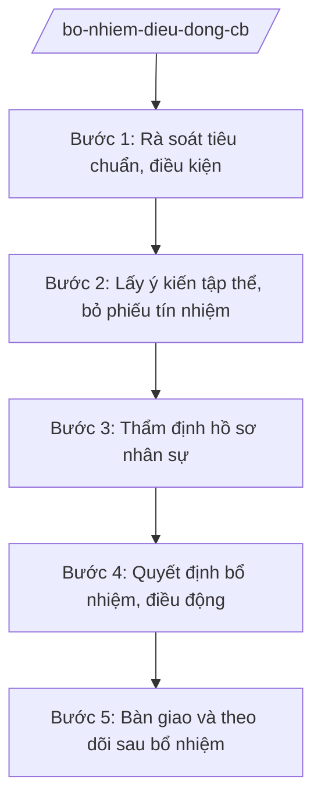

# Skill: Bổ nhiệm, điều động cán bộ

## 2. Khi nào dùng
- Bổ nhiệm cán bộ giữ chức vụ lãnh đạo, quản lý (Giám đốc, Phó Giám đốc sở; thủ trưởng đơn vị...).
- Điều động, luân chuyển cán bộ giữa các cơ quan, đơn vị.
- Bổ nhiệm lại khi hết thời hạn giữ chức vụ.

## 3. Đầu vào (Input)
| Trường | Mô tả | Bắt buộc |
|--------|-------|----------|
| `vi_tri_can_kien_toan` | Chức vụ, đơn vị cần bổ nhiệm/điều động | Có |
| `tieu_chuan_chuc_danh` | Tiêu chuẩn chức danh theo quy định | Có |
| `danh_sach_nhan_su` | Danh sách nhân sự trong quy hoạch / dự kiến | Có |
| `y_kien_tham_muu` | Ý kiến của cơ quan, đơn vị liên quan | Không |
| `thoi_han` | Thời hạn hoàn thành quy trình | Có |

## 4. Quy trình

**Bước 1. Rà soát tiêu chuẩn, điều kiện**
- Làm gì: Rà soát tiêu chuẩn chức danh (trình độ, năng lực, thâm niên, quy hoạch, sức khỏe, kỷ luật); lập danh sách nhân sự đáp ứng.
- Dùng input: `tieu_chuan_chuc_danh`, `danh_sach_nhan_su`
- Vai trò: Chuyên viên Phòng Tổ chức cán bộ (Sở Nội vụ tỉnh A) rà soát; AI hỗ trợ đối chiếu tiêu chuẩn ⏱ ~2 ngày làm việc (ước tính)
- Lưu ý nghiệp vụ: Nhân sự phải trong quy hoạch (trừ trường hợp đặc biệt); không vi phạm kỷ luật trong thời gian quy định.
- → Kết quả bước: Danh sách nhân sự đủ tiêu chuẩn, điều kiện.

**Bước 2. Lấy ý kiến tập thể, bỏ phiếu tín nhiệm**
- Làm gì: Tổ chức hội nghị lấy ý kiến tập thể lãnh đạo, bỏ phiếu tín nhiệm theo quy trình; tổng hợp kết quả.
- Dùng input: Danh sách Bước 1
- Vai trò: Cấp ủy, tập thể lãnh đạo cơ quan thực hiện; AI hỗ trợ lập biên bản, tổng hợp phiếu ⏱ ~3 ngày làm việc (ước tính)
- Lưu ý nghiệp vụ: Đúng quy trình, dân chủ, khách quan; tỷ lệ phiếu tín nhiệm phải đạt mức quy định.
- → Kết quả bước: Biên bản hội nghị, kết quả phiếu tín nhiệm.

**Bước 3. Thẩm định hồ sơ nhân sự**
- Làm gì: Sở Nội vụ thẩm định hồ sơ: lý lịch, quá trình công tác, kê khai tài sản, nhận xét, đánh giá; báo cáo cấp có thẩm quyền.
- Dùng input: Hồ sơ nhân sự, kết quả Bước 2
- Vai trò: Chuyên viên thẩm định; Trưởng phòng kiểm tra; AI hỗ trợ checklist hồ sơ ⏱ ~3 ngày làm việc (ước tính)
- Lưu ý nghiệp vụ: Hồ sơ phải đầy đủ, trung thực; phát hiện vấn đề phải báo cáo kịp thời, không bao che.
- → Kết quả bước: Báo cáo thẩm định nhân sự.

**Bước 4. Quyết định bổ nhiệm, điều động**
- Làm gì: Trình cấp có thẩm quyền quyết định; ban hành quyết định bổ nhiệm/điều động; công bố quyết định.
- Dùng input: Báo cáo thẩm định Bước 3
- Vai trò: Giám đốc Sở Nội vụ trình; Chủ tịch UBND tỉnh A (hoặc cấp có thẩm quyền) quyết định; AI hỗ trợ soạn quyết định đúng thể thức ⏱ ~2 ngày làm việc (ước tính)
- Lưu ý nghiệp vụ: Đúng thẩm quyền quyết định theo phân cấp; thời hạn bổ nhiệm theo quy định.
- → Kết quả bước: Quyết định bổ nhiệm/điều động đã ban hành.

**Bước 5. Bàn giao và theo dõi sau bổ nhiệm**
- Làm gì: Tổ chức bàn giao công việc; cập nhật hồ sơ cán bộ; theo dõi, đánh giá sau bổ nhiệm.
- Dùng input: Quyết định bổ nhiệm
- Vai trò: Đơn vị có cán bộ được bổ nhiệm tổ chức bàn giao; AI hỗ trợ lập biên bản bàn giao ⏱ ~2 ngày làm việc (ước tính)
- Lưu ý nghiệp vụ: Bàn giao đầy đủ công việc, hồ sơ, tài sản; không để gián đoạn.
- → Kết quả bước: Biên bản bàn giao; hồ sơ cán bộ đã cập nhật.

## Luồng quy trình (Workflow)

## 5. Đầu ra (Output)
- Báo cáo thẩm định nhân sự.
- Tờ trình đề nghị bổ nhiệm/điều động.
- Quyết định bổ nhiệm/điều động.
- Biên bản bàn giao công việc.

**Cấu trúc output chuẩn:**
- Thể thức: tuân thủ Nghị định 30/2020/NĐ-CP về công tác văn thư.
Khung quyết định bổ nhiệm:
1. Quốc hiệu "CỘNG HÒA XÃ HỘI CHỦ NGHĨA VIỆT NAM", Tiêu ngữ "Độc lập – Tự do – Hạnh phúc"; số, ký hiệu (số .../QĐ-UBND); địa danh, ngày tháng năm.
2. Tên: "QUYẾT ĐỊNH về việc bổ nhiệm ông/bà ... giữ chức vụ ...".
3. Căn cứ pháp lý.
4. Điều 1: Bổ nhiệm ông/bà ... giữ chức vụ ..., thời hạn ... năm.
5. Điều 2: Chế độ, chính sách được hưởng.
6. Điều 3: Trách nhiệm thi hành; hiệu lực.
7. Chữ ký Chủ tịch UBND tỉnh; đóng dấu.
- Nơi nhận: liệt kê các cơ quan, đơn vị nhận để biết/thực hiện; kết thúc bằng "- Lưu: VT, [mã đơn vị]".

> **Checklist thể thức văn bản theo NĐ 30/2020/NĐ-CP** — đối chiếu trước khi trình ký:
> 1. Quốc hiệu và Tiêu ngữ.
> 2. Tên cơ quan, tổ chức ban hành văn bản.
> 3. Số, ký hiệu của văn bản.
> 4. Địa danh và thời gian ban hành văn bản.
> 5. Tên loại và trích yếu nội dung văn bản.
> 6. Nội dung văn bản.
> 7. Chức vụ, họ tên và chữ ký của người có thẩm quyền.
> 8. Dấu, chữ ký số của cơ quan, tổ chức.
> 9. Nơi nhận (kèm Phụ lục nếu có).

## 6. Checklist nghiệm thu
- [ ] Nhân sự trong quy hoạch, đủ tiêu chuẩn chức danh.
- [ ] Đúng quy trình: lấy ý kiến, bỏ phiếu tín nhiệm, thẩm định.
- [ ] Hồ sơ đầy đủ, trung thực.
- [ ] Đúng thẩm quyền quyết định.
- [ ] Quyết định đúng thể thức NĐ 30/2020/NĐ-CP.
- [ ] Đã công bố quyết định và tổ chức bàn giao.
- [ ] Hồ sơ cán bộ đã cập nhật.

## 7. Ví dụ mô phỏng
*Dữ liệu dưới đây là giả lập 100% phục vụ minh họa.*

**Input mẫu:**
- vi_tri_can_kien_toan: Phó Giám đốc Sở Tài chính tỉnh A
- danh_sach_nhan_su: 2 nhân sự trong quy hoạch (giả lập)
- tieu_chuan_chuc_danh: Theo quy định về tiêu chuẩn chức danh Phó Giám đốc Sở

**Output mẫu (trích quyết định):**
> **QUYẾT ĐỊNH**
> **Về việc bổ nhiệm ông Bùi Văn X giữ chức vụ Phó Giám đốc Sở Tài chính tỉnh A**
>
> Điều 1. Bổ nhiệm ông Bùi Văn X, Trưởng phòng Quản lý ngân sách, giữ chức vụ Phó Giám đốc Sở Tài chính tỉnh A, thời hạn 5 năm...
> (Dữ liệu giả lập 100% phục vụ minh họa)

## 8. Human gate
- Trưởng phòng Tổ chức cán bộ: kiểm tra tiêu chuẩn và hồ sơ (Bước 1, 3).
- Tập thể lãnh đạo: bỏ phiếu tín nhiệm (Bước 2).
- Giám đốc Sở Nội vụ: ký tờ trình (Bước 4).
- Chủ tịch UBND tỉnh / cấp có thẩm quyền: quyết định bổ nhiệm.

## 9. Giới hạn
- AI không thay tập thể bỏ phiếu hay quyết định nhân sự.
- Không bịa hồ sơ, quá trình công tác của nhân sự.
- Không gợi ý "chạy" nhân sự hay can thiệp quy trình.
- Mọi bước phải đúng quy trình, dân chủ, công khai theo quy định.

## 10. Căn cứ & lưu ý
- TT 10/2025/TT-BNV (Sở Nội vụ: quản lý cán bộ, công chức).
- Quy định của Đảng về công tác cán bộ — dẫn tên, tra cứu bản hiện hành khi áp dụng.
