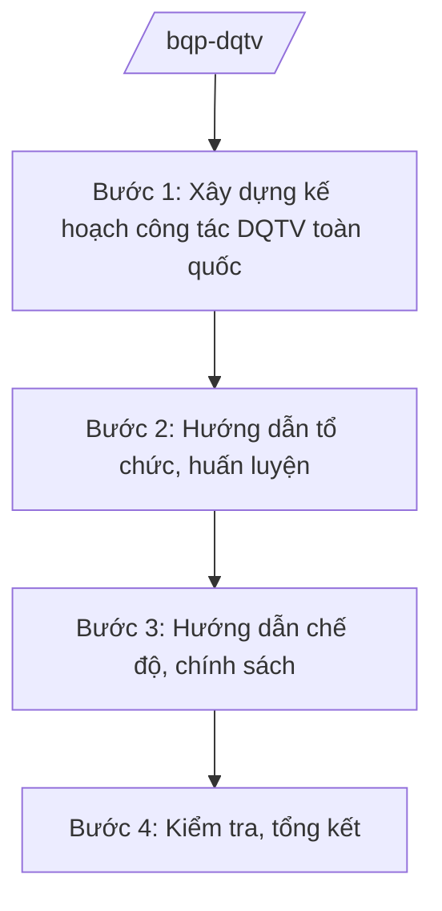

# Skill: Xây dựng lực lượng dân quân tự vệ

## 2. Khi nào dùng
- Hằng năm xây dựng kế hoạch công tác dân quân tự vệ toàn quốc: tổ chức, huấn luyện, hoạt động.
- Hướng dẫn địa phương, cơ quan, tổ chức xây dựng lực lượng dân quân tự vệ theo quy định.
- Kiểm tra, sơ kết, tổng kết công tác dân quân tự vệ.

## 3. Đầu vào (Input)

| Trường | Mô tả | Bắt buộc |
|--------|-------|----------|
| `nam_ke_hoach` | Năm kế hoạch | Có |
| `chi_thi_cua_tren` | Chỉ thị, kế hoạch của cấp trên | Có |
| `bao_cao_dia_phuong` | Báo cáo tình hình DQTV của địa phương, bộ ngành | Không |
| `noi_dung_trong_tam` | Nội dung trọng tâm năm (huấn luyện, diễn tập, chính sách...) | Có |

## 4. Quy trình

**Bước 1. Xây dựng kế hoạch công tác DQTV toàn quốc**
- Làm gì: Tổng hợp báo cáo địa phương, xây dựng kế hoạch năm: chỉ tiêu tổ chức, huấn luyện, chế độ chính sách, kiểm tra.
- Dùng input: `nam_ke_hoach`, `chi_thi_cua_tren`, `bao_cao_dia_phuong`, `noi_dung_trong_tam`.
- Vai trò: Chuyên viên cơ quan tham mưu xây dựng (AI hỗ trợ tổng hợp báo cáo, lập bảng chỉ tiêu dự kiến — 2 ngày) → Cục trưởng kiểm tra → Thứ trưởng phê duyệt.
- Lưu ý nghiệp vụ: Nội dung kế hoạch ở mức hành chính công khai; không chi tiết phương án, số liệu tổ chức cụ thể từng địa phương trong văn bản phổ biến rộng.
- → Kết quả bước: Kế hoạch công tác DQTV năm được phê duyệt.

**Bước 2. Hướng dẫn tổ chức, huấn luyện**
- Làm gì: Ban hành hướng dẫn: tổ chức lực lượng, nội dung, thời gian huấn luyện, công tác đảng, công tác chính trị trong DQTV.
- Dùng input: `noi_dung_trong_tam`.
- Vai trò: Chuyên viên soạn hướng dẫn (AI hỗ trợ rà soát văn bản hiện hành, chuẩn hóa — 2 ngày) → Cục trưởng ký ban hành.
- Lưu ý nghiệp vụ: Nội dung huấn luyện ở mức chương trình, giáo trình công khai; không biên soạn tài liệu chiến thuật mật trong khuôn khổ skill này.
- → Kết quả bước: Văn bản hướng dẫn gửi địa phương, bộ ngành.

**Bước 3. Hướng dẫn chế độ, chính sách**
- Làm gì: Hướng dẫn thực hiện chế độ phụ cấp, trợ cấp, bảo hiểm đối với dân quân tự vệ theo quy định hiện hành.
- Dùng input: `chi_thi_cua_tren`.
- Vai trò: Chuyên viên chính sách soạn hướng dẫn (AI hỗ trợ tra cứu chế độ hiện hành, lập bảng chế độ mẫu — 1 ngày) → Cục trưởng ký.
- Lưu ý nghiệp vụ: Áp dụng đúng đối tượng, mức hưởng theo văn bản còn hiệu lực; công khai, minh bạch.
- → Kết quả bước: Văn bản hướng dẫn chế độ, chính sách.

**Bước 4. Kiểm tra, tổng kết**
- Làm gì: Kiểm tra công tác DQTV tại một số địa phương; tổng hợp kết quả toàn quốc, đánh giá, đề xuất.
- Dùng input: Báo cáo kết quả của địa phương.
- Vai trò: Đoàn kiểm tra thực hiện (AI hỗ trợ tổng hợp báo cáo, so sánh chỉ tiêu/kết quả — 2 ngày) → Cục trưởng thẩm định → Thứ trưởng trình Bộ trưởng.
- Lưu ý nghiệp vụ: Kết luận kiểm tra tập trung mặt hành chính, tổ chức thực hiện.
- → Kết quả bước: Báo cáo tổng kết công tác DQTV năm.

## Luồng quy trình (Workflow)

## 5. Đầu ra (Output)

- Kế hoạch công tác DQTV năm; văn bản hướng dẫn tổ chức, huấn luyện.
- Văn bản hướng dẫn chế độ, chính sách.
- Báo cáo kiểm tra, tổng kết.

### Cấu trúc output chuẩn
1. Quốc hiệu "CỘNG HÒA XÃ HỘI CHỦ NGHĨA VIỆT NAM", Tiêu ngữ "Độc lập – Tự do – Hạnh phúc"; tên cơ quan ban hành.
2. Số, ký hiệu, địa danh, ngày tháng năm ban hành; trích yếu (thể thức NĐ 30/2020/NĐ-CP).
3. Căn cứ ban hành.
4. Nội dung: mục đích, yêu cầu, nhiệm vụ, thời gian, tổ chức thực hiện.
5. Nơi nhận (kết thúc "- Lưu: VT, [mã đơn vị]."), chữ ký (ghi rõ chức danh, họ tên người ký; ký hiệu "KT."/"TL." khi ký thay) người có thẩm quyền.

> **Chuẩn tài liệu đầu ra** (thứ tự ưu tiên):
> 1. Chuẩn riêng của ngành/cơ quan chủ quản — mẫu, biểu mẫu, quy chuẩn tại văn bản quy phạm chuyên ngành (xem mục "Căn cứ & lưu ý").
> 2. Tài liệu không có quy chuẩn riêng — thể thức NĐ 30/2020/NĐ-CP: Quốc hiệu và Tiêu ngữ; tên cơ quan ban hành; số, ký hiệu; địa danh và thời gian; tên loại và trích yếu; nội dung; chức vụ, họ tên, chữ ký người có thẩm quyền; dấu, chữ ký số; nơi nhận (kèm Phụ lục nếu có).

## 6. Checklist nghiệm thu
- [ ] Kế hoạch bao quát tổ chức, huấn luyện, chính sách, kiểm tra.
- [ ] Hướng dẫn phù hợp văn bản hiện hành, ban hành đúng thời gian.
- [ ] Chế độ, chính sách áp dụng đúng đối tượng, mức hưởng.
- [ ] Kiểm tra có kết luận, kiến nghị cụ thể.
- [ ] Không có nội dung mật, số liệu tổ chức chi tiết trong văn bản phổ biến rộng.
- [ ] Thể thức đúng NĐ 30/2020/NĐ-CP; đã qua human gate.

## 7. Ví dụ mô phỏng

*Dữ liệu dưới đây là giả lập 100% phục vụ minh họa.*

**Input mẫu:**
- nam_ke_hoach: 2026
- chi_thi_cua_tren: Chỉ thị công tác DQTV năm 2026 (giả lập)
- noi_dung_trong_tam: Nâng cao chất lượng huấn luyện; thực hiện tốt chế độ, chính sách

**Output mẫu (trích Kế hoạch):**

> **BỘ QUỐC PHÒNG — CƠ QUAN THAM MƯU**
> **Kế hoạch số 1234/KH-DQTV ngày 05/11/2025 về công tác dân quân tự vệ năm 2026**
>
> **I. Mục đích, yêu cầu:** Xây dựng lực lượng DQTV vững mạnh, rộng khắp, làm nòng cốt trong thực hiện nhiệm vụ quốc phòng, an ninh ở cơ sở.
>
> **II. Nhiệm vụ trọng tâm:** (1) Kiện toàn tổ chức DQTV theo quy định; (2) Nâng cao chất lượng huấn luyện, diễn tập ở mức cơ sở; (3) Thực hiện đầy đủ chế độ, chính sách đối với DQTV; (4) Kiểm tra 30% địa phương trong năm (số liệu giả lập).
>
> *Nơi nhận: ... — KT. BỘ TRƯỞNG / THỨ TRƯỞNG (bà Phạm Thị DD)*

## 8. Human gate
- Cục trưởng: duyệt kế hoạch, hướng dẫn, báo cáo tổng kết.
- Thứ trưởng phụ trách: phê duyệt kế hoạch năm.
- Bộ trưởng (ông Lê Văn CC): quyết định chủ trương lớn về công tác DQTV.

## 9. Giới hạn
- AI không quyết định tổ chức, quân số cụ thể; không soạn tài liệu huấn luyện chiến thuật.
- Không công khai, không suy đoán số liệu tổ chức, trang bị chi tiết.
- Không bịa số hiệu văn bản, số liệu; không viện dẫn văn bản hết hiệu lực.

## 10. Căn cứ & lưu ý
- Nghị định số 03/2025/NĐ-CP ngày 28/02/2025 của Chính phủ quy định chức năng, nhiệm vụ, quyền hạn và cơ cấu tổ chức của Bộ Quốc phòng.
- Nghị quyết số 176/2025/QH15 của Quốc hội về cơ cấu tổ chức của Chính phủ.
- Luật Dân quân tự vệ (dẫn tên, không ghi số hiệu).
- Nghị định số 30/2020/NĐ-CP về công tác văn thư (thể thức văn bản).
