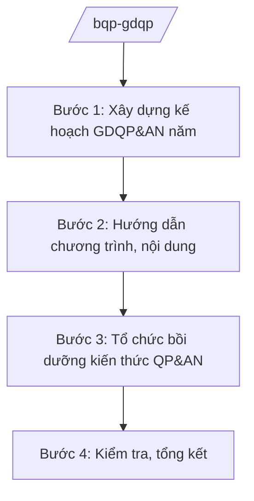

# Skill: Giáo dục quốc phòng và an ninh

## 2. Khi nào dùng
- Hằng năm xây dựng kế hoạch giáo dục QP&AN toàn quốc cho các đối tượng theo quy định.
- Tổ chức bồi dưỡng kiến thức QP&AN cho cán bộ, công chức, viên chức và người lao động.
- Kiểm tra, đánh giá kết quả GDQP&AN tại bộ ngành, địa phương, nhà trường.

## 3. Đầu vào (Input)

| Trường | Mô tả | Bắt buộc |
|--------|-------|----------|
| `nam_ke_hoach` | Năm kế hoạch | Có |
| `doi_tuong` | Các đối tượng GDQP&AN trong năm | Có |
| `chuong_trinh_hien_hanh` | Chương trình, giáo trình hiện hành | Không |
| `bao_cao_dia_phuong` | Báo cáo kết quả GDQP&AN của địa phương, bộ ngành | Không |

## 4. Quy trình

**Bước 1. Xây dựng kế hoạch GDQP&AN năm**
- Làm gì: Xác định đối tượng, chỉ tiêu bồi dưỡng; phân công trách nhiệm bộ ngành, địa phương, nhà trường; dự kiến kinh phí.
- Dùng input: `nam_ke_hoach`, `doi_tuong`, `bao_cao_dia_phuong`.
- Vai trò: Chuyên viên xây dựng kế hoạch (AI hỗ trợ tổng hợp báo cáo năm trước, lập bảng chỉ tiêu — 2 ngày) → Vụ trưởng kiểm tra → Thứ trưởng phê duyệt.
- Lưu ý nghiệp vụ: Đối tượng, nội dung theo đúng quy định hiện hành; kế hoạch khả thi, phù hợp điều kiện địa phương.
- → Kết quả bước: Kế hoạch GDQP&AN năm được phê duyệt.

**Bước 2. Hướng dẫn chương trình, nội dung**
- Làm gì: Ban hành hướng dẫn thực hiện chương trình GDQP&AN cho từng đối tượng: nội dung, thời lượng, hình thức, kiểm tra đánh giá.
- Dùng input: `chuong_trinh_hien_hanh`, `doi_tuong`.
- Vai trò: Chuyên viên soạn hướng dẫn (AI hỗ trợ rà soát chương trình hiện hành, chuẩn hóa văn bản — 2 ngày) → Vụ trưởng ký ban hành.
- Lưu ý nghiệp vụ: Nội dung ở mức chương trình công khai; cập nhật chủ trương, chính sách mới về quốc phòng, an ninh.
- → Kết quả bước: Văn bản hướng dẫn thực hiện chương trình.

**Bước 3. Tổ chức bồi dưỡng kiến thức QP&AN**
- Làm gì: Phối hợp tổ chức các lớp bồi dưỡng kiến thức QP&AN cho cán bộ đối tượng theo phân cấp; quản lý danh sách, kết quả.
- Dùng input: `doi_tuong`, `nam_ke_hoach`.
- Vai trò: Cơ quan thường trực Hội đồng GDQP&AN tổ chức (AI hỗ trợ lập kế hoạch lớp học, danh sách, mẫu giấy chứng nhận — 1 ngày) → Vụ trưởng theo dõi.
- Lưu ý nghiệp vụ: Bảo đảm đúng đối tượng, đủ thời lượng; cấp giấy chứng nhận theo quy định.
- → Kết quả bước: Các lớp bồi dưỡng được tổ chức; danh sách hoàn thành.

**Bước 4. Kiểm tra, tổng kết**
- Làm gì: Kiểm tra công tác GDQP&AN tại bộ ngành, địa phương, nhà trường; tổng hợp, đánh giá toàn quốc.
- Dùng input: Báo cáo kết quả của các đơn vị.
- Vai trò: Đoàn kiểm tra thực hiện (AI hỗ trợ tổng hợp số liệu, dự thảo báo cáo — 2 ngày) → Vụ trưởng thẩm định → Thứ trưởng trình Bộ trưởng.
- Lưu ý nghiệp vụ: Đánh giá thực chất, tránh hình thức.
- → Kết quả bước: Báo cáo tổng kết công tác GDQP&AN năm.

## Luồng quy trình (Workflow)

## 5. Đầu ra (Output)

- Kế hoạch GDQP&AN năm; văn bản hướng dẫn chương trình.
- Kế hoạch, danh sách các lớp bồi dưỡng kiến thức QP&AN.
- Báo cáo kiểm tra, tổng kết.

### Cấu trúc output chuẩn
1. Quốc hiệu "CỘNG HÒA XÃ HỘI CHỦ NGHĨA VIỆT NAM", Tiêu ngữ "Độc lập – Tự do – Hạnh phúc"; tên cơ quan ban hành.
2. Số, ký hiệu, địa danh, ngày tháng năm ban hành; trích yếu (thể thức NĐ 30/2020/NĐ-CP).
3. Căn cứ ban hành.
4. Nội dung: đối tượng, chỉ tiêu, nội dung, thời gian, tổ chức thực hiện, kinh phí.
5. Nơi nhận (kết thúc "- Lưu: VT, [mã đơn vị]."), chữ ký (ghi rõ chức danh, họ tên người ký; ký hiệu "KT."/"TL." khi ký thay) người có thẩm quyền.

> **Checklist thể thức văn bản theo NĐ 30/2020/NĐ-CP** — đối chiếu trước khi trình ký:
> 1. Quốc hiệu và Tiêu ngữ.
> 2. Tên cơ quan, tổ chức ban hành văn bản.
> 3. Số, ký hiệu của văn bản.
> 4. Địa danh và thời gian ban hành văn bản.
> 5. Tên loại và trích yếu nội dung văn bản.
> 6. Nội dung văn bản.
> 7. Chức vụ, họ tên và chữ ký của người có thẩm quyền.
> 8. Dấu, chữ ký số của cơ quan, tổ chức.
> 9. Nơi nhận (kèm Phụ lục nếu có).

## 6. Checklist nghiệm thu
- [ ] Kế hoạch bao quát đủ đối tượng theo quy định.
- [ ] Chương trình, nội dung cập nhật, đúng quy định hiện hành.
- [ ] Lớp bồi dưỡng tổ chức đúng đối tượng, đủ thời lượng.
- [ ] Kiểm tra, đánh giá thực chất, có kết luận cụ thể.
- [ ] Thể thức đúng NĐ 30/2020/NĐ-CP; đã qua human gate.

## 7. Ví dụ mô phỏng

*Dữ liệu dưới đây là giả lập 100% phục vụ minh họa.*

**Input mẫu:**
- nam_ke_hoach: 2026
- doi_tuong: Cán bộ đối tượng 2, 3 của các bộ ngành, địa phương; học sinh, sinh viên
- chuong_trinh_hien_hanh: Chương trình GDQP&AN hiện hành (giả lập)

**Output mẫu (trích Kế hoạch):**

> **BỘ QUỐC PHÒNG — HỘI ĐỒNG GIÁO DỤC QP&AN TRUNG ƯƠNG (CƠ QUAN THƯỜNG TRỰC)**
> **Kế hoạch số 1234/KH-GDQP ngày 20/11/2025 về công tác giáo dục quốc phòng và an ninh năm 2026**
>
> **I. Chỉ tiêu:** Bồi dưỡng kiến thức QP&AN cho 5.000 cán bộ đối tượng 2, 3 (số liệu giả lập); 100% học sinh, sinh viên được học chương trình GDQP&AN theo quy định.
>
> **II. Nội dung trọng tâm:** Quán triệt chủ trương, chính sách mới về quốc phòng, an ninh; nâng cao chất lượng giảng dạy GDQP&AN trong nhà trường; kiểm tra 20% địa phương, bộ ngành.
>
> *Nơi nhận: ... — KT. BỘ TRƯỞNG / THỨ TRƯỞNG (bà Phạm Thị DD)*

## 8. Human gate
- Vụ trưởng: duyệt kế hoạch, hướng dẫn, báo cáo tổng kết.
- Thứ trưởng phụ trách: phê duyệt kế hoạch năm.
- Bộ trưởng (ông Lê Văn CC): quyết định chủ trương lớn về GDQP&AN.

## 9. Giới hạn
- AI không quyết định nội dung chương trình, không cấp giấy chứng nhận thay cơ quan có thẩm quyền.
- Không bịa số hiệu văn bản, số liệu; không viện dẫn văn bản hết hiệu lực.
- Nội dung giảng dạy chi tiết do cơ quan chuyên môn biên soạn; AI chỉ hỗ trợ hành chính.

## 10. Căn cứ & lưu ý
- Nghị định số 03/2025/NĐ-CP ngày 28/02/2025 của Chính phủ quy định chức năng, nhiệm vụ, quyền hạn và cơ cấu tổ chức của Bộ Quốc phòng.
- Nghị quyết số 176/2025/QH15 của Quốc hội về cơ cấu tổ chức của Chính phủ.
- Luật Giáo dục quốc phòng và an ninh (dẫn tên, không ghi số hiệu).
- Nghị định số 30/2020/NĐ-CP về công tác văn thư (thể thức văn bản).
