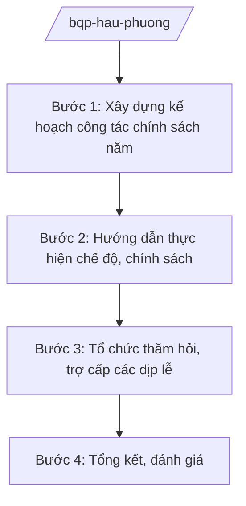

# Skill: Chính sách hậu phương quân đội

## 2. Khi nào dùng
- Hằng năm xây dựng kế hoạch công tác chính sách hậu phương quân đội: thăm hỏi, tặng quà, trợ cấp gia đình quân nhân có hoàn cảnh khó khăn.
- Giải quyết chế độ, chính sách đối với thân nhân liệt sĩ, thương binh, bệnh binh và gia đình quân nhân.
- Sơ kết, tổng kết phong trào "Đền ơn đáp nghĩa", công tác chính sách toàn quân.

## 3. Đầu vào (Input)

| Trường | Mô tả | Bắt buộc |
|--------|-------|----------|
| `nam_ke_hoach` | Năm kế hoạch | Có |
| `doi_tuong_chinh_sach` | Nhóm đối tượng thụ hưởng | Có |
| `che_do_hien_hanh` | Chế độ, mức trợ cấp hiện hành | Không |
| `bao_cao_don_vi` | Báo cáo đề xuất của các đơn vị | Không |
| `dip_le` | Dịp lễ, kỷ niệm cần thăm hỏi (27/7, Tết...) | Không |

## 4. Quy trình

**Bước 1. Xây dựng kế hoạch công tác chính sách năm**
- Làm gì: Xác định nhiệm vụ trọng tâm: thăm hỏi, trợ cấp, xây nhà tình nghĩa, phụng dưỡng Mẹ Việt Nam anh hùng; phân bổ kinh phí dự kiến.
- Dùng input: `nam_ke_hoach`, `doi_tuong_chinh_sach`, `dip_le`, `bao_cao_don_vi`.
- Vai trò: Chuyên viên cơ quan chính sách xây dựng (AI hỗ trợ tổng hợp đề xuất đơn vị, lập bảng kế hoạch — 2 ngày) → Cục trưởng kiểm tra → Thứ trưởng phê duyệt.
- Lưu ý nghiệp vụ: Ưu tiên đối tượng khó khăn, vùng sâu, vùng xa; công khai, minh bạch.
- → Kết quả bước: Kế hoạch công tác chính sách hậu phương quân đội năm.

**Bước 2. Hướng dẫn thực hiện chế độ, chính sách**
- Làm gì: Ban hành văn bản hướng dẫn thực hiện chế độ trợ cấp, thăm hỏi theo quy định hiện hành; quy định hồ sơ, trình tự xét duyệt.
- Dùng input: `che_do_hien_hanh`, `doi_tuong_chinh_sach`.
- Vai trò: Chuyên viên soạn hướng dẫn (AI hỗ trợ tra cứu chế độ hiện hành, lập bảng mức hưởng mẫu — 1 ngày) → Cục trưởng ký ban hành.
- Lưu ý nghiệp vụ: Áp dụng đúng đối tượng, mức hưởng; không để sót, trùng, sai đối tượng.
- → Kết quả bước: Văn bản hướng dẫn thực hiện chế độ, chính sách.

**Bước 3. Tổ chức thăm hỏi, trợ cấp các dịp lễ**
- Làm gì: Lập danh sách thăm hỏi, tặng quà các dịp lễ, Tết; tổ chức đoàn thăm hỏi của lãnh đạo Bộ; theo dõi đơn vị thực hiện.
- Dùng input: `dip_le`, `doi_tuong_chinh_sach`.
- Vai trò: Cơ quan chính sách chủ trì (AI hỗ trợ lập danh sách, lịch đoàn thăm hỏi, dự toán kinh phí — 1 ngày) → Cục trưởng trình Thứ trưởng.
- Lưu ý nghiệp vụ: Thông tin cá nhân đối tượng thụ hưởng được bảo mật, chỉ dùng trong phạm vi công tác.
- → Kết quả bước: Kế hoạch thăm hỏi, trợ cấp dịp lễ được triển khai.

**Bước 4. Tổng kết, đánh giá**
- Làm gì: Tổng hợp kết quả thực hiện toàn quân; đánh giá, biểu dương đơn vị, cá nhân tiêu biểu; đề xuất năm sau.
- Dùng input: Báo cáo kết quả của các đơn vị.
- Vai trò: Chuyên viên tổng hợp (AI hỗ trợ tổng hợp số liệu, dự thảo báo cáo — 2 ngày) → Cục trưởng thẩm định → Thứ trưởng trình Bộ trưởng.
- Lưu ý nghiệp vụ: Số liệu công khai ở mức tổng hợp; không nêu thông tin cá nhân cụ thể trong báo cáo phổ biến rộng.
- → Kết quả bước: Báo cáo tổng kết công tác chính sách hậu phương quân đội.

## Luồng quy trình (Workflow)

## 5. Đầu ra (Output)

- Kế hoạch công tác chính sách hậu phương quân đội năm.
- Văn bản hướng dẫn thực hiện chế độ, chính sách.
- Kế hoạch thăm hỏi, trợ cấp các dịp lễ; báo cáo tổng kết.

### Cấu trúc output chuẩn
1. Quốc hiệu "CỘNG HÒA XÃ HỘI CHỦ NGHĨA VIỆT NAM", Tiêu ngữ "Độc lập – Tự do – Hạnh phúc"; tên cơ quan ban hành.
2. Số, ký hiệu, địa danh, ngày tháng năm ban hành; trích yếu (thể thức NĐ 30/2020/NĐ-CP).
3. Căn cứ ban hành.
4. Nội dung: đối tượng, chế độ, mức hưởng, thời gian, tổ chức thực hiện, kinh phí.
5. Nơi nhận (kết thúc "- Lưu: VT, [mã đơn vị]."), chữ ký (ghi rõ chức danh, họ tên người ký; ký hiệu "KT."/"TL." khi ký thay) người có thẩm quyền.
## 6. Checklist nghiệm thu
- [ ] Kế hoạch bao quát thăm hỏi, trợ cấp, nhà tình nghĩa, phụng dưỡng.
- [ ] Chế độ áp dụng đúng đối tượng, mức hưởng theo văn bản còn hiệu lực.
- [ ] Danh sách thụ hưởng chính xác, không sót, trùng, sai đối tượng.
- [ ] Bảo mật thông tin cá nhân đối tượng chính sách.
- [ ] Báo cáo tổng kết có đánh giá, đề xuất cụ thể.
- [ ] Thể thức đúng NĐ 30/2020/NĐ-CP; đã qua human gate.

## 7. Ví dụ mô phỏng

*Dữ liệu dưới đây là giả lập 100% phục vụ minh họa.*

**Input mẫu:**
- nam_ke_hoach: 2026
- doi_tuong_chinh_sach: Gia đình liệt sĩ, thương binh, bệnh binh; gia đình quân nhân có hoàn cảnh khó khăn
- dip_le: Kỷ niệm 79 năm Ngày Thương binh – Liệt sĩ 27/7

**Output mẫu (trích Kế hoạch):**

> **BỘ QUỐC PHÒNG — CƠ QUAN CHÍNH SÁCH**
> **Kế hoạch số 1234/KH-CS ngày 01/7/2026 về thăm hỏi, tặng quà nhân dịp 27/7**
>
> **I. Đối tượng:** 10.000 gia đình chính sách (số liệu giả lập) thuộc các đơn vị toàn quân, ưu tiên vùng sâu, vùng xa, vùng đặc biệt khó khăn.
>
> **II. Mức quà:** Theo chế độ hiện hành; nguồn kinh phí từ ngân sách quốc phòng và quỹ "Đền ơn đáp nghĩa".
>
> **III. Tổ chức thực hiện:** Các đơn vị lập danh sách, xét duyệt, tổ chức thăm hỏi trước ngày 25/7/2026; báo cáo kết quả về cơ quan chính sách Bộ trước 05/8/2026.
>
> *Nơi nhận: ... — KT. BỘ TRƯỞNG / THỨ TRƯỞNG (bà Phạm Thị DD)*

## 8. Human gate
- Cục trưởng cơ quan chính sách: duyệt kế hoạch, hướng dẫn, danh sách thăm hỏi.
- Thứ trưởng phụ trách: phê duyệt kế hoạch năm, quyết định đoàn thăm hỏi cấp Bộ.
- Bộ trưởng (ông Lê Văn CC): quyết định chủ trương, mức chi lớn về công tác chính sách.

## 9. Giới hạn
- AI không quyết định đối tượng thụ hưởng, mức trợ cấp cụ thể cho từng trường hợp.
- Không công khai thông tin cá nhân của đối tượng chính sách.
- Không bịa số hiệu văn bản, số liệu; không viện dẫn văn bản hết hiệu lực.

## 10. Căn cứ & lưu ý
- Nghị định số 03/2025/NĐ-CP ngày 28/02/2025 của Chính phủ quy định chức năng, nhiệm vụ, quyền hạn và cơ cấu tổ chức của Bộ Quốc phòng.
- Nghị quyết số 176/2025/QH15 của Quốc hội về cơ cấu tổ chức của Chính phủ.
- Pháp lệnh Ưu đãi người có công với cách mạng (dẫn tên, không ghi số hiệu).
- Nghị định số 30/2020/NĐ-CP về công tác văn thư (thể thức văn bản).
