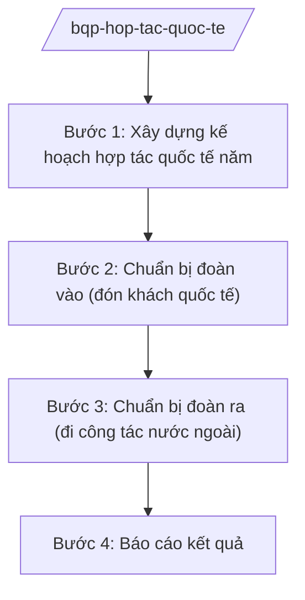

# Skill: Hợp tác quốc tế về quốc phòng

## 2. Khi nào dùng
- Hằng năm xây dựng kế hoạch hợp tác quốc tế về quốc phòng: đoàn ra, đoàn vào, hội nghị, diễn đàn đa phương.
- Chuẩn bị nội dung, chương trình đón tiếp đoàn khách quốc phòng nước ngoài thăm Việt Nam.
- Chuẩn bị đoàn của Bộ Quốc phòng đi công tác, dự hội nghị quốc tế.
- Sơ kết, tổng kết công tác đối ngoại quốc phòng.

## 3. Đầu vào (Input)

| Trường | Mô tả | Bắt buộc |
|--------|-------|----------|
| `nam_ke_hoach` | Năm kế hoạch | Có |
| `doi_tac` | Đối tác hợp tác (nước/tổ chức quốc tế, mức công khai) | Có |
| `hinh_thuc` | Đoàn ra / đoàn vào / hội nghị / biên bản ghi nhớ | Có |
| `chu_truong` | Chủ trương, văn bản giao nhiệm vụ | Có |
| `noi_dung_du_kien` | Nội dung hợp tác dự kiến (mức công khai) | Không |

## 4. Quy trình

**Bước 1. Xây dựng kế hoạch hợp tác quốc tế năm**
- Làm gì: Tổng hợp đề xuất các cơ quan, đơn vị; xây dựng kế hoạch đoàn ra, đoàn vào, hội nghị quốc tế; dự kiến kinh phí.
- Dùng input: `nam_ke_hoach`, `doi_tac`, `hinh_thuc`, `chu_truong`.
- Vai trò: Chuyên viên cơ quan đối ngoại xây dựng (AI hỗ trợ tổng hợp đề xuất, lập bảng kế hoạch — 2 ngày) → Vụ trưởng kiểm tra → Thứ trưởng phê duyệt.
- Lưu ý nghiệp vụ: Chỉ kế hoạch nội dung công khai (giao lưu, hội nghị, đào tạo, gìn giữ hòa bình); nội dung hợp tác chuyên sâu do cấp có thẩm quyền quyết định riêng.
- → Kết quả bước: Kế hoạch hợp tác quốc tế về quốc phòng năm được phê duyệt.

**Bước 2. Chuẩn bị đoàn vào (đón khách quốc tế)**
- Làm gì: Xây dựng chương trình, kịch bản đón tiếp đoàn khách: lễ tân, hội đàm, tham quan, văn kiện ký kết (nếu có); xin ý kiến các cơ quan liên quan.
- Dùng input: `doi_tac`, `noi_dung_du_kien`.
- Vai trò: Chuyên viên chuẩn bị (AI hỗ trợ soạn chương trình, kịch bản lễ tân, dự thảo văn kiện khung — 2 ngày) → Vụ trưởng duyệt → Thứ trưởng quyết định.
- Lưu ý nghiệp vụ: Tuân thủ nghi thức lễ tân nhà nước; văn kiện ký kết phải được thẩm định pháp lý trước.
- → Kết quả bước: Chương trình, kịch bản đón tiếp đoàn khách được phê duyệt.

**Bước 3. Chuẩn bị đoàn ra (đi công tác nước ngoài)**
- Làm gì: Lập đề án đoàn ra: thành phần, nội dung làm việc, chương trình, dự toán; trình cấp có thẩm quyền cử đoàn; chuẩn bị tài liệu.
- Dùng input: `doi_tac`, `noi_dung_du_kien`, `chu_truong`.
- Vai trò: Chuyên viên lập đề án (AI hỗ trợ soạn đề án, dự toán, tài liệu — 2 ngày) → Vụ trưởng thẩm định → Thứ trưởng trình Bộ trưởng quyết định cử đoàn.
- Lưu ý nghiệp vụ: Thành phần đoàn gọn, đúng đối tượng; nội dung làm việc trong phạm vi được giao.
- → Kết quả bước: Quyết định cử đoàn và bộ tài liệu công tác.

**Bước 4. Báo cáo kết quả**
- Làm gì: Tổng hợp kết quả từng hoạt động (biên bản hội đàm, văn kiện ký); báo cáo cấp trên; theo dõi thực hiện thỏa thuận.
- Dùng input: Kết quả hoạt động thực tế.
- Vai trò: Chuyên viên tổng hợp (AI hỗ trợ soạn báo cáo kết quả, lập danh mục văn kiện — 1 ngày) → Vụ trưởng thẩm định → Thứ trưởng trình Bộ trưởng.
- Lưu ý nghiệp vụ: Nội dung báo cáo phân loại mật theo quy định; bản báo cáo hành chính chỉ nêu nội dung công khai.
- → Kết quả bước: Báo cáo kết quả hoạt động hợp tác quốc tế.

## Luồng quy trình (Workflow)

## 5. Đầu ra (Output)

- Kế hoạch hợp tác quốc tế về quốc phòng năm.
- Chương trình, kịch bản đón tiếp đoàn khách; đề án đoàn ra.
- Báo cáo kết quả hoạt động; danh mục văn kiện ký kết.

### Cấu trúc output chuẩn
1. Quốc hiệu "CỘNG HÒA XÃ HỘI CHỦ NGHĨA VIỆT NAM", Tiêu ngữ "Độc lập – Tự do – Hạnh phúc"; tên cơ quan ban hành.
2. Số, ký hiệu, địa danh, ngày tháng năm ban hành; trích yếu (thể thức NĐ 30/2020/NĐ-CP).
3. Căn cứ ban hành.
4. Nội dung: đối tác, hình thức, thời gian, thành phần, nội dung, kinh phí, tổ chức thực hiện.
5. Nơi nhận (kết thúc "- Lưu: VT, [mã đơn vị]."), chữ ký (ghi rõ chức danh, họ tên người ký; ký hiệu "KT."/"TL." khi ký thay) người có thẩm quyền.
## 6. Checklist nghiệm thu
- [ ] Kế hoạch có chủ trương, bao quát đoàn ra/đoàn vào/hội nghị.
- [ ] Chương trình đón tiếp đúng nghi thức lễ tân nhà nước.
- [ ] Đề án đoàn ra có quyết định cử đoàn của cấp có thẩm quyền.
- [ ] Văn kiện ký kết đã qua thẩm định pháp lý.
- [ ] Báo cáo kết quả đầy đủ, phân loại mật đúng quy định.
- [ ] Thể thức đúng NĐ 30/2020/NĐ-CP; đã qua human gate.

## 7. Ví dụ mô phỏng

*Dữ liệu dưới đây là giả lập 100% phục vụ minh họa.*

**Input mẫu:**
- nam_ke_hoach: 2026
- doi_tac: Bộ Quốc phòng nước A (giả lập)
- hinh_thuc: Đoàn vào — thăm chính thức
- noi_dung_du_kien: Hội đàm về hợp tác đào tạo, gìn giữ hòa bình Liên hợp quốc (mức công khai)

**Output mẫu (trích Chương trình đón tiếp):**

> **BỘ QUỐC PHÒNG — CƠ QUAN ĐỐI NGOẠI**
> **Chương trình đón tiếp đoàn Bộ Quốc phòng nước A thăm chính thức Việt Nam (giả lập)**
>
> **Thời gian:** 3 ngày, tháng 5/2026 (giả lập).
>
> **Chương trình:** Lễ đón chính thức tại trụ sở Bộ Quốc phòng; hội đàm giữa Bộ trưởng hai nước (ông Lê Văn CC và người đồng cấp); ký biên bản ghi nhớ hợp tác đào tạo; tham quan đơn vị gìn giữ hòa bình.
>
> **Phân công:** Cơ quan đối ngoại chủ trì; Văn phòng Bộ bảo đảm lễ tân, hậu cần.
>
> *Phê duyệt: Thứ trưởng (bà Phạm Thị DD)*

## 8. Human gate
- Vụ trưởng cơ quan đối ngoại: duyệt kế hoạch, chương trình, đề án đoàn.
- Thứ trưởng phụ trách: phê duyệt kế hoạch năm, quyết định đoàn ra/đoàn vào.
- Bộ trưởng (ông Lê Văn CC): quyết định chủ trương hợp tác quan trọng, ký văn kiện cấp bộ trưởng.

## 9. Giới hạn
- AI không quyết định nội dung hợp tác, không soạn văn kiện có tính ràng buộc pháp lý thay cơ quan thẩm định.
- Mọi nội dung ở mức hành chính công khai; nội dung mật xử lý theo quy định bảo vệ bí mật nhà nước.
- Không bịa tên đối tác, số hiệu văn bản; không viện dẫn văn bản hết hiệu lực.

## 10. Căn cứ & lưu ý
- Nghị định số 03/2025/NĐ-CP ngày 28/02/2025 của Chính phủ quy định chức năng, nhiệm vụ, quyền hạn và cơ cấu tổ chức của Bộ Quốc phòng.
- Nghị quyết số 176/2025/QH15 của Quốc hội về cơ cấu tổ chức của Chính phủ.
- Luật Điều ước quốc tế; Luật Thỏa thuận quốc tế (dẫn tên, không ghi số hiệu).
- Nghị định số 30/2020/NĐ-CP về công tác văn thư (thể thức văn bản).
