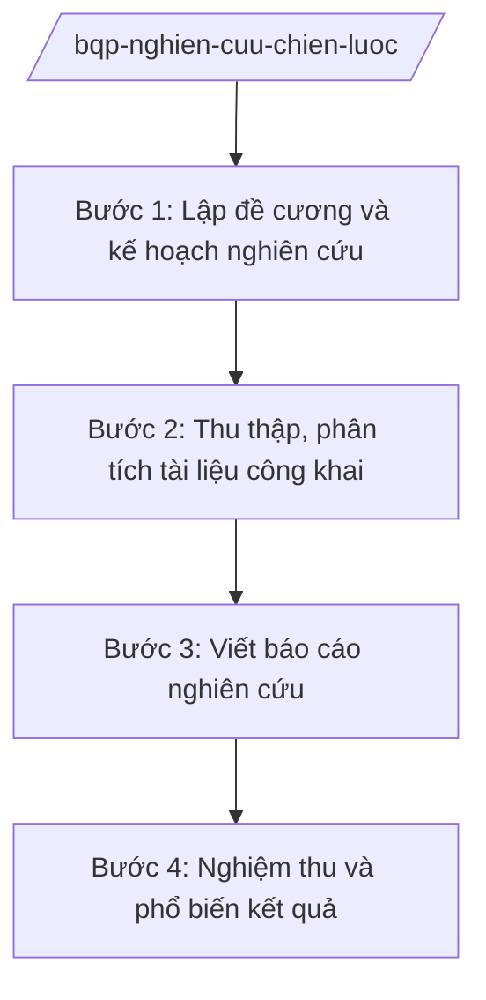

# Skill: Nghiên cứu chiến lược quốc phòng

## 2. Khi nào dùng
- Xây dựng kế hoạch nghiên cứu chiến lược, tổng kết thực tiễn về quốc phòng hằng năm.
- Tổ chức nghiên cứu đề tài, chuyên đề phục vụ hoạch định chính sách quốc phòng (nội dung công khai).
- Tổng hợp, phân tích tình hình thế giới, khu vực từ nguồn công khai phục vụ báo cáo.

## 3. Đầu vào (Input)

| Trường | Mô tả | Bắt buộc |
|--------|-------|----------|
| `ten_de_tai` | Tên đề tài/chuyên đề nghiên cứu | Có |
| `muc_tieu` | Mục tiêu, phạm vi nghiên cứu (mức công khai) | Có |
| `nguon_tai_lieu` | Nguồn tài liệu công khai sử dụng | Không |
| `thoi_han` | Thời hạn hoàn thành | Có |
| `don_vi_chu_tri` | Cơ quan, đơn vị chủ trì | Có |

## 4. Quy trình

**Bước 1. Lập đề cương và kế hoạch nghiên cứu**
- Làm gì: Xác định mục tiêu, phạm vi, phương pháp, đề cương chi tiết; phân công thực hiện; dự kiến sản phẩm.
- Dùng input: `ten_de_tai`, `muc_tieu`, `thoi_han`, `don_vi_chu_tri`.
- Vai trò: Chủ nhiệm đề tài lập đề cương (AI hỗ trợ rà soát tài liệu công khai liên quan, gợi ý khung đề cương — 2 ngày) → Thủ trưởng cơ quan nghiên cứu phê duyệt.
- Lưu ý nghiệp vụ: Phạm vi nghiên cứu giới hạn ở nội dung công khai (chính sách, học thuyết công bố, số liệu công khai); không đặt vấn đề nghiên cứu nội dung mật trong khuôn khổ skill này.
- → Kết quả bước: Đề cương nghiên cứu được phê duyệt.

**Bước 2. Thu thập, phân tích tài liệu công khai**
- Làm gì: Thu thập văn kiện, chính sách đã công bố, báo cáo công khai, học thuật; phân tích, đối chiếu.
- Dùng input: `nguon_tai_lieu`, `muc_tieu`.
- Vai trò: Nhóm nghiên cứu thực hiện (AI hỗ trợ tổng hợp, phân loại tài liệu, lập bảng so sánh chính sách các nước từ nguồn công khai — 5 ngày) → Chủ nhiệm đề tài kiểm tra.
- Lưu ý nghiệp vụ: Chỉ dùng nguồn công khai, ghi rõ xuất xứ; không suy đoán, không bịa số liệu.
- → Kết quả bước: Bộ tài liệu phân tích có trích dẫn nguồn.

**Bước 3. Viết báo cáo nghiên cứu**
- Làm gì: Viết báo cáo: đặt vấn đề, phân tích, đánh giá, kiến nghị chính sách (mức công khai).
- Dùng input: Kết quả bước 2.
- Vai trò: Nhóm nghiên cứu viết (AI hỗ trợ dàn ý, chuẩn hóa trích dẫn, rà soát logic — 3 ngày) → Chủ nhiệm đề tài rà soát → Hội đồng nghiệm thu (nếu có).
- Lưu ý nghiệp vụ: Kiến nghị phải khả thi, có căn cứ; phân biệt rõ sự kiện và nhận định.
- → Kết quả bước: Báo cáo nghiên cứu hoàn chỉnh.

**Bước 4. Nghiệm thu và phổ biến kết quả**
- Làm gì: Tổ chức nghiệm thu; phổ biến kết quả trong phạm vi cho phép; lưu trữ hồ sơ.
- Dùng input: Báo cáo nghiên cứu.
- Vai trò: Hội đồng nghiệm thu đánh giá (AI hỗ trợ tổng hợp ý kiến phản biện — 1 ngày) → Thủ trưởng cơ quan quyết định.
- Lưu ý nghiệp vụ: Phổ biến đúng phạm vi, đúng phân loại tài liệu.
- → Kết quả bước: Biên bản nghiệm thu; báo cáo được lưu trữ, phổ biến theo quy định.

## Luồng quy trình (Workflow)

## 5. Đầu ra (Output)

- Đề cương nghiên cứu được phê duyệt.
- Báo cáo nghiên cứu chiến lược (mức công khai).
- Biên bản nghiệm thu.

### Cấu trúc output chuẩn (thể thức NĐ 30/2020/NĐ-CP)

**Khung thể thức chung (NĐ 30/2020/NĐ-CP):** mọi văn bản trong output đều trình bày đầy đủ: Quốc hiệu "CỘNG HÒA XÃ HỘI CHỦ NGHĨA VIỆT NAM", Tiêu ngữ "Độc lập – Tự do – Hạnh phúc"; tên cơ quan ban hành; số, ký hiệu văn bản; địa danh, ngày tháng năm ban hành; tên loại văn bản; nội dung theo các mục dưới đây; nơi nhận (kết thúc "- Lưu: VT, [mã đơn vị]."); khối chữ ký (chức danh, họ tên người ký; ký hiệu "KT."/"TL." khi ký thay).
1. Bìa báo cáo: tên đề tài, cơ quan chủ trì, năm (thể thức văn bản hành chính).
2. Tóm tắt.
3. Đặt vấn đề, mục tiêu, phạm vi, phương pháp.
4. Phân tích, đánh giá (có trích dẫn nguồn công khai).
5. Kiến nghị chính sách.
6. Tài liệu tham khảo; phụ lục.
## 6. Checklist nghiệm thu
- [ ] Đề cương được phê duyệt trước khi triển khai.
- [ ] Chỉ sử dụng nguồn công khai, trích dẫn đầy đủ.
- [ ] Phân biệt rõ sự kiện và nhận định; không suy đoán.
- [ ] Kiến nghị khả thi, có căn cứ.
- [ ] Nghiệm thu theo quy định; phổ biến đúng phạm vi.
- [ ] Thể thức đúng NĐ 30/2020/NĐ-CP; đã qua human gate.

## 7. Ví dụ mô phỏng

*Dữ liệu dưới đây là giả lập 100% phục vụ minh họa.*

**Input mẫu:**
- ten_de_tai: "Chính sách quốc phòng của một số nước trong khu vực giai đoạn 2020–2025 — bài học kinh nghiệm (nghiên cứu từ nguồn công khai)"
- muc_tieu: Tổng hợp, phân tích chính sách quốc phòng công khai của các nước, rút bài học tham khảo
- thoi_han: 6 tháng
- don_vi_chu_tri: Viện nghiên cứu chiến lược – Bộ Quốc phòng (giả lập)

**Output mẫu (trích Tóm tắt báo cáo):**

> **BỘ QUỐC PHÒNG — VIỆN NGHIÊN CỨU CHIẾN LƯỢC (giả lập)**
> **Báo cáo tóm tắt đề tài: Chính sách quốc phòng của một số nước trong khu vực giai đoạn 2020–2025**
>
> **Mục tiêu:** Hệ thống hóa chính sách quốc phòng đã công bố của các nước trong khu vực từ nguồn tài liệu công khai (sách trắng quốc phòng, tuyên bố chính thức), phân tích xu hướng, rút bài học tham khảo cho công tác hoạch định chính sách.
>
> **Kết quả chính:** (1) Bảng tổng hợp chính sách quốc phòng công khai của 05 nước (giả lập); (2) 03 nhóm bài học kinh nghiệm về xây dựng lực lượng, hợp tác quốc phòng; (3) 05 kiến nghị chính sách ở mức công khai.
>
> *Chủ nhiệm đề tài: ông Hoàng Văn EE — Nghiệm thu: đạt*

## 8. Human gate
- Thủ trưởng cơ quan nghiên cứu: phê duyệt đề cương, quyết định nghiệm thu.
- Hội đồng nghiệm thu: đánh giá chất lượng báo cáo.
- Thứ trưởng phụ trách: quyết định phổ biến kết quả ở phạm vi rộng.
- Bộ trưởng (ông Lê Văn CC): quyết định chủ trương nghiên cứu chiến lược quan trọng.

## 9. Giới hạn
- AI không nghiên cứu, không phân tích nội dung mật; mọi đầu vào/ra ở mức công khai.
- AI không đưa ra kiến nghị chính sách thay con người; chỉ hỗ trợ tổng hợp, phân tích tài liệu công khai.
- Không bịa nguồn, số liệu, trích dẫn; không viện dẫn văn bản hết hiệu lực.

## 10. Căn cứ & lưu ý
- Nghị định số 03/2025/NĐ-CP ngày 28/02/2025 của Chính phủ quy định chức năng, nhiệm vụ, quyền hạn và cơ cấu tổ chức của Bộ Quốc phòng.
- Nghị quyết số 176/2025/QH15 của Quốc hội về cơ cấu tổ chức của Chính phủ.
- Nghị định số 30/2020/NĐ-CP về công tác văn thư (thể thức văn bản).
- Lưu ý: skill chỉ bao quát nghiên cứu ở mức công khai; nghiên cứu có nội dung mật thực hiện theo quy định riêng, AI không tham gia.
