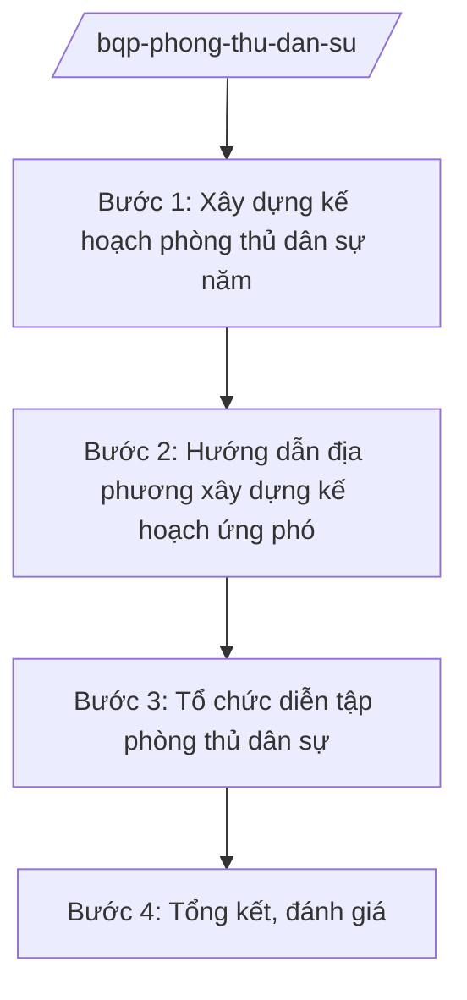

# Skill: Phòng thủ dân sự (kế hoạch, diễn tập)

## 2. Khi nào dùng
- Hằng năm xây dựng kế hoạch phòng thủ dân sự: phòng, chống, khắc phục hậu quả thiên tai, sự cố.
- Tổ chức diễn tập phòng thủ dân sự ở các cấp (mức công khai).
- Hướng dẫn địa phương xây dựng kế hoạch, lực lượng, phương tiện ứng phó tại chỗ.

## 3. Đầu vào (Input)

| Trường | Mô tả | Bắt buộc |
|--------|-------|----------|
| `nam_ke_hoach` | Năm kế hoạch | Có |
| `tinh_huong_gia_dinh` | Các tình huống giả định diễn tập (mức công khai) | Có |
| `bao_cao_dia_phuong` | Báo cáo công tác phòng thủ dân sự của địa phương | Không |
| `chi_dao_cua_tren` | Chỉ đạo của cấp trên về phòng thủ dân sự | Có |

## 4. Quy trình

**Bước 1. Xây dựng kế hoạch phòng thủ dân sự năm**
- Làm gì: Xác định nhiệm vụ trọng tâm: kiện toàn ban chỉ huy các cấp, xây dựng kế hoạch ứng phó tình huống, chuẩn bị lực lượng, phương tiện tại chỗ.
- Dùng input: `nam_ke_hoach`, `chi_dao_cua_tren`, `bao_cao_dia_phuong`.
- Vai trò: Chuyên viên xây dựng kế hoạch (AI hỗ trợ tổng hợp báo cáo, lập khung kế hoạch ⏱ 2 ngày (ước tính)) → Cục trưởng kiểm tra → Thứ trưởng phê duyệt.
- Lưu ý nghiệp vụ: Kế hoạch ở mức hành chính công khai; phương châm "4 tại chỗ" (chỉ huy, lực lượng, phương tiện, hậu cần tại chỗ).
- → Kết quả bước: Kế hoạch phòng thủ dân sự năm được phê duyệt.

**Bước 2. Hướng dẫn địa phương xây dựng kế hoạch ứng phó**
- Làm gì: Ban hành văn bản hướng dẫn địa phương: xây dựng kế hoạch ứng phó thiên tai, sự cố; tổ chức lực lượng xung kích; dự trữ phương tiện, vật tư.
- Dùng input: `chi_dao_cua_tren`.
- Vai trò: Chuyên viên soạn hướng dẫn (AI hỗ trợ rà soát văn bản hiện hành, chuẩn hóa ⏱ 2 ngày (ước tính)) → Cục trưởng ký ban hành.
- Lưu ý nghiệp vụ: Hướng dẫn cụ thể, khả thi, phù hợp điều kiện từng vùng (đồng bằng, miền núi, ven biển).
- → Kết quả bước: Văn bản hướng dẫn gửi địa phương.

**Bước 3. Tổ chức diễn tập phòng thủ dân sự**
- Làm gì: Xây dựng kế hoạch, kịch bản diễn tập ở mức công khai (diễn tập chỉ huy — tham mưu, diễn tập thực binh ứng phó sự cố); tổ chức, đánh giá, rút kinh nghiệm.
- Dùng input: `tinh_huong_gia_dinh`, `nam_ke_hoach`.
- Vai trò: Cơ quan tham mưu chủ trì (AI hỗ trợ soạn kịch bản khung, lịch diễn tập, mẫu đánh giá ⏱ 3 ngày (ước tính)) → Cục trưởng trình Thứ trưởng phê duyệt.
- Lưu ý nghiệp vụ: Kịch bản diễn tập ở mức công khai (ứng phó bão lũ, cháy nổ, sự cố); không đưa nội dung tác chiến vào diễn tập phòng thủ dân sự.
- → Kết quả bước: Kế hoạch, kịch bản và kết quả diễn tập.

**Bước 4. Tổng kết, đánh giá**
- Làm gì: Tổng hợp kết quả thực hiện toàn quốc; đánh giá, đề xuất nhiệm vụ năm sau.
- Dùng input: Báo cáo của địa phương, đơn vị.
- Vai trò: Chuyên viên tổng hợp (AI hỗ trợ tổng hợp số liệu, dự thảo báo cáo ⏱ 2 ngày (ước tính)) → Cục trưởng thẩm định → Thứ trưởng trình Bộ trưởng.
- Lưu ý nghiệp vụ: Đánh giá thực chất hiệu quả ứng phó thực tế (nếu có thiên tai, sự cố trong năm).
- → Kết quả bước: Báo cáo tổng kết công tác phòng thủ dân sự.

## Luồng quy trình (Workflow)

## 5. Đầu ra (Output)

- Kế hoạch phòng thủ dân sự năm; văn bản hướng dẫn địa phương.
- Kế hoạch, kịch bản diễn tập; biên bản đánh giá diễn tập.
- Báo cáo tổng kết.

### Cấu trúc output chuẩn
1. Quốc hiệu "CỘNG HÒA XÃ HỘI CHỦ NGHĨA VIỆT NAM", Tiêu ngữ "Độc lập – Tự do – Hạnh phúc"; tên cơ quan ban hành.
2. Số, ký hiệu, địa danh, ngày tháng năm ban hành; trích yếu (thể thức NĐ 30/2020/NĐ-CP).
3. Căn cứ ban hành.
4. Nội dung: tình huống, nhiệm vụ, lực lượng, phương tiện, thời gian, tổ chức thực hiện.
5. Nơi nhận (kết thúc "- Lưu: VT, [mã đơn vị]."), chữ ký (ghi rõ chức danh, họ tên người ký; ký hiệu "KT."/"TL." khi ký thay) người có thẩm quyền.

> **Chuẩn tài liệu đầu ra** (thứ tự ưu tiên):
> 1. Chuẩn riêng của ngành/cơ quan chủ quản — mẫu, biểu mẫu, quy chuẩn tại văn bản quy phạm chuyên ngành (xem mục "Căn cứ & lưu ý").
> 2. Tài liệu không có quy chuẩn riêng — thể thức NĐ 30/2020/NĐ-CP: Quốc hiệu và Tiêu ngữ; tên cơ quan ban hành; số, ký hiệu; địa danh và thời gian; tên loại và trích yếu; nội dung; chức vụ, họ tên, chữ ký người có thẩm quyền; dấu, chữ ký số; nơi nhận (kèm Phụ lục nếu có).

## 6. Checklist nghiệm thu
- [ ] Kế hoạch bao quát chỉ huy, lực lượng, phương tiện, hậu cần tại chỗ.
- [ ] Hướng dẫn địa phương cụ thể, phù hợp từng vùng.
- [ ] Kịch bản diễn tập ở mức công khai, không lẫn nội dung tác chiến.
- [ ] Diễn tập có đánh giá, rút kinh nghiệm bằng văn bản.
- [ ] Thể thức đúng NĐ 30/2020/NĐ-CP; đã qua human gate.

## 7. Ví dụ mô phỏng

*Dữ liệu dưới đây là giả lập 100% phục vụ minh họa.*

**Input mẫu:**
- nam_ke_hoach: 2026
- tinh_huong_gia_dinh: Ứng phó bão mạnh đổ bộ ven biển; cháy rừng diện rộng (giả lập, mức công khai)
- chi_dao_cua_tren: Chỉ đạo công tác phòng thủ dân sự năm 2026 (giả lập)

**Output mẫu (trích Kế hoạch diễn tập):**

> **BỘ QUỐC PHÒNG — CƠ QUAN THAM MƯU**
> **Kế hoạch số 1234/KH-PTDS ngày 15/4/2026 về diễn tập phòng thủ dân sự năm 2026**
>
> **I. Tình huống giả định (công khai):** Bão mạnh đổ bộ vào ven biển, gây ngập lụt diện rộng; cháy rừng tại khu vực đồi núi (giả lập).
>
> **II. Nội dung diễn tập:** (1) Diễn tập chỉ huy — tham mưu ứng phó bão lũ; (2) Thực binh sơ tán dân, cứu hộ, cứu nạn; (3) Diễn tập chữa cháy rừng có sự tham gia của lực lượng tại chỗ.
>
> **III. Thời gian, địa điểm:** Quý III/2026 tại 03 địa phương ven biển, miền núi (giả lập, không nêu cụ thể).
>
> *Nơi nhận: ... — KT. BỘ TRƯỞNG / THỨ TRƯỞNG (bà Phạm Thị DD)*

## 8. Human gate
- Cục trưởng: duyệt kế hoạch, hướng dẫn, kịch bản diễn tập.
- Thứ trưởng phụ trách: phê duyệt kế hoạch năm và diễn tập.
- Bộ trưởng (ông Lê Văn CC): quyết định chủ trương lớn về phòng thủ dân sự.

## 9. Giới hạn
- AI không xây dựng phương án tác chiến; mọi nội dung ở mức hành chính công khai.
- Không công khai, không suy đoán số liệu lực lượng, phương tiện, vị trí cụ thể.
- Không bịa số hiệu văn bản, số liệu; không viện dẫn văn bản hết hiệu lực.

## 10. Căn cứ & lưu ý
- Nghị định số 03/2025/NĐ-CP ngày 28/02/2025 của Chính phủ quy định chức năng, nhiệm vụ, quyền hạn và cơ cấu tổ chức của Bộ Quốc phòng.
- Nghị quyết số 176/2025/QH15 của Quốc hội về cơ cấu tổ chức của Chính phủ.
- Luật Phòng thủ dân sự (dẫn tên, không ghi số hiệu).
- Nghị định số 30/2020/NĐ-CP về công tác văn thư (thể thức văn bản).
