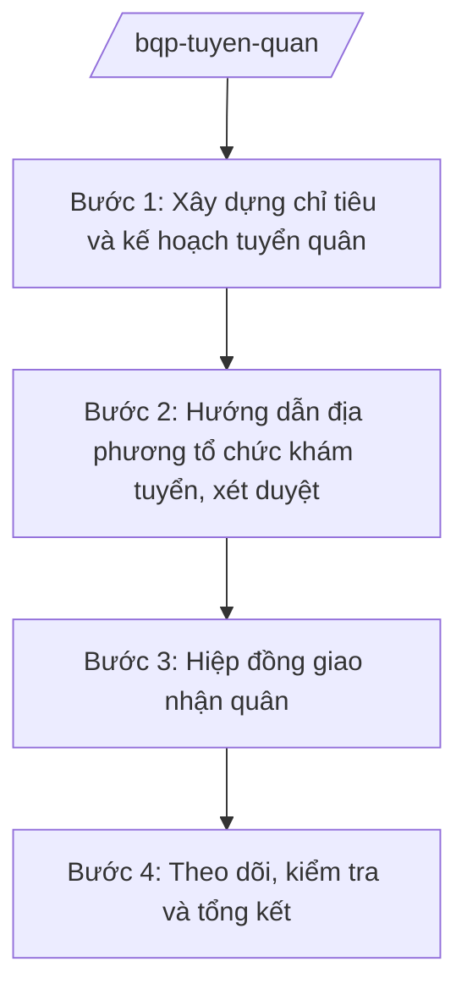

# Skill: Công tác tuyển chọn, gọi công dân nhập ngũ

## 2. Khi nào dùng
- Hằng năm, khi Bộ Quốc phòng triển khai công tác tuyển chọn, gọi công dân nhập ngũ và thực hiện nghĩa vụ tham gia Công an nhân dân.
- Cần xây dựng chỉ tiêu, kế hoạch tuyển quân giao cho các địa phương, đơn vị nhận quân.
- Tổng kết, đánh giá kết quả tuyển quân năm, rút kinh nghiệm năm tiếp theo.

## 3. Đầu vào (Input)

| Trường | Mô tả | Bắt buộc |
|--------|-------|----------|
| `nam_tuyen_quan` | Năm tuyển quân | Có |
| `chi_tieu_du_kien` | Chỉ tiêu tuyển quân dự kiến toàn quốc | Có |
| `don_vi_nhan_quan` | Danh sách đơn vị nhận quân | Có |
| `van_ban_chi_dao` | Chỉ thị, kế hoạch của cấp trên về tuyển quân | Có |
| `bao_cao_dia_phuong` | Báo cáo nguồn công dân trong độ tuổi của địa phương | Không |

## 4. Quy trình

**Bước 1. Xây dựng chỉ tiêu và kế hoạch tuyển quân**
- Làm gì: Tổng hợp nhu cầu các đơn vị nhận quân, dự kiến chỉ tiêu giao từng địa phương; xây dựng kế hoạch, hướng dẫn triển khai toàn quốc.
- Dùng input: `nam_tuyen_quan`, `chi_tieu_du_kien`, `don_vi_nhan_quan`, `van_ban_chi_dao`.
- Vai trò: Chuyên viên cơ quan tham mưu xây dựng (AI hỗ trợ tổng hợp số liệu địa phương báo cáo, lập bảng phân bổ chỉ tiêu dự kiến — 2 ngày) → Cục trưởng kiểm tra → Thứ trưởng phê duyệt kế hoạch.
- Lưu ý nghiệp vụ: Chỉ tiêu phải phù hợp khả năng nguồn của địa phương; không công khai số liệu chi tiết đơn vị nhận quân ngoài phạm vi công tác.
- → Kết quả bước: Kế hoạch tuyển quân năm và dự kiến chỉ tiêu giao địa phương.

**Bước 2. Hướng dẫn địa phương tổ chức khám tuyển, xét duyệt**
- Làm gì: Ban hành văn bản hướng dẫn Hội đồng nghĩa vụ quân sự các cấp: đăng ký, sơ tuyển, khám sức khỏe, xét duyệt chính trị, đạo đức; quy định tiêu chuẩn, thời gian biểu.
- Dùng input: `van_ban_chi_dao`, `bao_cao_dia_phuong`.
- Vai trò: Chuyên viên soạn hướng dẫn (AI hỗ trợ rà soát quy định hiện hành, chuẩn hóa văn bản — 2 ngày) → Cục trưởng ký ban hành hướng dẫn.
- Lưu ý nghiệp vụ: Bảo đảm công khai, công bằng, đúng tiêu chuẩn; xử lý nghiêm tiêu cực trong tuyển quân.
- → Kết quả bước: Văn bản hướng dẫn gửi địa phương, đơn vị.

**Bước 3. Hiệp đồng giao nhận quân**
- Làm gì: Tổ chức hiệp đồng giữa địa phương giao quân và đơn vị nhận quân: thời gian, địa điểm, quân số, phương thức bàn giao; kiểm tra công tác chuẩn bị.
- Dùng input: `don_vi_nhan_quan`, `chi_tieu_du_kien`.
- Vai trò: Cơ quan tham mưu chủ trì hiệp đồng (AI hỗ trợ lập lịch, danh sách đầu mối, biên bản hiệp đồng mẫu — 1 ngày) → báo cáo Thứ trưởng.
- Lưu ý nghiệp vụ: Nội dung hiệp đồng ở mức hành chính (thời gian, địa điểm, quân số); không chi tiết hóa phương án tác chiến.
- → Kết quả bước: Biên bản hiệp đồng giao nhận quân.

**Bước 4. Theo dõi, kiểm tra và tổng kết**
- Làm gì: Theo dõi tiến độ tuyển quân toàn quốc; kiểm tra đột xuất địa phương; tổng hợp kết quả, đánh giá, đề xuất khen thưởng và rút kinh nghiệm.
- Dùng input: Báo cáo kết quả của địa phương, đơn vị.
- Vai trò: Đoàn kiểm tra của Bộ thực hiện (AI hỗ trợ tổng hợp báo cáo toàn quốc, so sánh chỉ tiêu/kết quả, dự thảo báo cáo tổng kết — 3 ngày) → Cục trưởng thẩm định → Thứ trưởng trình Bộ trưởng.
- Lưu ý nghiệp vụ: Số liệu tổng hợp ở mức hành chính công khai; không nêu phiên hiệu, quân số chi tiết từng đơn vị trong báo cáo phổ biến rộng.
- → Kết quả bước: Báo cáo tổng kết công tác tuyển quân năm.

## Luồng quy trình (Workflow)

## 5. Đầu ra (Output)

- Kế hoạch tuyển quân năm; văn bản hướng dẫn địa phương.
- Biên bản hiệp đồng giao nhận quân.
- Báo cáo tổng kết công tác tuyển quân.

### Cấu trúc output chuẩn
1. Quốc hiệu "CỘNG HÒA XÃ HỘI CHỦ NGHĨA VIỆT NAM", Tiêu ngữ "Độc lập – Tự do – Hạnh phúc"; tên cơ quan ban hành.
2. Số, ký hiệu, địa danh, ngày tháng năm (thể thức NĐ 30/2020/NĐ-CP).
3. Trích yếu nội dung.
4. Căn cứ ban hành.
5. Nội dung: chỉ tiêu, nhiệm vụ, thời gian, tổ chức thực hiện, chế độ báo cáo.
6. Nơi nhận (kết thúc "- Lưu: VT, [mã đơn vị]."), chữ ký (ghi rõ chức danh, họ tên người ký; ký hiệu "KT."/"TL." khi ký thay) người có thẩm quyền.
## 6. Checklist nghiệm thu
- [ ] Chỉ tiêu phù hợp khả năng nguồn địa phương và nhu cầu đơn vị nhận quân.
- [ ] Kế hoạch, hướng dẫn ban hành đúng thời gian biểu toàn quốc.
- [ ] Quy trình khám tuyển, xét duyệt bảo đảm công khai, đúng tiêu chuẩn.
- [ ] Hiệp đồng giao nhận quân đầy đủ địa phương — đơn vị.
- [ ] Báo cáo tổng kết có đánh giá, đề xuất cụ thể cho năm sau.
- [ ] Không lộ lọt thông tin mật về tổ chức, quân số đơn vị.
- [ ] Thể thức đúng NĐ 30/2020/NĐ-CP; đã qua human gate.

## 7. Ví dụ mô phỏng

*Dữ liệu dưới đây là giả lập 100% phục vụ minh họa.*

**Input mẫu:**
- nam_tuyen_quan: 2026
- chi_tieu_du_kien: 100.000 công dân (số tròn giả lập)
- don_vi_nhan_quan: Các đơn vị nhận quân thuộc Bộ Quốc phòng (danh sách giả lập, không nêu cụ thể)
- van_ban_chi_dao: Chỉ thị tuyển chọn, gọi công dân nhập ngũ năm 2026 (giả lập)

**Output mẫu (trích Kế hoạch):**

> **BỘ QUỐC PHÒNG — CƠ QUAN THAM MƯU**
> **Kế hoạch số 1234/KH-TM ngày 10/10/2025 về tuyển chọn, gọi công dân nhập ngũ năm 2026**
>
> **I. Chỉ tiêu:** Tổng chỉ tiêu tuyển chọn, gọi công dân nhập ngũ năm 2026 là 100.000 công dân (số liệu giả lập), phân bổ cho các địa phương theo phụ lục kèm theo.
>
> **II. Thời gian biểu:** Đăng ký, sơ tuyển: xong trước 30/11/2025; khám sức khỏe: tháng 12/2025; xét duyệt, chốt quân số: tháng 01/2026; giao nhận quân: tháng 02/2026.
>
> **III. Tổ chức thực hiện:** Hội đồng nghĩa vụ quân sự các cấp tổ chức thực hiện; cơ quan quân sự địa phương là cơ quan thường trực; Bộ Quốc phòng kiểm tra toàn quốc.
>
> *Nơi nhận: ... — KT. BỘ TRƯỞNG / THỨ TRƯỞNG (bà Phạm Thị DD)*

## 8. Human gate
- Cục trưởng cơ quan tham mưu: duyệt kế hoạch, hướng dẫn, báo cáo tổng kết.
- Thứ trưởng phụ trách: phê duyệt kế hoạch tuyển quân, quyết định kiểm tra.
- Bộ trưởng (ông Lê Văn CC): quyết định các vấn đề lớn về chỉ tiêu, chủ trương tuyển quân.

## 9. Giới hạn
- AI không quyết định chỉ tiêu, không thay hội đồng xét duyệt hồ sơ công dân.
- Không công khai, không suy đoán số liệu quân số, phiên hiệu, vị trí đóng quân cụ thể của đơn vị.
- Không bịa số hiệu văn bản, số liệu tuyển quân; không viện dẫn văn bản hết hiệu lực.
- Mọi nội dung ở mức hành chính công khai; nội dung mật xử lý theo quy định bảo vệ bí mật nhà nước, AI không tham gia.

## 10. Căn cứ & lưu ý
- Nghị định số 03/2025/NĐ-CP ngày 28/02/2025 của Chính phủ quy định chức năng, nhiệm vụ, quyền hạn và cơ cấu tổ chức của Bộ Quốc phòng.
- Nghị quyết số 176/2025/QH15 của Quốc hội về cơ cấu tổ chức của Chính phủ.
- Luật Nghĩa vụ quân sự (dẫn tên, không ghi số hiệu).
- Nghị định số 30/2020/NĐ-CP về công tác văn thư (thể thức văn bản).
