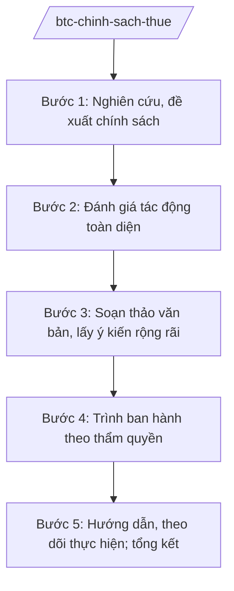

# Skill: Chính sách thuế, phí, lệ phí

## 2. Khi nào dùng
Khi xây dựng/sửa đổi chính sách thuế (thu nhập, giá trị gia tăng, tiêu thụ đặc biệt, xuất nhập khẩu...), phí, lệ phí; khi hướng dẫn thực hiện; khi đánh giá, tổng kết chính sách thuế.

## 3. Đầu vào (Input)

| Trường | Mô tả | Bắt buộc |
|--------|-------|----------|
| `sac_thue` | Loại thuế/phí/lệ phí điều chỉnh | Có |
| `muc_tieu` | Mục tiêu chính sách (tăng thu, hỗ trợ DN, điều tiết...) | Có |
| `tac_dong_du_kien` | Đánh giá tác động sơ bộ | Không |
| `cam_ket_qt` | Cam kết quốc tế liên quan (FTA, WTO) | Không |

## 4. Quy trình

**Bước 1. Nghiên cứu, đề xuất chính sách**
- Làm gì: Phân tích thực trạng thu; nghiên cứu kinh nghiệm quốc tế; đề xuất phương án (mức thuế suất, đối tượng chịu/không chịu, miễn giảm).
- Dùng input: `sac_thue`, `muc_tieu`.
- Vai trò: Chuyên viên Vụ Chính sách thuế — AI hỗ trợ tổng hợp chính sách thuế các nước, mô phỏng tác động thu ngân sách (⏱ 5–7 ngày).
- Lưu ý nghiệp vụ: Bảo đảm công bằng, minh bạch; không tạo ưu đãi tràn lan; tuân thủ cam kết cắt giảm thuế quan.
- → Kết quả bước: Đề xuất chính sách thuế kèm phân tích.

**Bước 2. Đánh giá tác động toàn diện**
- Làm gì: Đánh giá tác động đến NSNN, doanh nghiệp, người dân, sức cạnh tranh, môi trường đầu tư; lấy ý kiến chuyên gia.
- Dùng input: Đề xuất chính sách.
- Vai trò: Vụ Chính sách thuế chủ trì — AI hỗ trợ chạy kịch bản tác động, soạn báo cáo RIA (⏱ 5–7 ngày).
- Lưu ý nghiệp vụ: Thuế mới/tăng thuế suất phải có lộ trình; tránh "sốc" cho thị trường.
- → Kết quả bước: Báo cáo đánh giá tác động.

**Bước 3. Soạn thảo văn bản, lấy ý kiến rộng rãi**
- Làm gì: Soạn dự thảo luật/nghị định/thông tư; đăng lấy ý kiến công khai; tổ chức đối thoại với hiệp hội doanh nghiệp.
- Dùng input: Kết quả bước 1, 2.
- Vai trò: Vụ trưởng Vụ Chính sách thuế — AI hỗ trợ soạn dự thảo, tổng hợp ý kiến (⏱ 5–7 ngày).
- Lưu ý nghiệp vụ: Công khai minh bạch toàn bộ quá trình; tiếp thu có giải trình.
- → Kết quả bước: Dự thảo + báo cáo tiếp thu ý kiến.

**Bước 4. Trình ban hành theo thẩm quyền**
- Làm gì: Trình Chính phủ (nghị định), Quốc hội (luật) hoặc Bộ trưởng ban hành (thông tư); qua thẩm định của Bộ Tư pháp.
- Dùng input: Hồ sơ hoàn chỉnh.
- Vai trò: Thứ trưởng/Bộ trưởng ký Tờ trình — AI hỗ trợ kiểm tra hồ sơ lần cuối (⏱ 1–2 ngày).
- Lưu ý nghiệp vụ: Chính sách thuế thuộc thẩm quyền Quốc hội (luật) — Bộ chỉ đề xuất, trình.
- → Kết quả bước: Văn bản chính sách thuế được ban hành.

**Bước 5. Hướng dẫn, theo dõi thực hiện; tổng kết**
- Làm gì: Tổng cục Thuế hướng dẫn, tập huấn; theo dõi số thu; sơ kết, tổng kết chính sách; đề xuất điều chỉnh.
- Dùng input: Số liệu thu thực tế.
- Vai trò: Tổng cục Thuế — AI hỗ trợ phân tích số liệu thu theo sắc thuế, cảnh báo gian lận ⏱ ~liên tục trong quá trình thực hiện (ước tính).
- Lưu ý nghiệp vụ: Kịp thời tháo gỡ vướng mắc; chống gian lận, trốn thuế.
- → Kết quả bước: Báo cáo đánh giá thực hiện chính sách thuế.

## Luồng quy trình (Workflow)

## 5. Đầu ra (Output)
- Đề xuất chính sách thuế; báo cáo đánh giá tác động
- Dự thảo văn bản + báo cáo tiếp thu ý kiến
- Văn bản hướng dẫn thực hiện
- Báo cáo đánh giá thực hiện chính sách

### Cấu trúc output chuẩn (thể thức NĐ 30/2020/NĐ-CP)

**Khung thể thức chung (NĐ 30/2020/NĐ-CP):** mọi văn bản trong output đều trình bày đầy đủ: Quốc hiệu "CỘNG HÒA XÃ HỘI CHỦ NGHĨA VIỆT NAM", Tiêu ngữ "Độc lập – Tự do – Hạnh phúc"; tên cơ quan ban hành; số, ký hiệu văn bản; địa danh, ngày tháng năm ban hành; tên loại văn bản; nội dung theo các mục dưới đây; nơi nhận (kết thúc "- Lưu: VT, [mã đơn vị]."); khối chữ ký (chức danh, họ tên người ký; ký hiệu "KT."/"TL." khi ký thay).
Báo cáo đánh giá tác động chính sách thuế gồm:
1. Tên báo cáo; cơ quan lập
2. Sự cần thiết và mục tiêu chính sách
3. Các phương án chính sách (so sánh)
4. Tác động đến NSNN (số thu tăng/giảm — minh họa)
5. Tác động đến doanh nghiệp, người dân
6. Tác động đến môi trường đầu tư, sức cạnh tranh
7. Tương thích cam kết quốc tế
8. Kiến nghị phương án lựa chọn; chữ ký (ghi rõ chức danh, họ tên người ký; ký hiệu "KT."/"TL." khi ký thay)

> **Checklist thể thức văn bản theo NĐ 30/2020/NĐ-CP** — đối chiếu trước khi trình ký:
> 1. Quốc hiệu và Tiêu ngữ.
> 2. Tên cơ quan, tổ chức ban hành văn bản.
> 3. Số, ký hiệu của văn bản.
> 4. Địa danh và thời gian ban hành văn bản.
> 5. Tên loại và trích yếu nội dung văn bản.
> 6. Nội dung văn bản.
> 7. Chức vụ, họ tên và chữ ký của người có thẩm quyền.
> 8. Dấu, chữ ký số của cơ quan, tổ chức.
> 9. Nơi nhận (kèm Phụ lục nếu có).

## 6. Checklist nghiệm thu
- [ ] Đã mô phỏng tác động thu NSNN theo kịch bản
- [ ] Đã đánh giá tương thích cam kết quốc tế
- [ ] Đã lấy ý kiến doanh nghiệp, công khai
- [ ] Lộ trình thực hiện hợp lý, tránh sốc
- [ ] Đúng thẩm quyền ban hành (luật/nghị định/thông tư)
- [ ] Số liệu minh họa ghi rõ giả lập; thể thức đúng NĐ 30/2020/NĐ-CP
- [ ] Human gate đầy đủ

## 7. Ví dụ mô phỏng
*Dữ liệu dưới đây là giả lập 100% phục vụ minh họa.*

**Input mẫu:** Điều chỉnh thuế suất thuế thu nhập doanh nghiệp cho doanh nghiệp nhỏ (giả lập tình huống); mục tiêu: hỗ trợ DNNVV, nuôi dưỡng nguồn thu.

**Output mẫu (trích Báo cáo đánh giá tác động):**
> **BÁO CÁO Đánh giá tác động chính sách thuế thu nhập doanh nghiệp đối với DNNVV**
> 4. Tác động đến NSNN: phương án giảm thuế suất từ X% xuống Y% (minh họa) dự kiến giảm thu ... tỷ đồng/năm trong 2 năm đầu, sau đó tăng thu nhờ mở rộng cơ sở thuế...
> 5. Tác động đến doanh nghiệp: khoảng ... nghìn DNNVV được hưởng (minh họa)...

## 8. Human gate
Vụ Chính sách thuế soạn → Vụ trưởng kiểm tra → Thứ trưởng phụ trách cho ý kiến → **Bộ trưởng Bộ Tài chính ký** Tờ trình → Chính phủ/Quốc hội quyết định.

## 9. Giới hạn
- AI không quyết định mức thuế suất, đối tượng chịu thuế.
- Không bịa số liệu tác động; không rò rỉ phương án chưa công khai.
- Không tư vấn "lách thuế" dưới mọi hình thức.

## 10. Căn cứ & lưu ý
- Nghị định 29/2025/NĐ-CP ngày 24/02/2025 của Chính phủ — chức năng, nhiệm vụ, quyền hạn của Bộ Tài chính (được sửa đổi bởi NĐ 166/2025/NĐ-CP ngày 30/6/2025).
- Nghị định 122/2025/NĐ-CP ngày 11/6/2025 — phân quyền, phân cấp trong lĩnh vực quản lý thuế.
- Các luật thuế (thu nhập doanh nghiệp, thu nhập cá nhân, giá trị gia tăng, tiêu thụ đặc biệt, xuất khẩu nhập khẩu...); Luật Phí và lệ phí; Luật Quản lý thuế (nêu tên luật, không ghi số hiệu).
- Nghị định 30/2020/NĐ-CP — thể thức văn bản.
