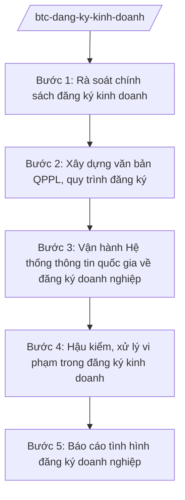

# Skill: Đăng ký kinh doanh (hệ thống, chính sách)

## 2. Khi nào dùng
Khi xây dựng chính sách, văn bản QPPL về đăng ký doanh nghiệp, hộ kinh doanh; khi quản lý, vận hành Hệ thống thông tin quốc gia về đăng ký doanh nghiệp; khi cải cách thủ tục gia nhập thị trường.

## 3. Đầu vào (Input)

| Trường | Mô tả | Bắt buộc |
|--------|-------|----------|
| `noi_dung` | Xây dựng chính sách / vận hành hệ thống / cải cách thủ tục | Có |
| `vuong_mac` | Vướng mắc từ địa phương, doanh nghiệp | Không |
| `so_lieu_dang_ky` | Số liệu đăng ký doanh nghiệp (nguồn chính thức) | Không |

## 4. Quy trình

**Bước 1. Rà soát chính sách đăng ký kinh doanh**
- Làm gì: Đánh giá thủ tục gia nhập thị trường (thời gian, chi phí, số thủ tục); so sánh với thông lệ quốc tế; tổng hợp vướng mắc.
- Dùng input: `vuong_mac`, `so_lieu_dang_ky`, `noi_dung`.
- Vai trò: Chuyên viên Cục Quản lý đăng ký kinh doanh — AI hỗ trợ phân tích chỉ số gia nhập thị trường, tổng hợp vướng mắc (⏱ 3–5 ngày).
- Lưu ý nghiệp vụ: Mục tiêu: giảm thời gian, chi phí gia nhập thị trường; cắt giảm điều kiện kinh doanh bất hợp lý.
- → Kết quả bước: Báo cáo rà soát.

**Bước 2. Xây dựng văn bản QPPL, quy trình đăng ký**
- Làm gì: Soạn nghị định/thông tư về đăng ký doanh nghiệp: hồ sơ, trình tự, liên thông (đăng ký kinh doanh – thuế – bảo hiểm – lao động).
- Dùng input: Kết quả bước 1.
- Vai trò: Cục trưởng Cục Quản lý đăng ký kinh doanh chủ trì — AI hỗ trợ soạn dự thảo, vẽ sơ đồ quy trình liên thông (⏱ 3–5 ngày).
- Lưu ý nghiệp vụ: Đẩy mạnh đăng ký trực tuyến toàn trình; liên thông dữ liệu, "một lần khai, dùng chung".
- → Kết quả bước: Dự thảo văn bản/quy trình.

**Bước 3. Vận hành Hệ thống thông tin quốc gia về đăng ký doanh nghiệp**
- Làm gì: Vận hành Cổng thông tin quốc gia về đăng ký doanh nghiệp; cấp mã số doanh nghiệp; đồng bộ dữ liệu với thuế, bảo hiểm.
- Dùng input: `so_lieu_dang_ky` (dữ liệu đăng ký từ 63 tỉnh/thành).
- Vai trò: Đơn vị vận hành hệ thống — AI hỗ trợ giám sát chất lượng dữ liệu, phát hiện hồ sơ bất thường ⏱ vận hành liên tục; tổng hợp báo cáo định kỳ hằng tháng/quý.
- Lưu ý nghiệp vụ: Bảo đảm hệ thống ổn định, an toàn thông tin; công khai thông tin doanh nghiệp theo quy định.
- → Kết quả bước: Hệ thống vận hành ổn định; báo cáo chất lượng dữ liệu.

**Bước 4. Hậu kiểm, xử lý vi phạm trong đăng ký kinh doanh**
- Làm gì: Hướng dẫn cơ quan đăng ký kinh doanh địa phương hậu kiểm (kê khai không trung thực, kinh doanh ngành nghề có điều kiện...); xử lý vi phạm.
- Dùng input: `vuong_mac` (vướng mắc, vi phạm phát hiện qua hậu kiểm địa phương).
- Vai trò: Thanh tra Bộ phối hợp Cục — AI hỗ trợ lập kế hoạch hậu kiểm theo rủi ro (⏱ 2–3 ngày).
- Lưu ý nghiệp vụ: Chuyển mạnh sang hậu kiểm thay vì tiền kiểm; không gây phiền hà cho doanh nghiệp chân chính.
- → Kết quả bước: Báo cáo hậu kiểm; quyết định xử lý vi phạm.

**Bước 5. Báo cáo tình hình đăng ký doanh nghiệp**
- Làm gì: Tổng hợp số doanh nghiệp thành lập mới, giải thể, tạm ngừng; phân tích xu hướng; báo cáo Chính phủ.
- Dùng input: `so_lieu_dang_ky`.
- Vai trò: Cục trưởng ký báo cáo — AI hỗ trợ phân tích xu hướng, lập báo cáo định kỳ ⏱ 2–3 ngày/báo cáo định kỳ (ước tính).
- Lưu ý nghiệp vụ: Số liệu phải từ hệ thống chính thức; phân tích theo vùng, ngành, quy mô.
- → Kết quả bước: Báo cáo tình hình đăng ký doanh nghiệp.

## Luồng quy trình (Workflow)

*Ghi chú: các bước là luồng công việc độc lập, lựa chọn theo loại việc (`loai_viec`); không nhất thiết thực hiện nối tiếp.*

## 5. Đầu ra (Output)
- Dự thảo văn bản QPPL/quy trình đăng ký kinh doanh
- Báo cáo vận hành hệ thống thông tin quốc gia
- Kế hoạch hậu kiểm; báo cáo xử lý vi phạm
- Báo cáo tình hình đăng ký doanh nghiệp định kỳ

### Cấu trúc output chuẩn (thể thức NĐ 30/2020/NĐ-CP)

**Khung thể thức chung (NĐ 30/2020/NĐ-CP):** mọi văn bản trong output đều trình bày đầy đủ: Quốc hiệu "CỘNG HÒA XÃ HỘI CHỦ NGHĨA VIỆT NAM", Tiêu ngữ "Độc lập – Tự do – Hạnh phúc"; tên cơ quan ban hành; số, ký hiệu văn bản; địa danh, ngày tháng năm ban hành; tên loại văn bản; nội dung theo các mục dưới đây; nơi nhận (kết thúc "- Lưu: VT, [mã đơn vị]."); khối chữ ký (chức danh, họ tên người ký; ký hiệu "KT."/"TL." khi ký thay).
Báo cáo tình hình đăng ký doanh nghiệp (tháng/quý) gồm:
1. Tên báo cáo; kỳ báo cáo
2. Số doanh nghiệp đăng ký thành lập mới (so với cùng kỳ — minh họa)
3. Số doanh nghiệp quay trở lại hoạt động, tạm ngừng, giải thể (minh họa)
4. Phân tích theo vùng, ngành nghề, quy mô vốn (minh họa)
5. Đánh giá xu hướng; kiến nghị
6. Chữ ký (ghi rõ chức danh, họ tên người ký; ký hiệu "KT."/"TL." khi ký thay) (Cục trưởng Cục Quản lý đăng ký kinh doanh)

> **Checklist thể thức văn bản theo NĐ 30/2020/NĐ-CP** — đối chiếu trước khi trình ký:
> 1. Quốc hiệu và Tiêu ngữ.
> 2. Tên cơ quan, tổ chức ban hành văn bản.
> 3. Số, ký hiệu của văn bản.
> 4. Địa danh và thời gian ban hành văn bản.
> 5. Tên loại và trích yếu nội dung văn bản.
> 6. Nội dung văn bản.
> 7. Chức vụ, họ tên và chữ ký của người có thẩm quyền.
> 8. Dấu, chữ ký số của cơ quan, tổ chức.
> 9. Nơi nhận (kèm Phụ lục nếu có).

## 6. Checklist nghiệm thu
- [ ] Thủ tục đơn giản, có phương án trực tuyến toàn trình
- [ ] Liên thông dữ liệu với thuế, bảo hiểm, lao động
- [ ] Hệ thống vận hành ổn định, an toàn
- [ ] Chuyển mạnh sang hậu kiểm, không gây phiền hà
- [ ] Số liệu từ hệ thống chính thức; ví dụ ghi rõ giả lập
- [ ] Thể thức đúng NĐ 30/2020/NĐ-CP; human gate đầy đủ

## 7. Ví dụ mô phỏng
*Dữ liệu dưới đây là giả lập 100% phục vụ minh họa.*

**Input mẫu:** Báo cáo tình hình đăng ký doanh nghiệp quý III/2026 (giả lập).

**Output mẫu (trích):**
> **BÁO CÁO Tình hình đăng ký doanh nghiệp quý III/2026**
> 2. Số doanh nghiệp thành lập mới: ... nghìn (minh họa), tăng ...% so với cùng kỳ...
> 4. Vùng có số doanh nghiệp thành lập mới cao nhất: ... (minh họa)...

## 8. Human gate
Chuyên viên Cục Quản lý đăng ký kinh doanh soạn → Cục trưởng kiểm tra → Thứ trưởng phụ trách cho ý kiến → **Bộ trưởng Bộ Tài chính ký** văn bản/báo cáo.

## 9. Giới hạn
- AI không cấp/không thu hồi giấy chứng nhận đăng ký doanh nghiệp.
- Không tiết lộ thông tin doanh nghiệp ngoài phạm vi công khai theo quy định.
- Không bịa số liệu đăng ký.

## 10. Căn cứ & lưu ý
- Nghị định 29/2025/NĐ-CP ngày 24/02/2025 của Chính phủ — chức năng, nhiệm vụ, quyền hạn của Bộ Tài chính (được sửa đổi bởi NĐ 166/2025/NĐ-CP ngày 30/6/2025).
- Luật Doanh nghiệp (nêu tên luật, không ghi số hiệu).
- Nghị định 30/2020/NĐ-CP — thể thức văn bản.
