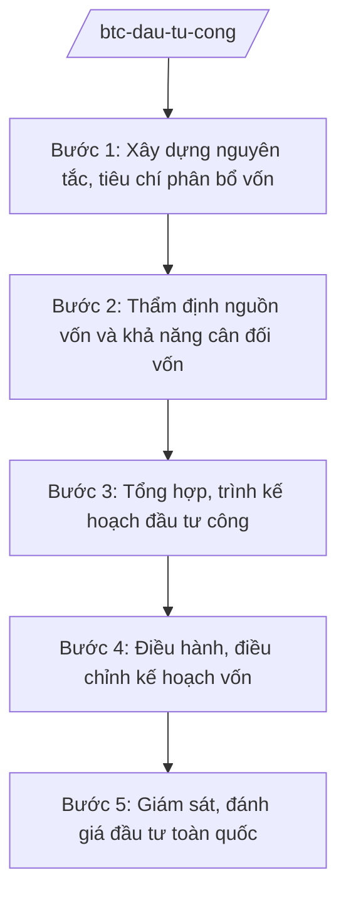

# Skill: Quản lý đầu tư công (cấp bộ)

## 2. Khi nào dùng
Khi xây dựng kế hoạch đầu tư công trung hạn và hằng năm; khi thẩm định chủ trương đầu tư, nguồn vốn; khi phân bổ, điều chỉnh kế hoạch vốn; khi giám sát, đánh giá đầu tư toàn quốc.

## 3. Đầu vào (Input)

| Trường | Mô tả | Bắt buộc |
|--------|-------|----------|
| `ke_hoach` | Kế hoạch đầu tư công trung hạn/hằng năm | Có |
| `danh_muc_du_an` | Danh mục dự án đề xuất sử dụng vốn đầu tư công | Không |
| `nguon_von` | NSNN / vốn ODA / vốn vay ưu đãi / vốn khác | Có |
| `bao_cao_giam_sat` | Báo cáo giám sát đầu tư của bộ/ngành/địa phương | Không |

## 4. Quy trình

**Bước 1. Xây dựng nguyên tắc, tiêu chí phân bổ vốn**
- Làm gì: Soạn nguyên tắc, tiêu chí, định mức phân bổ vốn đầu tư công (ưu tiên dự án trọng điểm quốc gia, vùng khó khăn, dự án chuyển tiếp).
- Dùng input: `ke_hoach`, định hướng của Đảng/Quốc hội.
- Vai trò: Vụ trưởng Vụ Đầu tư — AI hỗ trợ soạn khung tiêu chí, mô phỏng phân bổ theo kịch bản (3–5 ngày).
- Lưu ý nghiệp vụ: Chống dàn trải, manh mún; tập trung vốn cho dự án hoàn thành, đưa vào sử dụng.
- → Kết quả bước: Nguyên tắc, tiêu chí phân bổ vốn (trình Thủ tướng).

**Bước 2. Thẩm định nguồn vốn và khả năng cân đối vốn**
- Làm gì: Thẩm định khả năng cân đối vốn cho từng dự án/danh mục; cho ý kiến về chủ trương đầu tư các dự án quan trọng quốc gia, nhóm A.
- Dùng input: `danh_muc_du_an`, `nguon_von`.
- Vai trò: Chuyên viên Vụ Đầu tư — AI hỗ trợ kiểm tra tính khả thi tài chính, đối chiếu với kế hoạch trung hạn (3–5 ngày).
- Lưu ý nghiệp vụ: Không bố trí vốn cho dự án chưa đủ thủ tục đầu tư; vốn ODA phải gắn với hiệp định đã ký.
- → Kết quả bước: Ý kiến thẩm định nguồn vốn.

**Bước 3. Tổng hợp, trình kế hoạch đầu tư công**
- Làm gì: Tổng hợp kế hoạch của bộ/ngành/địa phương; trình Chính phủ, Quốc hội quyết định kế hoạch đầu tư công.
- Dùng input: Kết quả bước 1, 2.
- Vai trò: Thứ trưởng phụ trách chỉ đạo — AI hỗ trợ tổng hợp, lập bảng phân bổ chi tiết (5–7 ngày).
- Lưu ý nghiệp vụ: Kế hoạch hằng năm phải nằm trong kế hoạch trung hạn đã duyệt.
- → Kết quả bước: Kế hoạch đầu tư công được phê duyệt.

**Bước 4. Điều hành, điều chỉnh kế hoạch vốn**
- Làm gì: Giao kế hoạch vốn chi tiết; điều chỉnh vốn giữa các dự án (từ dự án chậm sang dự án có tiến độ tốt); xử lý vốn tồn đọng.
- Dùng input: Tiến độ giải ngân thực tế.
- Vai trò: Vụ Đầu tư — AI hỗ trợ theo dõi tỷ lệ giải ngân, đề xuất điều chuyển vốn ⏱ ~thực hiện hằng quý (ước tính).
- Lưu ý nghiệp vụ: Điều chuyển vốn phải đúng thẩm quyền; công khai, minh bạch.
- → Kết quả bước: Quyết định giao/điều chỉnh kế hoạch vốn.

**Bước 5. Giám sát, đánh giá đầu tư toàn quốc**
- Làm gì: Giám sát tiến độ, chất lượng dự án sử dụng vốn nhà nước; đánh giá hiệu quả đầu tư; xử lý dự án chậm, kém hiệu quả.
- Dùng input: `bao_cao_giam_sat`.
- Vai trò: Đoàn giám sát của Bộ — AI hỗ trợ lập báo cáo giám sát, bảng xếp hạng giải ngân (3–5 ngày).
- Lưu ý nghiệp vụ: Gắn trách nhiệm người đứng đầu với tỷ lệ giải ngân; kiến nghị thu hồi vốn dự án vi phạm.
- → Kết quả bước: Báo cáo giám sát, đánh giá đầu tư toàn quốc.

## Luồng quy trình (Workflow)

## 5. Đầu ra (Output)
- Nguyên tắc, tiêu chí phân bổ vốn đầu tư công
- Ý kiến thẩm định nguồn vốn, khả năng cân đối vốn
- Kế hoạch đầu tư công trung hạn/hằng năm
- Quyết định giao/điều chỉnh kế hoạch vốn
- Báo cáo giám sát, đánh giá đầu tư

### Cấu trúc output chuẩn (thể thức NĐ 30/2020/NĐ-CP)
Tờ trình Chính phủ về kế hoạch đầu tư công hằng năm gồm:
1. Quốc hiệu "CỘNG HÒA XÃ HỘI CHỦ NGHĨA VIỆT NAM", Tiêu ngữ "Độc lập – Tự do – Hạnh phúc"; tên Tờ trình; kính gửi: Chính phủ
2. Đánh giá thực hiện kế hoạch năm trước (tỷ lệ giải ngân — minh họa)
3. Nguyên tắc, tiêu chí phân bổ năm kế hoạch
4. Phương án tổng mức và phân bổ theo bộ/ngành/địa phương (minh họa)
5. Kiến nghị Chính phủ trình Quốc hội quyết định
6. Nơi nhận (kết thúc "- Lưu: VT, [mã đơn vị]."), chữ ký (ghi rõ chức danh, họ tên người ký; ký hiệu "KT."/"TL." khi ký thay) (Bộ trưởng Bộ Tài chính)

> **Checklist thể thức văn bản theo NĐ 30/2020/NĐ-CP** — đối chiếu trước khi trình ký:
> 1. Quốc hiệu và Tiêu ngữ.
> 2. Tên cơ quan, tổ chức ban hành văn bản.
> 3. Số, ký hiệu của văn bản.
> 4. Địa danh và thời gian ban hành văn bản.
> 5. Tên loại và trích yếu nội dung văn bản.
> 6. Nội dung văn bản.
> 7. Chức vụ, họ tên và chữ ký của người có thẩm quyền.
> 8. Dấu, chữ ký số của cơ quan, tổ chức.
> 9. Nơi nhận (kèm Phụ lục nếu có).

## 6. Checklist nghiệm thu
- [ ] Tiêu chí phân bổ rõ ràng, chống dàn trải
- [ ] Dự án có vốn đều đủ thủ tục đầu tư
- [ ] Kế hoạch năm nằm trong kế hoạch trung hạn
- [ ] Điều chuyển vốn đúng thẩm quyền, công khai
- [ ] Gắn trách nhiệm giải ngân với người đứng đầu
- [ ] Số liệu minh họa ghi rõ giả lập; thể thức đúng NĐ 30/2020/NĐ-CP
- [ ] Human gate đầy đủ

## 7. Ví dụ mô phỏng
*Dữ liệu dưới đây là giả lập 100% phục vụ minh họa.*

**Input mẫu:** Kế hoạch đầu tư công năm 2027 (giả lập); tổng vốn dự kiến X triệu tỷ đồng (giả lập); ưu tiên dự án trọng điểm quốc gia và vùng DTTS.

**Output mẫu (trích Tờ trình):**
> **TỜ TRÌNH Về kế hoạch đầu tư công năm 2027**
> Kính gửi: Chính phủ
> 2. Năm 2026, tỷ lệ giải ngân vốn đầu tư công ước đạt ...% kế hoạch (minh họa)...
> 4. Phương án năm 2027: tổng vốn ... (minh họa); trong đó vốn cho dự án trọng điểm quốc gia ...%, vùng khó khăn ...%...

## 8. Human gate
Vụ Đầu tư tổng hợp → Thứ trưởng phụ trách cho ý kiến → **Bộ trưởng Bộ Tài chính ký** Tờ trình → **Chính phủ trình Quốc hội** quyết định.

## 9. Giới hạn
- AI không quyết định phân bổ vốn cho dự án cụ thể; không can thiệp đấu thầu.
- Không bịa số liệu giải ngân, phân bổ; số liệu ví dụ ghi rõ giả lập.
- Không tiết lộ kế hoạch vốn chưa công khai.

## 10. Căn cứ & lưu ý
- Nghị định 29/2025/NĐ-CP ngày 24/02/2025 của Chính phủ — chức năng, nhiệm vụ, quyền hạn của Bộ Tài chính (được sửa đổi bởi NĐ 166/2025/NĐ-CP ngày 30/6/2025).
- Luật Đầu tư công (nêu tên luật, không ghi số hiệu).
- Nghị định 30/2020/NĐ-CP — thể thức văn bản.
