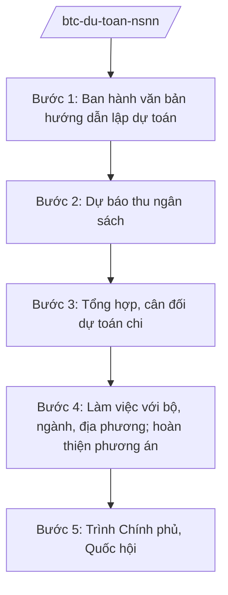

# Skill: Lập dự toán ngân sách nhà nước

## 2. Khi nào dùng
Hằng năm, khi xây dựng dự toán NSNN năm sau: hướng dẫn các bộ, ngành, địa phương lập dự toán; tổng hợp, cân đối; trình Chính phủ và Quốc hội quyết định.

## 3. Đầu vào (Input)

| Trường | Mô tả | Bắt buộc |
|--------|-------|----------|
| `nam_du_toan` | Năm ngân sách lập dự toán | Có |
| `du_bao_kinh_te` | Dự báo tăng trưởng, lạm phát, giá dầu... | Có |
| `du_toan_bo_nganh` | Dự toán thu/chi của các bộ, cơ quan trung ương | Không |
| `du_toan_dia_phuong` | Dự toán thu/chi của 63 tỉnh/thành | Không |
| `dinh_huong_chinh_tri` | Nghị quyết của Đảng, Quốc hội về kế hoạch tài chính | Có |

## 4. Quy trình

**Bước 1. Ban hành văn bản hướng dẫn lập dự toán**
- Làm gì: Soạn Thông tư/Công văn hướng dẫn: biểu mẫu, định mức, thời hạn gửi dự toán của bộ/ngành/địa phương.
- Dùng input: `nam_du_toan`, `dinh_huong_chinh_tri`.
- Vai trò: Vụ trưởng Vụ Ngân sách nhà nước — AI hỗ trợ soạn văn bản hướng dẫn, bộ biểu mẫu (2–3 ngày).
- Lưu ý nghiệp vụ: Hướng dẫn phải ban hành kịp thời để các đơn vị có đủ thời gian lập dự toán.
- → Kết quả bước: Văn bản hướng dẫn lập dự toán NSNN.

**Bước 2. Dự báo thu ngân sách**
- Làm gì: Dự báo các khoản thu (thuế, phí, lệ phí, thu từ dầu thô, thu từ đất...) theo kịch bản kinh tế vĩ mô.
- Dùng input: `du_bao_kinh_te`.
- Vai trò: Tổng cục Thuế, Tổng cục Hải quan phối hợp Vụ Ngân sách — AI hỗ trợ mô hình dự báo theo kịch bản, so sánh với thực hiện năm trước (5–7 ngày).
- Lưu ý nghiệp vụ: Dự báo thận trọng; tính đến chính sách thuế mới có hiệu lực; phân tích rủi ro (giá dầu, thiên tai).
- → Kết quả bước: Phương án dự báo thu NSNN.

**Bước 3. Tổng hợp, cân đối dự toán chi**
- Làm gì: Tổng hợp dự toán chi của bộ/ngành/địa phương; cân đối chi thường xuyên, chi đầu tư phát triển, chi trả nợ, dự phòng.
- Dùng input: `du_toan_bo_nganh`, `du_toan_dia_phuong`.
- Vai trò: Vụ Ngân sách nhà nước chủ trì — AI hỗ trợ đối chiếu số liệu, phát hiện chênh lệch bất thường giữa các đơn vị (5–7 ngày).
- Lưu ý nghiệp vụ: Ưu tiên chi cho con người, an sinh xã hội; kiểm soát bội chi trong giới hạn Quốc hội cho phép.
- → Kết quả bước: Phương án phân bổ dự toán chi.

**Bước 4. Làm việc với bộ, ngành, địa phương; hoàn thiện phương án**
- Làm gì: Trao đổi, điều chỉnh dự toán với các đơn vị có chênh lệch lớn; hoàn thiện phương án tổng thể.
- Dùng input: Kết quả bước 2, 3.
- Vai trò: Thứ trưởng phụ trách làm việc với các bộ — AI hỗ trợ chuẩn bị tài liệu làm việc, biên bản ⏱ ~theo lịch công tác (ước tính).
- Lưu ý nghiệp vụ: Mọi điều chỉnh phải có căn cứ, ghi biên bản.
- → Kết quả bước: Phương án dự toán NSNN hoàn chỉnh.

**Bước 5. Trình Chính phủ, Quốc hội**
- Làm gì: Lập Tờ trình Chính phủ; sau khi Chính phủ thông qua, trình Quốc hội quyết định dự toán NSNN (kỳ họp cuối năm).
- Dùng input: Phương án hoàn chỉnh.
- Vai trò: Bộ trưởng Bộ Tài chính ký Tờ trình — AI hỗ trợ soạn báo cáo thuyết trình, bộ slide trình bày (2–3 ngày).
- Lưu ý nghiệp vụ: Kèm báo cáo đánh giá thực hiện NSNN năm hiện hành; giải trình chất vấn của đại biểu Quốc hội.
- → Kết quả bước: Nghị quyết của Quốc hội về dự toán NSNN.

## Luồng quy trình (Workflow)

## 5. Đầu ra (Output)
- Văn bản hướng dẫn lập dự toán NSNN
- Phương án dự báo thu; phương án phân bổ chi
- **Tờ trình Chính phủ về dự toán NSNN**; Báo cáo thuyết trình trước Quốc hội

### Cấu trúc output chuẩn (thể thức NĐ 30/2020/NĐ-CP)
Tờ trình Chính phủ về dự toán NSNN gồm:
1. Quốc hiệu "CỘNG HÒA XÃ HỘI CHỦ NGHĨA VIỆT NAM", Tiêu ngữ "Độc lập – Tự do – Hạnh phúc"; tên Tờ trình; kính gửi: Chính phủ
2. Đánh giá thực hiện NSNN năm hiện hành
3. Dự báo tình hình kinh tế – xã hội năm dự toán
4. Phương án thu NSNN (tổng thu, cơ cấu)
5. Phương án chi NSNN (tổng chi, cơ cấu chi thường xuyên/đầu tư/trả nợ/dự phòng)
6. Cân đối NSNN, bội chi
7. Kiến nghị Chính phủ trình Quốc hội quyết định
8. Nơi nhận (kết thúc "- Lưu: VT, [mã đơn vị]."), chữ ký (ghi rõ chức danh, họ tên người ký; ký hiệu "KT."/"TL." khi ký thay) (Bộ trưởng Bộ Tài chính)

> **Checklist thể thức văn bản theo NĐ 30/2020/NĐ-CP** — đối chiếu trước khi trình ký:
> 1. Quốc hiệu và Tiêu ngữ.
> 2. Tên cơ quan, tổ chức ban hành văn bản.
> 3. Số, ký hiệu của văn bản.
> 4. Địa danh và thời gian ban hành văn bản.
> 5. Tên loại và trích yếu nội dung văn bản.
> 6. Nội dung văn bản.
> 7. Chức vụ, họ tên và chữ ký của người có thẩm quyền.
> 8. Dấu, chữ ký số của cơ quan, tổ chức.
> 9. Nơi nhận (kèm Phụ lục nếu có).

## 6. Checklist nghiệm thu
- [ ] Dự báo thu có cơ sở, theo kịch bản, thận trọng
- [ ] Cân đối chi đúng thứ tự ưu tiên, trong giới hạn bội chi
- [ ] Đã làm việc, thống nhất với bộ/ngành/địa phương có chênh lệch
- [ ] Kèm đánh giá thực hiện NSNN năm hiện hành
- [ ] Số liệu khớp giữa các biểu, không bịa số liệu
- [ ] Thể thức đúng NĐ 30/2020/NĐ-CP; human gate đầy đủ

## 7. Ví dụ mô phỏng
*Dữ liệu dưới đây là giả lập 100% phục vụ minh họa.*

**Input mẫu:** Lập dự toán NSNN năm 2027 (giả lập); dự báo tăng trưởng 7% (giả lập); định hướng: ưu tiên chi an sinh xã hội, kiểm soát bội chi dưới 4% GDP (giả lập).

**Output mẫu (trích Tờ trình):**
> **TỜ TRÌNH Về dự toán ngân sách nhà nước năm 2027**
> Kính gửi: Chính phủ
> 4. Dự kiến tổng thu NSNN: X triệu tỷ đồng (số liệu minh họa), tăng Y% so với ước thực hiện năm 2026...
> 5. Dự kiến tổng chi NSNN: Z triệu tỷ đồng (số liệu minh họa); trong đó chi đầu tư phát triển chiếm ...%, chi thường xuyên ...%...
> *(mọi số liệu đều là giả lập minh họa)*

## 8. Human gate
Vụ Ngân sách nhà nước tổng hợp → Thứ trưởng phụ trách cho ý kiến → **Bộ trưởng Bộ Tài chính ký** Tờ trình → **Chính phủ thông qua** → **Quốc hội quyết định**.

## 9. Giới hạn
- AI không quyết định con số dự toán; không tự ý điều chỉnh dự toán của đơn vị.
- Mọi số liệu trong ví dụ phải ghi rõ giả lập; không dùng số liệu NSNN thật.
- Không tiết lộ số liệu dự toán chưa công khai.

## 10. Căn cứ & lưu ý
- Nghị định 29/2025/NĐ-CP ngày 24/02/2025 của Chính phủ — chức năng, nhiệm vụ, quyền hạn của Bộ Tài chính (được sửa đổi bởi NĐ 166/2025/NĐ-CP ngày 30/6/2025).
- Luật Ngân sách nhà nước (nêu tên luật, không ghi số hiệu).
- Nghị quyết của Quốc hội về kế hoạch tài chính 5 năm, dự toán NSNN hằng năm (viện dẫn cụ thể theo từng năm thực tế).
- Nghị định 30/2020/NĐ-CP — thể thức văn bản.
