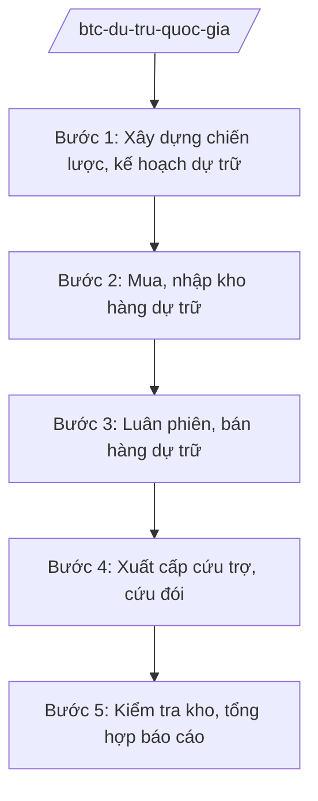

# Skill: Dự trữ quốc gia

## 2. Khi nào dùng
Khi xây dựng chiến lược, kế hoạch dự trữ quốc gia; khi mua, bán, luân phiên hàng dự trữ; khi xuất cấp hàng dự trữ cứu trợ thiên tai, dịch bệnh, cứu đói giáp hạt; khi kiểm tra kho dự trữ.

## 3. Đầu vào (Input)

| Trường | Mô tả | Bắt buộc |
|--------|-------|----------|
| `noi_dung` | Mua/bán/luân phiên/xuất cấp/kiểm tra | Có |
| `mat_hang` | Lương thực, vật tư, thiết bị cứu trợ... | Có |
| `muc_dich_xuat_cap` | Cứu trợ thiên tai / dịch bệnh / cứu đói / nhiệm vụ khác | Không |
| `de_nghi_dia_phuong` | Đề nghị hỗ trợ của địa phương (khi xuất cấp) | Không |

## 4. Quy trình

**Bước 1. Xây dựng chiến lược, kế hoạch dự trữ**
- Làm gì: Xác định danh mục, mức dự trữ; kế hoạch mua, bán, luân phiên hàng năm; phân bổ theo vùng, kho.
- Dùng input: `noi_dung`, `mat_hang`.
- Vai trò: Cục trưởng Cục Dự trữ Nhà nước chủ trì — AI hỗ trợ tính toán mức dự trữ tối ưu, lập kế hoạch (⏱ 5–7 ngày).
- Lưu ý nghiệp vụ: Ưu tiên lương thực, vật tư cứu trợ; phân bổ hợp lý theo vùng thiên tai trọng điểm.
- → Kết quả bước: Kế hoạch dự trữ quốc gia hằng năm.

**Bước 2. Mua, nhập kho hàng dự trữ**
- Làm gì: Tổ chức đấu thầu/mua hàng dự trữ theo kế hoạch; kiểm tra chất lượng; nhập kho bảo quản.
- Dùng input: Kế hoạch mua.
- Vai trò: Cục Dự trữ Nhà nước — AI hỗ trợ lập hồ sơ mời thầu, theo dõi chất lượng bảo quản ⏱ ~theo tiến độ thực hiện (ước tính).
- Lưu ý nghiệp vụ: Đấu thầu công khai, minh bạch; bảo quản đúng quy trình kỹ thuật, chống hư hỏng, thất thoát.
- → Kết quả bước: Hàng dự trữ nhập kho đạt chuẩn.

**Bước 3. Luân phiên, bán hàng dự trữ**
- Làm gì: Luân phiên đổi hàng (xuất cũ, nhập mới) đối với mặt hàng có hạn sử dụng; bán hàng dự trữ theo quyết định.
- Dùng input: Lịch luân phiên; quyết định bán.
- Vai trò: Chuyên viên Cục Dự trữ Nhà nước — AI hỗ trợ theo dõi hạn sử dụng, cảnh báo luân phiên ⏱ ~liên tục trong quá trình thực hiện (ước tính).
- Lưu ý nghiệp vụ: Không để hàng quá hạn phải tiêu hủy gây lãng phí; bán đúng giá, đúng đối tượng.
- → Kết quả bước: Hàng được luân phiên/bán; tiền nộp NSNN.

**Bước 4. Xuất cấp cứu trợ, cứu đói**
- Làm gì: Tiếp nhận đề nghị của địa phương; thẩm định; trình Thủ tướng quyết định xuất cấp; tổ chức vận chuyển, giao nhận.
- Dùng input: `de_nghi_dia_phuong`, `muc_dich_xuat_cap`.
- Vai trò: Cục trưởng Cục Dự trữ Nhà nước thẩm định — AI hỗ trợ soạn Tờ trình xuất cấp khẩn (⏱ 1–2 ngày, khẩn cấp trong ngày).
- Lưu ý nghiệp vụ: Xuất cấp kịp thời khi thiên tai, dịch bệnh; giao nhận có biên bản, đúng đối tượng; chống thất thoát, trục lợi.
- → Kết quả bước: Quyết định xuất cấp; hàng đến tay người dân.

**Bước 5. Kiểm tra kho, tổng hợp báo cáo**
- Làm gì: Kiểm tra định kỳ/đột xuất các kho dự trữ (số lượng, chất lượng, bảo quản); tổng hợp báo cáo.
- Dùng input: Kết quả kiểm kê.
- Vai trò: Đoàn kiểm tra của Cục — AI hỗ trợ lập báo cáo kiểm tra (⏱ 3–5 ngày).
- Lưu ý nghiệp vụ: Xử lý nghiêm thiếu hụt, hư hỏng do bảo quản kém.
- → Kết quả bước: Báo cáo công tác dự trữ quốc gia.

## Luồng quy trình (Workflow)

## 5. Đầu ra (Output)
- Kế hoạch dự trữ quốc gia hằng năm
- Hồ sơ đấu thầu mua hàng dự trữ
- **Tờ trình/Quyết định xuất cấp hàng dự trữ**
- Biên bản giao nhận hàng cứu trợ
- Báo cáo công tác dự trữ quốc gia

### Cấu trúc output chuẩn (thể thức NĐ 30/2020/NĐ-CP)
Tờ trình Thủ tướng về xuất cấp hàng dự trữ gồm:
1. Quốc hiệu "CỘNG HÒA XÃ HỘI CHỦ NGHĨA VIỆT NAM", Tiêu ngữ "Độc lập – Tự do – Hạnh phúc"; tên Tờ trình; kính gửi: Thủ tướng Chính phủ
2. Tình hình thiên tai/dịch bệnh; đề nghị của địa phương
3. Mặt hàng, số lượng đề nghị xuất cấp (minh họa)
4. Nguồn hàng (kho dự trữ khu vực...)
5. Kiến nghị Thủ tướng quyết định xuất cấp (không thu tiền)
6. Nơi nhận (kết thúc "- Lưu: VT, [mã đơn vị]."), chữ ký (ghi rõ chức danh, họ tên người ký; ký hiệu "KT."/"TL." khi ký thay) (Bộ trưởng Bộ Tài chính)

> **Checklist thể thức văn bản theo NĐ 30/2020/NĐ-CP** — đối chiếu trước khi trình ký:
> 1. Quốc hiệu và Tiêu ngữ.
> 2. Tên cơ quan, tổ chức ban hành văn bản.
> 3. Số, ký hiệu của văn bản.
> 4. Địa danh và thời gian ban hành văn bản.
> 5. Tên loại và trích yếu nội dung văn bản.
> 6. Nội dung văn bản.
> 7. Chức vụ, họ tên và chữ ký của người có thẩm quyền.
> 8. Dấu, chữ ký số của cơ quan, tổ chức.
> 9. Nơi nhận (kèm Phụ lục nếu có).

## 6. Checklist nghiệm thu
- [ ] Danh mục, mức dự trữ đúng chiến lược
- [ ] Đấu thầu mua hàng công khai, minh bạch
- [ ] Luân phiên kịp thời, không để hàng quá hạn
- [ ] Xuất cấp đúng đối tượng, kịp thời, có biên bản giao nhận
- [ ] Kho được kiểm tra định kỳ; số liệu ví dụ ghi rõ giả lập
- [ ] Thể thức đúng NĐ 30/2020/NĐ-CP; human gate đầy đủ

## 7. Ví dụ mô phỏng
*Dữ liệu dưới đây là giả lập 100% phục vụ minh họa.*

**Input mẫu:** Bão gây thiệt hại tại một số tỉnh (giả lập tình huống); UBND tỉnh A đề nghị hỗ trợ 1.000 tấn gạo cứu đói (giả lập).

**Output mẫu (trích Tờ trình):**
> **TỜ TRÌNH Về việc xuất cấp gạo dự trữ quốc gia hỗ trợ tỉnh A khắc phục hậu quả bão**
> Kính gửi: Thủ tướng Chính phủ
> 2. UBND tỉnh A đề nghị hỗ trợ 1.000 tấn gạo (giả lập) cứu đói cho ... hộ dân bị thiệt hại...
> 5. Bộ Tài chính kính đề nghị Thủ tướng quyết định xuất cấp (không thu tiền) 1.000 tấn gạo từ kho dự trữ khu vực ... cho tỉnh A.

## 8. Human gate
Cục Dự trữ Nhà nước thẩm định → Thứ trưởng phụ trách cho ý kiến → **Bộ trưởng Bộ Tài chính ký** Tờ trình → **Thủ tướng Chính phủ quyết định** xuất cấp.

## 9. Giới hạn
- AI không quyết định xuất cấp; không tự ý điều chuyển hàng dự trữ.
- Không bịa số lượng, chất lượng hàng dự trữ; số liệu ví dụ ghi rõ giả lập.
- Không tiết lộ vị trí, số lượng kho dự trữ chi tiết ngoài phạm vi công khai.

## 10. Căn cứ & lưu ý
- Nghị định 29/2025/NĐ-CP ngày 24/02/2025 của Chính phủ — chức năng, nhiệm vụ, quyền hạn của Bộ Tài chính (được sửa đổi bởi NĐ 166/2025/NĐ-CP ngày 30/6/2025).
- Nghị định 126/2025/NĐ-CP ngày 11/6/2025 — phân quyền, phân cấp trong lĩnh vực dự trữ quốc gia.
- Luật Dự trữ quốc gia (nêu tên luật, không ghi số hiệu).
- Nghị định 30/2020/NĐ-CP — thể thức văn bản.
