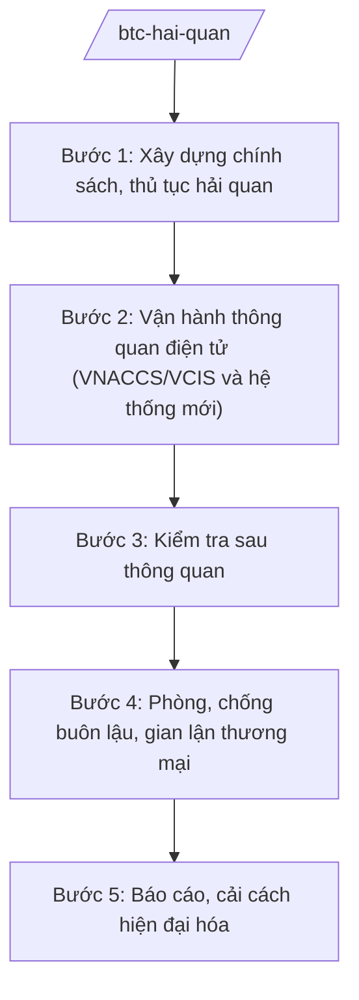

# Skill: Quản lý hải quan

## 2. Khi nào dùng
Khi xây dựng chính sách, thủ tục hải quan; khi quản lý hoạt động xuất nhập khẩu, quá cảnh; khi phòng, chống buôn lậu, gian lận thương mại qua biên giới; khi hiện đại hóa hải quan (thông quan điện tử).

## 3. Đầu vào (Input)

| Trường | Mô tả | Bắt buộc |
|--------|-------|----------|
| `noi_dung` | Xây dựng chính sách / thủ tục / kiểm tra chống buôn lậu | Có |
| `mat_hang` | Mặt hàng, loại hình XNK liên quan | Không |
| `vu_viec` | Hồ sơ vụ việc buôn lậu, gian lận (nếu có) | Không |

## 4. Quy trình

**Bước 1. Xây dựng chính sách, thủ tục hải quan**
- Làm gì: Soạn văn bản QPPL về thủ tục hải quan, kiểm tra, giám sát hải quan; biểu thuế xuất nhập khẩu; chính sách quản lý mặt hàng.
- Dùng input: `noi_dung`, `mat_hang`.
- Vai trò: Cục trưởng Cục Hải quan chủ trì — AI hỗ trợ soạn dự thảo, đối chiếu cam kết quốc tế về thuế quan (5–7 ngày).
- Lưu ý nghiệp vụ: Đơn giản hóa thủ tục, rút ngắn thời gian thông quan; tuân thủ cam kết FTA/WTO.
- → Kết quả bước: Dự thảo văn bản hải quan.

**Bước 2. Vận hành thông quan điện tử (VNACCS/VCIS và hệ thống mới)**
- Làm gì: Vận hành hệ thống thông quan tự động; phân luồng tờ khai (xanh/vàng/đỏ); quản lý rủi ro.
- Dùng input: Tờ khai hải quan điện tử.
- Vai trò: Đơn vị vận hành — AI hỗ trợ phân tích rủi ro, đề xuất tiêu chí phân luồng ⏱ ~liên tục trong quá trình thực hiện (ước tính).
- Lưu ý nghiệp vụ: Cân bằng tạo thuận lợi và kiểm soát; áp dụng quản lý rủi ro thay vì kiểm tra 100%.
- → Kết quả bước: Tờ khai được thông quan/giám sát theo luồng.

**Bước 3. Kiểm tra sau thông quan**
- Làm gì: Kiểm tra sau thông quan tại trụ sở doanh nghiệp (trị giá, mã số, xuất xứ, chính sách thuế).
- Dùng input: Danh sách doanh nghiệp rủi ro cao.
- Vai trò: Lực lượng kiểm tra sau thông quan — AI hỗ trợ lập kế hoạch theo rủi ro, soạn biên bản (3–5 ngày/đợt).
- Lưu ý nghiệp vụ: Đúng trình tự kiểm tra; bảo đảm quyền của doanh nghiệp.
- → Kết quả bước: Biên bản kiểm tra; quyết định truy thu/xử phạt (nếu có).

**Bước 4. Phòng, chống buôn lậu, gian lận thương mại**
- Làm gì: Tuần tra, kiểm soát biên giới, cửa khẩu; đấu tranh chuyên án buôn lậu, vận chuyển trái phép hàng hóa, ma túy, động vật hoang dã.
- Dùng input: `vu_viec`, tin báo, trinh sát.
- Vai trò: Lực lượng kiểm soát hải quan phối hợp Bộ đội Biên phòng, Công an — AI hỗ trợ phân tích tuyến, địa bàn trọng điểm ⏱ ~liên tục trong quá trình thực hiện (ước tính).
- Lưu ý nghiệp vụ: Bảo đảm an toàn lực lượng; phối hợp chặt chẽ liên ngành; xử lý tang vật đúng quy định.
- → Kết quả bước: Vụ việc buôn lậu bị phát hiện, xử lý.

**Bước 5. Báo cáo, cải cách hiện đại hóa**
- Làm gì: Báo cáo tình hình XNK, thu ngân sách từ hoạt động XNK; triển khai hải quan số, cơ chế một cửa quốc gia/ASEAN.
- Dùng input: Số liệu XNK.
- Vai trò: Cục trưởng Cục Hải quan ký báo cáo — AI hỗ trợ tổng hợp, phân tích xu hướng ⏱ ~theo định kỳ (ước tính).
- Lưu ý nghiệp vụ: Số liệu XNK là chỉ tiêu kinh tế vĩ mô quan trọng — bảo đảm chính xác, kịp thời.
- → Kết quả bước: Báo cáo công tác hải quan; đề án hiện đại hóa.

## Luồng quy trình (Workflow)

## 5. Đầu ra (Output)
- Dự thảo văn bản QPPL về hải quan
- Kế hoạch kiểm tra sau thông quan; biên bản kiểm tra
- Hồ sơ vụ việc buôn lậu, gian lận bị xử lý
- Báo cáo công tác hải quan định kỳ

### Cấu trúc output chuẩn (thể thức NĐ 30/2020/NĐ-CP)
Báo cáo công tác hải quan gồm:
1. Quốc hiệu "CỘNG HÒA XÃ HỘI CHỦ NGHĨA VIỆT NAM", Tiêu ngữ "Độc lập – Tự do – Hạnh phúc"; tên báo cáo; kỳ báo cáo
2. Tình hình xuất nhập khẩu (kim ngạch — minh họa)
3. Thu ngân sách từ hoạt động XNK (minh họa)
4. Công tác kiểm tra sau thông quan; phòng chống buôn lậu (số vụ — minh họa)
5. Cải cách, hiện đại hóa (thời gian thông quan — minh họa)
6. Kiến nghị
7. Chữ ký (ghi rõ chức danh, họ tên người ký; ký hiệu "KT."/"TL." khi ký thay) (Cục trưởng Cục Hải quan)
8. Nơi nhận (kết thúc "- Lưu: VT, [mã đơn vị].").
## 6. Checklist nghiệm thu
- [ ] Thủ tục đơn giản, đúng cam kết quốc tế
- [ ] Phân luồng rủi ro, không kiểm tra tràn lan
- [ ] Kiểm tra sau thông quan đúng trình tự
- [ ] Phối hợp liên ngành trong chống buôn lậu
- [ ] Số liệu XNK chính xác, kịp thời; ví dụ ghi rõ giả lập
- [ ] Thể thức đúng NĐ 30/2020/NĐ-CP; human gate đầy đủ

## 7. Ví dụ mô phỏng
*Dữ liệu dưới đây là giả lập 100% phục vụ minh họa.*

**Input mẫu:** Báo cáo công tác hải quan 9 tháng năm 2026 (giả lập).

**Output mẫu (trích):**
> **BÁO CÁO Công tác hải quan 9 tháng năm 2026**
> 2. Tổng kim ngạch XNK ước đạt ... tỷ USD (minh họa), tăng ...% so với cùng kỳ...
> 4. Phát hiện, xử lý ... vụ buôn lậu, gian lận thương mại (minh họa), trị giá tang vật ... (minh họa)...

## 8. Human gate
Chuyên viên Cục Hải quan soạn → Cục trưởng Cục Hải quan kiểm tra → Thứ trưởng phụ trách cho ý kiến → **Bộ trưởng Bộ Tài chính ký** văn bản/báo cáo quan trọng.

## 9. Giới hạn
- AI không quyết định thông quan/không thông quan lô hàng cụ thể; không can thiệp phân luồng.
- Không tiết lộ thông tin trinh sát, chuyên án chưa công khai.
- Không bịa số liệu XNK, thu ngân sách.

## 10. Căn cứ & lưu ý
- Nghị định 29/2025/NĐ-CP ngày 24/02/2025 của Chính phủ — chức năng, nhiệm vụ, quyền hạn của Bộ Tài chính (được sửa đổi bởi NĐ 166/2025/NĐ-CP ngày 30/6/2025).
- Luật Hải quan; Luật Thuế xuất khẩu, thuế nhập khẩu (nêu tên luật, không ghi số hiệu).
- Nghị định 30/2020/NĐ-CP — thể thức văn bản.
