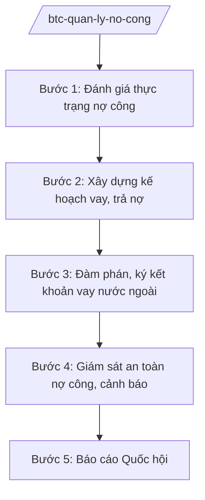

# Skill: Quản lý nợ công

## 2. Khi nào dùng
Khi xây dựng Chiến lược nợ công, kế hoạch vay – trả nợ hằng năm; khi đàm phán, ký kết khoản vay ODA/vay ưu đãi nước ngoài; khi giám sát chỉ tiêu an toàn nợ công; khi báo cáo Quốc hội về nợ công.

## 3. Đầu vào (Input)

| Trường | Mô tả | Bắt buộc |
|--------|-------|----------|
| `ky_bao_cao` | Năm/kỳ báo cáo | Có |
| `du_no_hien_tai` | Dư nợ công hiện tại (theo số liệu chính thức) | Có |
| `ke_hoach_vay` | Kế hoạch vay trong kỳ (trong nước, nước ngoài) | Không |
| `lich_tra_no` | Lịch trả nợ gốc, lãi đến hạn | Không |

## 4. Quy trình

**Bước 1. Đánh giá thực trạng nợ công**
- Làm gì: Tổng hợp dư nợ (nợ Chính phủ, nợ được Chính phủ bảo lãnh, nợ chính quyền địa phương); tính các chỉ tiêu: nợ công/GDP, nghĩa vụ trả nợ/thu NSNN.
- Dùng input: `du_no_hien_tai`, `lich_tra_no`, `ky_bao_cao`.
- Vai trò: Chuyên viên Cục Quản lý nợ — AI hỗ trợ tính toán chỉ tiêu, vẽ biểu đồ xu hướng (⏱ 2–3 ngày).
- Lưu ý nghiệp vụ: Số liệu phải từ nguồn chính thức (KBNN, báo cáo đã công khai); phân biệt nợ trong nước/ngoài, ngắn/dài hạn.
- → Kết quả bước: Báo cáo thực trạng nợ công.

**Bước 2. Xây dựng kế hoạch vay, trả nợ**
- Làm gì: Xác định nhu cầu vay (bù đắp bội chi, trả nợ đáo hạn, cho vay lại); cơ cấu kỳ hạn, lãi suất, đồng tiền; kế hoạch trả nợ.
- Dùng input: `ke_hoach_vay`, kết quả bước 1.
- Vai trò: Cục trưởng Cục Quản lý nợ chủ trì — AI hỗ trợ mô phỏng cơ cấu vay tối ưu chi phí/rủi ro (⏱ 3–5 ngày).
- Lưu ý nghiệp vụ: Ưu tiên vay trong nước, kỳ hạn dài; kiểm soát vay ngoại tệ; tuân thủ hạn mức Quốc hội phê duyệt.
- → Kết quả bước: Kế hoạch vay, trả nợ hằng năm.

**Bước 3. Đàm phán, ký kết khoản vay nước ngoài**
- Làm gì: Đàm phán điều kiện vay ODA/vay ưu đãi với đối tác; thẩm định hiệu quả dự án sử dụng vốn vay; trình Thủ tướng phê duyệt.
- Dùng input: Đề xuất dự án sử dụng vốn vay.
- Vai trò: Thứ trưởng phụ trách — AI hỗ trợ soạn tài liệu đàm phán, so sánh điều kiện các nhà tài trợ ⏱ ~theo tiến độ thực hiện (ước tính).
- Lưu ý nghiệp vụ: Chỉ vay cho đầu tư phát triển, không vay bù đắp chi thường xuyên; đánh giá khả năng trả nợ của dự án.
- → Kết quả bước: Hiệp định vay được ký kết.

**Bước 4. Giám sát an toàn nợ công, cảnh báo**
- Làm gì: Theo dõi chỉ tiêu an toàn nợ (trần nợ công, ngưỡng cảnh báo); cảnh báo khi tiệm cận ngưỡng; đề xuất giải pháp.
- Dùng input: Số liệu cập nhật hằng quý.
- Vai trò: Chuyên viên Cục Quản lý nợ — AI hỗ trợ dashboard theo dõi, cảnh báo tự động khi vượt ngưỡng ⏱ ~liên tục trong quá trình thực hiện (ước tính).
- Lưu ý nghiệp vụ: Công khai, minh bạch số liệu nợ công theo quy định.
- → Kết quả bước: Báo cáo giám sát nợ công; cảnh báo (nếu có).

**Bước 5. Báo cáo Quốc hội**
- Làm gì: Lập báo cáo tình hình nợ công trình Chính phủ, Quốc hội (kèm báo cáo NSNN).
- Dùng input: Kết quả các bước trên.
- Vai trò: Bộ trưởng Bộ Tài chính ký — AI hỗ trợ soạn báo cáo (⏱ 2–3 ngày).
- Lưu ý nghiệp vụ: Giải trình rõ biến động dư nợ, chi phí vay, rủi ro.
- → Kết quả bước: Báo cáo nợ công trình Quốc hội.

## Luồng quy trình (Workflow)

## 5. Đầu ra (Output)
- Báo cáo thực trạng nợ công
- Kế hoạch vay, trả nợ hằng năm
- Hồ sơ đàm phán, hiệp định vay
- Báo cáo giám sát an toàn nợ công
- Báo cáo nợ công trình Quốc hội

### Cấu trúc output chuẩn (thể thức NĐ 30/2020/NĐ-CP)
Báo cáo nợ công gồm:
1. Quốc hiệu "CỘNG HÒA XÃ HỘI CHỦ NGHĨA VIỆT NAM", Tiêu ngữ "Độc lập – Tự do – Hạnh phúc"; tên báo cáo; kính gửi: Chính phủ/Quốc hội
2. Dư nợ công (cơ cấu theo chủ thể, kỳ hạn, đồng tiền — số liệu minh họa)
3. Các chỉ tiêu an toàn nợ (nợ công/GDP, trả nợ/thu NSNN)
4. Tình hình vay, trả nợ trong kỳ
5. Đánh giá rủi ro; cảnh báo
6. Kiến nghị
7. Nơi nhận (kết thúc "- Lưu: VT, [mã đơn vị]."), chữ ký (ghi rõ chức danh, họ tên người ký; ký hiệu "KT."/"TL." khi ký thay) (Bộ trưởng Bộ Tài chính)

> **Checklist thể thức văn bản theo NĐ 30/2020/NĐ-CP** — đối chiếu trước khi trình ký:
> 1. Quốc hiệu và Tiêu ngữ.
> 2. Tên cơ quan, tổ chức ban hành văn bản.
> 3. Số, ký hiệu của văn bản.
> 4. Địa danh và thời gian ban hành văn bản.
> 5. Tên loại và trích yếu nội dung văn bản.
> 6. Nội dung văn bản.
> 7. Chức vụ, họ tên và chữ ký của người có thẩm quyền.
> 8. Dấu, chữ ký số của cơ quan, tổ chức.
> 9. Nơi nhận (kèm Phụ lục nếu có).

## 6. Checklist nghiệm thu
- [ ] Số liệu từ nguồn chính thức, có đối chiếu
- [ ] Chỉ tiêu an toàn nợ tính đúng, trong giới hạn cho phép
- [ ] Kế hoạch vay trong hạn mức Quốc hội phê duyệt
- [ ] Vốn vay nước ngoài chỉ cho đầu tư phát triển
- [ ] Rủi ro được đánh giá, có cảnh báo
- [ ] Số liệu ví dụ ghi rõ giả lập; thể thức đúng NĐ 30/2020/NĐ-CP
- [ ] Human gate đầy đủ

## 7. Ví dụ mô phỏng
*Dữ liệu dưới đây là giả lập 100% phục vụ minh họa.*

**Input mẫu:** Báo cáo nợ công năm 2026 (giả lập); dư nợ công/GDP ở mức an toàn (giả lập); kế hoạch vay năm 2027.

**Output mẫu (trích Báo cáo):**
> **BÁO CÁO Tình hình nợ công năm 2026**
> Kính gửi: Quốc hội
> 2. Dư nợ công đến cuối năm 2026 ước ...% GDP (số liệu minh họa), trong giới hạn ...% do Quốc hội quy định...
> 3. Nghĩa vụ trả nợ trực tiếp của Chính phủ so với thu NSNN: ...% (minh họa)...
> *(mọi số liệu đều là giả lập minh họa)*

## 8. Human gate
Cục Quản lý nợ tổng hợp → Thứ trưởng phụ trách cho ý kiến → **Bộ trưởng Bộ Tài chính ký** → Chính phủ trình **Quốc hội** xem xét.

## 9. Giới hạn
- AI không quyết định khoản vay; không tự ý cam kết nghĩa vụ trả nợ.
- Không tiết lộ số liệu nợ công chưa công khai; số liệu ví dụ phải ghi rõ giả lập.
- Không bịa điều kiện vay, lãi suất.

## 10. Căn cứ & lưu ý
- Nghị định 29/2025/NĐ-CP ngày 24/02/2025 của Chính phủ — chức năng, nhiệm vụ, quyền hạn của Bộ Tài chính (được sửa đổi bởi NĐ 166/2025/NĐ-CP ngày 30/6/2025).
- Luật Quản lý nợ công (nêu tên luật, không ghi số hiệu).
- Nghị quyết của Quốc hội về trần nợ công, kế hoạch vay trả nợ (viện dẫn cụ thể theo từng năm thực tế).
- Nghị định 30/2020/NĐ-CP — thể thức văn bản.
