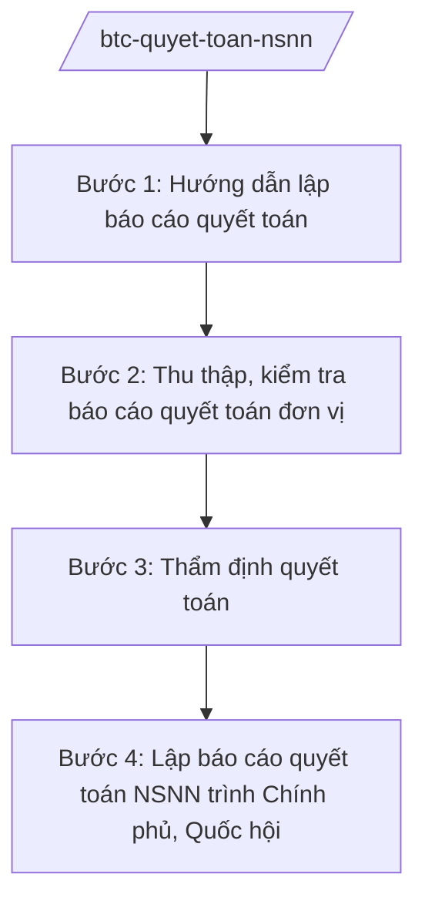

# Skill: Quyết toán ngân sách nhà nước

## 2. Khi nào dùng
Hằng năm, sau khi kết thúc năm ngân sách: hướng dẫn các bộ, ngành, địa phương lập báo cáo quyết toán; tổng hợp, thẩm định; trình Chính phủ và Quốc hội phê chuẩn quyết toán NSNN.

## 3. Đầu vào (Input)

| Trường | Mô tả | Bắt buộc |
|--------|-------|----------|
| `nam_quyet_toan` | Năm ngân sách quyết toán | Có |
| `bao_cao_qt_bo_nganh` | Báo cáo quyết toán của bộ, cơ quan trung ương | Không |
| `bao_cao_qt_dia_phuong` | Báo cáo quyết toán của 63 tỉnh/thành | Không |
| `ket_luan_kiem_toan` | Kết luận của Kiểm toán Nhà nước | Không |

## 4. Quy trình

**Bước 1. Hướng dẫn lập báo cáo quyết toán**
- Làm gì: Ban hành văn bản hướng dẫn: biểu mẫu, thời hạn, yêu cầu đối chiếu số liệu (thu qua KBNN, chi qua hệ thống TABMIS...).
- Dùng input: `nam_quyet_toan`.
- Vai trò: Vụ Ngân sách nhà nước — AI hỗ trợ soạn văn bản hướng dẫn, bộ biểu mẫu (⏱ 2–3 ngày).
- Lưu ý nghiệp vụ: Số liệu quyết toán phải khớp với số liệu Kho bạc Nhà nước; chênh lệch phải giải trình.
- → Kết quả bước: Văn bản hướng dẫn quyết toán NSNN.

**Bước 2. Thu thập, kiểm tra báo cáo quyết toán đơn vị**
- Làm gì: Thu báo cáo của bộ/ngành/địa phương; kiểm tra tính đầy đủ, hợp lệ; đối chiếu với dữ liệu KBNN.
- Dùng input: `bao_cao_qt_bo_nganh`, `bao_cao_qt_dia_phuong`.
- Vai trò: Chuyên viên Vụ Ngân sách nhà nước — AI hỗ trợ đối chiếu tự động, lập danh sách đơn vị có chênh lệch cần giải trình (⏱ 5–7 ngày).
- Lưu ý nghiệp vụ: Kiên quyết yêu cầu giải trình chênh lệch; không "hợp thức hóa" số liệu.
- → Kết quả bước: Bảng tổng hợp có đối chiếu, danh sách chênh lệch.

**Bước 3. Thẩm định quyết toán**
- Làm gì: Thẩm định nội dung: chi đúng chế độ, đúng dự toán được giao; xử lý các khoản chi sai chế độ (xuất toán, thu hồi).
- Dùng input: Kết quả bước 2; `ket_luan_kiem_toan`.
- Vai trò: Vụ Ngân sách nhà nước phối hợp Thanh tra Bộ — AI hỗ trợ rà soát các khoản chi bất thường theo tiêu chí (⏱ 5–7 ngày).
- Lưu ý nghiệp vụ: Phối hợp kết luận của Kiểm toán Nhà nước; kiến nghị xử lý trách nhiệm tập thể, cá nhân vi phạm.
- → Kết quả bước: Báo cáo thẩm định quyết toán NSNN.

**Bước 4. Lập báo cáo quyết toán NSNN trình Chính phủ, Quốc hội**
- Làm gì: Tổng hợp báo cáo quyết toán NSNN: thu, chi, bội chi, kết dư; so sánh với dự toán Quốc hội giao.
- Dùng input: Kết quả bước 3.
- Vai trò: Thứ trưởng phụ trách chỉ đạo — AI hỗ trợ soạn báo cáo, biểu đồ so sánh dự toán/quyết toán (⏱ 3–5 ngày).
- Lưu ý nghiệp vụ: Giải trình rõ các khoản vượt/thiếu so với dự toán; công khai sau khi Quốc hội phê chuẩn.
- → Kết quả bước: Báo cáo quyết toán NSNN trình Chính phủ → Quốc hội phê chuẩn.

## Luồng quy trình (Workflow)

## 5. Đầu ra (Output)
- Văn bản hướng dẫn quyết toán NSNN
- Báo cáo thẩm định quyết toán
- **Báo cáo quyết toán NSNN** trình Quốc hội phê chuẩn

### Cấu trúc output chuẩn (thể thức NĐ 30/2020/NĐ-CP)
Báo cáo quyết toán NSNN gồm:
1. Quốc hiệu "CỘNG HÒA XÃ HỘI CHỦ NGHĨA VIỆT NAM", Tiêu ngữ "Độc lập – Tự do – Hạnh phúc"; tên báo cáo; kính gửi: Quốc hội
2. Kết quả thu NSNN (tổng thu, cơ cấu, so với dự toán)
3. Kết quả chi NSNN (tổng chi, cơ cấu, so với dự toán)
4. Cân đối NSNN, bội chi, kết dư ngân sách
5. Đánh giá, nhận xét (kỷ luật tài chính, tồn tại)
6. Kiến nghị (xử lý vi phạm, hoàn thiện cơ chế)
7. Nơi nhận (kết thúc "- Lưu: VT, [mã đơn vị]."), chữ ký (ghi rõ chức danh, họ tên người ký; ký hiệu "KT."/"TL." khi ký thay) (Bộ trưởng Bộ Tài chính)

> **Checklist thể thức văn bản theo NĐ 30/2020/NĐ-CP** — đối chiếu trước khi trình ký:
> 1. Quốc hiệu và Tiêu ngữ.
> 2. Tên cơ quan, tổ chức ban hành văn bản.
> 3. Số, ký hiệu của văn bản.
> 4. Địa danh và thời gian ban hành văn bản.
> 5. Tên loại và trích yếu nội dung văn bản.
> 6. Nội dung văn bản.
> 7. Chức vụ, họ tên và chữ ký của người có thẩm quyền.
> 8. Dấu, chữ ký số của cơ quan, tổ chức.
> 9. Nơi nhận (kèm Phụ lục nếu có).

## 6. Checklist nghiệm thu
- [ ] Số liệu khớp với Kho bạc Nhà nước; chênh lệch đã giải trình
- [ ] Đã đối chiếu kết luận Kiểm toán Nhà nước
- [ ] Các khoản chi sai chế độ đã được xử lý (xuất toán/thu hồi)
- [ ] So sánh đầy đủ dự toán giao vs quyết toán
- [ ] Không bịa số liệu; số liệu ví dụ ghi rõ giả lập
- [ ] Thể thức đúng NĐ 30/2020/NĐ-CP; human gate đầy đủ

## 7. Ví dụ mô phỏng
*Dữ liệu dưới đây là giả lập 100% phục vụ minh họa.*

**Input mẫu:** Quyết toán NSNN năm 2026 (giả lập); 63/63 tỉnh gửi báo cáo; Kiểm toán Nhà nước có kết luận về một số khoản chi sai chế độ (giả lập).

**Output mẫu (trích Báo cáo):**
> **BÁO CÁO Quyết toán ngân sách nhà nước năm 2026**
> Kính gửi: Quốc hội
> 2. Tổng thu NSNN: X triệu tỷ đồng (giả lập), đạt Y% dự toán...
> 3. Tổng chi NSNN: Z triệu tỷ đồng (giả lập)...
> 5. Qua thẩm định, phát hiện một số đơn vị chi sai chế độ với tổng số tiền ... (giả lập); Bộ Tài chính đã yêu cầu xuất toán, thu hồi nộp NSNN...

## 8. Human gate
Vụ Ngân sách nhà nước tổng hợp, thẩm định → Thứ trưởng phụ trách cho ý kiến → **Bộ trưởng Bộ Tài chính ký** → **Chính phủ trình Quốc hội phê chuẩn**.

## 9. Giới hạn
- AI không tự ý điều chỉnh số liệu quyết toán; không "làm đẹp" số liệu.
- Không tiết lộ số liệu quyết toán chưa được Quốc hội phê chuẩn.
- Mọi số liệu ví dụ phải ghi rõ giả lập.

## 10. Căn cứ & lưu ý
- Nghị định 29/2025/NĐ-CP ngày 24/02/2025 của Chính phủ — chức năng, nhiệm vụ, quyền hạn của Bộ Tài chính (được sửa đổi bởi NĐ 166/2025/NĐ-CP ngày 30/6/2025).
- Luật Ngân sách nhà nước (nêu tên luật, không ghi số hiệu).
- Nghị định 30/2020/NĐ-CP — thể thức văn bản.
