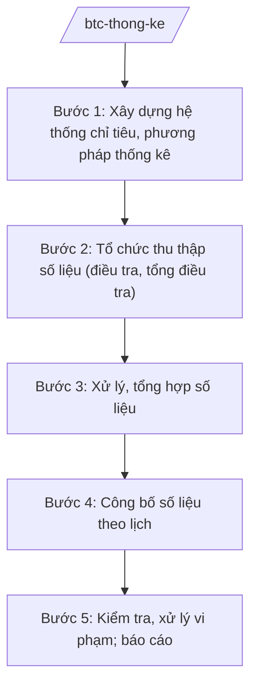

# Skill: Thống kê nhà nước

## 2. Khi nào dùng
Khi xây dựng hệ thống chỉ tiêu thống kê quốc gia; khi tổ chức tổng điều tra; khi công bố số liệu thống kê (GDP, CPI, lao động...); khi kiểm tra, xử lý vi phạm trong hoạt động thống kê.

## 3. Đầu vào (Input)

| Trường | Mô tả | Bắt buộc |
|--------|-------|----------|
| `noi_dung` | Hệ thống chỉ tiêu / tổng điều tra / công bố số liệu / kiểm tra | Có |
| `ky_thong_ke` | Kỳ thống kê (tháng/quý/năm) | Không |
| `so_lieu_tho` | Số liệu thô từ điều tra, báo cáo | Không |

## 4. Quy trình

**Bước 1. Xây dựng hệ thống chỉ tiêu, phương pháp thống kê**
- Làm gì: Soạn hệ thống chỉ tiêu thống kê quốc gia; quy định phương pháp tính (GDP, GRDP, CPI...); ban hành chế độ báo cáo thống kê.
- Dùng input: `noi_dung`.
- Vai trò: Cục trưởng Cục Thống kê chủ trì — AI hỗ trợ soạn danh mục chỉ tiêu, đối chiếu chuẩn mực quốc tế (5–7 ngày).
- Lưu ý nghiệp vụ: Phương pháp tính phải tương thích chuẩn quốc tế (SNA); thay đổi phương pháp phải công bố, giải trình.
- → Kết quả bước: Hệ thống chỉ tiêu, phương pháp thống kê.

**Bước 2. Tổ chức thu thập số liệu (điều tra, tổng điều tra)**
- Làm gì: Lập phương án tổng điều tra (dân số, kinh tế...); tập huấn điều tra viên; thu thập qua phiếu điện tử.
- Dùng input: Phương án được phê duyệt.
- Vai trò: Cục Thống kê — AI hỗ trợ thiết kế phiếu điều tra điện tử, kiểm soát logic số liệu nhập ⏱ ~theo tiến độ điều tra (ước tính).
- Lưu ý nghiệp vụ: Bảo mật thông tin người cung cấp; kiểm tra chéo, phúc tra mẫu.
- → Kết quả bước: Bộ số liệu thô đã kiểm soát.

**Bước 3. Xử lý, tổng hợp số liệu**
- Làm gì: Làm sạch, xử lý số liệu; tính toán các chỉ tiêu tổng hợp (GDP, CPI, tỷ lệ thất nghiệp...).
- Dùng input: `so_lieu_tho`.
- Vai trò: Chuyên viên Cục Thống kê — AI hỗ trợ phát hiện ngoại lệ (outlier), đối chiếu nguồn độc lập (3–5 ngày).
- Lưu ý nghiệp vụ: Mọi điều chỉnh số liệu phải có căn cứ phương pháp luận, ghi chép đầy đủ; không "nắn" số liệu theo ý chí.
- → Kết quả bước: Số liệu thống kê chính thức.

**Bước 4. Công bố số liệu theo lịch**
- Làm gì: Công bố số liệu kinh tế – xã hội hằng tháng/quý/năm theo lịch công bố đã ban hành; họp báo công bố GDP.
- Dùng input: Số liệu chính thức.
- Vai trò: Cục trưởng Cục Thống kê công bố — AI hỗ trợ soạn thông cáo báo chí, biểu đồ (1–2 ngày).
- Lưu ý nghiệp vụ: Công bố đúng lịch, đồng thời cho mọi đối tượng; không rò rỉ số liệu trước giờ công bố.
- → Kết quả bước: Thông cáo báo chí; niên giám thống kê.

**Bước 5. Kiểm tra, xử lý vi phạm; báo cáo**
- Làm gì: Kiểm tra việc chấp hành chế độ báo cáo thống kê; xử phạt hành vi báo cáo sai, chậm, từ chối cung cấp thông tin.
- Dùng input: Kết quả kiểm tra.
- Vai trò: Thanh tra Bộ — AI hỗ trợ lập kế hoạch kiểm tra (2–3 ngày).
- Lưu ý nghiệp vụ: Xử lý nghiêm hành vi làm sai lệch số liệu thống kê.
- → Kết quả bước: Quyết định xử lý vi phạm; báo cáo công tác thống kê.

## Luồng quy trình (Workflow)

## 5. Đầu ra (Output)
- Hệ thống chỉ tiêu thống kê quốc gia; phương án tổng điều tra
- Số liệu thống kê chính thức; thông cáo báo chí công bố
- Niên giám thống kê
- Báo cáo công tác thống kê

### Cấu trúc output chuẩn (thể thức NĐ 30/2020/NĐ-CP)

**Khung thể thức chung (NĐ 30/2020/NĐ-CP):** mọi văn bản trong output đều trình bày đầy đủ: Quốc hiệu "CỘNG HÒA XÃ HỘI CHỦ NGHĨA VIỆT NAM", Tiêu ngữ "Độc lập – Tự do – Hạnh phúc"; tên cơ quan ban hành; số, ký hiệu văn bản; địa danh, ngày tháng năm ban hành; tên loại văn bản; nội dung theo các mục dưới đây; nơi nhận (kết thúc "- Lưu: VT, [mã đơn vị]."); khối chữ ký (chức danh, họ tên người ký; ký hiệu "KT."/"TL." khi ký thay).
Thông cáo báo chí công bố số liệu gồm:
1. Tên thông cáo; ngày công bố
2. Các chỉ tiêu chính (GDP, CPI, xuất nhập khẩu... — số liệu minh họa)
3. Phân tích xu hướng, so sánh cùng kỳ (minh họa)
4. Đánh giá, nhận định
5. Liên hệ báo chí; chữ ký (ghi rõ chức danh, họ tên người ký; ký hiệu "KT."/"TL." khi ký thay)

> **Checklist thể thức văn bản theo NĐ 30/2020/NĐ-CP** — đối chiếu trước khi trình ký:
> 1. Quốc hiệu và Tiêu ngữ.
> 2. Tên cơ quan, tổ chức ban hành văn bản.
> 3. Số, ký hiệu của văn bản.
> 4. Địa danh và thời gian ban hành văn bản.
> 5. Tên loại và trích yếu nội dung văn bản.
> 6. Nội dung văn bản.
> 7. Chức vụ, họ tên và chữ ký của người có thẩm quyền.
> 8. Dấu, chữ ký số của cơ quan, tổ chức.
> 9. Nơi nhận (kèm Phụ lục nếu có).

## 6. Checklist nghiệm thu
- [ ] Phương pháp tính đúng chuẩn, có công bố khi thay đổi
- [ ] Số liệu đã kiểm soát logic, phúc tra mẫu
- [ ] Công bố đúng lịch, không rò rỉ trước giờ
- [ ] Bảo mật thông tin người cung cấp số liệu
- [ ] Mọi số liệu ví dụ ghi rõ giả lập
- [ ] Thể thức đúng NĐ 30/2020/NĐ-CP; human gate đầy đủ

## 7. Ví dụ mô phỏng
*Dữ liệu dưới đây là giả lập 100% phục vụ minh họa.*

**Input mẫu:** Công bố số liệu kinh tế – xã hội quý III/2026 (giả lập).

**Output mẫu (trích Thông cáo):**
> **THÔNG CÁO BÁO CHÍ Tình hình kinh tế – xã hội quý III/2026**
> 2. GDP quý III/2026 ước tăng ...% so với cùng kỳ (minh họa); CPI bình quân 9 tháng tăng ...% (minh họa)...

## 8. Human gate
Chuyên viên Cục Thống kê xử lý → Cục trưởng Cục Thống kê kiểm tra, phê duyệt số liệu → **Bộ trưởng Bộ Tài chính** (hoặc người được ủy quyền) công bố các chỉ tiêu quan trọng.

## 9. Giới hạn
- AI không tự ý điều chỉnh số liệu thống kê; không "nắn" số liệu.
- Không rò rỉ số liệu trước giờ công bố chính thức.
- Không tiết lộ thông tin định danh của đối tượng điều tra.

## 10. Căn cứ & lưu ý
- Nghị định 29/2025/NĐ-CP ngày 24/02/2025 của Chính phủ — chức năng, nhiệm vụ, quyền hạn của Bộ Tài chính (được sửa đổi bởi NĐ 166/2025/NĐ-CP ngày 30/6/2025).
- Nghị định 130/2025/NĐ-CP ngày 11/6/2025 — phân quyền, phân cấp trong lĩnh vực thống kê.
- Luật Thống kê (nêu tên luật, không ghi số hiệu).
- Nghị định 30/2020/NĐ-CP — thể thức văn bản.
