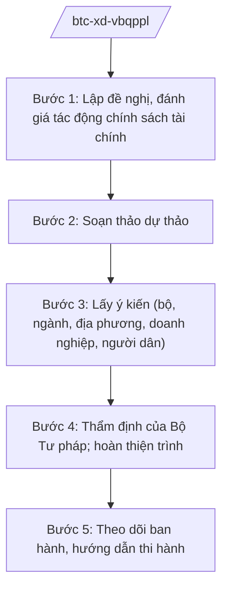

# Skill: Xây dựng VBQPPL lĩnh vực tài chính

## 2. Khi nào dùng
Khi Bộ Tài chính chủ trì soạn thảo luật, nghị định, thông tư về ngân sách nhà nước, thuế, phí, lệ phí, hải quan, đầu tư công, quản lý nợ công, dự trữ quốc gia, thống kê; hoặc thẩm định nội bộ trước khi trình Chính phủ.

## 3. Đầu vào (Input)

| Trường | Mô tả | Bắt buộc |
|--------|-------|----------|
| `ten_van_ban` | Tên dự thảo VBQPPL | Có |
| `cap_van_ban` | Luật / nghị định / thông tư | Có |
| `linh_vuc` | Ngân sách / thuế / hải quan / đầu tư công / nợ công... | Có |
| `yeu_cau_chinh_sach` | Chủ trương, yêu cầu cải cách | Có |
| `du_thao` | Dự thảo kèm Tờ trình, báo cáo đánh giá tác động | Không |

## 4. Quy trình

**Bước 1. Lập đề nghị, đánh giá tác động chính sách tài chính**
- Làm gì: Đánh giá tác động ngân sách (tăng/giảm thu, chi), tác động đến doanh nghiệp, người dân, môi trường đầu tư.
- Dùng input: `ten_van_ban`, `linh_vuc`, `yeu_cau_chinh_sach`.
- Vai trò: Chuyên viên Vụ Chính sách — AI hỗ trợ mô phỏng tác động thu ngân sách theo kịch bản, tổng hợp số liệu (3–5 ngày).
- Lưu ý nghiệp vụ: Chính sách thuế/phí mới phải đánh giá kỹ tác động đến sức cạnh tranh; tuân thủ cam kết quốc tế (FTA, WTO).
- → Kết quả bước: Báo cáo đánh giá tác động chính sách.

**Bước 2. Soạn thảo dự thảo**
- Làm gì: Thành lập Ban soạn thảo; xây dựng dự thảo theo cấp văn bản (luật → trình Quốc hội; nghị định → trình Chính phủ; thông tư → Bộ trưởng ban hành).
- Dùng input: Kết quả bước 1.
- Vai trò: Vụ trưởng Vụ Chính sách chủ trì — AI hỗ trợ soạn điều khoản, kiểm tra kỹ thuật lập pháp (5–7 ngày).
- Lưu ý nghiệp vụ: Phân biệt rõ nội dung thuộc thẩm quyền luật / nghị định / thông tư; không "luật khung, nghị định chi tiết tùy tiện".
- → Kết quả bước: Dự thảo 1 + Tờ trình + thuyết minh.

**Bước 3. Lấy ý kiến (bộ, ngành, địa phương, doanh nghiệp, người dân)**
- Làm gì: Đăng Cổng TTĐT; gửi lấy ý kiến; tổ chức hội thảo với hiệp hội doanh nghiệp, chuyên gia.
- Dùng input: Dự thảo 1.
- Vai trò: Chuyên viên Vụ Chính sách tổng hợp — AI hỗ trợ phân loại ý kiến, lập bảng tiếp thu/giải trình (3–5 ngày).
- Lưu ý nghiệp vụ: Chính sách thuế tác động rộng — phải lấy ý kiến cộng đồng doanh nghiệp đầy đủ, công khai.
- → Kết quả bước: Báo cáo tổng hợp, tiếp thu ý kiến.

**Bước 4. Thẩm định của Bộ Tư pháp; hoàn thiện trình**
- Làm gì: Gửi Bộ Tư pháp thẩm định; tiếp thu ý kiến thẩm định; hoàn thiện hồ sơ trình Chính phủ (nghị định) hoặc Quốc hội (luật).
- Dùng input: Dự thảo sau tiếp thu.
- Vai trò: Thứ trưởng phụ trách ký Tờ trình — AI hỗ trợ kiểm tra lần cuối thể thức, dẫn chiếu (1–2 ngày).
- Lưu ý nghiệp vụ: Hồ sơ trình Chính phủ phải có báo cáo thẩm định của Bộ Tư pháp.
- → Kết quả bước: Hồ sơ trình Chính phủ/Quốc hội.

**Bước 5. Theo dõi ban hành, hướng dẫn thi hành**
- Làm gì: Sau khi ban hành: ban hành văn bản hướng dẫn (thông tư); tập huấn cho cơ quan thuế, hải quan, kho bạc địa phương.
- Dùng input: Văn bản đã ban hành.
- Vai trò: Các vụ/cục chuyên ngành — AI hỗ trợ soạn tài liệu hỏi–đáp, cẩm nang hướng dẫn (5–7 ngày).
- Lưu ý nghiệp vụ: Có lộ trình chuyển tiếp; công khai trên Cổng TTĐT Bộ Tài chính.
- → Kết quả bước: Văn bản hướng dẫn + tài liệu tập huấn.

## Luồng quy trình (Workflow)

## 5. Đầu ra (Output)
- Báo cáo đánh giá tác động chính sách tài chính
- Dự thảo VBQPPL + Tờ trình + thuyết minh
- Báo cáo tổng hợp, tiếp thu ý kiến
- Văn bản hướng dẫn thi hành; tài liệu hỏi–đáp

### Cấu trúc output chuẩn (thể thức NĐ 30/2020/NĐ-CP)
Tờ trình Chính phủ về dự thảo nghị định gồm:
1. Quốc hiệu "CỘNG HÒA XÃ HỘI CHỦ NGHĨA VIỆT NAM", Tiêu ngữ "Độc lập – Tự do – Hạnh phúc"; tên Tờ trình; kính gửi: Chính phủ
2. Sự cần thiết ban hành
3. Quan điểm, mục tiêu
4. Quá trình xây dựng (đánh giá tác động, lấy ý kiến, thẩm định của Bộ Tư pháp)
5. Bố cục, nội dung cơ bản
6. Vấn đề còn ý kiến khác nhau
7. Kiến nghị
8. Nơi nhận (kết thúc "- Lưu: VT, [mã đơn vị]."), chữ ký (ghi rõ chức danh, họ tên người ký; ký hiệu "KT."/"TL." khi ký thay) (Bộ trưởng Bộ Tài chính)
## 6. Checklist nghiệm thu
- [ ] Có báo cáo đánh giá tác động ngân sách theo kịch bản
- [ ] Đã đánh giá tương thích cam kết quốc tế (nếu liên quan thuế XNK)
- [ ] Đã lấy ý kiến rộng rãi, có báo cáo tiếp thu
- [ ] Có báo cáo thẩm định của Bộ Tư pháp
- [ ] Phân định đúng cấp văn bản (luật/nghị định/thông tư)
- [ ] Thể thức đúng NĐ 30/2020/NĐ-CP; human gate đầy đủ

## 7. Ví dụ mô phỏng
*Dữ liệu dưới đây là giả lập 100% phục vụ minh họa.*

**Input mẫu:** Dự thảo Nghị định sửa đổi quy định về lệ phí trước bạ (giả lập tình huống); cấp: nghị định; lĩnh vực: phí, lệ phí.

**Output mẫu (trích Tờ trình):**
> **TỜ TRÌNH Về dự thảo Nghị định sửa đổi, bổ sung quy định về lệ phí trước bạ**
> Kính gửi: Chính phủ
> 1. Sự cần thiết: mức thu hiện hành chưa phản ánh đúng giá trị tài sản, gây thất thu ngân sách (số liệu minh họa)...
> 4. Quá trình xây dựng: đã đánh giá tác động (dự kiến tăng thu ngân sách X tỷ đồng/năm — số liệu minh họa); lấy ý kiến 63 tỉnh/thành, 15 hiệp hội doanh nghiệp...

## 8. Human gate
Chuyên viên Vụ Chính sách soạn → Vụ trưởng kiểm tra → Thứ trưởng phụ trách cho ý kiến → **Bộ trưởng Bộ Tài chính ký** Tờ trình → (Bộ Tư pháp thẩm định) → Chính phủ/Quốc hội xem xét.

## 9. Giới hạn
- AI không quyết định mức thuế, phí; không tự ý đề xuất chính sách trái chủ trương.
- Không bịa số liệu tác động ngân sách; mọi con số phải có nguồn tính toán.
- Không viện dẫn văn bản hết hiệu lực.

## 10. Căn cứ & lưu ý
- Nghị định 29/2025/NĐ-CP ngày 24/02/2025 của Chính phủ — chức năng, nhiệm vụ, quyền hạn của Bộ Tài chính (được sửa đổi bởi NĐ 166/2025/NĐ-CP ngày 30/6/2025).
- Nghị định 303/2025/NĐ-CP của Chính phủ — khung chung chức năng bộ, cơ quan ngang bộ.
- Nghị quyết 176/2025/QH15 của Quốc hội — cơ cấu tổ chức của Chính phủ.
- Luật Ban hành văn bản quy phạm pháp luật (nêu tên luật, không ghi số hiệu).
- Nghị định 30/2020/NĐ-CP — thể thức văn bản.
