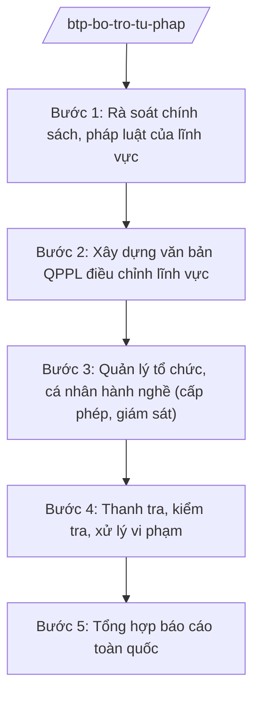

# Skill: Quản lý công chứng, luật sư, đấu giá, giám định tư pháp (cấp bộ)

## 2. Khi nào dùng
Khi xây dựng chính sách, văn bản QPPL về công chứng, luật sư, đấu giá, giám định tư pháp; khi quản lý tổ chức hành nghề (cấp phép, đình chỉ, thu hồi); khi kiểm tra, xử lý vi phạm trong hoạt động bổ trợ tư pháp.

## 3. Đầu vào (Input)

| Trường | Mô tả | Bắt buộc |
|--------|-------|----------|
| `linh_vuc` | Công chứng / luật sư / đấu giá / giám định tư pháp | Có |
| `noi_dung_quan_ly` | Xây dựng chính sách / cấp phép / kiểm tra xử lý | Có |
| `thuc_trang` | Báo cáo thực trạng hoạt động của lĩnh vực | Không |
| `vu_viec_vi_pham` | Hồ sơ vụ việc vi phạm cần xử lý (nếu có) | Không |

## 4. Quy trình

**Bước 1. Rà soát chính sách, pháp luật của lĩnh vực**
- Làm gì: Đánh giá thi hành pháp luật về lĩnh vực bổ trợ tư pháp; tổng hợp vướng mắc từ địa phương, tổ chức hành nghề.
- Dùng input: `linh_vuc`, `thuc_trang`.
- Vai trò: Chuyên viên Cục Bổ trợ tư pháp — AI hỗ trợ tổng hợp báo cáo địa phương, phân loại vướng mắc (⏱ 2–3 ngày).
- Lưu ý nghiệp vụ: Mỗi lĩnh vực có luật riêng điều chỉnh (công chứng, luật sư, đấu giá, giám định tư pháp) — không lẫn lộn căn cứ.
- → Kết quả bước: Báo cáo rà soát lĩnh vực.

**Bước 2. Xây dựng văn bản QPPL điều chỉnh lĩnh vực**
- Làm gì: Soạn dự thảo nghị định/thông tư hướng dẫn: điều kiện hành nghề, tổ chức hành nghề, phí, đạo đức nghề nghiệp.
- Dùng input: Kết quả bước 1.
- Vai trò: Cục trưởng Cục Bổ trợ tư pháp chủ trì — AI hỗ trợ soạn dự thảo, kiểm tra kỹ thuật (⏱ 3–5 ngày).
- Lưu ý nghiệp vụ: Quy định về điều kiện hành nghề phải rõ ràng, không tạo rào cản bất hợp lý; lấy ý kiến tổ chức xã hội – nghề nghiệp (Liên đoàn Luật sư, Hội Công chứng viên).
- → Kết quả bước: Dự thảo văn bản QPPL.

**Bước 3. Quản lý tổ chức, cá nhân hành nghề (cấp phép, giám sát)**
- Làm gì: Hướng dẫn Sở Tư pháp thực hiện cấp phép thành lập tổ chức hành nghề; quản lý danh sách công chứng viên, luật sư, đấu giá viên, giám định viên tư pháp.
- Dùng input: `noi_dung_quan_ly`.
- Vai trò: Chuyên viên Cục Bổ trợ tư pháp — AI hỗ trợ xây dựng cơ sở dữ liệu quốc gia về người hành nghề, cảnh báo chứng chỉ hết hạn (⏱ 2–3 ngày).
- Lưu ý nghiệp vụ: Công khai danh sách tổ chức hành nghề; xử lý nghiêm hành nghề không có giấy phép.
- → Kết quả bước: CSDL quốc gia về bổ trợ tư pháp; văn bản hướng dẫn.

**Bước 4. Thanh tra, kiểm tra, xử lý vi phạm**
- Làm gì: Thanh tra việc tuân thủ pháp luật của tổ chức hành nghề; xử lý vi phạm (phạt hành chính, đình chỉ, thu hồi giấy phép, chuyển cơ quan điều tra nếu có dấu hiệu hình sự).
- Dùng input: `vu_viec_vi_pham`.
- Vai trò: Thanh tra Bộ phối hợp Cục Bổ trợ tư pháp — AI hỗ trợ lập kế hoạch thanh tra, soạn biên bản, quyết định xử phạt theo mẫu (⏱ 3–5 ngày).
- Lưu ý nghiệp vụ: Bảo đảm trình tự xử phạt vi phạm hành chính; phối hợp tổ chức xã hội – nghề nghiệp xử lý vi phạm đạo đức nghề nghiệp.
- → Kết quả bước: Kết luận thanh tra; quyết định xử lý vi phạm.

**Bước 5. Tổng hợp báo cáo toàn quốc**
- Làm gì: Tổng hợp tình hình hoạt động bổ trợ tư pháp toàn quốc; báo cáo Chính phủ.
- Dùng input: Báo cáo của 63 Sở Tư pháp.
- Vai trò: Cục trưởng Cục Bổ trợ tư pháp ký — AI hỗ trợ tổng hợp số liệu (⏱ 1–2 ngày).
- Lưu ý nghiệp vụ: Số liệu phân theo lĩnh vực, địa phương.
- → Kết quả bước: Báo cáo công tác bổ trợ tư pháp toàn quốc.

## Luồng quy trình (Workflow)

## 5. Đầu ra (Output)
- Dự thảo văn bản QPPL về lĩnh vực bổ trợ tư pháp
- CSDL quốc gia về người/tổ chức hành nghề
- Kế hoạch thanh tra; kết luận thanh tra; quyết định xử lý vi phạm
- Báo cáo công tác bổ trợ tư pháp toàn quốc

### Cấu trúc output chuẩn (thể thức NĐ 30/2020/NĐ-CP)
Quyết định xử phạt vi phạm hành chính gồm:
1. Quốc hiệu "CỘNG HÒA XÃ HỘI CHỦ NGHĨA VIỆT NAM", Tiêu ngữ "Độc lập – Tự do – Hạnh phúc"; số, ký hiệu; tên quyết định
2. Căn cứ pháp lý (luật xử lý VPHC và luật chuyên ngành — nêu tên)
3. Thông tin tổ chức/cá nhân vi phạm
4. Hành vi vi phạm; điều khoản áp dụng; tình tiết tăng nặng/giảm nhẹ
5. Hình thức xử phạt; biện pháp khắc phục hậu quả
6. Thời hạn, nơi nộp phạt; quyền khiếu nại
7. Hiệu lực; nơi nhận (kết thúc "- Lưu: VT, [mã đơn vị]."); chữ ký (ghi rõ chức danh, họ tên người ký; ký hiệu "KT."/"TL." khi ký thay) người có thẩm quyền

> **Checklist thể thức văn bản theo NĐ 30/2020/NĐ-CP** — đối chiếu trước khi trình ký:
> 1. Quốc hiệu và Tiêu ngữ.
> 2. Tên cơ quan, tổ chức ban hành văn bản.
> 3. Số, ký hiệu của văn bản.
> 4. Địa danh và thời gian ban hành văn bản.
> 5. Tên loại và trích yếu nội dung văn bản.
> 6. Nội dung văn bản.
> 7. Chức vụ, họ tên và chữ ký của người có thẩm quyền.
> 8. Dấu, chữ ký số của cơ quan, tổ chức.
> 9. Nơi nhận (kèm Phụ lục nếu có).

## 6. Checklist nghiệm thu
- [ ] Căn cứ pháp lý đúng lĩnh vực (không lẫn luật giữa các lĩnh vực)
- [ ] Điều kiện hành nghề rõ ràng, không rào cản bất hợp lý
- [ ] Đã lấy ý kiến tổ chức xã hội – nghề nghiệp
- [ ] Trình tự xử phạt đúng quy định
- [ ] CSDL cập nhật, công khai theo quy định
- [ ] Thể thức đúng NĐ 30/2020/NĐ-CP
- [ ] Human gate đầy đủ

## 7. Ví dụ mô phỏng
*Dữ liệu dưới đây là giả lập 100% phục vụ minh họa.*

**Input mẫu:** Lĩnh vực: công chứng. Nội dung: kiểm tra việc tuân thủ quy định về niêm yết phí tại các tổ chức hành nghề công chứng; phát hiện 1 văn phòng không niêm yết.

**Output mẫu (trích Quyết định xử phạt — minh họa):**
> **QUYẾT ĐỊNH Xử phạt vi phạm hành chính**
> 3. Tổ chức vi phạm: Văn phòng công chứng AA (giả lập), địa chỉ: số 123 đường B (giả lập).
> 4. Hành vi: không niêm yết mức thu phí công chứng tại trụ sở — vi phạm quy định về công chứng...
> 5. Phạt tiền: mức minh họa; biện pháp khắc phục: niêm yết đầy đủ trong 5 ngày.

## 8. Human gate
Chuyên viên Cục Bổ trợ tư pháp soạn → Cục trưởng Cục Bổ trợ tư pháp kiểm tra → Thứ trưởng phụ trách cho ý kiến → **Bộ trưởng Bộ Tư pháp ký** văn bản QPPL; quyết định xử phạt do người có thẩm quyền xử phạt VPHC ký theo phân cấp.

## 9. Giới hạn
- AI không quyết định xử phạt; không thay người có thẩm quyền ký quyết định.
- Không bịa hồ sơ vi phạm; mọi xử lý phải dựa trên biên bản, chứng cứ thực tế.
- Không tiết lộ thông tin điều tra chưa công khai.

## 10. Căn cứ & lưu ý
- Nghị định 39/2025/NĐ-CP ngày 26/02/2025 của Chính phủ — chức năng, nhiệm vụ, quyền hạn của Bộ Tư pháp (quản lý nhà nước về bổ trợ tư pháp).
- Luật Công chứng; Luật Luật sư; Luật Đấu giá tài sản; Luật Giám định tư pháp; Luật Xử lý vi phạm hành chính (nêu tên luật, không ghi số hiệu).
- Nghị định 30/2020/NĐ-CP — thể thức văn bản.
