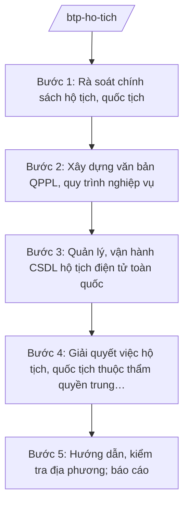

# Skill: Quản lý hộ tịch, quốc tịch (cấp bộ)

## 2. Khi nào dùng
Khi xây dựng chính sách, văn bản QPPL về hộ tịch, quốc tịch; khi quản lý, vận hành Cơ sở dữ liệu hộ tịch điện tử toàn quốc; khi giải quyết việc hộ tịch có yếu tố nước ngoài thuộc thẩm quyền trung ương; khi hướng dẫn, kiểm tra công tác hộ tịch địa phương.

## 3. Đầu vào (Input)

| Trường | Mô tả | Bắt buộc |
|--------|-------|----------|
| `noi_dung` | Xây dựng chính sách / quản lý CSDL / giải quyết việc cụ thể | Có |
| `vu_viec` | Hồ sơ việc hộ tịch/quốc tịch cụ thể (nếu có) | Không |
| `bao_cao_dia_phuong` | Báo cáo công tác hộ tịch của các tỉnh/thành | Không |

## 4. Quy trình

**Bước 1. Rà soát chính sách hộ tịch, quốc tịch**
- Làm gì: Đánh giá thi hành pháp luật về hộ tịch, quốc tịch; tổng hợp vướng mắc (đăng ký hộ tịch trực tuyến, liên thông khai sinh – BHYT – thường trú...).
- Dùng input: `bao_cao_dia_phuong`, `noi_dung`.
- Vai trò: Chuyên viên Cục Hộ tịch, quốc tịch, chứng thực — AI hỗ trợ tổng hợp vướng mắc theo nhóm việc (⏱ 2–3 ngày).
- Lưu ý nghiệp vụ: Ưu tiên đơn giản hóa thủ tục, liên thông dữ liệu, giảm giấy tờ cho người dân.
- → Kết quả bước: Báo cáo rà soát.

**Bước 2. Xây dựng văn bản QPPL, quy trình nghiệp vụ**
- Làm gì: Soạn dự thảo nghị định/thông tư hướng dẫn đăng ký hộ tịch; quy trình liên thông điện tử.
- Dùng input: Kết quả bước 1.
- Vai trò: Cục trưởng Cục Hộ tịch, quốc tịch, chứng thực chủ trì — AI hỗ trợ soạn dự thảo, vẽ sơ đồ quy trình liên thông (⏱ 3–5 ngày).
- Lưu ý nghiệp vụ: Bảo đảm đồng bộ với CSDL quốc gia về dân cư; quy định rõ trách nhiệm khi dữ liệu sai lệch.
- → Kết quả bước: Dự thảo văn bản/quy trình.

**Bước 3. Quản lý, vận hành CSDL hộ tịch điện tử toàn quốc**
- Làm gì: Vận hành hệ thống đăng ký, quản lý hộ tịch dùng chung; cấp số định danh cá nhân khi đăng ký khai sinh; bảo đảm an toàn dữ liệu.
- Dùng input: Dữ liệu từ địa phương đồng bộ về.
- Vai trò: Đơn vị vận hành CSDL — AI hỗ trợ giám sát chất lượng dữ liệu, phát hiện bản ghi trùng/sai ⏱ ~liên tục trong quá trình thực hiện (ước tính).
- Lưu ý nghiệp vụ: Dữ liệu hộ tịch là dữ liệu cá nhân — tuân thủ quy định bảo vệ dữ liệu cá nhân; phân quyền truy cập chặt chẽ.
- → Kết quả bước: Hệ thống CSDL vận hành ổn định; báo cáo chất lượng dữ liệu.

**Bước 4. Giải quyết việc hộ tịch, quốc tịch thuộc thẩm quyền trung ương**
- Làm gì: Thẩm định, trình giải quyết: nhập quốc tịch, trở lại quốc tịch, thôi quốc tịch Việt Nam; đăng ký hộ tịch có yếu tố nước ngoài vượt thẩm quyền địa phương.
- Dùng input: `vu_viec`.
- Vai trò: Chuyên viên Cục Hộ tịch, quốc tịch, chứng thực thẩm định — AI hỗ trợ kiểm tra tính đầy đủ hồ sơ, tra cứu tiền lệ (⏱ 2–3 ngày/hồ sơ).
- Lưu ý nghiệp vụ: Việc quốc tịch do Chủ tịch nước quyết định theo đề nghị của Chính phủ — Bộ Tư pháp thẩm định, trình Chính phủ.
- → Kết quả bước: Tờ trình Chính phủ về việc quốc tịch / văn bản giải quyết.

**Bước 5. Hướng dẫn, kiểm tra địa phương; báo cáo**
- Làm gì: Hướng dẫn nghiệp vụ cho Sở Tư pháp/UBND cấp xã; kiểm tra công tác đăng ký, quản lý hộ tịch; tổng hợp báo cáo toàn quốc.
- Dùng input: `bao_cao_dia_phuong`.
- Vai trò: Đoàn công tác của Cục — AI hỗ trợ lập đề cương kiểm tra, tổng hợp báo cáo (⏱ 3–5 ngày).
- Lưu ý nghiệp vụ: Kịp thời tháo gỡ vướng mắc về phần mềm, quy trình liên thông.
- → Kết quả bước: Báo cáo công tác hộ tịch, quốc tịch toàn quốc.

## Luồng quy trình (Workflow)

## 5. Đầu ra (Output)
- Dự thảo văn bản QPPL/quy trình nghiệp vụ hộ tịch
- Báo cáo vận hành CSDL hộ tịch điện tử
- Tờ trình Chính phủ về việc quốc tịch
- Văn bản hướng dẫn nghiệp vụ địa phương
- Báo cáo công tác hộ tịch, quốc tịch toàn quốc

### Cấu trúc output chuẩn (thể thức NĐ 30/2020/NĐ-CP)
Tờ trình Chính phủ về việc quốc tịch gồm:
1. Quốc hiệu "CỘNG HÒA XÃ HỘI CHỦ NGHĨA VIỆT NAM", Tiêu ngữ "Độc lập – Tự do – Hạnh phúc"; tên Tờ trình; kính gửi: Chính phủ
2. Thông tin người đề nghị (họ tên, ngày sinh, quốc tịch hiện tại — dữ liệu giả lập trong ví dụ)
3. Quá trình thẩm định hồ sơ
4. Ý kiến của cơ quan liên quan (Bộ Công an, Bộ Ngoại giao...)
5. Đề nghị Chính phủ trình Chủ tịch nước xem xét, quyết định
6. Nơi nhận (kết thúc "- Lưu: VT, [mã đơn vị]."), chữ ký (ghi rõ chức danh, họ tên người ký; ký hiệu "KT."/"TL." khi ký thay) (Bộ trưởng Bộ Tư pháp)

> **Checklist thể thức văn bản theo NĐ 30/2020/NĐ-CP** — đối chiếu trước khi trình ký:
> 1. Quốc hiệu và Tiêu ngữ.
> 2. Tên cơ quan, tổ chức ban hành văn bản.
> 3. Số, ký hiệu của văn bản.
> 4. Địa danh và thời gian ban hành văn bản.
> 5. Tên loại và trích yếu nội dung văn bản.
> 6. Nội dung văn bản.
> 7. Chức vụ, họ tên và chữ ký của người có thẩm quyền.
> 8. Dấu, chữ ký số của cơ quan, tổ chức.
> 9. Nơi nhận (kèm Phụ lục nếu có).

## 6. Checklist nghiệm thu
- [ ] Hồ sơ quốc tịch đầy đủ, đã lấy ý kiến cơ quan liên quan
- [ ] Quy trình liên thông điện tử rõ trách nhiệm từng bên
- [ ] Dữ liệu cá nhân được bảo vệ, phân quyền truy cập
- [ ] Văn bản hướng dẫn cụ thể, có ví dụ tình huống
- [ ] Thể thức đúng NĐ 30/2020/NĐ-CP
- [ ] Human gate đầy đủ

## 7. Ví dụ mô phỏng
*Dữ liệu dưới đây là giả lập 100% phục vụ minh họa.*

**Input mẫu:** Hồ sơ xin thôi quốc tịch Việt Nam của ông Trần Văn AA (giả lập, sinh năm 1980), đã có quốc tịch nước ngoài, không nợ thuế, không trong thời gian bị truy cứu trách nhiệm hình sự.

**Output mẫu (trích Tờ trình):**
> **TỜ TRÌNH Về việc giải quyết cho thôi quốc tịch Việt Nam**
> Kính gửi: Chính phủ
> 2. Ông Trần Văn AA (giả lập), sinh ngày 01/01/1980 (giả lập), hiện cư trú ở nước ngoài, đã được nhập quốc tịch nước ngoài...
> 3. Cục Hộ tịch, quốc tịch, chứng thực đã thẩm định hồ sơ, lấy ý kiến Bộ Công an, Bộ Ngoại giao — các cơ quan đều thống nhất...
> 5. Bộ Tư pháp kính đề nghị Chính phủ trình Chủ tịch nước xem xét, quyết định cho ông Trần Văn AA thôi quốc tịch Việt Nam.

## 8. Human gate
Chuyên viên Cục Hộ tịch, quốc tịch, chứng thực thẩm định → Cục trưởng kiểm tra → Thứ trưởng phụ trách cho ý kiến → **Bộ trưởng Bộ Tư pháp ký** Tờ trình → Chính phủ trình **Chủ tịch nước quyết định** (việc quốc tịch).

## 9. Giới hạn
- AI không quyết định việc quốc tịch; không tự ý đánh giá nhân thân.
- Tuyệt đối bảo vệ dữ liệu cá nhân trong hồ sơ hộ tịch/quốc tịch; không trích xuất thông tin thật vào ví dụ.
- Không bịa hồ sơ, tiền lệ.

## 10. Căn cứ & lưu ý
- Nghị định 39/2025/NĐ-CP ngày 26/02/2025 của Chính phủ — chức năng, nhiệm vụ, quyền hạn của Bộ Tư pháp (quản lý nhà nước về hộ tịch, quốc tịch, chứng thực).
- Luật Hộ tịch; Luật Quốc tịch Việt Nam (nêu tên luật, không ghi số hiệu).
- Nghị định 30/2020/NĐ-CP — thể thức văn bản.
