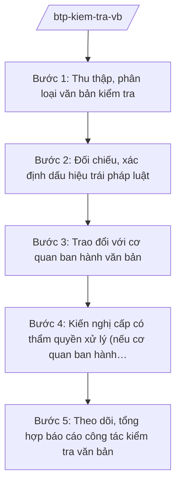

# Skill: Kiểm tra, xử lý VBQPPL

## 2. Khi nào dùng
Khi phát hiện (qua rà soát, phản ánh của tổ chức/cá nhân, kiến nghị của cơ quan nhà nước) văn bản QPPL do bộ, cơ quan ngang bộ, HĐND/UBND các cấp ban hành có dấu hiệu trái Hiến pháp, luật, văn bản của cơ quan nhà nước cấp trên.

## 3. Đầu vào (Input)

| Trường | Mô tả | Bắt buộc |
|--------|-------|----------|
| `van_ban_kiem_tra` | Văn bản QPPL bị nghi có dấu hiệu trái pháp luật | Có |
| `nguon_phat_hien` | Tự kiểm tra / phản ánh / kiến nghị | Có |
| `can_cu_doi_chieu` | Văn bản cấp trên dùng để đối chiếu | Có |
| `y_kien_co_quan_ban_hanh` | Giải trình của cơ quan ban hành (nếu đã có) | Không |

## 4. Quy trình

**Bước 1. Thu thập, phân loại văn bản kiểm tra**
- Làm gì: Tiếp nhận văn bản; phân loại theo cấp ban hành (bộ/ngành, tỉnh, xã) và lĩnh vực.
- Dùng input: `van_ban_kiem_tra`, `nguon_phat_hien`.
- Vai trò: Chuyên viên Cục Kiểm tra văn bản QPPL — AI hỗ trợ trích xuất nội dung chính, lập phiếu kiểm tra (0,5 ngày).
- Lưu ý nghiệp vụ: Ưu tiên kiểm tra văn bản ảnh hưởng quyền, nghĩa vụ của tổ chức, cá nhân.
- → Kết quả bước: Phiếu kiểm tra văn bản.

**Bước 2. Đối chiếu, xác định dấu hiệu trái pháp luật**
- Làm gì: Đối chiếu từng nội dung với Hiến pháp, luật, văn bản cấp trên; xác định điều/khoản trái, mức độ (trái thẩm quyền, trái nội dung, sai thể thức).
- Dùng input: `van_ban_kiem_tra`, `can_cu_doi_chieu`.
- Vai trò: Chuyên viên Cục Kiểm tra văn bản QPPL — AI hỗ trợ đối chiếu song song hai văn bản, highlight điểm khác biệt (1–2 ngày).
- Lưu ý nghiệp vụ: Phân biệt "trái pháp luật" (phải xử lý) với "chưa phù hợp thực tiễn" (kiến nghị sửa đổi).
- → Kết quả bước: Kết luận kiểm tra: có/không có dấu hiệu trái pháp luật.

**Bước 3. Trao đổi với cơ quan ban hành văn bản**
- Làm gì: Gửi kết luận kiểm tra, yêu cầu cơ quan ban hành tự kiểm tra và xử lý (đình chỉ thi hành, bãi bỏ, sửa đổi) trong thời hạn.
- Dùng input: Kết luận kiểm tra.
- Vai trò: Cục trưởng Cục Kiểm tra văn bản QPPL ký văn bản — AI hỗ trợ soạn công văn yêu cầu xử lý (0,5 ngày).
- Lưu ý nghiệp vụ: Thời hạn xử lý theo quy định; theo dõi đến khi có kết quả.
- → Kết quả bước: Văn bản yêu cầu tự xử lý.

**Bước 4. Kiến nghị cấp có thẩm quyền xử lý (nếu cơ quan ban hành không xử lý)**
- Làm gì: Kiến nghị Thủ tướng Chính phủ đình chỉ/bãi bỏ (đối với văn bản của bộ, UBND tỉnh); kiến nghị Bộ trưởng, Chủ tịch UBND tỉnh xử lý văn bản cấp dưới.
- Dùng input: Kết quả theo dõi bước 3.
- Vai trò: Thứ trưởng/Bộ trưởng Bộ Tư pháp ký văn bản kiến nghị — AI hỗ trợ soạn Tờ trình kiến nghị (1 ngày).
- Lưu ý nghiệp vụ: Đối với văn bản của HĐND: kiến nghị theo trình tự giám sát văn bản của HĐND.
- → Kết quả bước: Văn bản kiến nghị xử lý.

**Bước 5. Theo dõi, tổng hợp báo cáo công tác kiểm tra văn bản**
- Làm gì: Cập nhật cơ sở dữ liệu kiểm tra văn bản; tổng hợp báo cáo định kỳ gửi Chính phủ.
- Dùng input: Kết quả xử lý các văn bản đã kiểm tra.
- Vai trò: Chuyên viên Cục Kiểm tra văn bản QPPL — AI hỗ trợ tổng hợp số liệu, lập báo cáo (1 ngày).
- Lưu ý nghiệp vụ: Công khai kết quả kiểm tra theo quy định.
- → Kết quả bước: Báo cáo công tác kiểm tra văn bản QPPL.

## Luồng quy trình (Workflow)

## 5. Đầu ra (Output)
- Phiếu kiểm tra văn bản QPPL
- Kết luận kiểm tra văn bản
- Văn bản yêu cầu cơ quan ban hành tự xử lý / Văn bản kiến nghị cấp có thẩm quyền xử lý
- Báo cáo công tác kiểm tra văn bản định kỳ

### Cấu trúc output chuẩn (thể thức NĐ 30/2020/NĐ-CP)
Kết luận kiểm tra văn bản gồm:
1. Quốc hiệu "CỘNG HÒA XÃ HỘI CHỦ NGHĨA VIỆT NAM", Tiêu ngữ "Độc lập – Tự do – Hạnh phúc"; tên kết luận
2. Văn bản được kiểm tra (số hiệu, ngày ban hành, cơ quan ban hành, hiệu lực)
3. Căn cứ kiểm tra
4. Nội dung kiểm tra: từng dấu hiệu trái pháp luật (điều/khoản văn bản kiểm tra ↔ điều/khoản văn bản đối chiếu)
5. Kết luận: có/không trái pháp luật; mức độ
6. Yêu cầu xử lý và thời hạn
7. Nơi nhận (kết thúc "- Lưu: VT, [mã đơn vị]."), chữ ký (ghi rõ chức danh, họ tên người ký; ký hiệu "KT."/"TL." khi ký thay) (Cục trưởng Cục Kiểm tra văn bản QPPL)

> **Checklist thể thức văn bản theo NĐ 30/2020/NĐ-CP** — đối chiếu trước khi trình ký:
> 1. Quốc hiệu và Tiêu ngữ.
> 2. Tên cơ quan, tổ chức ban hành văn bản.
> 3. Số, ký hiệu của văn bản.
> 4. Địa danh và thời gian ban hành văn bản.
> 5. Tên loại và trích yếu nội dung văn bản.
> 6. Nội dung văn bản.
> 7. Chức vụ, họ tên và chữ ký của người có thẩm quyền.
> 8. Dấu, chữ ký số của cơ quan, tổ chức.
> 9. Nơi nhận (kèm Phụ lục nếu có).

## 6. Checklist nghiệm thu
- [ ] Đã đối chiếu đầy đủ với văn bản cấp trên còn hiệu lực
- [ ] Xác định chính xác điều/khoản có dấu hiệu trái
- [ ] Phân biệt đúng "trái pháp luật" và "chưa phù hợp"
- [ ] Đã trao đổi với cơ quan ban hành trước khi kiến nghị cấp trên
- [ ] Thời hạn xử lý rõ ràng, có theo dõi
- [ ] Thể thức đúng NĐ 30/2020/NĐ-CP
- [ ] Human gate đầy đủ

## 7. Ví dụ mô phỏng
*Dữ liệu dưới đây là giả lập 100% phục vụ minh họa.*

**Input mẫu:** Văn bản "Quyết định 1234/QĐ-UBND" (giả lập) của UBND tỉnh A quy định thu thêm một khoản phí khi cấp giấy phép xây dựng — có dấu hiệu trái quy định về phí, lệ phí thuộc thẩm quyền trung ương; nguồn phát hiện: phản ánh của doanh nghiệp.

**Output mẫu (trích Kết luận kiểm tra):**
> **KẾT LUẬN KIỂM TRA VĂN BẢN QUY PHẠM PHÁP LUẬT**
> 2. Văn bản được kiểm tra: Quyết định 1234/QĐ-UBND ngày ... của UBND tỉnh A.
> 4. Nội dung kiểm tra: Điều 3 Quyết định quy định thu khoản phí 500.000 đồng/hồ sơ cấp phép xây dựng — trái với quy định về phí, lệ phí do cơ quan trung ương ban hành (khoản phí này không có trong danh mục phí được phép thu)...
> 6. Yêu cầu UBND tỉnh A tự kiểm tra, xử lý (bãi bỏ nội dung trái pháp luật) trong 30 ngày.

## 8. Human gate
Chuyên viên Cục Kiểm tra văn bản QPPL lập phiếu/kết luận → Cục trưởng Cục Kiểm tra văn bản QPPL ký → (nếu kiến nghị cấp trên) **Thứ trưởng/Bộ trưởng Bộ Tư pháp ký** văn bản kiến nghị.

## 9. Giới hạn
- AI không tự kết luận văn bản "trái pháp luật"; chỉ hỗ trợ đối chiếu, soạn dự thảo — kết luận thuộc về người có thẩm quyền.
- Không bịa căn cứ đối chiếu; chỉ dùng văn bản còn hiệu lực, đã kiểm chứng.
- Không xử lý văn bản mật ngoài phạm vi được giao.

## 10. Căn cứ & lưu ý
- Nghị định 39/2025/NĐ-CP ngày 26/02/2025 của Chính phủ — chức năng, nhiệm vụ, quyền hạn của Bộ Tư pháp (kiểm tra văn bản QPPL).
- Nghị định 120/2025/NĐ-CP và 121/2025/NĐ-CP ngày 11/6/2025 — phân định thẩm quyền, phân quyền phân cấp trong lĩnh vực quản lý nhà nước của Bộ Tư pháp (chính quyền địa phương 2 cấp).
- Luật Ban hành văn bản quy phạm pháp luật (tên luật, không ghi số hiệu).
- Nghị định 30/2020/NĐ-CP — thể thức văn bản.
